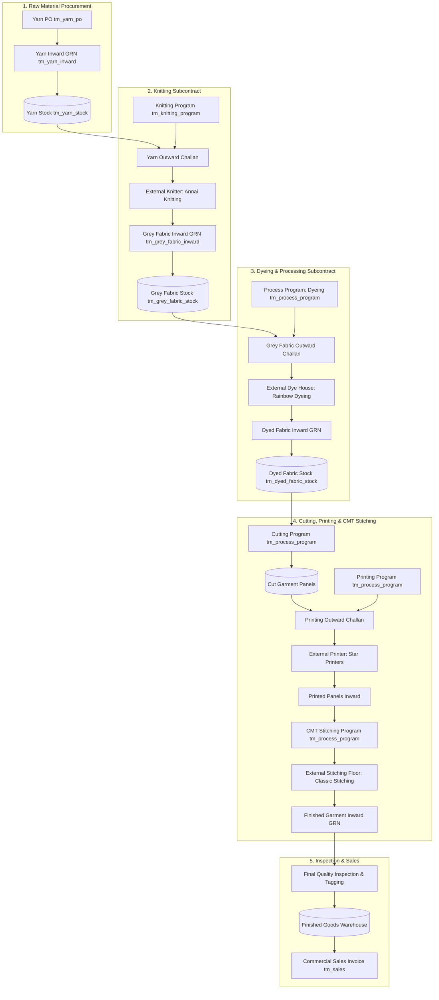
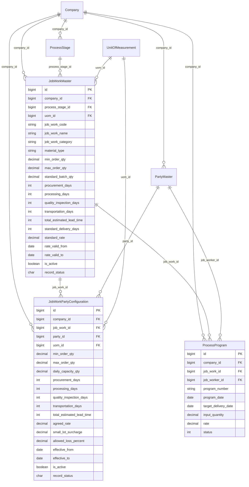

# Garments ERP & CRM — Job Work Master & Lead-Time Management Specification

**Document Version:** v1.0  
**Target Release:** Module 9 (Subcontracting, Job Work Master & Operations Planning)  
**Status:** DRAFT / PENDING IMPLEMENTATION  
**Author:** Antigravity Architect  
**Domain Scope:** Textile & Garment Manufacturing (Circular Knitting, Soft-Flow Dyeing, Screen/Rotary Printing, Fabric Lay Cutting, Garment CMT Stitching, Finishing)

---

## 1. Existing System Analysis

An in-depth analysis of the active Django backend codebase revealed the current state of process stages, job worker relationships, and operations modeling:

### 1.1 Existing Models Discovered

| App | Table / Model | Description | Strengths | Architecture Constraints & Gaps |
|---|---|---|---|---|
| `apps.process` | `mx_process_stage`<br>(`parent_process_stage_table`) | Macro production stages (Knitting, Dyeing, Compacting, Cutting, Printing, Stitching). | Defines sequence order, standard loss %, stage input/output categories. | Only defines broad process stages; lacks itemized Job Work operation codes, lead-time breakdowns, and vendor-specific capacity limits. |
| `apps.process` | `tm_process_program`<br>(`parent_process_program_table`) | Universal transactional job card / production program for any stage. | Captures input goods, expected output, process loss %, job rate, GST %, and status. | Relies on manual entry of rates and dates unless mapped to price lists. Does not enforce automated lead-time scheduling or party capacity ceilings. |
| `apps.knitting` | `tm_knitting_program`<br>(`parent_knitting_program_table`) | Dedicated job card for fabric knitting operations. | Full textile parameters (Dia, Gauge, GSM, Loop Length, Feeder blend %). | Lacks vendor lead-time validation; order delivery dates are entered manually. |
| `apps.masters` | `mx_party`<br>(`PartyMaster`) | Multi-domain party master. | Categorized by `party_type` (`KNITTING_UNIT`, `DYEING_UNIT`, `JOB_WORKER`, `MILL`, `TRADER`, `CUSTOMER`). | Holds commercial credit days and credit limit, but does not store job-work production capacity, standard batch sizes, or machine lead times. |
| `apps.masters` | `mx_uom`<br>(`UnitOfMeasurement`) | Units of measurement master (`KGS`, `MTR`, `PCS`, `DOZEN`, `BAG`, `ROLL`). | Standardized units with active flags. | Fully operational and reusable for job work quantity and capacity definition. |
| `apps.pricing` | `tm_price_list`<br>& `tm_price_list_job_rule` | Unified price list master and subcontract conversion rules. | Multi-tier resolution (Party Contract $\rightarrow$ General Base), loss %, technical slabs. | Primarily models commercial rates and basic turnaround time; does not manage planning capacities (Max Capacity), inspection buffers, or transit lead times. |
| `apps.inventory` | `tm_yarn_stock` & `tm_grey_fabric_stock` | Real-time stock ledgers for raw yarn and knitted greige fabric rolls. | Atomic balance recomputation (`Inward - Outward - Sales + Returns`). | Manages physical stock movement; job work planning must read from these ledgers to verify input material availability. |

### 1.2 Authentication, Multi-Tenancy & Code Conventions
- **Multi-Tenant Scoping**: All queries are strictly scoped by `company_id`. No cross-company data access is permitted.
- **Zero-FK Architecture**: Tables follow the project's Zero Foreign Key standard ([`10-database-and-models.md`](file:///d:/Codebase/Garments/.agents/rules/10-database-and-models.md)) using indexed `BigIntegerField` references (`company_id`, `party_id`, `process_stage_id`, `uom_id`).
- **Soft Deletion**: Records utilize `record_status` (`'A'`=Active, `'I'`=Inactive, `'D'`=Deleted) or `is_deleted=True`. Hard deletes are strictly forbidden.
- **Audit Trails**: Base models track `created_by`, `created_at`, `updated_by`, and `updated_at`.
- **API Standards**: Uniform API response envelopes (`{ "success": true, "data": ..., "meta": ... }` / `{ "success": false, "error": { "code": ..., "message": ... } }`).

---

## 2. Current Job Work Workflow & Material Flow

In the Tirupur garment manufacturing hub, production follows a multi-stage subcontracting workflow where goods move across external specialized units:



---

## 3. Functional Requirements

1. **Granular Job Work Master**: A centralized catalog of all subcontract operations (Single Jersey Knitting, Reactive Dyeing, Chest Screen Printing, Lay Cutting, Polo Stitching).
2. **Deterministic Lead-Time Breakdown**: Rather than a single opaque turnaround day figure, every operation must break lead time into:
   - **Procurement Days**: Raw material delivery / inward transit buffer.
   - **Processing Days**: Actual conversion time.
   - **Quality Inspection Days**: Fabric testing / garment audit turnaround.
   - **Transportation Days**: Inter-facility transit time between supplier, factory, and job worker.
3. **Quantity Thresholds & Capacity Management**:
   - **Minimum Order Quantity (MOQ)**: Smallest permissible lot size to prevent inefficient machine setups.
   - **Maximum Order Capacity**: Upper ceiling representing the vendor's maximum batch load or capacity window.
   - **Standard Batch Quantity**: Typical processing batch (e.g. 250 Kg soft-flow nozzle, 300 Kg knitting run).
4. **Multi-Vendor Configuration**: Ability to link multiple external job workers (`PartyMaster`) to a single job work operation with distinct agreed rates, individual capacities, and customized TATs.
5. **Dynamic Lead-Time & Delivery-Date Calculation**: Real-time computation of expected completion and dispatch dates based on order date, requested quantity, and vendor dependency rules.
6. **Order Quantity Validation & Overload Workflow**: Validates proposed program quantities against vendor MOQ and capacity, providing structured alerts, small-lot surcharges, or prompting order splitting.

---

## 4. Missing Features & Business Gaps

1. **Gap 1: Absence of Dedicated Operation Master**: `mx_process_stage` defines generic categories (`KNITTING`, `DYEING`, `CUTTING`), but cannot define specific machine configurations (e.g., 24GG vs 28GG knitting, 1-color vs 6-color printing).
2. **Gap 2: Aggregated Lead Time**: Existing systems either omit lead times or store a single integer, making it impossible to schedule logistics (dispatch date vs finish date vs quality signoff date).
3. **Gap 3: Missing Capacity Ceilings**: No mechanism exists to prevent overloading a job worker beyond their physical plant capacity, leading to production bottlenecks and delayed buyer shipments.
4. **Gap 4: Decoupled Job Worker Terms**: Master data currently lacks a dedicated planning bridge linking `PartyMaster` to specific job work processes with validated date windows (`effective_from` to `effective_to`).

---

## 5. Proposed Data Model & Entity Relationships

Following the Genplus Zero-FK architecture, we establish two primary master entities:
1. `tm_job_work` (`JobWorkMaster`): Defines enterprise-wide operational standards, technical categories, baseline lead times, and standard rates.
2. `tm_job_work_party_config` (`JobWorkPartyConfiguration`): Dedicated vendor contract terms capturing party-specific capacity, negotiated rates, and customized lead times.

### 5.1 Mermaid Entity Relationship Diagram



---

## 6. Field-by-Field Table Definitions

### 6.1 Job Work Master (`tm_job_work`)

| Field Name | Django Field Type | Mandatory | Validation Rule | Description & Textile Domain Example |
|---|---|---|---|---|
| `id` | `BigAutoField(primary_key=True)` | Yes | System generated | Unique surrogate identifier. |
| `company_id` | `BigIntegerField(db_index=True)` | Yes | Injected from session | Company multi-tenant isolation key. |
| `job_work_code` | `CharField(max_length=50)` | Yes | Alphanumeric, unique per company (excluding `'D'`) | Unique code, e.g., `JW-KNIT-SJ-24`, `JW-DYE-REACT-DK`. |
| `job_work_name` | `CharField(max_length=150)` | Yes | Minimum 3 chars | Full operation title, e.g., `Single Jersey 24GG Knitting Conversion`. |
| `process_stage_id` | `BigIntegerField(db_index=True)` | Yes | Must match active `mx_process_stage.id` | Macro process routing reference. |
| `job_work_category` | `CharField(max_length=40)` | Yes | Choice: `KNITTING`, `DYEING`, `COMPACTING`, `PRINTING`, `CUTTING`, `STITCHING`, `FINISHING` | Functional manufacturing classification. |
| `material_type` | `CharField(max_length=40)` | Yes | Choice: `YARN`, `GREY_FABRIC`, `DYED_FABRIC`, `CUT_PANEL`, `GARMENT` | Type of input substrate processed. |
| `description` | `TextField(blank=True, null=True)` | No | None | Technical guidelines, machine specs, or finish requirements. |
| `uom_id` | `BigIntegerField(db_index=True)` | Yes | Must match active `mx_uom.id` | Unit of measurement (`KGS`, `MTR`, `PCS`). |
| `min_order_qty` | `DecimalField(18, 3)` | Yes | `min_order_qty > 0` | Baseline Minimum Order Quantity (MOQ). E.g. `100.000` Kg. |
| `max_order_qty` | `DecimalField(18, 3, null=True)` | No | `max_order_qty >= min_order_qty` | Upper operational ceiling per batch. E.g. `5000.000` Kg. |
| `standard_batch_qty`| `DecimalField(18, 3, default=0)` | No | `standard_batch_qty >= 0` | Optimal run size. E.g. `250.000` Kg (standard soft-flow vessel). |
| `procurement_days` | `PositiveIntegerField(default=0)` | Yes | `>= 0` | Staging, indenting & yarn/greige dispatch buffer (days). |
| `processing_days` | `PositiveIntegerField(default=0)` | Yes | `>= 0` | Standard production machine cycle turnaround time (days). |
| `quality_inspection_days`| `PositiveIntegerField(default=0)` | Yes | `>= 0` | Inward QC, 4-point fabric inspection, lab dip audit (days). |
| `transportation_days`| `PositiveIntegerField(default=0)` | Yes | `>= 0` | Inter-mill road transit between godown and job worker (days). |
| `total_estimated_lead_time`| `PositiveIntegerField(default=0)` | Yes | Auto-computed sequential sum | $\sum (\text{Procurement} + \text{Processing} + \text{QC} + \text{Transit})$. |
| `standard_delivery_days`| `PositiveIntegerField(default=0)` | Yes | `>= 0` | Standard contractual SLA promise to buyers (days). |
| `standard_rate` | `DecimalField(18, 4, default=0)` | Yes | `>= 0.0000` | Baseline benchmark conversion charge per UOM (INR). |
| `rate_valid_from` | `DateField(null=True, blank=True)` | No | `rate_valid_from <= rate_valid_to` | Start date of standard benchmark rate applicability. |
| `rate_valid_to` | `DateField(null=True, blank=True)` | No | `rate_valid_to >= rate_valid_from` | Expiration date of standard benchmark rate applicability. |
| `is_active` | `BooleanField(default=True)` | Yes | Boolean | Whether operation is available for new production programs. |
| `remarks` | `CharField(max_length=255, blank=True)` | No | None | Special operational instructions. |
| `record_status` | `CharField(max_length=1, default='A')` | Yes | `'A'`, `'I'`, `'D'` | Soft deletion and status flag. |
| `created_by` | `BigIntegerField(null=True)` | No | User ID | Audit author. |
| `created_at` | `DateTimeField(auto_now_add=True)`| Yes | UTC timestamp | Record creation time. |
| `updated_by` | `BigIntegerField(null=True)` | No | User ID | Audit editor. |
| `updated_at` | `DateTimeField(auto_now=True)` | Yes | UTC timestamp | Last modification time. |

---

### 6.2 Job Worker Specific Configuration (`tm_job_work_party_config`)

| Field Name | Django Field Type | Mandatory | Validation Rule | Description & Textile Domain Example |
|---|---|---|---|---|
| `id` | `BigAutoField(primary_key=True)` | Yes | System generated | Unique surrogate identifier. |
| `company_id` | `BigIntegerField(db_index=True)` | Yes | Injected from session | Company multi-tenant isolation key. |
| `job_work_id` | `BigIntegerField(db_index=True)` | Yes | Must match active `tm_job_work.id` | Reference to parent Job Work Master operation. |
| `party_id` | `BigIntegerField(db_index=True)` | Yes | Must match active `mx_party.id` | Reference to external subcontract unit (`PartyMaster`). |
| `uom_id` | `BigIntegerField(db_index=True)` | Yes | Must match active `mx_uom.id` | Unit of measurement. |
| `min_order_qty` | `DecimalField(18, 3)` | Yes | `min_order_qty > 0` | Vendor negotiated MOQ. E.g. `200.000` Kg. |
| `max_order_qty` | `DecimalField(18, 3, null=True)` | No | `max_order_qty >= min_order_qty` | Vendor peak order capacity ceiling. E.g. `2000.000` Kg. |
| `daily_capacity_qty`| `DecimalField(18, 3, default=0)` | No | `>= 0` | Daily conversion throughput for multi-day scaling calculations. |
| `procurement_days` | `PositiveIntegerField(default=0)` | Yes | `>= 0` | Specific raw material transit days to this vendor's location. |
| `processing_days` | `PositiveIntegerField(default=0)` | Yes | `>= 0` | Negotiated conversion turnaround time for this vendor. |
| `quality_inspection_days`| `PositiveIntegerField(default=0)` | Yes | `>= 0` | Vendor-specific batch QC inspection days. |
| `transportation_days`| `PositiveIntegerField(default=0)` | Yes | `>= 0` | Vendor specific return logistics buffer. |
| `total_estimated_lead_time`| `PositiveIntegerField(default=0)` | Yes | Auto-computed sum | Total vendor sequential turnaround time in days. |
| `agreed_rate` | `DecimalField(18, 4)` | Yes | `>= 0.0000` | Negotiated contract conversion rate per UOM (INR). |
| `small_lot_surcharge`| `DecimalField(18, 4, default=0)` | No | `>= 0.0000` | Penalty / surcharge per unit if order qty is below vendor MOQ. |
| `allowed_loss_percent`| `DecimalField(5, 2, default=0)` | No | `0 <= loss <= 100` | Contractual allowed process loss % tolerance. |
| `effective_from` | `DateField()` | Yes | `effective_from <= effective_to` | Contractual validity start date. |
| `effective_to` | `DateField()` | Yes | `effective_to >= effective_from` | Contractual validity end date. |
| `is_active` | `BooleanField(default=True)` | Yes | Boolean | Active flag. |
| `remarks` | `CharField(max_length=255, blank=True)` | No | None | Special contract terms. |
| `record_status` | `CharField(max_length=1, default='A')` | Yes | `'A'`, `'I'`, `'D'` | Soft deletion flag. |

---

## 7. Business Rules & Validation Engine

### 7.1 Quantity Validations
1. **Strict Positive MOQ**: $\text{min\_order\_qty} > 0$. Zero or negative MOQs are strictly prohibited.
2. **Ceiling Invariant**: If `max_order_qty` is specified:
   $$\text{max\_order\_qty} \ge \text{min\_order\_qty}$$
3. **UOM Compatibility**: Orders cannot be booked in conflicting dimensions (e.g. attempting to order knitting in `PIECES` when the job work master is defined in `KGS`).

### 7.2 Lead-Time & Date Calculation Logic
1. **Sequential Lead Time (Default Rule)**:
   $$\text{Total Lead Time} = \text{Procurement Days} + \text{Processing Days} + \text{Quality Inspection Days} + \text{Transportation Days}$$
2. **Overlapping Dependency Calculation (Fast-Track Schedule)**:
   In fast-track garment export schedules, Quality Inspection occurs concurrently with the final day of processing, and Transportation commences immediately upon lot release:
   $$\text{Effective Fast-Track Lead Time} = \text{Procurement Days} + \max(\text{Processing Days}, \text{Quality Inspection Days}) + \text{Transportation Days}$$
3. **Target Delivery Date Determination**:
   $$\text{Target Delivery Date} = \text{Order Date} + \text{Total Lead Time (Days)}$$
   The delivery date calculation accounts for the company's operational calendar (excluding weekly holidays if configured).

### 7.3 Order Validation Workflow: Under-MOQ & Over-Capacity Handling
When a production planner drafts a Job Work Program (`tm_process_program`):
- **Condition 1: Order Qty < MOQ**:
  - If `small_lot_surcharge > 0`, the system automatically resolves the surcharge:
    $$\text{Effective Unit Rate} = \text{Agreed Rate} + \text{Small Lot Surcharge}$$
  - The API warns: `"Order quantity 150.000 Kg is below vendor MOQ 300.000 Kg. Small lot surcharge of Rs.2.50/Kg applied."`
- **Condition 2: Order Qty > Max Order Capacity**:
  - The system blocks immediate confirmation with a structured validation error:
    `"Order quantity 3500.000 Kg exceeds vendor maximum batch capacity of 2000.000 Kg."`
  - Offers **Order Splitting Engine**: Recommends splitting the order across multiple job workers (e.g., 2,000 Kg to Vendor A and 1,500 Kg to Vendor B), or allows managerial override with `is_authorized = 1`.

### 7.4 Historical Integrity
- Modifying rates, lead times, or MOQs on `JobWorkMaster` or `JobWorkPartyConfiguration` never mutates historical, posted, or in-process programs (`tm_process_program`). Transactions permanently store their agreed rate snapshot, target delivery date, and planned loss % at the moment of authorization.

---

## 8. Garment Manufacturing Domain Examples

### Example A: Circular Fabric Knitting
- **Job Work Code**: `JW-KNIT-SJ-24`
- **Operation Name**: Single Jersey 24GG Knitting Conversion
- **Substrate / Material**: Combed Cotton Yarn (`YARN`)
- **Order UOM**: `KGS`
- **Enterprise Baseline Master**:
  - MOQ: 100.000 Kg | Max Capacity: 5,000.000 Kg | Standard Batch: 300.000 Kg
  - Procurement Days: 2 days (yarn delivery from godown to knitter)
  - Processing Days: 3 days (circular machine knitting run)
  - Quality Inspection Days: 1 day (4-point greige fabric inspection & roll weighing)
  - Transportation Days: 1 day (roll return transit to greige warehouse)
  - **Sequential Lead Time**: $2 + 3 + 1 + 1 = \mathbf{7\text{ Days}}$
  - Standard Rate: `Rs. 18.0000 / Kg`
- **Job Worker Party Configuration (Annai Knitting Works - Party #3)**:
  - Negotiated MOQ: 300.000 Kg (single machine run minimum)
  - Max Order Capacity: 3,000.000 Kg
  - Negotiated Rate: `Rs. 16.0000 / Kg` | Small Lot Surcharge: `Rs. 2.0000 / Kg`
  - Processing Days: 3 days | Total TAT: 7 days

### Example B: Fabric Soft-Flow Dyeing
- **Job Work Code**: `JW-DYE-REACT-DK`
- **Operation Name**: Reactive Soft-Flow Dyeing - Dark Shade
- **Substrate / Material**: Grey Knitted Fabric (`GREY_FABRIC`)
- **Order UOM**: `KGS`
- **Enterprise Baseline Master**:
  - MOQ: 100.000 Kg | Max Capacity: 2,500.000 Kg | Standard Batch: 250.000 Kg
  - Procurement Days: 2 days (greige lot dispatch & weighing)
  - Processing Days: 4 days (scouring, bleaching, reactive dyeing, soaping & tubular drying)
  - Quality Inspection Days: 1 day (color matching under D65 lightbox, wash fastness, shrinkage test)
  - Transportation Days: 1 day (dyed fabric rolls delivery to garment factory)
  - **Sequential Lead Time**: $2 + 4 + 1 + 1 = \mathbf{8\text{ Days}}$
  - Standard Rate: `Rs. 65.0000 / Kg`
- **Job Worker Party Configuration (Rainbow Dyeing Mills - Party #4)**:
  - Negotiated MOQ: 250.000 Kg (vessel chamber minimum)
  - Max Order Capacity: 2,000.000 Kg (8-chamber daily batch limit)
  - Negotiated Rate: `Rs. 62.0000 / Kg` | Small Lot Surcharge: `Rs. 5.0000 / Kg`
  - Processing Days: 4 days | Total TAT: 8 days

### Example C: Chest Screen Printing
- **Job Work Code**: `JW-PRNT-CHEST-4C`
- **Operation Name**: 4-Color Chest Screen Print
- **Substrate / Material**: Cut T-Shirt Panels (`CUT_PANEL`)
- **Order UOM**: `PCS`
- **Enterprise Baseline Master**:
  - MOQ: 100.000 Pcs | Max Capacity: 10,000.000 Pcs | Standard Batch: 1,000.000 Pcs
  - Procurement Days: 2 days (cut bundle sorting, screen engraving & strike-off approval)
  - Processing Days: 4 days (automatic carousel table print & tunnel curing)
  - Quality Inspection Days: 1 day (cure wash fastness & print alignment check)
  - Transportation Days: 1 day (printed panels transfer to stitching floor)
  - **Sequential Lead Time**: $2 + 4 + 1 + 1 = \mathbf{8\text{ Days}}$
  - Standard Rate: `Rs. 4.5000 / Pc`
- **Job Worker Party Configuration (Star Screen Printers - Party #7)**:
  - Negotiated MOQ: 500.000 Pcs
  - Max Order Capacity: 5,000.000 Pcs
  - Negotiated Rate: `Rs. 4.0000 / Pc` | Small Lot Surcharge: `Rs. 0.8000 / Pc`
  - Processing Days: 3 days | Total TAT: 7 days

---

## 9. API Specifications

All endpoints require JWT Bearer Authentication (`Authorization: Bearer <token>`) and are multi-tenant scoped by the caller's `company_id`.

### 9.1 Endpoint Summary

| Method | Endpoint | Description |
|---|---|---|
| `GET` | `/api/v1/process/job-works/` | List and search Job Work Masters (filters: category, material, status). |
| `POST` | `/api/v1/process/job-works/` | Create a new Job Work Master. |
| `GET` | `/api/v1/process/job-works/<id>/` | Retrieve Job Work Master details with party configurations. |
| `PUT` | `/api/v1/process/job-works/<id>/` | Update Job Work Master. |
| `DELETE`| `/api/v1/process/job-works/<id>/` | Soft delete Job Work Master (`record_status = 'D'`). |
| `GET` | `/api/v1/process/job-work-party-configs/` | List vendor configurations (filters: party, job_work, active). |
| `POST` | `/api/v1/process/job-work-party-configs/` | Create or update party-specific MOQ, capacity, rate, and lead times. |
| `PUT` | `/api/v1/process/job-work-party-configs/<id>/` | Update party configuration. |
| `POST` | `/api/v1/process/job-works/validate-order/` | Validates proposed order quantity against vendor MOQ, capacity, and returns small lot surcharge status. |
| `POST` | `/api/v1/process/job-works/calculate-schedule/` | Calculates estimated completion and target delivery dates given order date, qty, and vendor. |

---

### 9.2 Sample Payloads & Responses

#### A. Create Job Work Master (`POST /api/v1/process/job-works/`)

**Request Payload:**
```json
{
  "job_work_code": "JW-KNIT-SJ-24",
  "job_work_name": "Single Jersey 24GG Knitting Conversion",
  "process_stage_id": 1,
  "job_work_category": "KNITTING",
  "material_type": "YARN",
  "uom_id": 1,
  "min_order_qty": 100.0,
  "max_order_qty": 5000.0,
  "standard_batch_qty": 300.0,
  "procurement_days": 2,
  "processing_days": 3,
  "quality_inspection_days": 1,
  "transportation_days": 1,
  "standard_delivery_days": 7,
  "standard_rate": 18.0000,
  "rate_valid_from": "2026-04-01",
  "rate_valid_to": "2027-03-31",
  "description": "Circular knitting conversion for single jersey fabric 20s to 34s count."
}
```

**Success Response (`201 Created`):**
```json
{
  "success": true,
  "data": {
    "id": 101,
    "company_id": 1,
    "job_work_code": "JW-KNIT-SJ-24",
    "job_work_name": "Single Jersey 24GG Knitting Conversion",
    "job_work_category": "KNITTING",
    "material_type": "YARN",
    "uom_id": 1,
    "min_order_qty": "100.000",
    "max_order_qty": "5000.000",
    "standard_batch_qty": "300.000",
    "procurement_days": 2,
    "processing_days": 3,
    "quality_inspection_days": 1,
    "transportation_days": 1,
    "total_estimated_lead_time": 7,
    "standard_delivery_days": 7,
    "standard_rate": "18.0000",
    "is_active": true,
    "record_status": "A",
    "created_at": "2026-10-14T17:45:00Z"
  }
}
```

---

#### B. Validate Proposed Job Work Order (`POST /api/v1/process/job-works/validate-order/`)

**Request Payload:**
```json
{
  "job_work_id": 101,
  "party_id": 3,
  "quantity": 150.0,
  "uom_id": 1
}
```

**Response (`200 OK` - Below MOQ with Surcharge):**
```json
{
  "success": true,
  "data": {
    "is_valid": true,
    "job_work_id": 101,
    "party_id": 3,
    "vendor_name": "Annai Knitting Works",
    "order_quantity": "150.000",
    "min_order_qty": "300.000",
    "max_order_qty": "3000.000",
    "is_below_moq": true,
    "is_capacity_exceeded": false,
    "agreed_rate": "16.0000",
    "small_lot_surcharge": "2.0000",
    "effective_unit_rate": "18.0000",
    "estimated_total_charges": "2700.0000",
    "total_lead_time_days": 7,
    "warning_message": "Order quantity 150.000 is below vendor MOQ 300.000. Small lot surcharge of Rs.2.0000 applied."
  }
}
```

---

#### C. Calculate Schedule & Estimated Completion (`POST /api/v1/process/job-works/calculate-schedule/`)

**Request Payload:**
```json
{
  "job_work_id": 101,
  "party_id": 3,
  "order_date": "2026-10-15",
  "quantity": 500.0,
  "is_fast_track": false
}
```

**Success Response (`200 OK`):**
```json
{
  "success": true,
  "data": {
    "order_date": "2026-10-15",
    "procurement_days": 2,
    "processing_days": 3,
    "quality_inspection_days": 1,
    "transportation_days": 1,
    "total_lead_time_days": 7,
    "schedule_milestones": {
      "procurement_dispatch_date": "2026-10-17",
      "processing_completion_date": "2026-10-20",
      "quality_signoff_date": "2026-10-21",
      "target_delivery_date": "2026-10-22"
    },
    "is_fast_track": false
  }
}
```

---

## 10. Database Migration Plan

1. **Step 1**: Create model definitions in `backend/apps/process/models.py`:
   - `class JobWorkMaster(UppercaseModel)` (`tm_job_work`)
   - `class JobWorkPartyConfiguration(UppercaseModel)` (`tm_job_work_party_config`)
2. **Step 2**: Generate Django schema migration:
   ```bash
   python manage.py makemigrations process
   ```
3. **Step 3**: Execute migration:
   ```bash
   python manage.py migrate process
   ```
4. **Step 4**: Seed initial Job Work Masters and Party Configurations for Company #1 using `ProcessStageService.seed_default_stages` and `JobWorkService.seed_default_job_works`.

---

## 11. Testing Requirements

A comprehensive test suite in `apps/process/tests.py` must validate:
1. `test_job_work_master_creation`: Validates field persistence and auto-computed `total_estimated_lead_time`.
2. `test_duplicate_job_work_code_blocked`: Ensures unique constraint per company.
3. `test_moq_greater_than_zero`: Rejects `min_order_qty <= 0`.
4. `test_max_order_qty_validation`: Rejects `max_order_qty < min_order_qty`.
5. `test_lead_time_calculation`: Verifies sequential summation of days.
6. `test_party_config_override`: Confirms vendor-specific MOQ, rates, and lead times override base master settings.
7. `test_order_validation_below_moq`: Verifies `is_below_moq=True` and surcharge calculation.
8. `test_order_validation_exceeds_capacity`: Verifies capacity ceiling block.
9. `test_schedule_calculation`: Validates milestone date progression.
10. `test_soft_delete`: Confirms `record_status = 'D'` preserves historical foreign references.

---

## 12. Implementation Plan

1. **Phase 1: Model Implementation**
   - Add `JobWorkMaster` and `JobWorkPartyConfiguration` to `backend/apps/process/models.py`.
   - Run `makemigrations process` and `migrate process`.
2. **Phase 2: Repositories & Services**
   - Add `JobWorkRepository` and `JobWorkPartyConfigRepository`.
   - Implement `JobWorkService` with transactional CRUD, order validation, schedule calculation, and default seeding.
3. **Phase 3: Serializers & Views**
   - Implement DRF serializers (`JobWorkSerializer`, `JobWorkCreateSerializer`, `JobWorkPartyConfigSerializer`, `JobWorkValidateOrderSerializer`, `JobWorkScheduleSerializer`).
   - Wire endpoints in `apps/process/views.py` and `apps/process/urls.py`.
4. **Phase 4: Automated Testing & Verification**
   - Write comprehensive unit tests in `apps/process/tests.py`.
   - Verify `python manage.py test apps.process`.
5. **Phase 5: Documentation & Postman Update**
   - Record completed ticket in `docs/TRACKER.md`.
   - Update Postman collection with Job Work Master endpoints.
