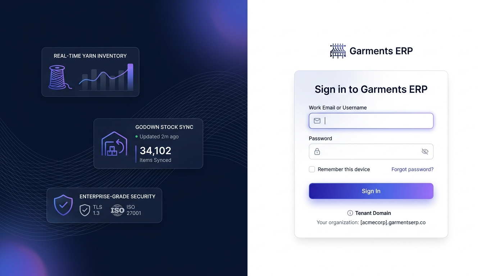
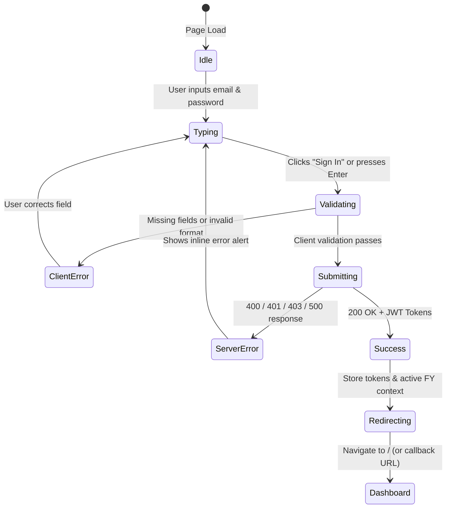

# UI Specification: Login & Authentication Portal

- **Screen ID**: `SCR-AUTH-001`
- **Module**: `Module 1 — Authentication & RBAC`
- **Route**: `/login` (Next.js route: `app/(auth)/login/page.tsx`)
- **Access Privilege**: `Public / Unauthenticated` (`AllowAny`)
- **API Endpoint**: `POST /api/v1/auth/login/` (Dual route alias: `POST /api/v1/auth/token/`)
- **Country Pack**: `IN` (India standard formatting & GST-ready tenant scoping)
- **Document Version**: `v1.0.0`
- **Status**: `Ready for Review / Implementation`

---

## 1. Visual Mockup & Screen Blueprint



### Wireframe Layout Structure

```
+----------------------------------------------------------------------------------------------------+
|                                    1440px+ Desktop Viewport                                        |
+-------------------------------------------------+--------------------------------------------------+
|  LEFT HERO & TELEMETRY PANEL (50%)              |  RIGHT AUTHENTICATION CONTAINER (50%)            |
|  (Deep Midnight Navy #0B0F19 + Woven Texture)   |  (Light Neutral Background #F8FAFC)              |
|                                                 |                                                  |
|  [+] Brand Watermark & Ambient Mesh Glow        |       +------------------------------------+     |
|                                                 |       |       [LOOM ICON] Garments ERP     |     |
|  +-------------------------------------------+  |       |                                    |     |
|  | [SPOOL] REAL-TIME YARN INVENTORY          |  |       |      Sign in to Garments ERP       |     |
|  | Live PO vs GRN stock telemetry card       |  |       |      Access manufacturing portal   |     |
|  +-------------------------------------------+  |       |                                    |     |
|                                                 |       |  Work Email or Username            |     |
|  +-------------------------------------------+  |       |  [ [@] user@textilecorp.in       ] |     |
|  | [WAREHOUSE] GODOWN STOCK SYNC             |  |       |                                    |     |
|  | - Updated 2m ago   34,102 Items Synced    |  |       |  Password                          |     |
|  +-------------------------------------------+  |       |  [ [*] ••••••••••••••••••    [O] ] |     |
|                                                 |       |                                    |     |
|  +-------------------------------------------+  |       |  [ ] Remember device    Forgot pw? |     |
|  | [SHIELD] ENTERPRISE-GRADE SECURITY        |  |       |                                    |     |
|  | TLS 1.3  •  ISO 27001  •  GST Audit-Ready |  |       |  [      Sign In to ERP       ]     |     |
|  +-------------------------------------------+  |       |                                    |     |
|                                                 |       |  (i) Tenant Domain:                |     |
|                                                 |       |  [acmecorp].garmentserp.co         |     |
|                                                 |       +------------------------------------+     |
|                                                 |                                                  |
|                                                 |  Footer: (c) 2026 Garments ERP. All rights res.  |
+-------------------------------------------------+--------------------------------------------------+
```

---

## 2. Design Tokens & Styling Specifications

### 2.1 Color Palette

| Token Name | Hex Code | Tailwind Equivalent | Usage / Surface |
|---|---|---|---|
| `--color-bg-dark` | `#0B0F19` | `bg-slate-950` | Left hero showcase backdrop |
| `--color-bg-light` | `#F8FAFC` | `bg-slate-50` | Right auth page backdrop |
| `--color-card-surface` | `#FFFFFF` | `bg-white` | Login form card container |
| `--color-primary-600` | `#4F46E5` | `bg-indigo-600` | Primary brand accent & button start |
| `--color-primary-700` | `#4338CA` | `bg-indigo-700` | Primary button hover / active |
| `--color-violet-500` | `#8B5CF6` | `bg-purple-500` | Gradient secondary accent |
| `--color-text-main` | `#0F172A` | `text-slate-900` | High-contrast form headings & labels |
| `--color-text-muted` | `#64748B` | `text-slate-500` | Supporting text, placeholders, hints |
| `--color-border-subtle` | `#E2E8F0` | `border-slate-200` | Input borders, card stroke |
| `--color-border-focus` | `#6366F1` | `border-indigo-500` | Input focus ring outline |
| `--color-success` | `#10B981` | `text-emerald-500` | Live sync status indicator |
| `--color-error` | `#EF4444` | `text-red-500` | Validation errors and alert banners |

### 2.2 Typography Scale (Inter / Outfit)

| Element | Font Size | Weight | Line Height | Tracking |
|---|---|---|---|---|
| Card Main Heading | `24px` (`1.5rem`) | 700 (Bold) | `32px` | `-0.025em` |
| Subheading / Caption | `14px` (`0.875rem`) | 400 (Regular) | `20px` | `0` |
| Field Labels | `13px` (`0.8125rem`) | 600 (Semibold) | `18px` | `0` |
| Input Text & Placeholders | `14px` (`0.875rem`) | 400 (Regular) | `20px` | `0` |
| Action Button Label | `15px` (`0.9375rem`) | 600 (Semibold) | `22px` | `0` |
| Footnotes / Domain Pill | `12px` (`0.75rem`) | 500 (Medium) | `16px` | `0` |

### 2.3 Elevation, Radius & Shadows
- **Card Radius**: `rounded-2xl` (`16px`).
- **Input Radius**: `rounded-xl` (`10px`).
- **Button Radius**: `rounded-xl` (`10px`).
- **Card Shadow**: `0 20px 40px -15px rgba(15, 23, 42, 0.08)`.
- **Button Glow**: `0 10px 25px -5px rgba(99, 102, 241, 0.35)`.

---

## 3. Responsive Breakpoint Matrix

| Viewport | Width Range | Layout Behavior |
|---|---|---|
| **Desktop (XL)** | `≥ 1280px` | Split 50/50 view. Full left telemetry showcase + right centered card. |
| **Laptop (MD-LG)** | `1024px – 1279px` | Split 40/60 view. Telemetry cards condensed into single metrics strip. |
| **Tablet (SM)** | `768px – 1023px` | Single column stacked view. Brand header displayed at top; card centered. |
| **Mobile (XS)** | `< 768px` | Fullscreen card view. Left hero hidden to minimize cognitive load. Inputs full width with touch-friendly 44px minimum tap targets. |

---

## 4. Component Inventory & Interactive States

### 4.1 Brand Header
- **Glyph**: Stylized geometric weaving loom icon inside an indigo-purple gradient pill.
- **Wordmark**: `Garments ERP` with small version badge `v1.2`.
- **Description**: *"Enterprise Manufacturing & CRM System"*.

### 4.2 Form Fields

#### A. Username / Email Input
- **Label**: `Work Email or Username`
- **Field Type**: Text (accepts standard email `user@company.com` or employee username `john_operator`).
- **Leading Icon**: Heroicon `EnvelopeIcon` or `UserIcon` (`#94A3B8`).
- **Placeholder**: `name@company.com or username`
- **Validation**:
  - Required field.
  - Sanitization: `.trim().toLowerCase()`.
  - Trigger: On submit & on blur when touched.

#### B. Password Input
- **Label**: `Password`
- **Field Type**: Password (masked dots `••••••••`) with toggleable text visibility.
- **Leading Icon**: Heroicon `LockClosedIcon` (`#94A3B8`).
- **Trailing Action**: Interactive eye icon (`EyeIcon` / `EyeSlashIcon`). Click switches input type between `password` and `text`.
- **Validation**:
  - Required field.
  - Minimum length: 6 characters.

#### C. Session Options Row
- **Remember this device Checkbox**: Native styled custom checkbox (`accent-indigo-600`). When checked, stores long-lived refresh token in local persistent storage.
- **Forgot password? Link**: Right-aligned, `#4F46E5`. On click, opens password reset modal or routes to `/forgot-password`.

#### D. Primary "Sign In" Button
- **Label**: `Sign In` / `Sign In to ERP`
- **Background**: Horizontal gradient `linear-gradient(135deg, #4F46E5 0%, #7C3AED 100%)`.
- **Hover**: Brightness `105%`, shadow expands to `0 12px 28px -5px rgba(99, 102, 241, 0.45)`.
- **Active / Press**: `scale(0.98)` transition for tactile responsiveness.
- **Loading State**:
  - Text replaced or paired with spinning SVG spinner.
  - Button disabled (`cursor-not-allowed`, opacity `0.85`).
  - Form inputs temporarily set to `readOnly`.

#### E. Organization / Tenant Domain Indicator
- **Display**: Subtle info pill below button:
  `Tenant Domain: [acmecorp].garmentserp.co`
- **Purpose**: Displays the automatically resolved tenant identifier or company namespace.

---

## 5. State Machine & User Flow



### 5.1 Error Handling Matrix

| HTTP Code | Backend Error Code | UI Notification Message | Field Highlight |
|---|---|---|---|
| `400` | `VALIDATION_ERROR` | *"Please enter a valid email/username and password."* | Red border on invalid inputs. |
| `401` | `AUTHENTICATION_ERROR` | *"Invalid email/username or password. Please try again."* | Red border on password field. |
| `403` | `PERMISSION_DENIED` | *"Employee account is inactive or resigned. Access denied."* | Banner alert with lock icon. |
| `429` | `THROTTLED` | *"Too many login attempts. Please wait 60 seconds."* | Button disabled with countdown. |
| `500+` | `SERVER_ERROR` | *"Cannot reach the ERP service. Check connection."* | Banner alert with retry button. |

---

## 6. API Integration Contract

### Request Specification
- **Method & URL**: `POST /api/v1/auth/login/`
- **Headers**:
  ```http
  Content-Type: application/json
  Accept: application/json
  ```
- **Payload**:
  ```json
  {
    "email": "admin@textilecorp.in",
    "password": "SecretPassword123"
  }
  ```

### Response Handling (Success `200 OK`)
```json
{
  "access": "eyJhbGciOiJIUzI1NiIsInR5cCI6IkpXVCJ9...",
  "refresh": "eyJhbGciOiJIUzI1NiIsInR5cCI6IkpXVCJ9...",
  "user": {
    "id": 4,
    "email": "admin@textilecorp.in",
    "username": "admin_textile",
    "first_name": "Ramesh",
    "last_name": "Kumar",
    "employee_code": "EMP-0004",
    "department": "Production",
    "designation": "Plant Manager",
    "role": "ADMIN_USER",
    "role_display": "Company Admin",
    "is_superadmin": false,
    "is_admin_user": true,
    "is_company_user": false,
    "company": {
      "id": 1,
      "name": "Textile Corp India Pvt Ltd",
      "code": "TCIPL"
    },
    "active_financial_year": {
      "id": 1,
      "name": "FY 2025-2026",
      "code": "2025-2026",
      "start_date": "2025-04-01",
      "end_date": "2026-03-31"
    }
  }
}
```

### Post-Login Storage Requirements
1. **Access Token**: Store in `sessionStorage` or secure client cookie for subsequent API requests (`Authorization: Bearer <access>`).
2. **Refresh Token**: Store in `localStorage` if "Remember this device" is checked; otherwise `sessionStorage`.
3. **Company & FY Headers**: Set default global headers:
   - `X-Company-ID: user.company.id`
   - `X-Financial-Year-ID: user.active_financial_year.id`
4. **Navigation**: Redirect to `/dashboard` (or `?redirect=` target if user was intercepted).

---

## 7. Accessibility (A11y) & Security Checklist

- [x] **WCAG 2.1 AA Compliance**: All input text and buttons exceed the minimum contrast ratio of 4.5:1.
- [x] **Screen Readers**: Form has appropriate `<label>` elements linked with `htmlFor` and `aria-describedby` for error strings.
- [x] **Keyboard Navigation**: Full `Tab` navigation order: `Email -> Password -> Show Password Toggle -> Remember Me -> Forgot Password -> Sign In Button`.
- [x] **Autocomplete Attributes**: `autocomplete="username"` and `autocomplete="current-password"`.
- [x] **Brute Force Protection**: Form triggers rate-limiting cooldown and locks input during active in-flight requests.
- [x] **No Plaintext Passwords in Logs**: Passwords are never written to browser console, local storage, or telemetry payloads.
