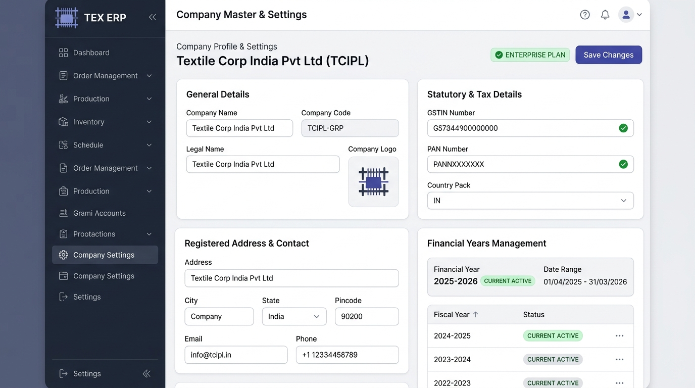
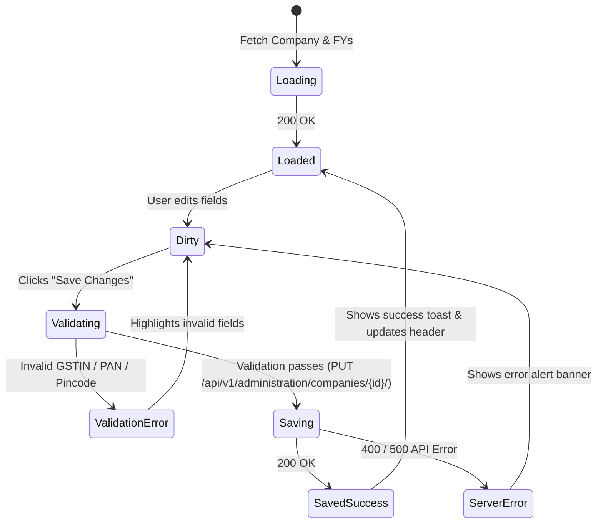

# UI Specification: Company Profile, Statutory & Financial Year Administration

- **Screen ID**: `SCR-COMP-001`
- **Module**: `Module 0 — Foundation & Multi-Tenancy`
- **Route**: `/administration/company` (Next.js route: `app/(app)/administration/company/page.tsx`)
- **Access Privilege**: `IsAdminUser` (Edit own tenant) / `IsSuperAdmin` (Full multi-tenant administration)
- **API Endpoints**: 
  - `GET /api/v1/administration/companies/{id}/` (Retrieve company profile)
  - `PUT/PATCH /api/v1/administration/companies/{id}/` (Update company profile)
  - `GET/POST /api/v1/administration/financial-years/` (Manage FY records)
  - `POST /api/v1/auth/switch-financial-year/` (Switch active working FY)
- **Country Pack**: `IN` (GSTIN 15-char, PAN 10-char, Currency INR `₹`, Date `DD/MM/YYYY`)
- **Document Version**: `v1.0.0`
- **Status**: `Ready for Review / Implementation`

---

## 1. Visual Mockup & Screen Blueprint



### Wireframe Layout Structure

```
+----------------------------------------------------------------------------------------------------+
| TOP APPLICATION HEADER (Breadcrumbs: Administration > Company Settings | Notifications | User Profile)
+-------------------+--------------------------------------------------------------------------------+
| SIDEBAR (240px)   | MAIN CONTENT AREA                                                              |
| [LOOM] TEX ERP    |                                                                                |
|                   | Company Profile & Settings                                                     |
| [=] Dashboard     | Textile Corp India Pvt Ltd (TCIPL)       [✔ ENTERPRISE PLAN]   [ Save Changes ]|
| [v] Procurement   |                                                                                |
| [v] Production    | +------------------------------------+  +------------------------------------+ |
| [v] Inventory     | | CARD 1: GENERAL DETAILS            |  | CARD 2: STATUTORY & TAX REG.       | |
| [v] Commercial    | | Company Name: [Textile Corp India] |  | GSTIN: [33AABCT1234F1Z5]     [✔]   | |
| [*] Company Stgs  | | Company Code: [TCIPL-GRP] (locked) |  | PAN:   [AABCT1234F]          [✔]   | |
|                   | | Legal Name:   [Textile Corp India] |  | Country Pack: [IN (India)    v]    | |
|                   | | Logo: [Upload File / Preview]      |  | Currency:     [INR (₹) - Indian]   | |
|                   | +------------------------------------+  +------------------------------------+ |
|                   |                                                                                |
|                   | +------------------------------------+  +------------------------------------+ |
|                   | | CARD 3: ADDRESS & CONTACT          |  | CARD 4: FINANCIAL YEARS MANAGEMENT | |
|                   | | Address: [124, Mill Road, Tirupur] |  | Current FY: [2025-2026] [ACTIVE]   | |
|                   | | City: [Tirupur] State: [TN     v]  |  | Period: 01/04/2025 - 31/03/2026    | |
|                   | | Pincode: [641604]                  |  |                                    | |
|                   | | Email: [info@tcipl.in]             |  | [ + Add Financial Year ]           | |
|                   | | Phone: [+91 98765 43210]           |  | FY List: 2024-2025 (Closed) [...]  | |
|                   | +------------------------------------+  +------------------------------------+ |
+-------------------+--------------------------------------------------------------------------------+
```

---

## 2. Design Tokens & Styling Specifications

### 2.1 Color Palette

| Token Name | Hex Code | Tailwind Equivalent | Usage / Surface |
|---|---|---|---|
| `--color-sidebar-bg` | `#0B0F19` | `bg-slate-950` | Primary navigation sidebar |
| `--color-main-bg` | `#F8FAFC` | `bg-slate-50` | App workspace canvas |
| `--color-card-bg` | `#FFFFFF` | `bg-white` | Content cards surface |
| `--color-primary-600` | `#4F46E5` | `bg-indigo-600` | Primary action button ("Save Changes") |
| `--color-primary-hover` | `#4338CA` | `bg-indigo-700` | Save button hover state |
| `--color-success-pill` | `#10B981` | `bg-emerald-500` / `text-emerald-700` | Active FY badge & verified tax checkmarks |
| `--color-text-header` | `#0F172A` | `text-slate-900` | Company title & section headings |
| `--color-text-muted` | `#64748B` | `text-slate-500` | Input labels, placeholders, subtext |
| `--color-border-card` | `#E2E8F0` | `border-slate-200` | Card borders & input outlines |
| `--color-border-focus` | `#6366F1` | `border-indigo-500` | Focused input border ring |

### 2.2 Typography Scale

| Element | Font Size | Weight | Line Height | Usage |
|---|---|---|---|---|
| Page Main Heading | `24px` (`1.5rem`) | 700 (Bold) | `32px` | Company Name & Header |
| Section / Card Heading | `16px` (`1rem`) | 600 (Semibold) | `24px` | Card Titles (e.g. General Details) |
| Field Labels | `13px` (`0.8125rem`) | 600 (Semibold) | `18px` | Form field labels |
| Input Text | `14px` (`0.875rem`) | 400 (Regular) | `20px` | Form values |
| Status Pills / Badges | `12px` (`0.75rem`) | 600 (Semibold) | `16px` | `ENTERPRISE PLAN`, `CURRENT ACTIVE` |

---

## 3. Responsive Breakpoint Matrix

| Viewport | Grid Columns | Behavior |
|---|---|---|
| **Desktop (≥ 1280px)** | 2 Columns (`grid-cols-2`) | Left sidebar fixed (240px); 4 cards organized in 2x2 grid. |
| **Laptop (1024px – 1279px)** | 2 Columns (`grid-cols-2`) | Sidebar collapses to 64px icon rail; cards adapt fluidly. |
| **Tablet (768px – 1023px)** | 1 Column (`grid-cols-1`) | Sidebar hidden under hamburger drawer; cards stack vertically. |
| **Mobile (< 768px)** | 1 Column (`grid-cols-1`) | Full-width vertical stack. Sticky bottom action bar for "Save Changes". |

---

## 4. Component Inventory & Interactive Fields

### 4.1 Card 1: General Details
- **Company Name** (`name`):
  - Type: Text input (`maxlength="255"`).
  - Validation: Required, trimmed.
- **Company Code** (`code`):
  - Type: Text input (`maxlength="50"`).
  - Behavior: **Read-Only / Disabled** after company creation to protect multi-tenant ledger integrity. Displayed with a lock icon.
- **Legal Entity Name** (`legal_name`):
  - Type: Text input. Used in legal GST tax invoices and PO prints.
- **Company Logo** (`logo`):
  - Type: Image file upload (PNG/JPG/SVG, max 2MB).
  - Preview: 80x80px square avatar with change/delete action triggers.

### 4.2 Card 2: Statutory & Tax Registrations
- **GSTIN Number** (`gst_number`):
  - Type: 15-character uppercase text input (`maxlength="15"`).
  - Validation: Regex check `^[0-9]{2}[A-Z]{5}[0-9]{4}[A-Z]{1}[1-9A-Z]{1}Z[0-9A-Z]{1}$`.
  - Visual: Green checkmark badge appears automatically when regex passes.
- **PAN Number** (`pan_number`):
  - Type: 10-character uppercase text input (`maxlength="10"`).
  - Validation: Regex check `^[A-Z]{5}[0-9]{4}[A-Z]{1}$`. Extracted automatically from digits 3–12 of GSTIN if left empty.
- **Country Pack** (`country_pack`):
  - Type: Select dropdown. Locked to `IN` (India: INR `₹`, GST SGST/CGST/IGST, Financial Year 01/04 - 31/03).

### 4.3 Card 3: Registered Address & Communication
- **Address Line 1 & Line 2** (`address_line1`, `address_line2`): Registered factory/mill physical address.
- **City** (`city`): Text input (e.g. `Tirupur`, `Surat`, `Coimbatore`).
- **State** (`state`): Select dropdown containing all 36 Indian States and Union Territories with state code (e.g., `33 - Tamil Nadu`, `24 - Gujarat`).
- **Pincode** (`pincode`): 6-digit numeric input with regex `^\d{6}$`.
- **Primary Email** (`email`): Official company email address with email format validation.
- **Phone** (`phone`): Primary landline/mobile with country dial code (`+91`).

### 4.4 Card 4: Financial Years Lifecycle Management
- **Current Active Financial Year Banner**:
  - Displays code (e.g., `2025-2026`), display name (`FY 2025-2026`), and dates (`01/04/2025 - 31/03/2026`).
  - Marked with green `CURRENT ACTIVE` pill.
- **Action: Add Financial Year Modal**:
  - Triggered by `+ Add Financial Year` button.
  - Fields: Name, Code (e.g. `2026-2027`), Start Date (`01/04/2026`), End Date (`31/03/2027`), Set as current checkbox.
- **Financial Years History Table**:
  - Columns: Fiscal Year Code, Date Range, Status (`CURRENT`, `OPEN`, `LOCKED`, `CLOSED`), Actions (`Set Active`, `Lock`).
  - Action menu (`...`):
    - **Set as Active FY**: Calls `POST /api/v1/auth/switch-financial-year/`.
    - **Lock FY**: Prevents retroactive voucher/stock entries.

---

## 5. User Interaction & State Machine



---

## 6. API Integration Contract

### 6.1 Retrieve Company Details
- **Method & URL**: `GET /api/v1/administration/companies/{company_id}/`
- **Response Shape**:
  ```json
  {
    "id": 1,
    "name": "Textile Corp India Pvt Ltd",
    "code": "TCIPL-GRP",
    "legal_name": "Textile Corp India Private Limited",
    "gst_number": "33AABCT1234F1Z5",
    "pan_number": "AABCT1234F",
    "email": "info@tcipl.in",
    "phone": "+91 98765 43210",
    "address_line1": "124, Mill Road, Angeripalayam",
    "address_line2": "Post Box 42",
    "city": "Tirupur",
    "state": "Tamil Nadu",
    "pincode": "641604",
    "is_active": true,
    "subscription_plan": "ENTERPRISE",
    "current_financial_year": {
      "id": 1,
      "name": "FY 2025-2026",
      "code": "2025-2026",
      "start_date": "2025-04-01",
      "end_date": "2026-03-31",
      "is_current": true,
      "is_closed": false
    },
    "financial_years": [
      {
        "id": 1,
        "name": "FY 2025-2026",
        "code": "2025-2026",
        "start_date": "2025-04-01",
        "end_date": "2026-03-31",
        "is_current": true
      }
    ]
  }
  ```

### 6.2 Update Company Profile
- **Method & URL**: `PATCH /api/v1/administration/companies/{company_id}/`
- **Payload**:
  ```json
  {
    "name": "Textile Corp India Pvt Ltd",
    "legal_name": "Textile Corp India Private Limited",
    "gst_number": "33AABCT1234F1Z5",
    "pan_number": "AABCT1234F",
    "email": "info@tcipl.in",
    "phone": "+91 98765 43210",
    "address_line1": "124, Mill Road, Angeripalayam",
    "city": "Tirupur",
    "state": "Tamil Nadu",
    "pincode": "641604"
  }
  ```

### 6.3 Switch Active Financial Year
- **Method & URL**: `POST /api/v1/auth/switch-financial-year/`
- **Payload**:
  ```json
  {
    "financial_year_id": 1
  }
  ```

---

## 7. Form Validation & Statutory Guardrails

1. **GSTIN Checksum & State Prefix**:
   - Must match 15-character statutory format.
   - First 2 characters must match selected State code (e.g. `33` for Tamil Nadu, `24` for Gujarat).
2. **PAN Number Extraction**:
   - If user pastes a valid 15-character GSTIN, auto-populate the PAN field using characters 3 to 12.
3. **Pincode Verification**:
   - Must be exactly 6 numeric digits (`641604`).
4. **Company Code Immutability**:
   - The company code is the master tenant scoping key. Once created, it is disabled from direct UI editing to prevent orphaned records in `tm_`, `tx_`, and `tl_` tables.
5. **Financial Year Overlap Check**:
   - Adding a new FY checks for non-overlapping date ranges. Start date must be `01/04/YYYY` and end date `31/03/YYYY+1`.
