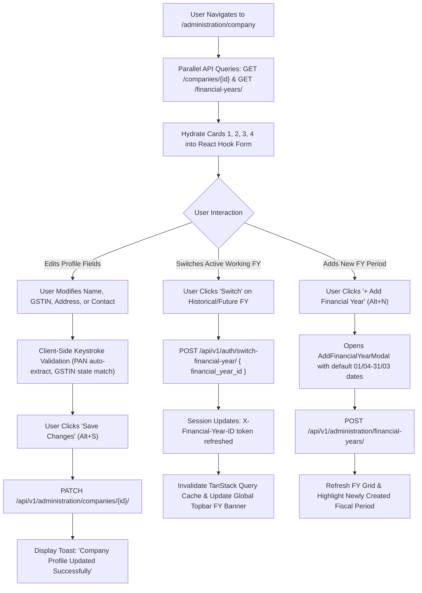

# Company Profile, Statutory Registrations & Financial Year Administration Specification

| Standard Code | Screen ID | Target Platform | API Version | Document Version | Date | Status |
|---|---|---|---|---|---|---|
| **STD-UI-001** | **`SCR-COMP-001`** | Next.js 14 (App Router) + TypeScript | `v1.2` (Django 5 DRF) | `v2.0.0` | 16/10/2026 | **APPROVED FOR IMPLEMENTATION** |

---

## 1. Document Overview, Version, Scope, and Status

### 1.1 Purpose
This specification defines the complete technical architecture, UI layout, field definitions, statutory Indian tax validation rules, multi-year fiscal lifecycle management, Zod schemas, TypeScript types, and backend API integration for the **Company Profile, Statutory & Financial Year Administration Screen** (`SCR-COMP-001`).

In the Garments ERP & CRM platform, the Company entity is the single foundational tenant authority. Every single transaction, master record, stock ledger balance, and double-entry accounting voucher is scoped strictly to a `company_id`. This screen serves as the authoritative, secure control console for:
1. **Company Legal & Commercial Identity**: Managing legal trade name, logo, primary corporate communication, and registered manufacturing mill address.
2. **Statutory Indian Tax Compliance**: Validating and enforcing 15-character Goods and Services Tax Identification Number (GSTIN), Permanent Account Number (PAN), Tax Deduction Account Number (TAN), and MSME Udyam registration.
3. **Country Pack Invariants**: Enforcing Indian currency (INR `₹`), date formats (`DD/MM/YYYY`), state tax distribution (CGST/SGST vs IGST), and bag weight standards ($45.360\text{ Kg}$).
4. **Financial Year Lifecycle & Session Scoping**: Creating, locking, and closing financial years (`01/04/YYYY` to `31/03/YYYY+1`), as well as switching active session working fiscal periods across all transactional screens.

### 1.2 Scope
- **Entities Handled**:
  - Company Tenant Entity: [`Company`](file:///d:/Codebase/Garments/backend/apps/authentication/models.py) (`company`).
  - Financial Year Entity: [`FinancialYear`](file:///d:/Codebase/Garments/backend/apps/authentication/models.py) (`financial_year`).
  - System Roles & Privileges: [`Role`](file:///d:/Codebase/Garments/backend/apps/authentication/models.py) (`user_role`) and [`Privilege`](file:///d:/Codebase/Garments/backend/apps/authentication/models.py) (`user_privilege`).
- **Country Pack**: India (`IN`) — Indian Rupee (`₹`), Indian numerical grouping (`12,34,567.89`), Date format (`DD/MM/YYYY`), GST State codes (01 to 37), PAN extraction regex.
- **Target Route**: `/administration/company` (Next.js route: `app/(app)/administration/company/page.tsx`).


---

## 2. Module Details, Screen ID, Route, Access Privileges, and API Endpoints

### 2.1 Core Metadata

| Parameter | Specification |
|---|---|
| **Module** | `Module 0 — Foundation & Multi-Tenancy` |
| **Screen ID** | `SCR-COMP-001` |
| **Frontend Route** | `/administration/company` |
| **File Location** | `app/(app)/administration/company/page.tsx` |
| **Required Privilege** | `IsAdminUser` (Manage own company tenant); `IsSuperAdmin` (Full multi-tenant administration across companies) |
| **Authorized Roles** | `SUPER_ADMIN`, `ADMIN_USER` (Managing Director, Chief Financial Officer, Corporate Controller, System Administrator) |
| **Country Pack** | `IN` (India: Currency INR `₹`, Date `DD/MM/YYYY`, GSTIN 15-char, PAN 10-char, FY `01/04` to `31/03`) |

### 2.2 Primary API Endpoints

| HTTP Method | API Path | Privilege / Scope | Description |
|---|---|---|---|
| `GET` | `/api/v1/administration/companies/{id}/` | `IsAdminUser` / `IsSuperAdmin` | Retrieve full company profile, statutory tax numbers, and active financial year |
| `PATCH` | `/api/v1/administration/companies/{id}/` | `IsAdminUser` / `IsSuperAdmin` | Update company profile details, addresses, contacts, and tax registrations |
| `GET` | `/api/v1/administration/financial-years/?company_id={id}` | `IsAdminUser` | List all historical, active, locked, and closed financial years for the company |
| `POST` | `/api/v1/administration/financial-years/` | `IsAdminUser` | Create a new financial year period (`01/04/YYYY` to `31/03/YYYY+1`) |
| `PATCH` | `/api/v1/administration/financial-years/{id}/` | `IsAdminUser` | Toggle financial year status (`is_closed`, `is_current`) or update notes |
| `POST` | `/api/v1/auth/switch-financial-year/` | `IsCompanyUser` | Switch active working financial year for the current user's authenticated session |

---

## 3. UI Layout, Screen Blueprint, and Visual Mockup (1440px+ Wireframe)

```
+-----------------------------------------------------------------------------------------------------------------------------+
| GARMENTS ERP — Administration & Multi-Tenant Control                         Company: ABC Textiles Ltd | FY: 2026-2027      |
+-----------------------------------------------------------------------------------------------------------------------------+
| TOP BREADCRUMB: Administration > Company Settings & Financial Years                                                         |
| COMPANY PROFILE & FISCAL ADMINISTRATION                  [ 💾 Save Changes (Alt+S) ]  [ 🔄 Reset Form ]  [ 🖨 Print Summary ]|
+-----------------------------------------------------------------------------------------------------------------------------+
| TENANT HEADER BANNER                                                                                                        |
| [ 🏢 LOGO ]  ABC Textiles Pvt Ltd (ABCTPL)                      [ ⭐ ENTERPRISE PLAN ]   [ 🟢 ACTIVE TENANT ]   [ 🔒 CODE LOCKED ]|
| Legal Name: ABC Textiles Private Limited | Corporate Mill Location: Tirupur, Tamil Nadu | Timezone: Asia/Kolkata (UTC+05:30) |
+-----------------------------------------------------------------------------------------------------------------------------+
| 2x2 BALANCED ENTERPRISE CARD GRID                                                                                           |
|                                                                                                                             |
| +---------------------------------------------------------+ +-------------------------------------------------------------+ |
| | CARD 1: GENERAL & CORPORATE DETAILS                     | | CARD 2: STATUTORY & INDIAN TAX REGISTRATIONS                | |
| |                                                         | |                                                             | |
| | Company Trade Name*:                                    | | Goods & Services Tax (GSTIN)*:                              | |
| | [ ABC Textiles Pvt Ltd                                ] | | [ 33AABCA1234F1Z8             ] [ ✔ 33 - Tamil Nadu Valid ] | |
| |                                                         | |                                                             | |
| | Legal Registered Name*:                                 | | Permanent Account Number (PAN)*:                            | |
| | [ ABC Textiles Private Limited                        ] | | [ AABCA1234F                  ] [ ✔ Auto-Extracted ]        | |
| |                                                         | |                                                             | |
| | System Tenant Code (Immutable)*:                        | | Tax Deduction Account (TAN):      MSME Udyam Registration:  | |
| | [ ABCTPL-GRP                      ] [ 🔒 System Key   ] | | [ CHEA12345B                  ]   [ UDYAM-TN-28-0012345   ] | |
| |                                                         | |                                                             | |
| | Company Brand Logo:                                     | | Export Letter of Undertaking (LUT / Bond No):               | |
| | [ [IMG] 80x80 Avatar ]  [ ⬆ Upload New Logo (Max 2MB) ] | | [ AD330326001234M             ] [ Valid for FY 2026-2027  ] | |
| |                         [ 🗑 Remove ]                   | |                                                             | |
| |                                                         | | Country Pack Authority:       Base Operating Currency:      | |
| | Primary Website URL:                                    | | [ IN (India Standards)     🔒 ] [ INR (₹) — Indian Rupee  🔒 ] | |
| | [ https://www.abctextiles.in                          ] | +-------------------------------------------------------------+ |
| +---------------------------------------------------------+                                                                 |
|                                                                                                                             |
| +---------------------------------------------------------+ +-------------------------------------------------------------+ |
| | CARD 3: REGISTERED MILL ADDRESS & COMMUNICATION         | | CARD 4: FINANCIAL YEARS LIFECYCLE MANAGEMENT                | |
| |                                                         | |                                                             | |
| | Mill / Factory Address Line 1*:                         | | CURRENT ACTIVE FINANCIAL YEAR IN SESSION:                   | |
| | [ 124/B, Palladam Main Road, Veerapandi               ] | | +---------------------------------------------------------+ | |
| |                                                         | | | 🟢 FY 2026-2027 [ACTIVE SESSION]   Period: 01/04/26-31/03/27| | |
| | Address Line 2:                                         | | | Books Status: OPEN FOR ENTRY    Entries: 1,420 Vouchers | | |
| | [ Angeripalayam Post Box #42                          ] | | +---------------------------------------------------------+ | |
| |                                                         | |                                                             | |
| | City / Town*:                 State / Union Territory*: | | [ ➕ Add Financial Year (Alt+N) ]   [ 🔄 Refresh FY Status ] | |
| | [ Tirupur                   ] [ 33 - Tamil Nadu       ▼]| |                                                             | |
| |                                                         | | HISTORICAL & UPCOMING FISCAL PERIODS:                       | |
| | Postal Pincode*:              Country:                  | | +-------------+---------------------+---------+-----------+ | |
| | [ 641604 ] (6-Digit Valid)    [ India                 🔒]| | | Fiscal Code | Date Period         | Status  | Actions   | | |
| |                                                         | | +-------------+---------------------+---------+-----------+ | |
| | Primary Accounts Email*:      Primary Phone / Mobile*:  | | | 2026-2027   | 01/04/2026-31/03/2027 | CURRENT | [Active]  | | |
| | [ accounts@abctextiles.in   ] [ +91 98765 43210       ] | | | 2025-2026   | 01/04/2025-31/03/2026 | LOCKED  | [Switch]🔒| | |
| |                                                         | | | 2024-2025   | 01/04/2024-31/03/2025 | CLOSED  | [Audit] 🔒| | |
| | Secondary Dispatch Email:     Emergency Landline:       | | +-------------+---------------------+---------+-----------+ | |
| | [ dispatch@abctextiles.in   ] [ 0421 2233445          ] | +-------------------------------------------------------------+ |
| +---------------------------------------------------------+                                                                 |
+-----------------------------------------------------------------------------------------------------------------------------+
| STICKY FOOTER ACTION DOCK                                                                                                   |
| Form State: [ ✔ All statutory validations passed ]               [ 🔄 Discard Changes ]   [ 💾 Save Changes (Alt+S) ]       |
+-----------------------------------------------------------------------------------------------------------------------------+
```

---

## 4. Page Initialization, Query Parameters, and Default Form State

### 4.1 URL Parameters & Scope
- **Route**: `/administration/company`
- **Optional Query Parameter**: `?tab=financial_years` (Automatically scrolls and focuses Card 4).
- **Tenant Context**:
  - Regular Administrator (`IsAdminUser`): Automatically loads `user.company_id`.
  - Super Administrator (`IsSuperAdmin`): Supports optional `?company_id={id}` to view and manage secondary tenants.

### 4.2 Page Initialization Flow
1. **Security Handshake**: Verify user holds `IsAdminUser` or `IsSuperAdmin`. If unauthorized, redirect to `/dashboard` with an error toast.
2. **Parallel Hydration**:
   - Query 1: `GET /api/v1/administration/companies/{company_id}/` (Company metadata, statutory numbers, addresses).
   - Query 2: `GET /api/v1/administration/financial-years/?company_id={company_id}` (List of financial year periods).
3. **Form State Population**: Hydrate React Hook Form with server values. Mark initial state as `isDirty = false`.
4. **GSTIN State Code Match**: Verify that the first 2 digits of `gst_number` match the registered `state` code. If matched, show green verified badge.

---

## 5. Document Header, Fiscal Context, and Financial Year Configuration

### 5.1 Financial Year Immutability & Session Authority
- **Single Authority**: The session working financial year determines document date validity across the entire ERP (Yarn PO, Inward GRN, Outward DC, Sales Tax Invoice, Sales Returns).
- **Switching FY**:
  - Triggering **"Switch Working FY"** issues `POST /api/v1/auth/switch-financial-year/` with `{ "financial_year_id": id }`.
  - Upon `200 OK`, updates the global app header token `X-Financial-Year-ID`, updates session storage, and invalidates all TanStack Query caches.
- **FY Status Semantics**:
  - `CURRENT`: The company's default working financial year.
  - `OPEN`: Accepts new transactions dated within `start_date` and `end_date`.
  - `LOCKED`: Temporarily frozen by management; requires `backdate_entry` privilege to post entries.
  - `CLOSED`: Year-end close completed; books carry-forward executed; strictly immutable.

---

## 6. Primary Master Linkages

| Master / Control Entity | Model / Table | Linkage Field | UI Impact |
|---|---|---|---|
| **Country Pack** | `tc_country_pack` | `country_pack = 'IN'` | Enforces Indian GST, INR currency (`₹`), DD/MM/YYYY date format |
| **Currency Control** | `tc_currency` | `currency_code = 'INR'` | Pre-sets all monetary masks and symbols |
| **Number Format** | `tc_number_format` | `number_format = 'IN'` | Configures Indian numbering grouping ($12,34,567.89$) |
| **Timezone Authority** | `tc_timezone` | `timezone = 'Asia/Kolkata'` | Single temporal authority for server day boundaries |
| **Financial Year** | [`FinancialYear`](file:///d:/Codebase/Garments/backend/apps/authentication/models.py) (`sys_financial_year`) | `financial_year_id` | Controls document entry date window |

---

## 7. Dynamic Technical Specifications (Statutory Indian Registrations)

Textile operations in India require specific statutory filings that appear on printed delivery challans, invoices, and purchase contracts:

| Field Name | Statutory Code | Field Key | Formatting / Validation Rule | Document Print Linkage |
|---|---|---|---|---|
| **GSTIN** | Goods & Services Tax | `gst_number` | 15-char alphanumeric: `^[0-9]{2}[A-Z]{5}[0-9]{4}[A-Z]{1}[1-9A-Z]{1}Z[0-9A-Z]{1}$` | Tax Invoice (CGST/SGST/IGST), Delivery Challan, PO |
| **PAN** | Income Tax PAN | `pan_number` | 10-char uppercase: `^[A-Z]{5}[0-9]{4}[A-Z]{1}$` (Extracted from GSTIN 3–12) | E-Way Bill, TDS/TCS Declarations |
| **TAN** | Tax Deduction Account | `tan_number` | 10-char alphanumeric: `^[A-Z]{4}[0-9]{5}[A-Z]{1}$` | Vendor TDS Certificates (Form 16A) |
| **MSME Udyam** | Ministry of MSME | `msme_registration` | Format: `UDYAM-[A-Z]{2}-[0-9]{2}-[0-9]{7}` | Commercial Invoices (MSME 45-day payment clause) |
| **LUT / Bond** | Letter of Undertaking | `lut_number` | Alphanumeric (e.g. `AD330326001234M`) with validity date | Zero-rated Export Sales Invoices |
| **IEC Code** | Importer Exporter Code | `iec_number` | 10-digit alphanumeric code | Foreign Yarn/Fabric Export Packing Lists |

---

## 8. Interactive Cards & Financial Years Management Grid

### 8.1 Financial Years History Table Columns

| # | Column Name | Field | Width | Alignment | UI Format / Rule |
|---|---|---|---|---|---|
| 1 | **Fiscal Code** | `code` | 120px | Left | Semibold (e.g. `2026-2027`) |
| 2 | **Fiscal Name** | `name` | 160px | Left | Text (e.g. `FY 2026-2027`) |
| 3 | **Start Date** | `start_date` | 120px | Center | `DD/MM/YYYY` (Standard: `01/04/YYYY`) |
| 4 | **End Date** | `end_date` | 120px | Center | `DD/MM/YYYY` (Standard: `31/03/YYYY+1`) |
| 5 | **Status Pill** | `status` | 130px | Center | `CURRENT` (Green), `OPEN` (Blue), `LOCKED` (Amber), `CLOSED` (Slate) |
| 6 | **Notes** | `description` | 200px | Left | Truncated remarks with tooltip |
| 7 | **Actions** | `action` | 160px | Center | Contextual buttons: `[Switch FY]`, `[Lock]`, `[Unlock]`, `[Edit]` |

### 8.2 Add Financial Year Modal Dialog
- **Modal Trigger**: `➕ Add Financial Year` button or `Alt + N` shortcut.
- **Fields**:
  - `name`: Display Name (e.g. `FY 2027-2028`).
  - `code`: Fiscal Code (e.g. `2027-2028`).
  - `start_date`: Calendar Date picker (Defaults to `01/04/2027`).
  - `end_date`: Calendar Date picker (Defaults to `31/03/2028`).
  - `set_as_current`: Checkbox (`Set as Active session FY immediately upon creation`).
  - `description`: Optional notes regarding fiscal budget or audit guidelines.

---

## 9. Mathematical Formulas & Keystroke Calculation Engine

### 9.1 GSTIN State Code Cross-Verification Formula
Every Indian GSTIN begins with a 2-digit Census State Code:

$$\text{GSTIN Prefix} = \text{SubString}(\text{GSTIN}, 0, 2)$$

$$\text{State Code Check}: \quad \text{GSTIN Prefix} \stackrel{?}{=} \text{Selected State Census Code}$$

*Example*: If State is `33 - Tamil Nadu`, then `gst_number` must begin with `33`. If mismatched, UI raises an instant error: *"GSTIN prefix (XX) does not match registered State (33 - Tamil Nadu)"*.

### 9.2 Automated PAN Extraction Formula
The Permanent Account Number is mathematically embedded inside characters 3 through 12 (0-indexed: 2 through 12) of a 15-character GSTIN:

$$\text{PAN} = \text{SubString}(\text{GSTIN}, 2, 10)$$

When a user pastes a valid 15-character GSTIN into the input box:
1. Extract characters 3 to 12.
2. Validate against regex `^[A-Z]{5}[0-9]{4}[A-Z]{1}$`.
3. If valid and `pan_number` is currently empty or untouched, automatically populate the PAN field.

### 9.3 Financial Year Date Continuity Invariant
Financial years in India must maintain strict 12-month calendar continuity:

$$\text{Duration} = \text{end\_date} - \text{start\_date} + 1 \text{ day} = 365 \text{ (or 366 in leap year)}$$

$$\text{Non-Overlapping Condition}: \quad \forall \text{ FY}_j \ne \text{ FY}_k, \quad [\text{start}_j, \text{end}_j] \cap [\text{start}_k, \text{end}_k] = \emptyset$$

---

## 10. Multi-Branch & Godown Linkages

In textile and apparel operations, a single Company tenant operates multiple physical godowns and sub-units:
- **Central Storage Godown**: Raw yarn cones receiving and weighing.
- **Processing Godown**: Yarn stock issued to external Knitters/Dyers.
- **Fabric Warehouse**: Knitted grey fabric rolls inspection and storage.
- **Finished Garment Storage**: Export packed cartons ready for container dispatch.

All godown records in [`GodownMaster`](file:///d:/Codebase/Garments/backend/apps/masters/models.py) (`tm_warehouse`) inherit the tenant scoping key `company_id`.

---

## 11. Summary Bar, Action Header, and Plan Badges

### 11.1 Tenant Status Indicators
- **Subscription Plan Badge**: `⭐ ENTERPRISE PLAN` (Emerald high-contrast pill).
- **Tenant Status Badge**: `🟢 ACTIVE TENANT` (`is_active = true`).
- **Code Lock Badge**: `🔒 CODE LOCKED` (Tooltip: *"Tenant key ABCTPL-GRP is immutable to preserve ledger audit trail"*).

### 11.2 Sticky Action Dock
Fixed at the bottom right of the viewport:
- **Unsaved Changes Indicator**: Flashes amber badge *"Unsaved changes"* when form is dirty.
- **Discard Button**: Reverts all form inputs to the last saved server state.
- **Save Changes Button**: Primary Indigo button (`Alt + S`). Disabled during network transit.

---

## 12. Form Validation Rules and Error Messages (Field-by-Field Matrix & Zod Schema)

### 12.1 Validation Matrix

| Field Name | Requirement | Validation Rule / Regex | User Error Message |
|---|---|---|---|
| `name` | Mandatory | Length between 2 and 255 characters | *"Company trade name is required (2–255 characters)."* |
| `legal_name` | Mandatory | Length between 2 and 255 characters | *"Legal entity name is required for statutory tax invoices."* |
| `gst_number` | Mandatory | `^[0-9]{2}[A-Z]{5}[0-9]{4}[A-Z]{1}[1-9A-Z]{1}Z[0-9A-Z]{1}$` | *"Enter a valid 15-character Indian GSTIN (e.g. 33AABCA1234F1Z8)."* |
| `pan_number` | Mandatory | `^[A-Z]{5}[0-9]{4}[A-Z]{1}$` | *"Enter a valid 10-character Income Tax PAN (e.g. AABCA1234F)."* |
| `tan_number` | Optional | `^[A-Z]{4}[0-9]{5}[A-Z]{1}$` | *"Invalid 10-character TAN format (e.g. CHEA12345B)."* |
| `email` | Mandatory | Valid RFC email pattern | *"Enter a valid corporate accounts email address."* |
| `phone` | Mandatory | Regex `^(\+91[\-\s]?)?[0]?(91)?[6789]\d{9}$` or landline | *"Enter a valid 10-digit Indian phone or mobile number."* |
| `address_line1`| Mandatory | Minimum 5 characters | *"Registered factory/mill address is required."* |
| `city` | Mandatory | Minimum 2 characters | *"City is required."* |
| `state` | Mandatory | Must match Indian state dictionary | *"Please select a valid State or Union Territory."* |
| `pincode` | Mandatory | Exactly 6 numeric digits `^\d{6}$` | *"Postal Pincode must be exactly 6 digits (e.g. 641604)."* |

### 12.2 Copy-Paste Ready Zod Schema

```typescript
import { z } from "zod";

const gstinRegex = /^[0-9]{2}[A-Z]{5}[0-9]{4}[A-Z]{1}[1-9A-Z]{1}Z[0-9A-Z]{1}$/;
const panRegex = /^[A-Z]{5}[0-9]{4}[A-Z]{1}$/;
const tanRegex = /^[A-Z]{4}[0-9]{5}[A-Z]{1}$/;
const pincodeRegex = /^\d{6}$/;
const phoneRegex = /^(\+91[\-\s]?)?[0]?(91)?[6789]\d{9}$/;

// Indian State Codes dictionary
export const INDIAN_STATE_CODES: Record<string, string> = {
  "33": "Tamil Nadu",
  "24": "Gujarat",
  "27": "Maharashtra",
  "03": "Punjab",
  "09": "Uttar Pradesh",
  "19": "West Bengal",
  "29": "Karnataka",
  "36": "Telangana",
  "37": "Andhra Pradesh",
  "08": "Rajasthan",
  "07": "Delhi",
  "06": "Haryana",
  "23": "Madhya Pradesh",
  "32": "Kerala",
};

export const companyProfileSchema = z.object({
  name: z.string().min(2, "Company trade name is required").max(255),
  legal_name: z.string().min(2, "Legal registered entity name is required").max(255),
  code: z.string().min(2).max(50), // Read-only in UI
  gst_number: z.string().regex(gstinRegex, "Must be a valid 15-character GSTIN (e.g. 33AABCA1234F1Z8)"),
  pan_number: z.string().regex(panRegex, "Must be a valid 10-character PAN (e.g. AABCA1234F)"),
  tan_number: z.string().regex(tanRegex, "Invalid 10-character TAN format").optional().or(z.literal("")),
  msme_registration: z.string().max(50).optional().or(z.literal("")),
  lut_number: z.string().max(50).optional().or(z.literal("")),
  email: z.string().email("Enter a valid official accounts email address"),
  phone: z.string().min(8, "Phone number is required").max(20),
  website: z.string().url("Enter a valid URL (https://...)").optional().or(z.literal("")),
  address_line1: z.string().min(5, "Registered mill address is required").max(255),
  address_line2: z.string().max(255).optional().or(z.literal("")),
  city: z.string().min(2, "City is required").max(100),
  state: z.string().min(2, "State is required").max(100),
  pincode: z.string().regex(pincodeRegex, "Pincode must be exactly 6 numeric digits"),
  country: z.literal("India").default("India"),
  currency: z.literal("INR").default("INR"),
}).superRefine((data, ctx) => {
  // Enforce GSTIN state code alignment
  const gstinStatePrefix = data.gst_number.substring(0, 2);
  const expectedStateName = INDIAN_STATE_CODES[gstinStatePrefix];

  if (expectedStateName && !data.state.toLowerCase().includes(expectedStateName.toLowerCase())) {
    ctx.addIssue({
      code: z.ZodIssueCode.custom,
      path: ["gst_number"],
      message: `GSTIN prefix (${gstinStatePrefix}) belongs to ${expectedStateName}, but selected state is ${data.state}`,
    });
  }

  // Enforce PAN matches characters 3-12 of GSTIN
  const extractedPan = data.gst_number.substring(2, 12);
  if (data.pan_number && data.pan_number.toUpperCase() !== extractedPan) {
    ctx.addIssue({
      code: z.ZodIssueCode.custom,
      path: ["pan_number"],
      message: `PAN (${data.pan_number}) must match characters 3–12 of GSTIN (${extractedPan})`,
    });
  }
});

export const addFinancialYearSchema = z.object({
  name: z.string().min(3, "Display name required (e.g. FY 2027-2028)").max(100),
  code: z.string().min(3, "Fiscal code required (e.g. 2027-2028)").max(50),
  start_date: z.string().regex(/^(0[1-9]|[12][0-9]|3[01])\/(0[1-9]|1[012])\/(19|20)\d\d$/, "Start Date must be DD/MM/YYYY"),
  end_date: z.string().regex(/^(0[1-9]|[12][0-9]|3[01])\/(0[1-9]|1[012])\/(19|20)\d\d$/, "End Date must be DD/MM/YYYY"),
  set_as_current: z.boolean().default(false),
  description: z.string().max(500).optional(),
}).superRefine((data, ctx) => {
  const parseDDMMYYYY = (val: string): Date => {
    const [d, m, y] = val.split("/").map(Number);
    return new Date(y, m - 1, d);
  };
  const start = parseDDMMYYYY(data.start_date);
  const end = parseDDMMYYYY(data.end_date);

  if (end <= start) {
    ctx.addIssue({
      code: z.ZodIssueCode.custom,
      path: ["end_date"],
      message: "End Date must be after Start Date",
    });
  }
});

export type CompanyProfileFormValues = z.infer<typeof companyProfileSchema>;
export type AddFinancialYearFormValues = z.infer<typeof addFinancialYearSchema>;
```

---

## 13. Lifecycle Workflows



---

## 14. API Integration, Request Headers, and HTTP Errors

### 14.1 Request Headers
```http
PATCH /api/v1/administration/companies/1/ HTTP/1.1
Host: api.garmentserp.local
Authorization: Bearer <JWT_ACCESS_TOKEN>
X-Company-ID: 1
Content-Type: application/json
Accept: application/json
```

### 14.2 API Payload Serialization
```json
{
  "name": "ABC Textiles Pvt Ltd",
  "legal_name": "ABC Textiles Private Limited",
  "gst_number": "33AABCA1234F1Z8",
  "pan_number": "AABCA1234F",
  "tan_number": "CHEA12345B",
  "email": "accounts@abctextiles.in",
  "phone": "+91 98765 43210",
  "address_line1": "124/B, Palladam Main Road, Veerapandi",
  "address_line2": "Angeripalayam Post Box #42",
  "city": "Tirupur",
  "state": "Tamil Nadu",
  "pincode": "641604"
}
```

### 14.3 Error Handling Matrix

| HTTP Status | Backend Error Code | UI Behavior | User Remediation |
|---|---|---|---|
| `400 Bad Request` | `VALIDATION_ERROR` | Inline red border on invalid input | Correct GSTIN/PAN format |
| `403 Forbidden` | `PERMISSION_DENIED` | Modal alert: *"Administrator privileges required"* | Contact Super Admin |
| `409 Conflict` | `OVERLAPPING_FY` | Red alert inside Add FY Modal | Choose non-overlapping dates |
| `500 Server Error`| `INTERNAL_ERROR` | Persistent toast with Correlation ID | Retry or contact IT support |

---

## 15. Next.js Folder Structure and Component Responsibilities

```
app/(app)/administration/company/
├── page.tsx                           # Master orchestrator, data hydration & query state
├── components/
│   ├── CompanyHeaderBanner.tsx        # Tenant logo, trade name, plan pill, lock status
│   ├── GeneralDetailsCard.tsx         # Card 1: Trade name, legal name, logo avatar upload
│   ├── StatutoryRegistrationsCard.tsx # Card 2: GSTIN, PAN, TAN, MSME, LUT, Country Pack
│   ├── AddressContactCard.tsx         # Card 3: Mill street address, city, state, pincode, emails
│   ├── FinancialYearsCard.tsx         # Card 4: Current active FY banner & historical grid
│   ├── AddFinancialYearModal.tsx      # Modal dialog to create upcoming financial years
│   └── CompanyStickyFooterBar.tsx     # Persistent save/discard action bar
├── hooks/
│   ├── useCompanyProfile.ts           # TanStack Query & Mutation hook for /companies/{id}/
│   └── useFinancialYears.ts           # FY list, creation, and session switch mutations
└── types/
    └── company.types.ts               # TypeScript DTOs, form interfaces, and state types
```

---

## 16. React Hooks, TypeScript Types, and Form State

```typescript
// types/company.types.ts

export interface FinancialYearDTO {
  id: number;
  name: string; // "FY 2026-2027"
  code: string; // "2026-2027"
  start_date: string; // YYYY-MM-DD (API)
  end_date: string;   // YYYY-MM-DD (API)
  is_current: boolean;
  is_closed: boolean;
  description: string;
}

export interface CompanyDTO {
  id: number;
  name: string;
  code: string;
  legal_name: string;
  gst_number: string;
  pan_number: string;
  tan_number?: string;
  email: string;
  phone: string;
  address_line1: string;
  address_line2?: string;
  city: string;
  state: string;
  pincode: string;
  is_active: boolean;
  subscription_plan: string;
  current_financial_year?: FinancialYearDTO;
  financial_years: FinancialYearDTO[];
}
```

---

## 17. Factory Floor & Admin Keyboard Ergonomics (Shortcuts)

| Shortcut | Scope | Behavior |
|---|---|---|
| `Alt + S` | Global Page | Submits form and triggers **Save Changes** |
| `Alt + N` | Global Page | Opens the **Add Financial Year Modal** dialog |
| `Alt + R` | Global Page | Prompts to **Reset / Discard** unsaved form edits |
| `Ctrl + P` / `Cmd + P` | Global Page | Opens printable company profile summary sheet |
| `Tab` | Form Inputs | Advances focus to the next field |
| `Shift + Tab` | Form Inputs | Moves focus backwards |
| `Esc` | Modals | Closes active modal or dialog without saving |

---

## 18. Loading States, Shimmer Skeletons, and Failure Handling

- **Page Mount**: Renders high-contrast shimmer skeleton boxes across all 4 cards while `useCompanyProfile` hydrates.
- **Save Pending**: Changes Save button state to *"Saving Profile..."* with spinning SVG indicator and disables inputs.
- **Success Feedback**: Emits a non-intrusive green toast: *"Company settings and statutory records updated successfully."*
- **Error Feedback**: Red highlight on fields that failed server validation with specific error text.

---

## 19. Security, Tenant Scoping, and Backend Invariant Validation

1. **Company Code Immutability**:
   - `code` is strictly read-only in the UI. Backend ignores any payload attempting to alter `sys_company.code`.
2. **Tenant Isolation Invariant**:
   - Updates enforce `WHERE id = request.user.company_id`. A tenant administrator cannot edit records belonging to another company.
3. **Double-Entry Ledger Protection**:
   - Closing or locking a financial year prevents back-dated vouchers from altering historical trial balances.
4. **GSTIN Statutory Audit**:
   - Every invoice printed references the authoritative `gst_number` stored in `sys_company`.

---

## 20. Implementation Sequence and Developer Acceptance Checklist

- [ ] **Step 1: Scaffolding**: Create `app/(app)/administration/company/` with components and types.
- [ ] **Step 2: Zod Schema**: Implement `companyProfileSchema` and `addFinancialYearSchema`.
- [ ] **Step 3: React Hook Form**: Wire inputs with uncontrolled form state and real-time PAN extraction.
- [ ] **Step 4: Statutory Cards**: Build `GeneralDetailsCard`, `StatutoryRegistrationsCard`, and `AddressContactCard`.
- [ ] **Step 5: FY Grid**: Implement `FinancialYearsCard` with active status pills and switch actions.
- [ ] **Step 6: Add FY Modal**: Construct `AddFinancialYearModal` with date picker and continuity check.
- [ ] **Step 7: API Mutation**: Wire `PATCH /api/v1/administration/companies/{id}/` and session switch.
- [ ] **Step 8: Tests**: Author Playwright E2E test verifying GSTIN validation and financial year switching.

---

## 21. Existing Inconsistencies, Edge Cases, and Items Requiring Confirmation

1. **Multi-GSTIN Support**:
   - *Scenario*: A company operates manufacturing plants in both Tamil Nadu (`33`) and Gujarat (`24`).
   - *Architecture*: Currently, each tenant has one primary GSTIN in `sys_company`. Additional state GSTINs can be registered as separate branch entities under `tm_branch`.
2. **GSTIN Amendment Safeguard**:
   - Changing a company's GSTIN does **NOT** alter existing posted invoices or filed GSTR-1 ledgers; it takes effect only for future transactions.
