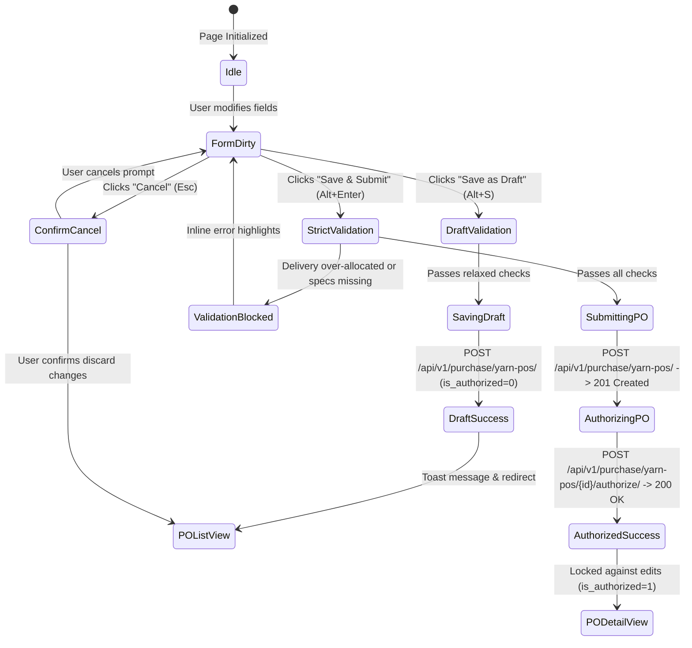

# UI & Frontend Workflow Specification: Yarn Purchase Order (PO) Add Page

## 1. Document Overview, Version, Scope, and Status

- **Document Title**: Yarn Purchase Order (PO) Add Page UI & Frontend Developer Specification
- **Screen ID**: `SCR-PROC-001-ADD`
- **Document Version**: `v1.2.0`
- **Last Updated**: `15/10/2026`
- **Target Audience**: Frontend Engineers, Full-Stack Developers, QA Engineers, and Technical Product Owners
- **Implementation Status**: `Ready for Review / Implementation`
- **Scope**: Covers the complete user workflow, screen blueprint, step-by-step field specifications, dynamic technical validations, real-time calculation formulas, split delivery allocation rules, API contracts, Zod schemas, TypeScript types, keyboard ergonomics, and developer checklists for creating new Yarn Purchase Orders in the Garments ERP & CRM system.

---

## 2. Module Details, Screen ID, Route, Access Privileges, and API Endpoints

### 2.1 Core Metadata

| Parameter | Specification |
|---|---|
| **Module** | `Module 3 — Procurement (Yarn PO)` |
| **Screen ID** | `SCR-PROC-001-ADD` |
| **Frontend Route** | `/procurement/yarn-po/new` |
| **File Location** | `app/(app)/procurement/yarn-po/new/page.tsx` |
| **Required Privilege** | `purchase_yarn_po.can_create` |
| **Authorized Roles** | `SUPER_ADMIN`, `ADMIN_USER`, `COMPANY_USER` (holding procurement permissions) |
| **Country Pack** | `IN` (India: Currency INR `₹`, Date `DD/MM/YYYY`, Bags standard `45.360 Kg`) |

### 2.2 Primary API Endpoints

| HTTP Method | API Path | Privilege / Scope | Description |
|---|---|---|---|
| `POST` | `/api/v1/purchase/yarn-pos/` | `can_create` | Create a new Yarn PO header with nested line items and split deliveries |
| `POST` | `/api/v1/purchase/yarn-pos/{id}/authorize/` | `can_approve` | Authorize and lock the newly created PO against direct edits |
| `GET` | `/api/v1/purchase/yarn-types/` | `can_read` | Fetch active yarn process configurations and dynamic requirements (`tc_company_yarn_type`) |
| `GET` | `/api/v1/masters/parties/?party_type=MILL&record_status=A` | `can_read` | Search and retrieve active spinning mills |
| `GET` | `/api/v1/masters/parties/?party_type=TRADER,SUPPLIER,MILL&record_status=A` | `can_read` | Search and retrieve active commercial suppliers and commission agents |
| `GET` | `/api/v1/masters/parties/?party_type=KNITTER,GODOWN,WAREHOUSE&record_status=A` | `can_read` | Retrieve delivery destination warehouses and subcontract knitting mills |
| `GET` | `/api/v1/masters/yarn-counts/?record_status=A` | `can_read` | Retrieve yarn count catalogue (e.g. 30s Combed, 34s Carded) |
| `GET` | `/api/v1/masters/color-shades/?is_active=1` | `can_read` | Retrieve color shades / lab dips for Dyed and Melange orders |

---

## 3. UI Layout, Screen Blueprint, and Visual Mockup

### 3.1 Visual Mockup Reference


### 3.2 Desktop Wireframe Layout (1440px+ Viewport)

```
+------------------------------------------------------------------------------------------------------------------+
| TOP BREADCRUMB & HEADER: Procurement > Yarn PO > Create                                                          |
| New Yarn Purchase Order               [● Draft Badge]        [ Save as Draft (Alt+S) ]   [ Save & Submit (Alt+Enter) ]|
+------------------------------------------------------------------------------------------------------------------+
| +-------------------------------------------------------+  +---------------------------------------------------+ |
| | CARD 1: DOCUMENT & SUPPLIER                           |  | CARD 2: YARN PROCESS & TECHNICAL SPECS            | |
| | PO Number:     [ YPO-202610-0042 (Auto) ] [LOCKED]    |  | Yarn Process Type:                                | |
| | PO Date:       [ 15/10/2026            ] [CALENDAR]  |  | (o) Grey    ( ) Dyed    ( ) Melange    ( ) Blended| |
| | Spinning Mill: [ Vardhman Textiles Ltd.            v] |  | Color Shade:  [ Navy Blue - PANTONE 19-3832    v] | |
| | Trader/Agent:  [ Direct Mill Purchase (Optional)   v] |  | Blend Ratio:  [ 60% Cotton / 40% Polyester      ] | |
| | Active FY:     [ FY 2025-2026 (Auto-scoped)        ]  |  | Dynamic Specs: [Ply / TPI / Slub / Lycra Denier ] | |
| +-------------------------------------------------------+  +---------------------------------------------------+ |
|                                                                                                                  |
| +--------------------------------------------------------------------------------------------------------------+ |
| | CARD 3: ORDER ITEMS & COMMERCIAL PRICING (INTERACTIVE SPREADSHEET MATRIX)                                     | |
| | [ + Add Item Row (Alt+N) ]                                                                                    | |
| | +-----+--------------------+-------+---------+---------------+-------------+----------+----------+----------+ | |
| | | #   | Yarn Count         | Bags  | Kg/Bag  | Net Qty (Kg)  | Rate/Kg (₹) | Disc (₹) | Net Rate | Line Amt | | |
| | +-----+--------------------+-------+---------+---------------+-------------+----------+----------+----------+ | |
| | | 1   | [ 30s Combed Cot v]| [100] | [45.360]| 4,536.000     | [350.00   ] | [0.00  ] | ₹350.00  |₹15,87,600|X| |
| | +-----+--------------------+-------+---------+---------------+-------------+----------+----------+----------+ | |
| +--------------------------------------------------------------------------------------------------------------+ |
|                                                                                                                  |
| +--------------------------------------------------------------------------------------------------------------+ |
| | CARD 4: SPLIT DELIVERY SCHEDULE (OPTIONAL MULTI-LOT ALLOCATION)                                              | |
| | [✔] Enable Split Delivery Schedule                                                                           | |
| | Allocation Progress: [████████████████████████████████████████] 100 / 100 Bags (100% Fully Allocated)        | |
| | +-----------------------+---------------------------------------+-----------+------------+-----------------+ | |
| | | Expected Date         | Destination Party / Warehouse         | Bags      | Bag Wt(Kg) | Scheduled (Kg)  | | |
| | +-----------------------+---------------------------------------+-----------+------------+-----------------+ | |
| | | [ 25/10/2026       ]  | [ Angeripalayam Knitter Godown     v] | [ 50    ] | 45.360     | 2,268.000 Kg    | | |
| | | [ 05/11/2026       ]  | [ Main Factory Raw Godown          v] | [ 50    ] | 45.360     | 2,268.000 Kg    | | |
| | +-----------------------+---------------------------------------+-----------+------------+-----------------+ | |
| | [ + Add Delivery Lot ]                                                                                       | |
| +--------------------------------------------------------------------------------------------------------------+ |
|                                                                                                                  |
| +--------------------------------------------------------------------------------------------------------------+ |
| | STICKY FOOTER SUMMARY BAR                                                                                    | |
| | Order Remarks: [ Payment within 30 days against LC. Delivery tolerance +/- 2%                              ] | |
| | TOTAL BAGS: 100 Bags  |  TOTAL QTY: 4,536.000 Kg  |  AVG NET RATE: ₹350.00/Kg  |  TOTAL VALUE: ₹15,87,600.00 | |
+------------------------------------------------------------------------------------------------------------------+
```

### 3.3 Responsive Breakpoint Adaptations

| Viewport | Width | Layout Structure |
|---|---|---|
| **Desktop (XL)** | `≥ 1280px` | 2-column header cards (Document & Supplier, Technical Specs), full-width editable spreadsheet grid, delivery card, and fixed bottom summary bar. |
| **Laptop (MD-LG)** | `1024px – 1279px` | Header cards adapt to fluid width; line items table supports horizontal scroll with sticky columns (`#`, `Yarn Count`, `Actions`). |
| **Tablet (SM)** | `768px – 1023px` | Header cards stack into 1 column. Table switches to responsive card-list or overflow container with touch-friendly 44px tap targets. |
| **Mobile (XS)** | `< 768px` | Single-column stacked form. Bottom summary bar becomes a collapsible drawer with a persistent "Submit" button. |

---

## 4. Page Initialization and Default Values

When the page loads at `/procurement/yarn-po/new`, the frontend executes the following initialization sequence:

1. **Session & Security Scoping**:
   - Reads `company_id` and `company_name` from authenticated user session.
   - Reads `active_financial_year` (`id`, `code`, `start_date`, `end_date`) from user context.
   - Injects global headers: `X-Company-ID: <id>`, `X-Financial-Year-ID: <id>`.
2. **Master Data Hydration (Parallel Queries via TanStack Query/SWR)**:
   - `GET /api/v1/purchase/yarn-types/` -> Filters active company yarn categories.
   - `GET /api/v1/masters/parties/?party_type=MILL` -> Caches spinning mills list.
   - `GET /api/v1/masters/parties/?party_type=TRADER,SUPPLIER,MILL` -> Caches commercial suppliers list.
   - `GET /api/v1/masters/yarn-counts/` -> Caches yarn counts.
3. **Form State Default Initialization**:
   - `po_number`: Display preview string `YPO-YYYYMM-XXXX` (Read-only).
   - `po_date`: Formatted current date `DD/MM/YYYY` in company timezone (`Asia/Kolkata`).
   - `cfyear`: Set to active financial year ID (e.g. `FY 2025-2026`).
   - `is_direct_mill_purchase`: `false`.
   - `yarn_type`: First active type from company configuration, defaulting to `'GREY'`.
   - `ply_count`: `1`.
   - `line_items`: Pre-populated with exactly 1 empty line item:
     - `yarn_count_id`: `null`
     - `bag`: `null` (or `0`)
     - `per_bag`: `45.360`
     - `actual_rate`: `null` (or `0.00`)
     - `discount`: `0.00`
     - `quantity`: `0.000`
     - `rate`: `0.00`
     - `amount`: `0.00`
   - `is_delivery`: `false` (Deliveries array initialized empty `[]`).
   - `remarks`: `""`.
4. **Ergonomic Focus**: Automatically places keyboard cursor in the **Spinning Mill** combobox.

---

## 5. Document Header and Financial Year Configuration

This section details the fields located in **Card 1 (Left): Document & Fiscal Context**.

### 5.1 PO Number (`po_number`)
- **Field Label**: `PO Number`
- **Backend Field Key**: `po_number`
- **Field Type**: Read-only text input with lock icon (`LockClosedIcon`).
- **Default Value**: Auto-generated sequential preview (e.g. `YPO-202610-XXXX`).
- **Required / Optional**: System-assigned (Read-only on creation).
- **Data Source / API**: Generated by backend numbering service (`YarnPOService.generate_po_number`) during submission.
- **Validation Rules**: Unique per company across valid records (`status=1`).
- **Conditional Visibility**: Always visible; non-editable.
- **Automatic Calculations**: Sequence derived from current Year/Month and last incremented integer.
- **User Interaction Behavior**: Disabled styling (`bg-slate-100 text-slate-500 cursor-not-allowed`).
- **Error Messages**: *"Purchase Order #[number] already exists"* (HTTP 409 Conflict).
- **Related Business Rules**: Number format follows `tc_doc_series`: `YPO-YYYYMM-XXXX`. Cannot be altered by client to prevent sequence collision.

### 5.2 PO Date (`po_date`)
- **Field Label**: `PO Date`
- **Backend Field Key**: `po_date`
- **Field Type**: Calendar date picker input (`DD/MM/YYYY`).
- **Default Value**: Current date in company timezone (`Asia/Kolkata`).
- **Required / Optional**: **Required**.
- **Data Source / API**: Client input serialized to ISO `YYYY-MM-DD` on submission.
- **Validation Rules**: Must fall strictly between `active_financial_year.start_date` and `active_financial_year.end_date` (`01/04/2025` to `31/03/2026`).
- **Conditional Visibility**: Always visible.
- **Automatic Calculations**: None.
- **User Interaction Behavior**: Selecting an out-of-bounds date displays an immediate non-blocking warning badge: *"Date outside active FY (2025-2026)"*.
- **Error Messages**: *"PO Date must fall within the active financial year"* or *"Invalid date format. Expected DD/MM/YYYY"*.
- **Related Business Rules**: Invariant: No procurement document may be booked into a locked or closed financial year.

### 5.3 Active Financial Year (`cfyear`)
- **Field Label**: `Fiscal Year`
- **Backend Field Key**: `cfyear` (or `cfyear_id`)
- **Field Type**: Read-only badge / pill.
- **Default Value**: Active working FY name (e.g. `FY 2025-2026`).
- **Required / Optional**: **Required** (Injected by server context).
- **Data Source / API**: User session / `GET /api/v1/auth/me/`.
- **Validation Rules**: Must correspond to an active, non-closed `tm_financial_year` record.
- **Conditional Visibility**: Always visible.
- **Automatic Calculations**: Resolved automatically from `X-Financial-Year-ID` header.
- **User Interaction Behavior**: Non-interactive display badge with tooltip: *"Tenant working financial year"*.
- **Error Messages**: *"A valid Financial Year is required for the Purchase Order"*.
- **Related Business Rules**: Invariant: All transaction tables (`tm_yarn_po`, `tx_purchase_order`, `tx_yarn_po`) require indexed `cfyear` linkage.

### 5.4 Order Reference / Job Card Name (`name`)
- **Field Label**: `Order Reference / Job Name`
- **Backend Field Key**: `name`
- **Field Type**: Text input.
- **Default Value**: `""` (Empty string).
- **Required / Optional**: Optional.
- **Data Source / API**: User entry.
- **Validation Rules**: Maximum 50 characters, trimmed.
- **Conditional Visibility**: Always visible.
- **Automatic Calculations**: None.
- **User Interaction Behavior**: Free-text entry with placeholder: `e.g. Summer 2026 Polo T-Shirt Lot`.
- **Error Messages**: *"Reference name cannot exceed 50 characters"*.
- **Related Business Rules**: Allows procurement teams to tag purchase orders with customer project references.

---

## 6. Spinning Mill, Supplier, Trader, and Direct Purchase Selection

This section details the vendor selection fields in **Card 1 (Right): Vendor Details**.

### 6.1 Spinning Mill (`mill`)
- **Field Label**: `Spinning Mill`
- **Backend Field Key**: `mill` (or `mill_id`)
- **Field Type**: Searchable Async Combobox.
- **Default Value**: `null`.
- **Required / Optional**: **Required**.
- **Data Source / API**: `GET /api/v1/masters/parties/?party_type=MILL&record_status=A`.
- **Validation Rules**: Must be a valid party ID with `party_type == 'MILL'`.
- **Conditional Visibility**: Always visible.
- **Automatic Calculations**: If `is_direct_mill_purchase` is checked, changes to Mill automatically update `party_id`.
- **User Interaction Behavior**: Typing searches by mill name, city, or GSTIN. Dropdown item displays: `[Mill Name] — [City], [State] (GST: [GSTIN])`.
- **Error Messages**: *"Spinning Mill is required"*.
- **Related Business Rules**: Every yarn purchase order must identify the manufacturing spinning mill for CSP, twist, and count quality tracking.

### 6.2 Direct Mill Purchase Toggle (`is_direct_mill_purchase`)
- **Field Label**: `Direct Mill Purchase`
- **Backend Field Key**: Client-side UI state flag (maps to setting `party = mill`).
- **Field Type**: Toggle Switch / Checkbox.
- **Default Value**: `false`.
- **Required / Optional**: Optional.
- **Data Source / API**: Client state.
- **Validation Rules**: Boolean.
- **Conditional Visibility**: Always visible next to Mill selector.
- **Automatic Calculations**: When enabled, copies `mill_id` into `party_id`.
- **User Interaction Behavior**:
  - `ON`: Locks the Trader/Agent dropdown and displays: *"Direct purchase from spinning mill"*.
  - `OFF`: Unlocks Trader/Agent dropdown for separate commercial invoicing party entry.
- **Error Messages**: None.
- **Related Business Rules**: In textile procurement, companies often purchase directly from spinning mills without a commission agent.

### 6.3 Supplier / Trader / Agent (`party`)
- **Field Label**: `Billing Supplier / Trader`
- **Backend Field Key**: `party` (or `party_id`)
- **Field Type**: Searchable Async Combobox.
- **Default Value**: `null`.
- **Required / Optional**: **Required**.
- **Data Source / API**: `GET /api/v1/masters/parties/?party_type=TRADER,SUPPLIER,MILL&record_status=A`.
- **Validation Rules**: Must be a valid party ID representing the invoicing vendor.
- **Conditional Visibility**: Always visible; disabled when `is_direct_mill_purchase` is `true`.
- **Automatic Calculations**: Linked to commercial accounts payable ledger upon invoice posting.
- **User Interaction Behavior**: Displays vendor name, phone, city, and verified GSTIN badge.
- **Error Messages**: *"Supplier / Trader is required"*.
- **Related Business Rules**: The `party` represents the commercial entity issuing the tax invoice, which may differ from the physical spinning mill.

---

## 7. Yarn Type and Conditional Technical Specifications

Located in **Card 2: Yarn Process & Technical Specs**. When `yarn_type` changes, the UI dynamically reconfigures visible and mandatory fields.

### 7.1 Dynamic Behavior Matrix

| Yarn Category | Backend Code | Color Shade Field | Blend Ratio Field | Ply & TPI Fields | Slub Pattern | Core Spun Denier |
|---|---|---|---|---|---|---|
| **Grey Yarn** | `GREY` | Hidden | Hidden | Hidden | Hidden | Hidden |
| **Dyed Yarn** | `DYED` | **Mandatory** | Hidden | Hidden | Hidden | Hidden |
| **Melange Yarn** | `MELANGE` | **Mandatory** | **Mandatory** | Hidden | Hidden | Hidden |
| **Blended Yarn** | `BLENDED` | Optional | **Mandatory** | Hidden | Hidden | Hidden |
| **Wound / Doubled** | `WOUND` | Optional | Hidden | **Mandatory** (Ply $\ge 2$) | Hidden | Hidden |
| **Slub / Fancy** | `SLUB` | Optional | Optional | Hidden | **Mandatory** | Hidden |
| **Core-Spun (Lycra)**| `CORE_SPUN` | Optional | Optional | Hidden | Hidden | **Mandatory** |
| **Recycled Yarn** | `RECYCLED` | Optional | **Mandatory** | Hidden | Hidden | Optional |

### 7.2 Detailed Field Specifications

#### A. Yarn Process Category (`yarn_type`)
- **Label**: `Yarn Process Type`
- **Backend Key**: `yarn_type`
- **Field Type**: Segmented Button Chips / Radio Group.
- **Default Value**: `'GREY'`.
- **Required / Optional**: **Required**.
- **Data Source / API**: `GET /api/v1/purchase/yarn-types/` (Shows active types configured in `tc_company_yarn_type`).
- **Validation Rules**: Must match one of `YarnCategory.CHOICES`. Must be enabled for tenant company.
- **Error Messages**: *"Yarn process type is not enabled for this company"*.

#### B. Color Shade Master (`color_shade`)
- **Label**: `Color Shade / Lab Dip`
- **Backend Key**: `color_shade` (or `color_shade_id`)
- **Field Type**: Searchable Combobox with color swatch preview.
- **Default Value**: `null`.
- **Required / Optional**: **Mandatory** if `yarn_type` is `DYED` or `MELANGE`; otherwise optional/hidden.
- **Data Source / API**: `GET /api/v1/masters/color-shades/?is_active=1`.
- **Validation Rules**: Must be a valid `ColorShadeMaster` ID.
- **Error Messages**: *"Color shade is required for Dyed and Melange Yarn Purchase Orders"*.

#### C. Fiber Blend Ratio (`blend_ratio`)
- **Label**: `Blend Percentage Ratio`
- **Backend Key**: `blend_ratio`
- **Field Type**: Text Input with quick preset suggestion pills (`65/35 PC`, `85/15 Melange`, `50/50 Cotton Modal`, `60/40 CVC`).
- **Default Value**: `""`.
- **Required / Optional**: **Mandatory** for `MELANGE`, `BLENDED`, and `RECYCLED`.
- **Validation Rules**: Max 50 characters, non-empty when mandatory.
- **Error Messages**: *"Fiber blend ratio (e.g. 65/35 PC) is required"*.

#### D. Ply Count (`ply_count`)
- **Label**: `Ply Count`
- **Backend Key**: `ply_count`
- **Field Type**: Numeric Stepper (`1`, `2`, `3`, `4`).
- **Default Value**: `1`.
- **Required / Optional**: **Mandatory $\ge 2$** if `yarn_type == 'WOUND'`.
- **Validation Rules**: Integer $\ge 1$.
- **Error Messages**: *"Ply count must be at least 2 for Wound / Doubled Yarn"*.

#### E. Twists Per Inch (`twists_per_inch`)
- **Label**: `Twists Per Inch (TPI)`
- **Backend Key**: `twists_per_inch`
- **Field Type**: Decimal Input (`0.00`).
- **Default Value**: `null`.
- **Required / Optional**: Visible when `yarn_type == 'WOUND'`.
- **Validation Rules**: Positive decimal with up to 2 decimal places.
- **Error Messages**: *"TPI must be a positive number"*.

#### F. Slub Pattern Profile (`slub_pattern`)
- **Label**: `Slub Pattern Profile Code`
- **Backend Key**: `slub_pattern`
- **Field Type**: Text Input (`maxlength="60"`).
- **Default Value**: `""`.
- **Required / Optional**: **Mandatory** when `yarn_type == 'SLUB'`.
- **Validation Rules**: Non-empty string.
- **Error Messages**: *"Slub pattern profile code is required for Slub yarn"*.

#### G. Core Filament Denier (`core_denier`)
- **Label**: `Core Filament Denier`
- **Backend Key**: `core_denier`
- **Field Type**: Text Input with presets (`40D Spandex`, `70D Lycra`, `20D Elastane`).
- **Default Value**: `""`.
- **Required / Optional**: **Mandatory** when `yarn_type == 'CORE_SPUN'`.
- **Validation Rules**: Non-empty string.
- **Error Messages**: *"Core filament denier (e.g. 40D Spandex) is required"*.

---

## 8. Yarn PO Line Items and Commercial Pricing

Located in **Card 3: Order Items & Commercial Pricing**. Features a high-speed spreadsheet-style data grid supporting multi-count line item entries.

### 8.1 Line Items Grid Column Specifications

| Col # | Header Label | Backend Key | Type | Default | Required | Validation & Constraints |
|---|---|---|---|---|---|---|
| **1** | `#` | `line_number` | Read-only Index | `1` | Yes | Auto-incrementing row sequence index (`1, 2, 3...`). |
| **2** | `Yarn Count` | `yarn_count_id` | Select Combobox | `null` | **Yes** | Active ID from `GET /api/v1/masters/yarn-counts/`. Cannot be duplicate with same shade. |
| **3** | `Bags` | `bag` | Integer Input | `null` | **Yes** | Integer $\ge 1$. Triggers instant recalculation of line quantity and amount. |
| **4** | `Kg/Bag` | `per_bag` | Decimal Input | `45.360` | **Yes** | Decimal $> 0$, default `45.360` (standard textile bag) or `50.000`. |
| **5** | `Net Qty (Kg)` | `quantity` | Computed Text | `0.000` | Read-only | Formula: `bag * per_bag`. Displayed formatted to 3 decimal places. |
| **6** | `Rate/Kg (₹)` | `actual_rate` | Decimal Currency | `null` | **Yes** | Decimal $\ge 0.00$. Base catalogue purchase rate in INR. |
| **7** | `Disc (₹)` | `discount` | Decimal Currency | `0.00` | Optional | Decimal $\ge 0.00$. Must not exceed `actual_rate`. |
| **8** | `Net Rate` | `rate` | Computed Text | `₹0.00` | Read-only | Formula: `actual_rate - discount`. Final commercial rate per Kg. |
| **9** | `Line Amount` | `amount` | Computed Text | `₹0.00` | Read-only | Formula: `quantity * rate`. Displayed in INR with Indian numbering grouping. |
| **10**| `Actions` | — | Icon Button | — | — | Delete button (`TrashIcon`). Disabled if grid contains only 1 row. |

### 8.2 Grid Interaction & Row Actions

- **`+ Add Item Row` Button**: Clicking button or pressing **`Alt + N`** appends an empty row initialized with `per_bag = 45.360` and `discount = 0.00`, immediately moving focus to the new row's `Yarn Count` selector.
- **Fast Enter Commit**: Pressing `Enter` inside the `Discount` field of the last row automatically appends the next item row.
- **Delete Row Action**: Removes the selected row and recalculates all header aggregations.

---

## 9. Quantity, Weight, Rate, Discount, and Amount Calculations

All calculations execute **synchronously on keystroke** using exact decimal precision.

### 9.1 Mathematical Formulas

1. **Line Item Net Quantity (Kg)**:
   $$\text{quantity} = \text{bag} \times \text{per\_bag}$$
   *(Precision: 3 decimal places, e.g. $100 \times 45.360 = 4,536.000\text{ Kg}$)*

2. **Line Item Effective Net Rate (₹/Kg)**:
   $$\text{rate} = \max(0, \text{actual\_rate} - \text{discount})$$
   *(Precision: 2 decimal places, e.g. $350.00 - 10.00 = 340.00\text{ ₹/Kg}$)*

3. **Line Item Total Amount (₹)**:
   $$\text{amount} = \text{quantity} \times \text{rate}$$
   *(Precision: 2 decimal places, e.g. $4,536.000 \times 340.00 = 15,42,240.00\text{ ₹}$)*

4. **Header Total Bags**:
   $$\text{total\_bags} = \sum_{i=1}^{n} \text{line\_items}[i].\text{bag}$$

5. **Header Total Net Quantity (Kg)**:
   $$\text{total\_quantity} = \sum_{i=1}^{n} \text{line\_items}[i].\text{quantity}$$

6. **Header Weighted Average Net Rate (₹/Kg)**:
   $$\text{average\_rate} = \begin{cases} \dfrac{\text{total\_amount}}{\text{total\_quantity}} & \text{if } \text{total\_quantity} > 0 \\ 0.00 & \text{otherwise} \end{cases}$$

7. **Header Grand Total Order Value (₹)**:
   $$\text{total\_amount} = \sum_{i=1}^{n} \text{line\_items}[i].\text{amount}$$

---

## 10. Split Delivery Schedule and Allocation Validation

Located in **Card 4: Split Delivery Schedule**. Manages staged deliveries and direct dispatches to subcontract knitting mills or internal godowns.

### 10.1 Toggle & Allocation State

- **Toggle Switch (`is_delivery`)**: Enables or disables the split delivery lot table.
- **Real-Time Allocation Invariant**:
  $$\text{Scheduled Bags} = \sum_{j=1}^{m} \text{deliveries}[j].\text{bag} \quad \le \quad \text{Total PO Bags} = \sum_{i=1}^{n} \text{line\_items}[i].\text{bag}$$

### 10.2 Progress Bar Status Thresholds

| Condition | Bar Color | Badge Indicator | Form Submission State |
|---|---|---|---|
| `Scheduled == 0` | Slate Gray (`bg-slate-300`) | `Direct / Unscheduled Delivery` | Allowed |
| `0 < Scheduled < Total` | Amber (`bg-amber-500`) | `Partially Allocated (e.g. 60%)` | Allowed |
| `Scheduled == Total` | Emerald (`bg-emerald-500`) | `Fully Allocated (100%)` | Allowed |
| `Scheduled > Total` | Crimson Red (`bg-red-500`) | **`Over-Allocated! Cannot exceed total PO bags`** | **Blocked / Disabled** |

### 10.3 Delivery Lot Table Columns

1. **Expected Arrival Date (`delivery_date`)**: Calendar date picker. Constraint: $\ge$ `po_date`.
2. **Destination Party (`party_id`)**: Combobox from `GET /api/v1/masters/parties/?party_type=KNITTER,GODOWN,WAREHOUSE`.
3. **Yarn Count (`yarn_count_id`)**: Dropdown restricted to counts selected in Card 3 line items.
4. **Scheduled Bags (`bag`)**: Positive integer.
5. **Bag Weight (`bag_wt`)**: Decimal default `45.360 Kg`.
6. **Scheduled Net Qty (`quantity`)**: Computed `bag * bag_wt`.
7. **Actions**: Remove delivery lot button.

---

## 11. Summary Bar, Remarks, and Total Calculations

Located in **Card 5 & Sticky Bottom Summary Bar**.

### 11.1 Terms & Remarks (`remarks`)
- **Field Key**: `remarks`
- **Field Type**: Multiline Textarea (`rows="2"`, `maxlength="150"`).
- **Validation**: Optional, maximum 150 characters.
- **UI Element**: Live counter showing `(used / 150)` characters.
- **Placeholder**: `e.g. Payment within 30 days against LC. Delivery tolerance +/- 2%. Yarn CSP > 2800.`

### 11.2 Sticky Footer Bar Metrics

```
+------------------------------------------------------------------------------------------------------------------+
| TOTAL BAGS: 100 Bags  |  TOTAL QTY: 4,536.000 Kg  |  AVG NET RATE: ₹350.00/Kg  |  TOTAL VALUE: ₹15,87,600.00 |
+------------------------------------------------------------------------------------------------------------------+
```

---

## 12. Form Validation Rules and Error Messages

| Field / Target | Trigger | Validation Rule | User-Facing Error Message | UI Highlight |
|---|---|---|---|---|
| `mill_id` | Submit / Blur | Mandatory selection | *"Spinning Mill is required"* | Red input border & focus ring |
| `party_id` | Submit / Blur | Mandatory selection | *"Supplier / Trader is required"* | Red input border & focus ring |
| `po_date` | Change / Submit | Within active FY dates | *"PO Date must fall within active FY (01/04/2025 - 31/03/2026)"* | Amber warning alert banner |
| `color_shade_id` | Change / Submit | Required for Dyed/Melange | *"Color shade is mandatory for Dyed and Melange Yarn"* | Red border on Shade combobox |
| `blend_ratio` | Change / Submit | Required for Melange/Blended | *"Fiber blend ratio (e.g. 65/35 PC) is mandatory"* | Red border on Blend input |
| `ply_count` | Change / Submit | $\ge 2$ for Wound Yarn | *"Ply count must be at least 2 for Wound / Doubled Yarn"* | Red border on Ply stepper |
| `line_items` | Submit | Minimum 1 valid row | *"At least one yarn item with Count and Bags is required"* | Banner alert above grid |
| `line_items[i].bag` | Change / Submit | Integer $\ge 1$ | *"Bags must be at least 1"* | Red border on table cell |
| `line_items[i].discount`| Change / Submit | $\le$ `actual_rate` | *"Discount cannot exceed base rate"* | Red border on Discount cell |
| `deliveries` | Change / Submit | $\sum \text{Del. Bags} \le \text{Total Bags}$ | *"Total scheduled bags ([X]) cannot exceed total PO bags ([Y])"* | Crimson progress bar & banner |

---

## 13. Save as Draft, Save & Submit, Authorization, and Cancel Workflows



### 13.1 Action Buttons Specification

1. **"Cancel / Back" Button**:
   - Shortcut: `Esc`.
   - Behavior: If form is dirty, triggers modal: *"Discard unsaved changes? Entered line items will be lost."*
2. **"Save as Draft" Button**:
   - Shortcut: `Alt + S`.
   - Payload: `is_authorized: 0`.
   - Validation Scope: Relaxed. Requires Mill, Date, and at least 1 line item with Bags. Does not block partial delivery allocation.
3. **"Save & Submit / Authorize" Button**:
   - Shortcut: `Alt + Enter`.
   - Payload Action: Sends `POST /api/v1/purchase/yarn-pos/`, followed immediately by `POST /api/v1/purchase/yarn-pos/{id}/authorize/`.
   - Validation Scope: **Strict Invariant Check**. All dynamic fields and delivery constraints must pass.

---

## 14. API Integration, Request Headers, Payload Serialization, and Error Handling

### 14.1 Request Headers

```http
Content-Type: application/json
Accept: application/json
Authorization: Bearer <access_token>
X-Company-ID: 1
X-Financial-Year-ID: 1
```

### 14.2 API Payload Serialization Mapping

```typescript
export function serializeYarnPOPayload(values: YarnPOFormValues) {
  const lineItems = values.line_items.map((item) => ({
    yarn_type: values.yarn_type,
    yarn_count_id: item.yarn_count_id,
    color_shade_id: values.color_shade_id || null,
    blend_ratio: values.blend_ratio || null,
    ply_count: values.ply_count || 1,
    twists_per_inch: values.twists_per_inch || null,
    slub_pattern: values.slub_pattern || null,
    core_denier: values.core_denier || null,
    bag: item.bag,
    per_bag: item.per_bag,
    actual_rate: item.actual_rate,
    discount: item.discount,
  }));

  const totalBags = lineItems.reduce((acc, i) => acc + i.bag, 0);
  const primaryItem = lineItems[0];

  return {
    po_number: values.po_number || undefined,
    po_date: values.po_date,
    yarn_type: values.yarn_type,
    mill: values.mill_id,
    party: values.party_id,
    yarn_count: primaryItem.yarn_count_id,
    color_shade: values.color_shade_id || null,
    blend_ratio: values.blend_ratio || null,
    ply_count: values.ply_count || 1,
    twists_per_inch: values.twists_per_inch || null,
    slub_pattern: values.slub_pattern || null,
    core_denier: values.core_denier || null,
    bag: totalBags,
    per_bag: primaryItem.per_bag,
    rate: primaryItem.actual_rate,
    discount: primaryItem.discount,
    remarks: values.remarks || "",
    is_delivery: (values.deliveries && values.deliveries.length > 0) ? 1 : 0,
    line_items: lineItems,
    deliveries: (values.deliveries || []).map((d) => ({
      party: d.party_id,
      yarn_count: d.yarn_count_id || primaryItem.yarn_count_id,
      delivery_date: d.delivery_date,
      bag: d.bag,
      bag_wt: d.bag_wt,
    })),
  };
}
```

### 14.3 HTTP Error Code Handling

- **`400 Bad Request`**: Maps `error.details` directly to form fields using `setError()` in `react-hook-form`.
- **`401 Unauthorized`**: Redirects to `/login` preserving return URL query parameter.
- **`403 Forbidden`**: Displays toast: *"You lack privilege `purchase_yarn_po.can_create`"*.
- **`409 Conflict`**: *"PO number already exists. The sequence has been refreshed."*
- **`500 Server Error`**: Displays global toast with retry option: *"Server error processing order. Contact support."*

---

## 15. Next.js Folder Structure and Component Responsibilities

```
frontend/app/(app)/procurement/yarn-po/new/
├── page.tsx                           # Master page orchestrator & query state
├── components/
│   ├── YarnPOHeaderCard.tsx           # Document & Supplier inputs (Mill, Trader, Date)
│   ├── YarnTechnicalSpecsCard.tsx     # Yarn type segmented chips & dynamic specs
│   ├── YarnLineItemsTable.tsx         # Editable data grid container with auto-math
│   ├── YarnLineItemRow.tsx            # Single grid row with cell focus & keyboard handlers
│   ├── YarnDeliveryScheduleCard.tsx   # Split deliveries allocation & visual progress bar
│   └── YarnPOSummaryFooter.tsx        # Sticky bottom bar with totals & action buttons
├── hooks/
│   ├── useYarnPOForm.ts               # React Hook Form + Zod state & calculation listeners
│   └── useYarnMasters.ts              # TanStack Query / SWR hooks for Mills, Counts & Shades
└── types/
    └── yarn-po.types.ts               # DTO interfaces and Form state definitions
```

---

## 16. React Hooks, TypeScript Types, Zod Schemas, and Form State Management

### 16.1 TypeScript Interfaces (`yarn-po.types.ts`)

```typescript
export interface YarnLineItem {
  id?: number;
  yarn_count_id: number;
  bag: number;
  per_bag: number;
  quantity: number;
  actual_rate: number;
  discount: number;
  rate: number;
  amount: number;
}

export interface YarnDeliveryLot {
  id?: number;
  delivery_date: string;
  party_id: number;
  yarn_count_id?: number;
  bag: number;
  bag_wt: number;
  quantity: number;
}

export interface YarnPOFormValues {
  po_number?: string;
  po_date: string;
  yarn_type: "GREY" | "DYED" | "MELANGE" | "BLENDED" | "WOUND" | "SLUB" | "CORE_SPUN" | "RECYCLED";
  mill_id: number;
  party_id: number;
  is_direct_mill_purchase?: boolean;
  color_shade_id?: number | null;
  blend_ratio?: string;
  ply_count: number;
  twists_per_inch?: number | null;
  slub_pattern?: string;
  core_denier?: string;
  remarks?: string;
  is_delivery: boolean;
  line_items: YarnLineItem[];
  deliveries?: YarnDeliveryLot[];
}
```

### 16.2 Zod Validation Schema (`yarn-po.schema.ts`)

```typescript
import { z } from "zod";

export const yarnItemSchema = z.object({
  yarn_count_id: z.number({ required_error: "Yarn count is required" }).positive("Select a yarn count"),
  bag: z.number({ invalid_type_error: "Enter bags" }).int().min(1, "Bags must be at least 1"),
  per_bag: z.number().positive("Weight per bag must be positive").default(45.360),
  actual_rate: z.number({ invalid_type_error: "Enter base rate" }).min(0, "Rate cannot be negative"),
  discount: z.number().min(0, "Discount cannot be negative").default(0),
});

export const yarnDeliverySchema = z.object({
  delivery_date: z.string().min(1, "Expected arrival date is required"),
  party_id: z.number({ required_error: "Destination party is required" }).positive(),
  yarn_count_id: z.number().optional(),
  bag: z.number().int().min(1, "Scheduled bags must be at least 1"),
  bag_wt: z.number().positive().default(45.360),
});

export const yarnPOFormSchema = z.object({
  po_number: z.string().optional(),
  po_date: z.string().min(1, "PO Date is required"),
  yarn_type: z.enum(["GREY", "DYED", "MELANGE", "BLENDED", "WOUND", "SLUB", "CORE_SPUN", "RECYCLED"]),
  mill_id: z.number({ required_error: "Spinning Mill is required" }).positive("Select spinning mill"),
  party_id: z.number({ required_error: "Supplier / Trader is required" }).positive("Select supplier"),
  color_shade_id: z.number().nullable().optional(),
  blend_ratio: z.string().optional(),
  ply_count: z.number().int().min(1).default(1),
  twists_per_inch: z.number().nullable().optional(),
  slub_pattern: z.string().optional(),
  core_denier: z.string().optional(),
  remarks: z.string().max(150, "Remarks cannot exceed 150 characters").optional(),
  is_delivery: z.boolean().default(false),
  line_items: z.array(yarnItemSchema).min(1, "At least one yarn item is required"),
  deliveries: z.array(yarnDeliverySchema).optional(),
}).superRefine((data, ctx) => {
  // Conditional: Dyed & Melange require Color Shade
  if (["DYED", "MELANGE"].includes(data.yarn_type) && !data.color_shade_id) {
    ctx.addIssue({
      code: z.ZodIssueCode.custom,
      message: "Color shade is mandatory for Dyed and Melange Yarn",
      path: ["color_shade_id"],
    });
  }

  // Conditional: Melange, Blended & Recycled require Blend Ratio
  if (["MELANGE", "BLENDED", "RECYCLED"].includes(data.yarn_type) && !data.blend_ratio?.trim()) {
    ctx.addIssue({
      code: z.ZodIssueCode.custom,
      message: "Fiber blend ratio (e.g. 65/35 PC) is mandatory",
      path: ["blend_ratio"],
    });
  }

  // Conditional: Wound requires Ply Count >= 2
  if (data.yarn_type === "WOUND" && (data.ply_count < 2)) {
    ctx.addIssue({
      code: z.ZodIssueCode.custom,
      message: "Ply count must be at least 2 for Wound / Doubled Yarn",
      path: ["ply_count"],
    });
  }

  // Delivery Over-Allocation Guard
  const totalPOBags = data.line_items.reduce((sum, item) => sum + (item.bag || 0), 0);
  const totalDeliveryBags = (data.deliveries || []).reduce((sum, d) => sum + (d.bag || 0), 0);

  if (totalDeliveryBags > totalPOBags) {
    ctx.addIssue({
      code: z.ZodIssueCode.custom,
      message: `Total scheduled bags (${totalDeliveryBags}) cannot exceed total PO bags (${totalPOBags})`,
      path: ["deliveries"],
    });
  }
});
```

---

## 17. Keyboard Shortcuts and User Interaction Behavior

| Shortcut Key | Scope / Context | Action & Focus Behavior |
|---|---|---|
| `Tab` | Form Inputs / Grid | Moves focus horizontally to the next sequential input cell. |
| `Shift + Tab` | Form Inputs / Grid | Moves focus backwards to the previous cell. |
| `Enter` | `Discount` field in last row | Commits current line, appends a new item row, and focuses `Yarn Count`. |
| `Alt + N` | Global Page | Appends a new item row to the Line Items grid (Card 3). |
| `Alt + D` | Global Page | Appends a new delivery lot to Split Delivery Schedule (Card 4). |
| `Alt + S` | Global Page | Triggers **Save as Draft** (`is_authorized: 0`). |
| `Alt + Enter`| Global Page | Triggers **Save & Submit / Authorize** (`is_authorized: 1`). |
| `Esc` | Global Page / Modals | Closes active dropdown/modal or prompts unsaved discard confirmation. |

---

## 18. Loading States, Success Messages, Failure Handling, and Navigation

1. **Page Load Skeleton**:
   - Renders animated shimmer cards while `GET /api/v1/purchase/yarn-types/` and parties are hydrating.
2. **In-Flight Submission Loader**:
   - Action buttons display inline spinner (`LucideLoader2 animate-spin`).
   - Button text updates to: *"Submitting Order..."* or *"Authorizing PO..."*.
   - Entire form surface enters read-only overlay (`pointer-events-none opacity-80`).
3. **Success Feedback & Navigation**:
   - **Draft Saved**: Shows green toast: *"Purchase Order YPO-202610-0042 saved as Draft"* and navigates to `/procurement/yarn-po`.
   - **Order Authorized**: Shows emerald banner toast: *"Purchase Order YPO-202610-0042 authorized and locked"* and navigates to `/procurement/yarn-po/{id}`.
4. **Network & Server Failure Handling**:
   - Retains form state in memory so the user does not lose entered line items.
   - Shows sticky alert banner with technical message and a **"Retry Submission"** button.

---

## 19. Security, Access Control, and Backend Validation Requirements

1. **Company Tenant Isolation**:
   - The frontend never passes `company_id` in request body.
   - `company_id` is derived on the backend exclusively from authenticated user session and validated against `X-Company-ID`.
2. **Financial Year Immutability**:
   - `cfyear` is enforced server-side. Posting transactions to a locked or closed financial year raises `ValidationError`.
3. **Double Invariant Enforcement**:
   - All client-side math (Quantity, Net Rate, Totals, Delivery allocation) is re-calculated and verified inside `YarnPOService.create_yarn_po()` within an atomic transaction (`@transaction.atomic`).
4. **Authorization Lock**:
   - Once `is_authorized == 1`, direct `PUT` or `PATCH` requests are rejected with `ConflictError: "Authorized PO cannot be edited"`. Edits require formal unauthorization (`POST /unauthorize/`).

---

## 20. Implementation Sequence and Developer Acceptance Checklist

### Developer Verification Checklist

- [ ] **1. Scaffolding & Routing**: Route `/procurement/yarn-po/new` created with Next.js App Router.
- [ ] **2. Auth & Session Hydration**: Company ID and active Financial Year successfully hydrated from auth context.
- [ ] **3. Master Dropdowns**: Spinning Mill, Trader, Yarn Counts, and Color Shades load asynchronously with search debounce (300ms).
- [ ] **4. Direct Mill Toggle**: Switching "Direct Mill Purchase" sets and disables the Trader dropdown.
- [ ] **5. Dynamic Technical Specs**: Toggling Yarn Process Type dynamically toggles Color Shade, Blend Ratio, Ply/TPI, Slub, and Denier fields.
- [ ] **6. Grid Inline Math**: Changing Bags or Rate in Line Items updates Quantity, Net Rate, and Amount in real-time.
- [ ] **7. Split Delivery Allocation**: Progress bar correctly reflects Scheduled vs Total bags. Form blocks submit if scheduled bags exceed PO bags.
- [ ] **8. Keyboard Shortcuts**: `Alt+N`, `Alt+D`, `Alt+S`, `Alt+Enter`, and `Enter`-to-add-row function across all major desktop browsers.
- [ ] **9. Zod Validation**: All client validation errors render inline error messages on the appropriate fields.
- [ ] **10. API Serialization**: Payload structure matches DRF `POST /api/v1/purchase/yarn-pos/` exactly.
- [ ] **11. Draft Flow**: "Save as Draft" creates an un-authorized PO record (`is_authorized: 0`).
- [ ] **12. Authorize Flow**: "Save & Submit" authorizes the record (`is_authorized: 1`) and locks input fields.
- [ ] **13. Unsaved Navigation Guard**: Closing tab or clicking back with dirty form prompts discard confirmation.

---

## 21. Existing Inconsistencies, Missing Scenarios, and Items Requiring Confirmation

| Issue ID | Relevant Section | Existing Behavior / Requirement | Identified Inconsistency / Missing Scenario | Why It Matters | Recommended Resolution | Confirmation Required |
|---|---|---|---|---|---|---|
| **`ISS-001`** | §8 & §14 API Contract | `parent_po_table` contains single-count fields (`bag`, `rate`, `quantity`, `yarn_count`) while also having a child table `child_po_table` (`line_items`). | If a multi-count PO is entered (e.g. 50 bags 30s + 50 bags 34s), the backend header stores the aggregate bags, but what count should be in the header `yarn_count_id`? | Database schema requires `parent_po_table.yarn_count_id` to be non-null. | Recommend setting header `yarn_count_id` to the primary (first) line item's count, and `bag` to the sum of line item bags. | **Developer Confirmation** |
| **`ISS-002`** | §10 Split Delivery Linkage | Split Delivery table (`yarn_po_delivery_table`) has `yarn_count_id`, but does not have a direct foreign key to the specific line item `child_po_table_id`. | If an order has two lines with the *same* yarn count but different shades or rates (e.g. 30s Dyed Navy vs 30s Dyed Red), deliveries only record count, losing shade association. | Could cause ambiguity when generating outward delivery challans to knitters. | Add an optional `color_shade_id` or `child_po_id` to `yarn_po_delivery_table` if multi-shade split delivery is required. | **Business Confirmation** |
| **`ISS-003`** | §13 Two-Step Authorization | "Save & Submit" issues two sequential requests: `POST /yarn-pos/` followed by `POST /authorize/`. | If the first request succeeds but the second fails (network drop), the PO remains as an un-authorized draft without user awareness. | Inconsistent document lifecycle state. | Recommend adding a query parameter `?authorize=true` to `POST /api/v1/purchase/yarn-pos/` so creation and authorization occur atomically in one backend transaction. | **Developer Confirmation** |
| **`ISS-004`** | §5.2 FY Boundary Arithmetic | PO Date validation checks active FY start and end dates. | Does the system allow backdating into the previous closed financial year if the user possesses the `backdate_entry` privilege? | Rule `40-company-fy-employee-privileges.md` allows backdating only with special role privilege. | Allow backdating only if `user.privileges.includes('backdate_entry')`; otherwise strictly restrict to active working FY. | **Business Confirmation** |
| **`ISS-005`** | §8.1 Bag Weight Override | Standard bag weight defaults to `45.360 Kg`, but can be edited per line item (e.g. `50.000 Kg`). | Does the company godown inward process enforce uniform bag weights across the entire PO or allow mixed weights per count? | Inward GRN weighing scales compare gross tare against standard bag tare. | Preserve per-line editable bag weight, but flag a soft warning if a non-standard weight ($\ne 45.360$ or $50.000$) is entered. | **Business Confirmation** |
