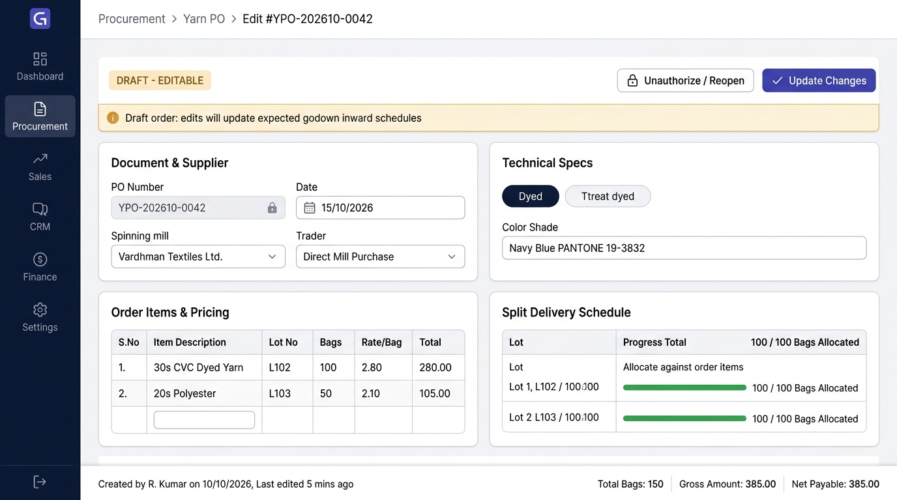
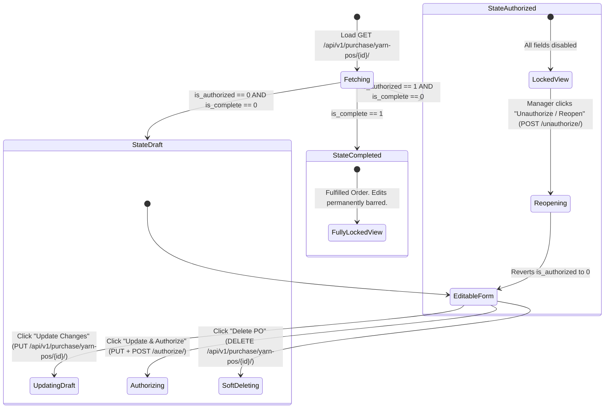

# UI & Frontend Workflow Specification: Yarn Purchase Order (PO) Edit Screen

## 1. Document Overview, Version, Scope, and Status

- **Document Title**: Yarn Purchase Order (PO) Edit Screen UI & Frontend Developer Specification
- **Screen ID**: `SCR-PROC-001-EDIT`
- **Document Version**: `v1.0.0`
- **Last Updated**: `15/10/2026`
- **Target Audience**: Frontend Engineers, Full-Stack Developers, QA Engineers, and Technical Product Owners
- **Implementation Status**: `Ready for Review / Implementation`
- **Scope**: Covers data hydration, state-dependent UI locking (Draft vs Authorized vs Completed), field-by-field modification rules, partial inward safeguards, re-opening/unauthorization workflows, real-time recalculations, Zod schemas, API integration (`GET`, `PUT/PATCH`, `POST /authorize/`, `POST /unauthorize/`), keyboard shortcuts, and developer acceptance checklists for the Yarn PO Edit screen.

---

## 2. Module Details, Screen ID, Route, Access Privileges, and API Endpoints

### 2.1 Core Metadata

| Parameter | Specification |
|---|---|
| **Module** | `Module 3 — Procurement (Yarn PO)` |
| **Screen ID** | `SCR-PROC-001-EDIT` |
| **Frontend Route** | `/procurement/yarn-po/[id]/edit` |
| **File Location** | `app/(app)/procurement/yarn-po/[id]/edit/page.tsx` |
| **Required Privilege** | `purchase_yarn_po.can_update` (for editing Drafts); `purchase_yarn_po.can_approve` (for Unauthorizing/Re-opening locked orders) |
| **Authorized Roles** | `SUPER_ADMIN`, `ADMIN_USER`, `COMPANY_USER` (procurement officers and merchandisers) |
| **Country Pack** | `IN` (India: Currency INR `₹`, Date `DD/MM/YYYY`, standard bag `45.360 Kg`) |

### 2.2 Primary API Endpoints

| HTTP Method | API Path | Privilege / Scope | Description |
|---|---|---|---|
| `GET` | `/api/v1/purchase/yarn-pos/{id}/` | `can_read` | Fetch existing PO header, line items, delivery lots, and authorization status |
| `PUT / PATCH` | `/api/v1/purchase/yarn-pos/{id}/` | `can_update` | Submit updated draft PO header, modified line items, and updated delivery schedules |
| `POST` | `/api/v1/purchase/yarn-pos/{id}/authorize/` | `can_approve` | Authorize and lock the edited purchase order |
| `POST` | `/api/v1/purchase/yarn-pos/{id}/unauthorize/` | `can_approve` | Unlock an authorized PO back to Draft status for revision |
| `GET` | `/api/v1/purchase/balances/?tm_po={id}` | `can_read` | Check live received inward bags and weight before permitting quantity reductions |
| `DELETE` | `/api/v1/purchase/yarn-pos/{id}/` | `can_delete` | Soft delete draft PO (only allowed when `is_authorized == 0`) |

---

## 3. UI Layout, Screen Blueprint, and Visual Mockup

### 3.1 Visual Mockup Reference



### 3.2 Desktop Wireframe Layout (1440px+ Viewport)

```
+------------------------------------------------------------------------------------------------------------------+
| TOP BREADCRUMB & HEADER: Procurement > Yarn PO > Edit #YPO-202610-0042                                          |
| Edit Yarn Purchase Order             [● DRAFT - EDITABLE]      [🔓 Unauthorize / Reopen]   [✔ Update Changes (Alt+S)] |
+------------------------------------------------------------------------------------------------------------------+
| [i] INFO BANNER: Draft order: edits will update expected godown inward schedules. (or Locked Warning if Auth)   |
+------------------------------------------------------------------------------------------------------------------+
| +-------------------------------------------------------+  +---------------------------------------------------+ |
| | CARD 1: DOCUMENT & SUPPLIER                           |  | CARD 2: TECHNICAL SPECS                           | |
| | PO Number:     [ YPO-202610-0042 ] [PERMANENTLY LOCKED]|  | Yarn Process Type:                                | |
| | PO Date:       [ 15/10/2026            ] [CALENDAR]  |  | ( ) Grey    (o) Dyed    ( ) Melange    ( ) Blended| |
| | Spinning Mill: [ Vardhman Textiles Ltd.            v] |  | Color Shade:  [ Navy Blue - PANTONE 19-3832    v] | |
| | Trader/Agent:  [ Direct Mill Purchase (Optional)   v] |  | Blend Ratio:  [ 60% Cotton / 40% Polyester      ] | |
| | Active FY:     [ FY 2025-2026 (Locked Scope)       ]  |  | Dynamic Specs: [Ply / TPI / Slub / Lycra Denier ] | |
| +-------------------------------------------------------+  +---------------------------------------------------+ |
|                                                                                                                  |
| +--------------------------------------------------------------------------------------------------------------+ |
| | CARD 3: ORDER ITEMS & COMMERCIAL PRICING (EDITABLE MATRIX)                                                    | |
| | [ + Add Item Row (Alt+N) ]                                                                                    | |
| | +-----+--------------------+-------+---------+---------------+-------------+----------+----------+----------+ | |
| | | #   | Yarn Count         | Bags  | Kg/Bag  | Net Qty (Kg)  | Rate/Kg (₹) | Disc (₹) | Net Rate | Line Amt | | |
| | +-----+--------------------+-------+---------+---------------+-------------+----------+----------+----------+ | |
| | | 1   | [ 30s CVC Dyed   v]| [100] | [45.360]| 4,536.000     | [350.00   ] | [0.00  ] | ₹350.00  |₹15,87,600|X| |
| | | 2   | [ 20s Polyester  v]| [ 50] | [45.360]| 2,268.000     | [210.00   ] | [5.00  ] | ₹205.00  | ₹4,64,940|X| |
| | +-----+--------------------+-------+---------+---------------+-------------+----------+----------+----------+ | |
| +--------------------------------------------------------------------------------------------------------------+ |
|                                                                                                                  |
| +--------------------------------------------------------------------------------------------------------------+ |
| | CARD 4: SPLIT DELIVERY SCHEDULE (MULTI-LOT RE-ALLOCATION)                                                    | |
| | [✔] Enable Split Delivery Schedule                                                                           | |
| | Allocation Progress: [████████████████████████████████████████] 150 / 150 Bags (100% Fully Allocated)        | |
| | +-----------------------+---------------------------------------+-----------+------------+-----------------+ | |
| | | Expected Date         | Destination Party / Warehouse         | Bags      | Bag Wt(Kg) | Scheduled (Kg)  | | |
| | +-----------------------+---------------------------------------+-----------+------------+-----------------+ | |
| | | [ 25/10/2026       ]  | [ Angeripalayam Knitter Godown     v] | [100    ] | 45.360     | 4,536.000 Kg    | | |
| | | [ 05/11/2026       ]  | [ Main Factory Raw Godown          v] | [ 50    ] | 45.360     | 2,268.000 Kg    | | |
| | +-----------------------+---------------------------------------+-----------+------------+-----------------+ | |
| | [ + Add Delivery Lot ]                                                                                       | |
| +--------------------------------------------------------------------------------------------------------------+ |
|                                                                                                                  |
| +--------------------------------------------------------------------------------------------------------------+ |
| | STICKY FOOTER SUMMARY & AUDIT BAR                                                                            | |
| | Revision Notes: [ Adjusted quantity for 20s Polyester per buyer revision request                           ] | |
| | Created by R. Kumar on 10/10/2026 • Last edited 5 mins ago by Admin                                          | |
| | TOTAL BAGS: 150 Bags  |  TOTAL QTY: 6,804.000 Kg  |  AVG NET RATE: ₹301.67/Kg  |  TOTAL VALUE: ₹20,52,540.00 | |
+------------------------------------------------------------------------------------------------------------------+
```

---

## 4. Page Initialization, Hydration, and State Transitions

When entering `/procurement/yarn-po/[id]/edit`, the page fetches the existing record and determines the edit state.

### 4.1 State Machine & Screen Mode Matrix



### 4.2 State Comparison Table

| Feature / Control | State A: DRAFT (`is_authorized: 0`) | State B: AUTHORIZED (`is_authorized: 1`) | State C: FULFILLED (`is_complete: 1`) |
|---|---|---|---|
| **Top Status Badge** | Amber: `● DRAFT - EDITABLE` | Blue: `🔒 AUTHORIZED (LOCKED)` | Green: `✔ FULFILLED / CLOSED` |
| **Top Banner** | Info: *"Draft order: edits will update expected inward schedules"* | Alert: *"Order is Authorized. Re-open to make edits."* | Notice: *"Order fulfilled. Direct edits are disabled."* |
| **Form Inputs State** | **Fully Editable** (except PO #) | **All Inputs Read-Only / Disabled** | **All Inputs Read-Only / Disabled** |
| **Line Items Grid** | Add, edit, delete rows enabled | Table locked; delete disabled | Table locked; shows received counts |
| **Primary Action** | `Update Changes` (`PUT`) | `Unauthorize / Reopen` (`POST /unauthorize/`) | `Print PO` / `Export PDF` only |
| **Secondary Action**| `Update & Authorize` | `Back to PO List` | `Back to PO List` |

---

## 5. Document Header and Immutability Controls

### 5.1 PO Number (`po_number`) — Strictly Immutable
- **Field Label**: `PO Number`
- **Backend Field Key**: `po_number`
- **Field Type**: Read-only text input with closed lock icon.
- **Value**: Populated from loaded record (e.g. `YPO-202610-0042`).
- **Required / Optional**: System-assigned.
- **Validation Rules**: **Strictly Immutable**. Excluded from `PUT`/`PATCH` payload to prevent altering audit keys.
- **UI Behavior**: Rendered in dark disabled state (`bg-slate-100 text-slate-700 font-mono font-semibold cursor-not-allowed`).

### 5.2 PO Date (`po_date`)
- **Field Label**: `PO Date`
- **Backend Field Key**: `po_date`
- **Field Type**: Calendar date picker input (`DD/MM/YYYY`).
- **Hydrated Value**: Parsed from API ISO date `YYYY-MM-DD`.
- **Validation Rules**: Editable only in Draft mode. Must remain within the active financial year date range (`01/04/2025 – 31/03/2026`).

### 5.3 Active Financial Year (`cfyear`)
- **Field Label**: `Fiscal Year`
- **Backend Field Key**: `cfyear_id`
- **Field Type**: Read-only status pill.
- **Validation Rules**: Locked to the original fiscal year of document creation. Cross-FY transfer is prohibited.

### 5.4 Order Reference / Job Card Name (`name`)
- **Field Label**: `Order Reference / Job Name`
- **Backend Field Key**: `name`
- **Field Type**: Text input (`maxlength="50"`).
- **Hydrated Value**: Existing reference string or empty.
- **Validation Rules**: Max 50 characters.

---

## 6. Spinning Mill, Supplier, Trader, and Direct Purchase Editing

### 6.1 Spinning Mill (`mill`)
- **Field Label**: `Spinning Mill`
- **Backend Field Key**: `mill_id`
- **Field Type**: Searchable Async Combobox.
- **Hydration**: Pre-selected with `po.mill.id` and display label `[Mill Name] — [City]`.
- **Modification Rule**:
  - In Draft mode: Editable.
  - If changed and `is_direct_mill_purchase` is checked, automatically updates `party_id`.
  - If Inward GRN has already been recorded against this PO: Changing the Spinning Mill is **blocked** by backend.

### 6.2 Direct Mill Purchase Toggle (`is_direct_mill_purchase`)
- **Field Label**: `Direct Mill Purchase`
- **Field Type**: Toggle Switch / Checkbox.
- **Hydration**: Evaluated on load: `po.mill_id === po.party_id`.
- **Behavior**: Toggling sets `party_id = mill_id` and disables manual trader selection.

### 6.3 Supplier / Trader / Agent (`party`)
- **Field Label**: `Billing Supplier / Trader`
- **Backend Field Key**: `party_id`
- **Field Type**: Searchable Async Combobox.
- **Hydration**: Pre-selected with `po.party.id`.
- **Validation**: Mandatory vendor ID.

---

## 7. Yarn Type and Conditional Technical Specifications Modification

### 7.1 Yarn Type Switching Safeguard
- **Field Key**: `yarn_type`
- **Hydrated Value**: Pre-selected chip (e.g. `DYED`).
- **Dynamic Transition Warning**:
  If the user switches from `DYED` to `GREY`, the UI triggers a confirmation prompt:
  *"Switching to Grey Yarn will clear selected Color Shades and Lab Dips. Proceed?"*
- **Field State Updates**:
  - `DYED` / `MELANGE`: Preserves or prompts for `color_shade_id`.
  - `MELANGE` / `BLENDED`: Preserves or prompts for `blend_ratio`.
  - `WOUND`: Preserves or prompts for `ply_count` ($\ge 2$) and `twists_per_inch`.

---

## 8. Yarn PO Line Items and Commercial Pricing Matrix (Pre-filled & Received Locks)

### 8.1 Grid Columns with Partial Inward Protection

| Col # | Column Label | Backend Key | Hydration & Editing Rule | Inward Safeguard Rule |
|---|---|---|---|---|
| **1** | `#` | `line_number` | Sequential index (`1, 2...`). | Read-only. |
| **2** | `Yarn Count` | `yarn_count_id` | Populated from `line_items[i].yarn_count_id`. | If inward GRN posted for this count, count selector is **disabled**. |
| **3** | `Bags` | `bag` | Populated from `line_items[i].bag`. | **Quantity Floor Rule**: Cannot be reduced below `received_bags` (`inward_bag`). |
| **4** | `Kg/Bag` | `per_bag` | Populated from `line_items[i].per_bag`. | Editable in Draft mode. |
| **5** | `Net Qty (Kg)` | `quantity` | Auto-computed: `bag * per_bag`. | Displays received indicator: `Recv: 40 / 100 Bags`. |
| **6** | `Rate/Kg (₹)` | `actual_rate` | Populated from `line_items[i].actual_rate`. | Editable in Draft mode. |
| **7** | `Disc (₹)` | `discount` | Populated from `line_items[i].discount`. | Editable in Draft mode ($\le \text{actual\_rate}$). |
| **8** | `Net Rate` | `rate` | Auto-computed: `actual_rate - discount`. | Read-only. |
| **9** | `Line Amount` | `amount` | Auto-computed: `quantity * rate`. | Read-only. |
| **10**| `Actions` | — | Delete icon button (`TrashIcon`). | **Blocked**: Cannot delete a row if inward GRN items exist for it. |

---

## 9. Quantity, Weight, Rate, Discount, and Amount Recalculations

Identical to Add Screen formulas, recalculated live upon any edit:
- $\text{Line Net Qty} = \text{bag} \times \text{per\_bag}$
- $\text{Line Net Rate} = \max(0, \text{actual\_rate} - \text{discount})$
- $\text{Line Amount} = \text{quantity} \times \text{rate}$
- $\text{Header Total Bags} = \sum \text{line\_items.bag}$
- $\text{Header Total Qty} = \sum \text{line\_items.quantity}$
- $\text{Header Total Value} = \sum \text{line\_items.amount}$

---

## 10. Split Delivery Schedule Modification and Allocation Validation

### 10.1 Multi-Lot Re-Allocation Rules
- Hydrates existing rows from `po.deliveries`.
- Real-time progress bar recalculates:
  $$\text{Allocated Bags} = \sum \text{deliveries.bag} \quad / \quad \text{Updated Total PO Bags}$$
- If user reduces total PO bags in Card 3 such that $\sum \text{Scheduled Bags} > \text{New Total Bags}$, progress bar turns crimson red and displays:
  *"Over-Allocated! Delivery schedule (150 Bags) exceeds updated PO bags (120 Bags). Adjust delivery lots before saving."*
- Submission is disabled until delivery lots are balanced.

---

## 11. Summary Bar, Remarks, and Revision Audit History

### 11.1 Revision Notes Field
- **Label**: `Revision Notes / Edit Reason`
- **Backend Key**: Included in audit logging / appended to `remarks`.
- **Field Type**: Text Input.
- **Placeholder**: `e.g. Revised bags count from 100 to 120 per production plan.`

### 11.2 Audit Metadata Pill
Displays author and update timestamps:
- `Created by [User] on [DD/MM/YYYY HH:MM]`
- `Last edited by [User] [X minutes ago]`

---

## 12. Form Validation Rules, State Guards, and Error Messages

| Validation Target | Trigger | Condition | Error Message |
|---|---|---|---|
| `po.is_authorized` | Submit (`PUT`) | Attempting edit while `is_authorized == 1` | *"Purchase Order is Authorized and locked. It must be un-authorized before editing."* |
| `line_items[i].bag`| Change / Submit | Updated bags < already received GRN bags | *"Cannot reduce bags to [X]. Godown has already received [Y] bags."* |
| `deliveries` | Change / Submit | Total scheduled bags > updated PO bags | *"Total scheduled delivery bags ([X]) exceeds updated PO bags ([Y])."* |
| `color_shade_id` | Submit | `yarn_type == 'DYED'` and shade is null | *"Color shade is required for Dyed Yarn Purchase Orders."* |
| `blend_ratio` | Submit | `yarn_type == 'MELANGE'` and blend is null | *"Fiber blend ratio is required for Melange Yarn."* |

---

## 13. Update Draft, Update & Authorize, Re-open / Unauthorize, and Cancel/Void Workflows

### 13.1 Action Controls Breakdown

1. **"Update Changes" (Draft Update)**:
   - Method: `PUT /api/v1/purchase/yarn-pos/{id}/`
   - Payload: Updated header fields, full replacement arrays for `line_items` and `deliveries`.
   - Result: Toast *"Purchase Order #{po_number} successfully updated"*.
2. **"Update & Authorize"**:
   - Method: `PUT /api/v1/purchase/yarn-pos/{id}/` followed by `POST /api/v1/purchase/yarn-pos/{id}/authorize/`.
   - Result: Locks the order and navigates to Detail View.
3. **"Unauthorize / Reopen" Action Button**:
   - Condition: Visible when `is_authorized == 1` and user holds `purchase_yarn_po.can_approve`.
   - Trigger: Displays confirmation dialog: *"Are you sure you want to re-open PO #{po_number} for revisions? Authorized inward schedules will be unlocked."*
   - Method: `POST /api/v1/purchase/yarn-pos/{id}/unauthorize/`
   - Result: Reverts `is_authorized = 0`, unlocks all inputs for editing, and sets status banner to Draft.
4. **"Cancel PO / Void" Action**:
   - Condition: Only permitted if `is_authorized == 0` and 0 inward receipts posted.
   - Method: `DELETE /api/v1/purchase/yarn-pos/{id}/` (Soft deletes record: `status = 0`, `is_active = 0`).

---

## 14. API Integration, Request Headers, Payload Serialization (PUT/PATCH), and Error Handling

### 14.1 Update Request Payload (`PUT /api/v1/purchase/yarn-pos/{id}/`)

```json
{
  "po_date": "2026-10-15",
  "yarn_type": "DYED",
  "mill": 3,
  "party": 3,
  "yarn_count": 5,
  "color_shade": 12,
  "blend_ratio": null,
  "ply_count": 1,
  "twists_per_inch": null,
  "slub_pattern": null,
  "core_denier": null,
  "bag": 150,
  "per_bag": "45.360",
  "rate": "350.00",
  "discount": "0.00",
  "remarks": "Adjusted quantity for 20s Polyester per buyer revision request",
  "is_delivery": 1,
  "line_items": [
    {
      "yarn_type": "DYED",
      "yarn_count_id": 5,
      "color_shade_id": 12,
      "bag": 100,
      "per_bag": "45.360",
      "actual_rate": "350.00",
      "discount": "0.00"
    },
    {
      "yarn_type": "GREY",
      "yarn_count_id": 8,
      "color_shade_id": null,
      "bag": 50,
      "per_bag": "45.360",
      "actual_rate": "210.00",
      "discount": "5.00"
    }
  ],
  "deliveries": [
    {
      "party": 7,
      "yarn_count": 5,
      "delivery_date": "2026-10-25",
      "bag": 100,
      "bag_wt": "45.360"
    },
    {
      "party": 2,
      "yarn_count": 8,
      "delivery_date": "2026-11-05",
      "bag": 50,
      "bag_wt": "45.360"
    }
  ]
}
```

---

## 15. Next.js Folder Structure and Component Responsibilities

```
frontend/app/(app)/procurement/yarn-po/[id]/edit/
├── page.tsx                           # Data fetcher & state orchestrator (SSR / Client query)
├── components/
│   ├── YarnPOEditHeaderCard.tsx       # Locked PO #, Date picker, Mill & Trader
│   ├── YarnPOStatusBanner.tsx         # Contextual banner (Draft, Locked, Unauthorize button)
│   ├── YarnPOTechnicalSpecsCard.tsx   # Yarn type chips & dynamic attributes
│   ├── YarnPOEditLineItemsTable.tsx   # Grid with received bag locks and auto-math
│   ├── YarnPODeliveryScheduleCard.tsx # Multi-lot allocation & visual progress bar
│   └── YarnPOEditFooter.tsx           # Audit timestamp, live totals, Update/Submit buttons
├── hooks/
│   ├── useYarnPODetail.ts             # Fetches existing PO and inward balance metrics
│   └── useYarnPOEditForm.ts           # Form state hydration, dirty detection & Zod validation
└── types/
    └── yarn-po-edit.types.ts          # PO Detail DTO & Edit Form payload types
```

---

## 16. React Hooks, TypeScript Types, Zod Schemas, and Form State Management

### 16.1 Hydration Hook (`useYarnPOEditForm.ts`)

```typescript
export function useYarnPOEditForm(poData: ParentPODetailDTO) {
  const form = useForm<YarnPOFormValues>({
    resolver: zodResolver(yarnPOFormSchema),
    defaultValues: {
      po_number: poData.po_number,
      po_date: poData.po_date,
      yarn_type: poData.yarn_type,
      mill_id: poData.mill.id,
      party_id: poData.party.id,
      is_direct_mill_purchase: poData.mill.id === poData.party.id,
      color_shade_id: poData.color_shade?.id || null,
      blend_ratio: poData.blend_ratio || "",
      ply_count: poData.ply_count || 1,
      twists_per_inch: poData.twists_per_inch ? Number(poData.twists_per_inch) : null,
      slub_pattern: poData.slub_pattern || "",
      core_denier: poData.core_denier || "",
      remarks: poData.remarks || "",
      is_delivery: Boolean(poData.is_delivery),
      line_items: poData.line_items.map((item) => ({
        id: item.id,
        yarn_count_id: item.yarn_count,
        bag: item.bag,
        per_bag: Number(item.per_bag),
        quantity: Number(item.quantity),
        actual_rate: Number(item.actual_rate),
        discount: Number(item.discount),
        rate: Number(item.rate),
        amount: Number(item.amount),
        remaining_bag: item.remaining_bag,
      })),
      deliveries: (poData.deliveries || []).map((d) => ({
        id: d.id,
        delivery_date: d.delivery_date,
        party_id: d.party,
        yarn_count_id: d.yarn_count,
        bag: d.bag,
        bag_wt: Number(d.bag_wt),
        quantity: Number(d.quantity),
      })),
    },
  });

  return form;
}
```

---

## 17. Keyboard Shortcuts and User Interaction Behavior

| Shortcut Key | Action & Ergonomic Behavior |
|---|---|
| `Alt + S` | Triggers **Update Changes** (`PUT /api/v1/purchase/yarn-pos/{id}/`). |
| `Alt + Enter` | Triggers **Update & Authorize** (`PUT` + `POST /authorize/`). |
| `Alt + U` | Triggers **Unauthorize / Reopen** confirmation dialog (when in Authorized mode). |
| `Alt + N` | Appends a new item row to the grid (if editable). |
| `Alt + D` | Appends a new delivery lot (if editable). |
| `Esc` | Prompts discard changes dialog and returns to PO List. |

---

## 18. Loading States, Success Messages, Failure Handling, and Navigation

1. **Initial Hydration Shimmer**:
   - Renders card skeletons with pulses while `GET /purchase/yarn-pos/{id}/` is loading.
2. **In-Flight Update State**:
   - Buttons display inline spinner (`Updating Order...`).
   - Fields locked against simultaneous edits.
3. **Optimistic Feedback & Toast**:
   - Success toast: *"Purchase Order #YPO-202610-0042 successfully updated"*.
   - Reopen toast: *"Purchase Order #YPO-202610-0042 re-opened for edits"*.
4. **Lockout Alert Banner**:
   - If an unauthorized user attempts to edit a locked PO, a sticky top alert prevents form submission and clearly links to contact the approving manager.

---

## 19. Security, Access Control, and Backend Validation Requirements

1. **Server-Side Authorization Check**:
   - `update_yarn_po()` enforces `if po.is_authorized == 1: raise ValidationError`. Frontend locking is reinforced by strict database validation.
2. **Tenant Scoping & Ownership**:
   - `po.company_id == request.user.company_id` is enforced. Cross-tenant editing raises `ResourceNotFound` (HTTP 404).
3. **Atomic Replacement of Child Rows**:
   - All line items and delivery schedule replacements commit inside `transaction.atomic()`. If an invalid count or bag count is passed, the entire update rolls back.

---

## 20. Implementation Sequence and Developer Acceptance Checklist

- [ ] **1. Route Setup**: Dynamic route created at `/procurement/yarn-po/[id]/edit/page.tsx`.
- [ ] **2. Data Hydration**: Successfully fetches and maps existing PO header, line items, and delivery lots into form state.
- [ ] **3. PO Number Immutability**: `po_number` renders in disabled read-only state.
- [ ] **4. State-Dependent Locking**: Draft POs are editable; Authorized POs lock all fields and display the Authorization Alert Banner.
- [ ] **5. Reopen Action**: Authorized users with `can_approve` can click "Unauthorize / Reopen" to revert PO to Draft status.
- [ ] **6. Partial Inward Guard**: Blocks reducing bag quantities below already received godown GRN counts.
- [ ] **7. Dynamic Specs Sync**: Changing Yarn Type preserves relevant fields and prompts when switching from Dyed/Melange to Grey.
- [ ] **8. Recalculation Engine**: Modifying quantities or rates updates line totals and header aggregates in real-time.
- [ ] **9. Delivery Re-allocation**: Progress bar accurately updates based on modified total bags. Over-allocation blocks submission.
- [ ] **10. API Submission**: `PUT /api/v1/purchase/yarn-pos/{id}/` executes cleanly and replaces child tables atomically.
- [ ] **11. Discard Changes Guard**: Navigating away with unsaved modifications triggers confirmation modal.

---

## 21. Existing Inconsistencies, Edge Cases, and Items Requiring Confirmation

| Issue ID | Section | Requirement / Behavior | Inconsistency / Edge Case | Why It Matters | Recommended Resolution | Confirmation Required |
|---|---|---|---|---|---|---|
| **`ISS-E01`** | §8 Partial Inward Floor | Inward receipts reduce `remaining_quantity` in `child_po_table`. | If line item 1 had 100 bags and 40 bags arrived via GRN, does the edit screen allow reducing total bags to 30? | Reducing below received quantity causes negative remaining stock balance in `yarn_po_balance_table`. | Enforce `min(item.bag) = item.bag - item.remaining_bag` (cannot be less than received). | **Developer Confirmation** |
| **`ISS-E02`** | §13 Unauthorize Permission | Reopening locked orders calls `POST /unauthorize/`. | Who holds privilege to reopen? `can_update` or strictly `can_approve`? | Operators should not be able to unlock approved orders without managerial oversight. | Restrict "Unauthorize / Reopen" to users holding `purchase_yarn_po.can_approve`. | **Business Confirmation** |
| **`ISS-E03`** | §8 Child Line Item IDs | `update_yarn_po` deletes and recreates all `child_po_table` rows (`delete()` + `bulk_create()`). | Deleting existing child rows assigns new auto-increment IDs to line items, which can break foreign key references if inward GRNs reference specific `child_po_id`. | If GRN tables link to `child_po_id`, deleting child rows causes integrity failure. | Verify whether GRN links to `parent_po_id + yarn_count_id` or specific `child_po_id`. In `child_yarn_inward_table`, link is via `tm_po_id` and count. | **Developer Confirmation** |
| **`ISS-E04`** | §10 Delivery Schedule Update | Modifying line items bags without touching delivery lots. | If total bags are reduced from 150 to 100, existing delivery lots sum to 150. | Over-allocation occurs silently if delivery card is collapsed. | Automatically expand delivery schedule card and display blocking error if allocation > 100%. | **Developer Confirmation** |
| **`ISS-E05`** | §11 Revision History Audit | Updating PO updates `updated_by` and `updated_on`. | Does the business require tracking line-item level revision history (e.g. `ta_po_audit` with old rate vs new rate)? | Price audits are critical for spinning mill price fluctuations. | Recommend logging rate and quantity changes to `ta_pricing_audit` or revision log table. | **Business Confirmation** |
