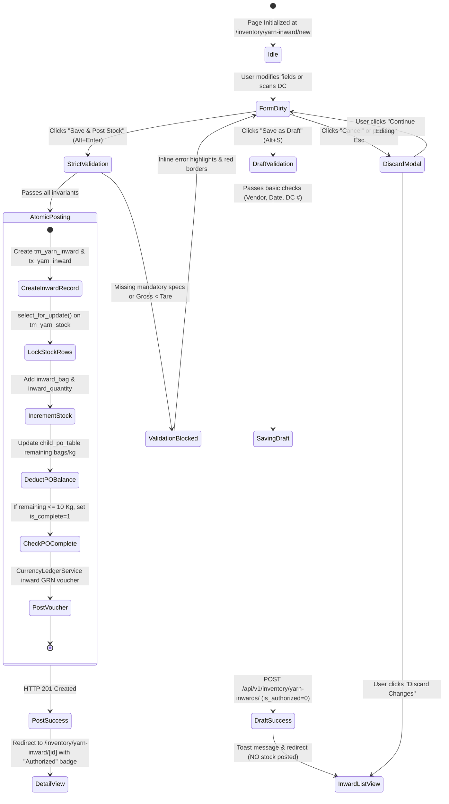

# UI & Frontend Workflow Specification: Yarn Inward (GRN) Add Page

## 1. Document Overview, Version, Scope, and Status

- **Document Title**: Yarn Inward Goods Receipt Note (GRN) Add Page UI & Frontend Developer Specification
- **Screen ID**: `SCR-INVN-001-ADD`
- **Document Version**: `v1.0.0`
- **Last Updated**: `15/10/2026`
- **Target Audience**: Frontend Engineers, Full-Stack Developers, QA Automation Engineers, and ERP Technical Architects
- **Implementation Status**: `Ready for Review / Implementation`
- **Scope**: Defines the complete technical workflow, UI blueprint, field definitions, dynamic technical validations, weighbridge gross/tare deduction math, automated GST tax distribution (CGST/SGST/IGST), pending PO remaining balance tracking, atomic stock ledger updates (`tm_yarn_stock`), Zod validation schemas, TypeScript interfaces, keyboard shortcuts, and developer acceptance criteria for creating new Yarn Inward GRN entries in the Garments ERP & CRM system.

---

## 2. Module Details, Screen ID, Route, Access Privileges, and API Endpoints

### 2.1 Core Metadata

| Parameter | Specification |
|---|---|
| **Module** | `Module 4 — Inventory & Godown Stock Ledger` |
| **Screen ID** | `SCR-INVN-001-ADD` |
| **Frontend Route** | `/inventory/yarn-inward/new` |
| **File Location** | `app/(app)/inventory/yarn-inward/new/page.tsx` |
| **Required Privilege** | `inventory_yarn_inward.can_create` |
| **Authorized Roles** | `SUPER_ADMIN`, `ADMIN_USER`, `COMPANY_USER` (Godown / Inventory Manager, Gatekeeper, Accounts Payable) |
| **Country Pack** | `IN` (India: Currency INR `₹`, Date `DD/MM/YYYY`, Bags standard `45.360 Kg`, GST CGST/SGST/IGST) |

### 2.2 Primary API Endpoints

| HTTP Method | API Path | Privilege / Scope | Description |
|---|---|---|---|
| `POST` | `/api/v1/inventory/yarn-inwards/` | `can_create` | Create a new Yarn Inward GRN header with nested line items and post live stock atomically |
| `GET` | `/api/v1/purchase/yarn-pos/?is_authorized=1&is_complete=0` | `can_read` | Fetch authorized, unfulfilled Yarn Purchase Orders to pre-fill inward details |
| `GET` | `/api/v1/purchase/yarn-pos/{id}/` | `can_read` | Fetch single PO details including pending line items, bag count, and remaining balance |
| `GET` | `/api/v1/inventory/yarn-outwards/?outward_type=DYEING&is_complete=0` | `can_read` | Fetch unfulfilled Dyeing Outwards when receiving processed dyed yarn |
| `GET` | `/api/v1/masters/warehouses/?record_status=A` | `can_read` | Retrieve active destination godowns / factory warehouses (`WarehouseMaster`) |
| `GET` | `/api/v1/masters/parties/?party_type=MILL&record_status=A` | `can_read` | Search and retrieve active spinning mills (`PartyMaster`) |
| `GET` | `/api/v1/masters/parties/?party_type=TRADER,SUPPLIER,MILL&record_status=A` | `can_read` | Search and retrieve invoicing suppliers, dealers, and commercial agents |
| `GET` | `/api/v1/masters/parties/?party_type=DYER&record_status=A` | `can_read` | Retrieve active commission dyeing units (for Dyeing Return receipts) |
| `GET` | `/api/v1/masters/yarn-counts/?record_status=A` | `can_read` | Retrieve yarn count catalogue (e.g. 30s Combed, 34s Carded, 40s Compact) |
| `GET` | `/api/v1/masters/color-shades/?is_active=1` | `can_read` | Retrieve color shades / lab dip references for Dyed and Melange yarn |
| `GET` | `/api/v1/masters/taxes/?is_deleted=false` | `can_read` | Fetch active GST slabs (5%, 12%, 18%) for input tax credit computation |

---

## 3. UI Layout, Screen Blueprint, and Visual Mockup

### 3.1 Visual Mockup Reference


> [!NOTE]
> The Yarn Inward GRN screen provides a high-density, dual-mode layout: receiving goods against an existing authorized **Purchase Order (`PURCHASE_PO`)**, receiving processed yarn against a **Dyeing Outward (`DYEING_RETURN`)**, or recording an emergency **Direct Inward**.

### 3.2 Desktop Wireframe Layout (1440px+ Viewport)

```
+--------------------------------------------------------------------------------------------------------------------------+
| TOP BREADCRUMB & HEADER: Inventory > Yarn Inward > Create GRN                                                             |
| New Yarn Inward (GRN)                 [● Draft Badge]                  [ Save as Draft (Alt+S) ]   [ Save & Post (Alt+Enter) ]|
+--------------------------------------------------------------------------------------------------------------------------+
| +-------------------------------------------------------+  +-----------------------------------------------------------+ |
| | CARD 1: DOCUMENT & GATE ENTRY CONTEXT                 |  | CARD 2: VENDOR, SOURCE & GODOWN ALLOCATION                | |
| | Inward No:     [ YIN-202610-0084 (Auto) ] [LOCKED]    |  | Inward Source:  (o) From PO   ( ) Dyeing Return   ( ) Direct| |
| | Inward Date:   [ 15/10/2026            ] [CALENDAR]  |  | Linked PO:      [ YPO-202610-0042 (Vardhman) - 100 Bags  v] | |
| | Supplier DC #: [ DC-94821              ]             |  | Spinning Mill:  [ Vardhman Textiles Ltd.                v] | |
| | DC Date:       [ 14/10/2026            ] [CALENDAR]  |  | Billing Party:  [ Vardhman Textiles Ltd. (Direct Mill)  v] | |
| | Vehicle No:    [ TN-38-BZ-4921         ] [TRUCK ICON]|  | Dest. Godown:   [ Main Factory Godown - Bay A           v] | |
| | Fiscal Year:   [ FY 2025-2026 (Auto)   ] [BADGE]     |  | Mill Lot No:    [ VTM-7842                              ] | |
| +-------------------------------------------------------+  +-----------------------------------------------------------+ |
|                                                                                                                          |
| +----------------------------------------------------------------------------------------------------------------------+ |
| | CARD 3: YARN PROCESS & TECHNICAL SPECIFICATIONS                                                                      | |
| | Yarn Process Type:  (o) Grey      ( ) Dyed      ( ) Melange      ( ) Blended      ( ) Wound / Doubled      ( ) Slub  | |
| | Color Shade:  [ N/A - Grey Yarn                    v]  |  Fiber Blend Ratio: [ 100% Combed Cotton                  ] | |
| | Dynamic Specs: Ply: [ 1 ]  |  TPI: [ N/A ]  |  Slub Profile: [ N/A ]  |  Core Denier: [ N/A ]                        | |
| +----------------------------------------------------------------------------------------------------------------------+ |
|                                                                                                                          |
| +----------------------------------------------------------------------------------------------------------------------+ |
| | CARD 4: PHYSICAL WEIGHBRIDGE & LINE ITEMS MATRIX (INTERACTIVE SPREADSHEET GRID)                                       | |
| | [ + Add Item Row (Alt+N) ]   [ Quick Scale Connect ]   [ Auto-Fill Remaining PO Balance ]                            | |
| | +-----+--------------------+----------+-------+---------+------------+-----------+------------+----------+-----------+ | |
| | | #   | Yarn Count         | Lot No   | Bags  | Kg/Bag  | Gross (Kg) | Tare (Kg) | Net Wt(Kg) | Rate (₹) | Amount (₹)| | |
| | +-----+--------------------+----------+-------+---------+------------+-----------+------------+----------+-----------+ | |
| | | 1   | [ 30s Combed Cot v]| VTM-7842 | [100] | [45.360]| 4,590.000  | 54.000    | 4,536.000  | [350.00] | 15,87,600 |X| |
| | +-----+--------------------+----------+-------+---------+------------+-----------+------------+----------+-----------+ | |
| | PO Match Indicator: Linked Line 1: 100 Bags / 4,536.000 Kg received. (100% of PO Fulfilled — PO will mark Complete) | |
| +----------------------------------------------------------------------------------------------------------------------+ |
|                                                                                                                          |
| +-------------------------------------------------------+  +-----------------------------------------------------------+ |
| | CARD 5: TRANSPORTER & GATE PASS DETAILS               |  | CARD 6: TAX ENGINE & COMMERCIAL INVOICE SUMMARY           | |
| | Transporter:   [ Associated Road Carriers Ltd.     ]  |  | Subtotal (Taxable):                   ₹15,87,600.00       | |
| | LR / Bilty No: [ ARC-CBE-882109                    ]  |  | GST Applicable: [ 5% Yarn Standard (Intra-state)        v]| |
| | LR Date:       [ 14/10/2026            ] [CALENDAR]  |  | CGST (2.5%):                            ₹39,690.00        | |
| | Driver Phone:  [ +91 98421 55321                   ]  |  | SGST (2.5%):                            ₹39,690.00        | |
| | Gate Entry No: [ GE-2026-10-094                    ]  |  | IGST (0.0%):                                 ₹0.00        | |
| | Remarks:       [ Bags verified at weighbridge. OK  ]  |  | Round Off:                                  ₹0.00        | |
| |                                                       |  | GRAND TOTAL VALUE:                   ₹16,66,980.00        | |
| +-------------------------------------------------------+  +-----------------------------------------------------------+ |
|                                                                                                                          |
| +----------------------------------------------------------------------------------------------------------------------+ |
| | STICKY FOOTER SUMMARY BAR                                                                                            | |
| | TOTAL BAGS: 100 Bags  |  GROSS: 4,590.000 Kg  |  TARE: 54.000 Kg  |  NET QTY: 4,536.000 Kg  |  GRAND TOTAL: ₹16,66,980 | |
| +----------------------------------------------------------------------------------------------------------------------+ |
```

### 3.3 Responsive Breakpoint Adaptations

| Viewport | Width | Layout Structure |
|---|---|---|
| **Desktop (XL)** | `≥ 1280px` | 2-column header cards (Gate Entry + Vendor Allocation), full-width weighbridge spreadsheet grid, 2-column footer cards (Transporter + Tax Breakdown), and persistent sticky summary bar. |
| **Laptop (MD-LG)** | `1024px – 1279px` | Header cards shrink fluidly; line items table supports smooth horizontal scroll with frozen columns (`#`, `Yarn Count`, `Actions`). |
| **Tablet (SM)** | `768px – 1023px` | Header cards stack into 1 column. Table switches to responsive card-list or overflow container with touch-friendly 44px tap targets. |
| **Mobile (XS)** | `< 768px` | Single-column stacked form. Bottom summary bar becomes a collapsible drawer with a persistent "Save & Post" button. |

---

## 4. Page Initialization and Default Values

When the page loads at `/inventory/yarn-inward/new`, the frontend executes the following initialization sequence:

1. **Session & Security Scoping**:
   - Reads `company_id` and `company_name` from the authenticated user session.
   - Reads `active_financial_year` (`id`, `code`, `start_date`, `end_date`) from user context.
   - Injects global headers: `X-Company-ID: <id>`, `X-Financial-Year-ID: <id>`.
2. **URL Query Parameter Check (`?po_id=123` or `?outward_id=456`)**:
   - If `po_id` is present in the route query:
     - Automatically sets `inward_source = 'PURCHASE_PO'`.
     - Calls `GET /api/v1/purchase/yarn-pos/{po_id}/`.
     - Hydrates Mill, Party, Yarn Type, Color Shade, Blend Ratio, Count, Rate, and pre-fills the Weighbridge grid with the remaining unreceived PO balance.
   - If `outward_id` is present in the route query:
     - Automatically sets `inward_source = 'DYEING_RETURN'`.
     - Calls `GET /api/v1/inventory/yarn-outwards/{outward_id}/`.
     - Hydrates Dyer, Mill, Count, Shade, and calculates expected yarn return weight.
3. **Master Data Hydration (Parallel Queries via TanStack Query/SWR)**:
   - `GET /api/v1/purchase/yarn-pos/?is_authorized=1&is_complete=0` -> Caches open, authorized POs.
   - `GET /api/v1/masters/warehouses/?record_status=A` -> Caches godowns/warehouses.
   - `GET /api/v1/masters/parties/?party_type=MILL` -> Caches spinning mills list.
   - `GET /api/v1/masters/parties/?party_type=TRADER,SUPPLIER,MILL` -> Caches invoicing vendors.
   - `GET /api/v1/masters/yarn-counts/` -> Caches yarn counts.
   - `GET /api/v1/masters/taxes/?is_deleted=false` -> Caches GST tax rules.
4. **Form State Default Initialization**:
   - `inward_number`: Display preview string `YIN-YYYYMM-XXXX` (Read-only).
   - `inward_date`: Formatted current date `DD/MM/YYYY` in company timezone (`Asia/Kolkata`).
   - `dc_date`: Formatted current date `DD/MM/YYYY`.
   - `inward_source`: `'PURCHASE_PO'`.
   - `cfyear_id`: Active financial year ID (e.g. `FY 2025-2026`).
   - `yarn_type`: Default `'GREY'`.
   - `ply_count`: `1`.
   - `lot_no`: `'GEN'`.
   - `line_items`: Pre-populated with exactly 1 empty line item:
     - `yarn_count_id`: `null`
     - `lot_no`: `""`
     - `bag`: `0`
     - `per_bag`: `45.360`
     - `gross_wt`: `0.000`
     - `tare_wt`: `0.000`
     - `net_wt`: `0.000`
     - `rate`: `0.00`
     - `amount`: `0.00`
     - `tax_percent`: `5.00`
     - `tax_amount`: `0.00`
   - `remarks`: `""`.
5. **Ergonomic Focus**: Automatically places keyboard cursor in the **Supplier DC #** text input.

---

## 5. Document Header and Financial Year Configuration

This section details the fields located in **Card 1: Document & Gate Entry Context**.

### 5.1 Inward Number (`inward_number`)
- **Field Label**: `Inward No (GRN)`
- **Backend Field Key**: `inward_number`
- **Field Type**: Read-only text input with lock icon (`LockClosedIcon`).
- **Default Value**: Auto-generated sequential preview (e.g. `YIN-202610-0084`).
- **Required / Optional**: System-assigned (Read-only on creation).
- **Data Source / API**: Generated by backend numbering service (`YarnInwardService.generate_inward_number`) upon submission.
- **Validation Rules**: Unique per company across valid records (`status=1`).
- **Conditional Visibility**: Always visible; non-editable.
- **Automatic Calculations**: Sequence derived from current Year/Month and last incremented integer.
- **User Interaction Behavior**: Disabled styling (`bg-slate-100 text-slate-500 cursor-not-allowed`).
- **Error Messages**: *"Inward Number [number] already exists"* (HTTP 409 Conflict).
- **Related Business Rules**: Number format follows `tc_doc_series`: `YIN-YYYYMM-XXXX`.

### 5.2 Inward Date (`inward_date`)
- **Field Label**: `Inward Date`
- **Backend Field Key**: `inward_date`
- **Field Type**: Calendar date picker input (`DD/MM/YYYY`).
- **Default Value**: Current date in company timezone (`Asia/Kolkata`).
- **Required / Optional**: **Required**.
- **Data Source / API**: Client input serialized to ISO `YYYY-MM-DD` on submission.
- **Validation Rules**: Must fall strictly between `active_financial_year.start_date` and `active_financial_year.end_date` (`01/04/2025` to `31/03/2026`). Must not be future-dated.
- **Conditional Visibility**: Always visible.
- **User Interaction Behavior**: Selecting an out-of-bounds date displays an immediate non-blocking warning badge: *"Date outside active FY (2025-2026)"*.
- **Error Messages**: *"Inward Date must fall within active financial year"* or *"Inward Date cannot be future-dated"*.
- **Related Business Rules**: Invariant: No inventory transaction may be booked into a locked or closed financial year.

### 5.3 Supplier DC / Invoice Number (`dc_number`)
- **Field Label**: `Supplier DC / Invoice No`
- **Backend Field Key**: `dc_number`
- **Field Type**: Text input with barcode icon.
- **Default Value**: `""` (Empty string).
- **Required / Optional**: **Required**.
- **Data Source / API**: Physical supplier delivery challan / tax invoice paper copy.
- **Validation Rules**: 1 to 50 characters, trimmed. Must be unique for the selected supplier within the active financial year to prevent duplicate bill receipts.
- **Conditional Visibility**: Always visible.
- **User Interaction Behavior**: Free-text entry with placeholder: `e.g. DC-94821 or INV/2026/0491`. On blur, triggers check against existing inwards for duplicate DC alert.
- **Error Messages**: *"Supplier DC / Invoice Number is required"*, *"A GRN with this DC number already exists for this vendor"*.
- **Related Business Rules**: Essential for accounts payable reconciliation and purchase bill three-way matching (PO vs GRN vs Tax Invoice).

### 5.4 DC Date (`dc_date`)
- **Field Label**: `DC / Invoice Date`
- **Backend Field Key**: `dc_date`
- **Field Type**: Calendar date picker input (`DD/MM/YYYY`).
- **Default Value**: Current date in company timezone.
- **Required / Optional**: **Required**.
- **Data Source / API**: Client input serialized to ISO `YYYY-MM-DD`.
- **Validation Rules**: Must be $\le$ `inward_date` (Challan cannot be issued after arrival date).
- **Conditional Visibility**: Always visible.
- **Error Messages**: *"DC Date cannot be later than Inward Date"*.

### 5.5 Vehicle Number (`vehicle_no`)
- **Field Label**: `Vehicle / Lorry No`
- **Backend Field Key**: `vehicle_no`
- **Field Type**: Text input with auto-capitalization.
- **Default Value**: `""`.
- **Required / Optional**: Optional (Recommended for gate pass tracking).
- **Data Source / API**: User entry.
- **Validation Rules**: Max 30 characters, uppercase alphanumeric (e.g. `TN-38-BZ-4921`).
- **Conditional Visibility**: Always visible.
- **User Interaction Behavior**: Automatically converts entered text to uppercase.
- **Error Messages**: *"Vehicle number cannot exceed 30 characters"*.

### 5.6 Active Financial Year (`cfyear_id`)
- **Field Label**: `Fiscal Year`
- **Backend Field Key**: `cfyear` (or `cfyear_id`)
- **Field Type**: Read-only badge / pill.
- **Default Value**: Active working FY name (e.g. `FY 2025-2026`).
- **Required / Optional**: **Required** (Injected by server context).
- **Data Source / API**: User session / `GET /api/v1/auth/me/`.
- **Validation Rules**: Must correspond to an active, non-closed `tm_financial_year` record.
- **Conditional Visibility**: Always visible.
- **Automatic Calculations**: Resolved automatically from `X-Financial-Year-ID` header.

---

## 6. Inward Source, PO Linkage, Mill, Supplier, and Warehouse Selection

Located in **Card 2: Vendor, Source & Godown Allocation**.

### 6.1 Inward Source Selector (`inward_source`)
- **Field Label**: `Inward Source`
- **Backend Field Key**: `inward_source`
- **Field Type**: Segmented Button Group with Radio selection:
  1. `PURCHASE_PO`: "Receipt Against Yarn PO"
  2. `DYEING_RETURN`: "Dyeing Return (Job Work)"
  3. `DIRECT`: "Direct Purchase / Non-PO Receipt"
- **Default Value**: `'PURCHASE_PO'`.
- **Required / Optional**: **Required**.
- **Validation Rules**: Must be one of `['PURCHASE_PO', 'DYEING_RETURN', 'DIRECT']`.
- **User Interaction Behavior**:
  - Selecting `PURCHASE_PO` reveals the **Linked Yarn PO** combobox and hides Dyeing Outward.
  - Selecting `DYEING_RETURN` reveals the **Linked Dyeing Outward** combobox, automatically locks Yarn Type to `'DYED'`, and reveals Dyeing Charges and Process Loss cards.
  - Selecting `DIRECT` unlocks all Mill, Supplier, Count, and Rate fields for manual entry without PO linkage.

### 6.2 Linked Yarn PO (`po_id`)
- **Field Label**: `Linked Yarn Purchase Order`
- **Backend Field Key**: `po` (or `po_id`)
- **Field Type**: Searchable Async Combobox with remaining balance badge.
- **Default Value**: `null` (or pre-hydrated from query parameter `?po_id=123`).
- **Required / Optional**: **Mandatory** when `inward_source == 'PURCHASE_PO'`.
- **Data Source / API**: `GET /api/v1/purchase/yarn-pos/?is_authorized=1&is_complete=0`.
- **Dropdown Display Format**: `[PO Number] — [Mill Name] | [Count] | Pending: [Remaining Bags] Bags ([Remaining Kg] Kg)`.
- **Automatic Hydration on Selection**:
  1. Populates `mill_id` with `po.mill`.
  2. Populates `party_id` with `po.party`.
  3. Populates `yarn_type` with `po.yarn_type` (Locks field to prevent cross-type corruption).
  4. Populates technical specifications: `color_shade_id`, `blend_ratio`, `ply_count`, `twists_per_inch`, `slub_pattern`, `core_denier`.
  5. Clears current weighbridge rows and injects line items corresponding to `po.line_items` with pending bag balances pre-filled.
- **Validation Rules**: Must be an authorized PO (`is_authorized == 1`) and not marked completed (`is_complete == 0`).
- **Error Messages**: *"Please select an authorized Yarn Purchase Order"*, *"Selected PO is already marked complete"*.

### 6.3 Linked Dyeing Outward (`outward_id`)
- **Field Label**: `Linked Dyeing Outward DC`
- **Backend Field Key**: `outward` (or `outward_id`)
- **Field Type**: Searchable Async Combobox.
- **Default Value**: `null` (or pre-hydrated from `?outward_id=456`).
- **Required / Optional**: **Mandatory** when `inward_source == 'DYEING_RETURN'`.
- **Data Source / API**: `GET /api/v1/inventory/yarn-outwards/?outward_type=DYEING&is_complete=0`.
- **Dropdown Display Format**: `[Outward DC #] — [Dyer Name] | [Count] | Dispatched: [Quantity] Kg | Pending: [Remaining Kg] Kg`.
- **Automatic Hydration on Selection**:
  - Populates `party_id` with `outward.destination_party` (Dyeing Unit).
  - Populates `mill_id` with `outward.mill`.
  - Sets `yarn_type = 'DYED'`.
  - Populates `yarn_count_id` and `color_shade_id` from the outward dispatch record.
  - Automatically calculates expected weight and sets `dyeing_rate` from subcontract tariff.

### 6.4 Spinning Mill (`mill_id`)
- **Field Label**: `Spinning Mill`
- **Backend Field Key**: `mill` (or `mill_id`)
- **Field Type**: Searchable Async Combobox.
- **Default Value**: `null` (Locked when PO is linked).
- **Required / Optional**: **Required**.
- **Data Source / API**: `GET /api/v1/masters/parties/?party_type=MILL&record_status=A`.
- **Validation Rules**: Must be a valid party ID with `party_type == 'MILL'`.
- **User Interaction Behavior**: Disabled/Read-only when PO is linked. Dropdown item displays: `[Mill Name] — [City], [State] (GST: [GSTIN])`.
- **Error Messages**: *"Spinning Mill is required"*.
- **Related Business Rules**: Live stock in `tm_yarn_stock` is partitioned by `mill_id` to prevent mixing yarn from different spinning mills.

### 6.5 Billing Supplier / Trader / Dyer (`party_id`)
- **Field Label**: `Invoicing Supplier / Trader`
- **Backend Field Key**: `party` (or `party_id`)
- **Field Type**: Searchable Async Combobox.
- **Default Value**: `null` (Locked when PO is linked).
- **Required / Optional**: **Required**.
- **Data Source / API**: `GET /api/v1/masters/parties/?party_type=TRADER,SUPPLIER,MILL,DYER&record_status=A`.
- **Validation Rules**: Valid commercial party ID.
- **Error Messages**: *"Supplier / Invoicing Party is required"*.
- **Related Business Rules**: Used by `CurrencyLedgerService` to credit Accounts Payable upon invoice posting.

### 6.6 Destination Godown / Warehouse (`warehouse_id`)
- **Field Label**: `Destination Godown / Warehouse`
- **Backend Field Key**: `warehouse` (or `warehouse_id`)
- **Field Type**: Searchable Combobox.
- **Default Value**: Default company warehouse or first active record (`GET /api/v1/masters/warehouses/`).
- **Required / Optional**: **Required**.
- **Data Source / API**: `GET /api/v1/masters/warehouses/?record_status=A`.
- **Validation Rules**: Must be a valid, active warehouse ID.
- **Error Messages**: *"Destination Godown / Warehouse is required"*.
- **Related Business Rules**: Physical stock will increment in this specific godown location in `tm_yarn_stock`.

### 6.7 Mill Lot Number (`lot_no`)
- **Field Label**: `Mill Spinning Lot No`
- **Backend Field Key**: `lot_no`
- **Field Type**: Text input with badge.
- **Default Value**: `'GEN'`.
- **Required / Optional**: **Required** (Defaults to `'GEN'` if unassigned).
- **Validation Rules**: 1 to 50 characters, uppercase alphanumeric.
- **User Interaction Behavior**: Free-text entry with placeholder: `e.g. VTM-7842 or LOT-491-B`.
- **Error Messages**: *"Mill Lot Number is required"*.
- **Related Business Rules**: In textile manufacturing, mixing spinning lots causes shade variation (barre defect) in knitted fabric.

---

## 7. Yarn Type and Dynamic Technical Specifications

Located in **Card 3: Yarn Process & Technical Specifications**. When `yarn_type` changes, the UI dynamically reconfigures visible and mandatory fields.

### 7.1 Dynamic Behavior Matrix

| Yarn Category | Backend Code | Color Shade Field | Blend Ratio Field | Ply & TPI Fields | Slub Pattern | Core Spun Denier |
|---|---|---|---|---|---|---|
| **Grey Yarn** | `GREY` | Hidden / N/A | Optional | Hidden | Hidden | Hidden |
| **Dyed Yarn** | `DYED` | **Mandatory** | Optional | Hidden | Hidden | Hidden |
| **Melange Yarn** | `MELANGE` | **Mandatory** | **Mandatory** | Hidden | Hidden | Hidden |
| **Blended Yarn** | `BLENDED` | Optional | **Mandatory** | Hidden | Hidden | Hidden |
| **Wound / Doubled** | `WOUND` | Optional | Optional | **Mandatory** (Ply $\ge 2$) | Hidden | Hidden |
| **Slub / Fancy** | `SLUB` | Optional | Optional | Hidden | **Mandatory** | Hidden |
| **Core-Spun (Lycra)**| `CORE_SPUN` | Optional | Optional | Hidden | Hidden | **Mandatory** |
| **Recycled Yarn** | `RECYCLED` | Optional | **Mandatory** | Hidden | Hidden | Optional |

### 7.2 Detailed Field Specifications

#### A. Yarn Process Category (`yarn_type`)
- **Label**: `Yarn Process Type`
- **Backend Key**: `yarn_type`
- **Field Type**: Segmented Button Chips / Radio Group.
- **Default Value**: `'GREY'`.
- **Required / Optional**: **Required**.
- **Data Source / API**: Enum choices `YarnCategory.CHOICES`.
- **Validation Rules**: Must match one of `['GREY', 'DYED', 'MELANGE', 'BLENDED', 'WOUND', 'SLUB', 'CORE_SPUN', 'RECYCLED']`. Locked if PO is linked.

#### B. Color Shade Master (`color_shade_id`)
- **Label**: `Color Shade / Lab Dip Ref`
- **Backend Key**: `color_shade` (or `color_shade_id`)
- **Field Type**: Searchable Combobox with color swatch preview.
- **Default Value**: `null`.
- **Required / Optional**: **Mandatory** if `yarn_type` is `DYED` or `MELANGE`; otherwise optional/hidden.
- **Data Source / API**: `GET /api/v1/masters/color-shades/?is_active=1`.
- **Validation Rules**: Must be a valid `ColorShadeMaster` ID.
- **Error Messages**: *"Color shade is required for Dyed and Melange Yarn Inward"*.

#### C. Fiber Blend Ratio (`blend_ratio`)
- **Label**: `Fiber Blend Percentage`
- **Backend Key**: `blend_ratio`
- **Field Type**: Text Input with quick preset suggestion pills (`100% Combed Cotton`, `65/35 PC`, `85/15 Melange`, `50/50 Cotton Modal`).
- **Default Value**: `""`.
- **Required / Optional**: **Mandatory** for `MELANGE`, `BLENDED`, and `RECYCLED`.
- **Validation Rules**: Max 50 characters, non-empty when mandatory.
- **Error Messages**: *"Fiber blend ratio (e.g. 65/35 PC) is required"*.

#### D. Ply Count (`ply_count`)
- **Label**: `Ply Count`
- **Backend Key**: `ply_count`
- **Field Type**: Numeric Stepper (`1`, `2`, `3`, `4`).
- **Default Value**: `1`.
- **Required / Optional**: **Mandatory $\ge 2$** if `yarn_type == 'WOUND'`.
- **Validation Rules**: Integer $\ge 1$.
- **Error Messages**: *"Ply count must be at least 2 for Wound / Doubled Yarn"*.

#### E. Twists Per Inch (`twists_per_inch`)
- **Label**: `Twists Per Inch (TPI)`
- **Backend Key**: `twists_per_inch`
- **Field Type**: Decimal Input (`0.00`).
- **Default Value**: `null`.
- **Required / Optional**: Visible when `yarn_type == 'WOUND'`.

#### F. Slub Pattern Profile (`slub_pattern`)
- **Label**: `Slub Pattern Profile Code`
- **Backend Key**: `slub_pattern`
- **Field Type**: Text Input (`maxlength="60"`).
- **Default Value**: `""`.
- **Required / Optional**: **Mandatory** when `yarn_type == 'SLUB'`.

#### G. Core Filament Denier (`core_denier`)
- **Label**: `Core Filament Denier`
- **Backend Key**: `core_denier`
- **Field Type**: Text Input with presets (`40D Spandex`, `70D Lycra`, `20D Elastane`).
- **Default Value**: `""`.
- **Required / Optional**: **Mandatory** when `yarn_type == 'CORE_SPUN'`.

---

## 8. Line Items and Physical Weighing Grid

Located in **Card 4: Physical Weighbridge & Line Items Matrix**. Features an editable, high-speed spreadsheet data grid engineered for factory gate and godown weighing stations.

### 8.1 Weighing Grid Column Specifications

| Col # | Header Label | Backend Key | Type | Default | Required | Validation & Ergonomic Behavior |
|---|---|---|---|---|---|---|
| **1** | `#` | `line_number` | Read-only Index | `1` | Yes | Auto-incrementing row sequence index (`1, 2, 3...`). |
| **2** | `Yarn Count` | `yarn_count_id` | Select Combobox | `null` | **Yes** | Active count from `GET /api/v1/masters/yarn-counts/`. Pre-filled if PO is linked. |
| **3** | `Lot No` | `lot_no` | Text Input | `'GEN'` | **Yes** | Mill lot number for this count. Defaults to Card 2 header Lot No. |
| **4** | `Bags` | `bag` | Integer Input | `0` | **Yes** | Integer $\ge 1$. Number of physical yarn bags / cartons unloaded. |
| **5** | `Kg/Bag` | `per_bag` | Decimal Input | `45.360` | **Yes** | Standard textile bag tare weight. Default `45.360` (standard) or `50.000`. |
| **6** | `Gross (Kg)`| `gross_wt` | Decimal Input | `0.000` | Optional | Gross weight from physical weighbridge scale. |
| **7** | `Tare (Kg)` | `tare_wt` | Decimal Input | `0.000` | Optional | Packaging tare weight (cones, polythene covers, cartons/gunny bags). |
| **8** | `Net Wt(Kg)` | `net_wt` | Computed / Decimal| `0.000` | **Yes** | Auto-calculated: `Gross - Tare`. If gross is 0, auto-calculates: `Bags * Kg/Bag`. |
| **9** | `Rate/Kg (₹)`| `rate` | Decimal Currency | `0.00` | **Yes** | Commercial purchase rate per Kg. Auto-hydrated from linked PO. |
| **10**| `Subtotal (₹)`| `amount` | Computed Text | `₹0.00` | Read-only | Formula: `net_wt * rate`. Line taxable amount before GST. |
| **11**| `GST %` | `tax_percent` | Decimal Select | `5.00` | **Yes** | Tax slab. Defaults to `5.00%` (Textile Yarn standard rate). |
| **12**| `GST Amt (₹)`| `tax_amount` | Computed Text | `₹0.00` | Read-only | Formula: `amount * (tax_percent / 100)`. Formatted to 2 decimal places. |
| **13**| `Line Total` | `total_amount` | Computed Text | `₹0.00` | Read-only | Formula: `amount + tax_amount`. Final payable line value. |
| **14**| `Actions` | — | Icon Button | — | — | Delete row icon button (`TrashIcon`). Disabled if only 1 row exists. |

### 8.2 Weighbridge Automation & Row Actions

- **Dual-Mode Net Weight Calculation**:
  - **Mode A (Weighbridge Scale Mode)**: The user enters `Gross Wt` and `Tare Wt`. The grid calculates:
    $$\text{net\_wt} = \text{gross\_wt} - \text{tare\_wt}$$
  - **Mode B (Standard Nominal Mode)**: If gross weight is not measured directly, entering `Bags` and `Kg/Bag` calculates:
    $$\text{net\_wt} = \text{bag} \times \text{per\_bag}$$
- **`+ Add Item Row` Button**: Pressing **`Alt + N`** or clicking the button appends an empty row pre-populated with `per_bag = 45.360`, `tax_percent = 5.00`, and focuses the new row's `Yarn Count` selector.
- **Fast Enter Commit**: Pressing `Enter` in the `Rate` or `Gross Wt` cell automatically focuses the next input or appends a new row.
- **PO Balance Protection Badge**: If receiving against a PO, each row displays a badge comparing received quantity against the PO's remaining balance. If received weight exceeds the remaining balance by $> 5\%$, a warning alert displays: *"Received quantity exceeds PO remaining balance by [X] Kg (Tolerance 5% exceeded)"*.

---

## 9. Weight, Tare Deductions, Rate, Tax Engine (CGST/SGST/IGST), and Grand Total Calculations

All mathematical calculations execute **synchronously on keystroke** with strict floating-point decimal rounding.

### 9.1 Mathematical Formulas

1. **Line Item Net Weight (Kg)**:
   $$\text{net\_wt} = \begin{cases} \text{gross\_wt} - \text{tare\_wt} & \text{if } \text{gross\_wt} > 0 \text{ and } \text{tare\_wt} \ge 0 \\ \text{bag} \times \text{per\_bag} & \text{otherwise} \end{cases}$$
   *(Precision: 3 decimal places, e.g. $4,590.000 - 54.000 = 4,536.000\text{ Kg}$)*

2. **Line Item Taxable Subtotal (₹)**:
   $$\text{amount} = \text{net\_wt} \times \text{rate}$$
   *(Precision: 2 decimal places, e.g. $4,536.000 \times 350.00 = 15,87,600.00\text{ ₹}$)*

3. **Line Item GST Amount (₹)**:
   $$\text{tax\_amount} = \text{amount} \times \left( \frac{\text{tax\_percent}}{100} \right)$$
   *(Precision: 2 decimal places, e.g. $15,87,600.00 \times 0.05 = 79,380.00\text{ ₹}$)*

4. **Document Subtotal (Taxable Value ₹)**:
   $$\text{subtotal} = \sum_{i=1}^{n} \text{line\_items}[i].\text{amount}$$

5. **Place of Supply Tax Distribution (Indian GST Engine)**:
   - Let $\text{State}_{\text{Company}}$ be the state code of the receiving company godown.
   - Let $\text{State}_{\text{Supplier}}$ be the state code of the invoicing party (`party_id`).
   - **Case A: Intra-State Transaction** ($\text{State}_{\text{Company}} == \text{State}_{\text{Supplier}}$):
     $$\text{cgst\_percent} = \frac{\text{tax\_percent}}{2}, \quad \text{cgst\_amount} = \frac{\text{tax\_amount}}{2}$$
     $$\text{sgst\_percent} = \frac{\text{tax\_percent}}{2}, \quad \text{sgst\_amount} = \frac{\text{tax\_amount}}{2}$$
     $$\text{igst\_percent} = 0.00, \quad \text{igst\_amount} = 0.00$$
   - **Case B: Inter-State Transaction** ($\text{State}_{\text{Company}} \ne \text{State}_{\text{Supplier}}$):
     $$\text{igst\_percent} = \text{tax\_percent}, \quad \text{igst\_amount} = \text{tax\_amount}$$
     $$\text{cgst\_percent} = 0.00, \quad \text{cgst\_amount} = 0.00$$
     $$\text{sgst\_percent} = 0.00, \quad \text{sgst\_amount} = 0.00$$

6. **Dyeing Job Work Charges & Process Loss (Applicable only if `DYEING_RETURN`)**:
   $$\text{process\_loss\_wt} = \max(0, \text{outward.remaining\_quantity} - \text{net\_wt})$$
   $$\text{process\_loss\_percent} = \begin{cases} \left( \dfrac{\text{process\_loss\_wt}}{\text{outward.quantity}} \right) \times 100 & \text{if } \text{outward.quantity} > 0 \\ 0.00 & \text{otherwise} \end{cases}$$
   $$\text{dyeing\_charges} = \text{net\_wt} \times \text{dyeing\_rate}$$

7. **Grand Total Invoice Amount (₹)**:
   $$\text{total\_amount} = \text{subtotal} + \text{tax\_amount} + \text{dyeing\_charges} + \text{round\_off}$$

---

## 10. Godown / Warehouse Stock Allocation & Storage Location

Yarn Inward GRN is the definitive primary document that **creates physical inventory** in the factory.

### 10.1 Live Stock Ledger Invariant (`tm_yarn_stock`)

Upon authorization (`is_authorized: 1`), the backend `YarnStockService.add_inward_stock()` executes an atomic database row lock (`select_for_update()`) based on the composite unique key:
$$\text{Unique Stock Key} = (\text{company}, \text{warehouse}, \text{yarn\_type}, \text{yarn\_count}, \text{mill}, \text{color\_shade}, \text{lot\_no})$$

### 10.2 Stock Balance Recalculation Rules

```python
stock.inward_bag += inward.bag
stock.inward_quantity += inward.net_wt
stock.recalculate_balance()
# stock.balance_bag = (inward_bag + sales_return_bag) - (outward_bag + sales_bag)
# stock.balance_quantity = (inward_quantity + sales_return_quantity) - (outward_quantity + sales_quantity)
stock.save()
```

- **Warehouse Bin / Bay Allocation (Optional)**: If the godown has multiple storage zones, the user can assign a storage bin (e.g. `Godown 1 / Bay A-04`) to guide forklift operators during unloading.
- **Stock Identity Verification**: Inward stock is strictly partitioned by `yarn_type`. Grey yarn received from a spinning mill cannot be mixed with Dyed yarn returned from a dyehouse, even if they share the same yarn count.

---

## 11. Summary Bar, Remarks, Lorry Receipt (LR) Details, and Total Calculations

Located in **Card 5 (Left), Card 6 (Right), and the Sticky Bottom Bar**.

### 11.1 Transporter, Gate Pass & Driver Details

- **Transporter Name (`transporter_name`)**: Text input (e.g. `Associated Road Carriers Ltd.`).
- **LR / Bilty Number (`lr_number`)**: Lorry receipt tracking number issued by the transport agency.
- **LR Date (`lr_date`)**: Date of consignment booking.
- **Driver Contact Phone (`driver_phone`)**: 10-digit mobile number for dispatch coordination.
- **Gate Entry Number (`gate_entry_no`)**: Security gate pass reference number.
- **Remarks (`remarks`)**: Multiline textarea (`rows="2"`, `maxlength="200"`) with character counter `(used / 200)`. Placeholder: `e.g. 100 bags received in sound condition. 2 bags repacked at weighbridge.`

### 11.2 Sticky Footer Bar Metrics

```
+--------------------------------------------------------------------------------------------------------------------------+
| TOTAL BAGS: 100 Bags  |  GROSS: 4,590.000 Kg  |  TARE: 54.000 Kg  |  NET QTY: 4,536.000 Kg  |  GRAND TOTAL: ₹16,66,980.00|
+--------------------------------------------------------------------------------------------------------------------------+
```

---

## 12. Form Validation Rules and Error Messages

| Field / Target | Trigger | Validation Rule | User-Facing Error Message | UI Highlight |
|---|---|---|---|---|
| `dc_number` | Submit / Blur | Non-empty string, max 50 chars | *"Supplier DC / Invoice Number is required"* | Red input border & focus ring |
| `dc_date` | Change / Submit | Date $\le$ `inward_date` | *"DC Date cannot be later than Inward Date"* | Red border & calendar alert |
| `inward_date` | Change / Submit | Within active FY date boundaries | *"Inward Date must fall within active FY (01/04/2025 - 31/03/2026)"* | Amber warning alert banner |
| `po_id` | Submit / Change | Mandatory if `inward_source == 'PURCHASE_PO'` | *"Please select an authorized Yarn Purchase Order"* | Red border on PO Combobox |
| `outward_id` | Submit / Change | Mandatory if `inward_source == 'DYEING_RETURN'` | *"Please select an open Dyeing Outward DC"* | Red border on Outward Combobox |
| `mill_id` | Submit / Blur | Mandatory party selection | *"Spinning Mill is required"* | Red border on Mill combobox |
| `party_id` | Submit / Blur | Mandatory party selection | *"Invoicing Supplier / Trader is required"* | Red border on Supplier combobox |
| `warehouse_id` | Submit / Blur | Mandatory godown selection | *"Destination Godown / Warehouse is required"* | Red border on Warehouse combobox |
| `color_shade_id` | Change / Submit | Required for Dyed/Melange | *"Color shade is mandatory for Dyed and Melange Yarn Inward"* | Red border on Shade combobox |
| `blend_ratio` | Change / Submit | Required for Melange/Blended/Recycled | *"Fiber blend ratio (e.g. 65/35 PC) is mandatory"* | Red border on Blend input |
| `ply_count` | Change / Submit | $\ge 2$ for Wound Yarn | *"Ply count must be at least 2 for Wound / Doubled Yarn"* | Red border on Ply stepper |
| `line_items` | Submit | Minimum 1 valid line item row | *"At least one yarn item with Count and Bags is required"* | Banner alert above grid |
| `line_items[i].bag` | Change / Submit | Integer $\ge 1$ | *"Bags must be at least 1"* | Red border on table cell |
| `line_items[i].net_wt`| Change / Submit | Decimal $> 0.000\text{ Kg}$ | *"Net weight must be greater than 0 Kg"* | Red border on Net Wt cell |
| `line_items[i].gross_wt`| Change / Submit | Gross Wt $\ge$ Tare Wt | *"Gross weight cannot be less than tare weight"* | Red border on Gross Wt cell |
| `po_tolerance` | Submit | Total Net Wt $\le 1.10 \times \text{PO Balance}$ | *"Received weight exceeds remaining PO balance by more than 10%"* | Modal confirmation dialog |

---

## 13. Save as Draft vs Save & Post to Stock Ledger Workflows



### 13.1 Action Buttons Specification

1. **"Cancel / Back" Button**:
   - Shortcut: `Esc`.
   - Behavior: If form is dirty, triggers modal: *"Discard unsaved Yarn Inward entry? Unsaved weighbridge weights will be lost."*
2. **"Save as Draft" Button**:
   - Shortcut: `Alt + S`.
   - Payload: `is_authorized: 0`.
   - Validation Scope: Relaxed. Allows saving un-weighed challans prior to physical lorry unloading. **Does not post stock to `tm_yarn_stock`**.
3. **"Save & Post to Stock Ledger" Button**:
   - Shortcut: `Alt + Enter`.
   - Payload: `is_authorized: 1`.
   - Validation Scope: **Strict Invariant Validation**. Requires complete weighbridge data, calculates exact GST breakdown, locks `tm_yarn_stock` rows, deducts open PO balance, and writes to double-entry financial voucher.

---

## 14. API Integration, Request Headers, Payload Serialization, and Error Handling

### 14.1 Request Headers

```http
Content-Type: application/json
Accept: application/json
Authorization: Bearer <access_token>
X-Company-ID: 1
X-Financial-Year-ID: 1
```

### 14.2 API Payload Serialization Mapping

```typescript
export function serializeYarnInwardPayload(values: YarnInwardFormValues) {
  const lineItems = values.line_items.map((item) => {
    const gross = Number(item.gross_wt) || 0;
    const tare = Number(item.tare_wt) || 0;
    const bags = Number(item.bag) || 0;
    const perBag = Number(item.per_bag) || 45.360;
    const net = gross > 0 && tare >= 0 ? gross - tare : bags * perBag;
    const rate = Number(item.rate) || 0;
    const amount = Number((net * rate).toFixed(3));
    const taxPercent = Number(item.tax_percent) || 5.00;
    const taxAmount = Number(((amount * taxPercent) / 100).toFixed(3));

    return {
      yarn_count_id: item.yarn_count_id,
      color_shade_id: values.color_shade_id || null,
      blend_ratio: values.blend_ratio || null,
      ply_count: values.ply_count || 1,
      twists_per_inch: values.twists_per_inch || null,
      slub_pattern: values.slub_pattern || null,
      core_denier: values.core_denier || null,
      lot_no: item.lot_no || values.lot_no || "GEN",
      bag: bags,
      per_bag: perBag,
      gross_wt: gross,
      tare_wt: tare,
      net_wt: net,
      rate: rate,
      amount: amount,
      tax_percent: taxPercent,
      tax_amount: taxAmount,
    };
  });

  const totalBags = lineItems.reduce((acc, i) => acc + i.bag, 0);
  const totalGross = lineItems.reduce((acc, i) => acc + i.gross_wt, 0);
  const totalTare = lineItems.reduce((acc, i) => acc + i.tare_wt, 0);
  const totalNet = lineItems.reduce((acc, i) => acc + i.net_wt, 0);
  const primaryItem = lineItems[0];

  return {
    inward_number: values.inward_number || undefined,
    inward_date: values.inward_date,
    dc_number: values.dc_number.trim(),
    dc_date: values.dc_date,
    vehicle_no: values.vehicle_no ? values.vehicle_no.trim().toUpperCase() : "",
    inward_source: values.inward_source,
    po_id: values.inward_source === "PURCHASE_PO" ? values.po_id : null,
    outward_id: values.inward_source === "DYEING_RETURN" ? values.outward_id : null,
    yarn_type: values.yarn_type,
    mill_id: values.mill_id,
    party_id: values.party_id,
    warehouse_id: values.warehouse_id,
    yarn_count_id: primaryItem.yarn_count_id,
    color_shade_id: values.color_shade_id || null,
    blend_ratio: values.blend_ratio || null,
    ply_count: values.ply_count || 1,
    twists_per_inch: values.twists_per_inch || null,
    slub_pattern: values.slub_pattern || null,
    core_denier: values.core_denier || null,
    lot_no: values.lot_no || "GEN",
    bag: totalBags,
    per_bag: primaryItem.per_bag,
    gross_wt: totalGross,
    tare_wt: totalTare,
    net_wt: totalNet,
    rate: primaryItem.rate,
    amount: primaryItem.amount,
    tax_percent: primaryItem.tax_percent,
    tax_id: values.tax_id || null,
    process_loss_wt: values.process_loss_wt || 0,
    dyeing_rate: values.dyeing_rate || 0,
    remarks: values.remarks || "",
    is_authorized: values.is_authorized !== undefined ? values.is_authorized : 1,
    line_items: lineItems,
  };
}
```

### 14.3 HTTP Status Code Error Handling

- **`400 Bad Request`**: Maps backend `error.details` directly to form fields using `setError()` in `react-hook-form`. Displays inline red borders and tooltips.
- **`401 Unauthorized`**: Session expired. Retains entered form values in `sessionStorage` and redirects to `/login`.
- **`403 Forbidden`**: Displays error banner: *"Access Denied: You lack privilege `inventory_yarn_inward.can_create`"*.
- **`404 Not Found`**: *"Linked Purchase Order #[id] does not exist or has been deleted"*.
- **`409 Conflict`**: *"A Yarn Inward record with DC Number [number] already exists for this vendor in this financial year"*.
- **`422 Unprocessable Entity`**: *"PO validation failure: Inward type conflicts with PO yarn type"*.
- **`500 Internal Server Error`**: Displays persistent toast with technical correlation ID: *"Server error during atomic stock ledger posting. Please retry or contact system administrator."*

---

## 15. Next.js Folder Structure and Component Responsibilities

```
frontend/app/(app)/inventory/yarn-inward/new/
├── page.tsx                             # Master page orchestrator & query state
├── components/
│   ├── YarnInwardHeaderCard.tsx         # Document Context (Inward No, Date, DC #, DC Date, Vehicle)
│   ├── YarnInwardSourceCard.tsx         # Source selector (PO / Dyeing Return / Direct) & Vendor linkage
│   ├── YarnInwardTechSpecsCard.tsx      # Yarn category chips & dynamic specifications
│   ├── YarnInwardWeighingGrid.tsx       # Spreadsheet matrix (Bags, Gross, Tare, Net, Rate, Tax)
│   ├── YarnInwardWeighingRow.tsx        # Individual row renderer with auto-calculation listeners
│   ├── YarnInwardDyeingCard.tsx         # Process loss & job work charges card (conditional)
│   ├── YarnInwardTransporterCard.tsx    # Lorry receipt, driver phone & gate pass metadata
│   ├── YarnInwardTaxSummaryCard.tsx     # Subtotal, CGST, SGST, IGST & net payable card
│   └── YarnInwardStickyFooter.tsx       # Bottom bar with aggregate metrics & action buttons
├── hooks/
│   ├── useYarnInwardForm.ts             # React Hook Form + Zod state, watcher & calculation engine
│   ├── useYarnInwardMasters.ts          # TanStack queries for Mills, Warehouses, Counts & Taxes
│   └── usePOAutofill.ts                 # Listens to PO selection & hydrates inward line items
└── types/
    └── yarn-inward.types.ts             # TypeScript interfaces and DTO definitions
```

---

## 16. React Hooks, TypeScript Types, Zod Schemas, and Form State Management

### 16.1 TypeScript Interfaces (`yarn-inward.types.ts`)

```typescript
export interface YarnInwardLineItem {
  id?: number;
  yarn_count_id: number;
  lot_no: string;
  bag: number;
  per_bag: number;
  gross_wt: number;
  tare_wt: number;
  net_wt: number;
  rate: number;
  amount: number;
  tax_percent: number;
  tax_amount: number;
}

export interface YarnInwardFormValues {
  inward_number?: string;
  inward_date: string;
  dc_number: string;
  dc_date: string;
  vehicle_no?: string;
  inward_source: "PURCHASE_PO" | "DYEING_RETURN" | "DIRECT";
  po_id?: number | null;
  outward_id?: number | null;
  yarn_type: "GREY" | "DYED" | "MELANGE" | "BLENDED" | "WOUND" | "SLUB" | "CORE_SPUN" | "RECYCLED";
  mill_id: number;
  party_id: number;
  warehouse_id: number;
  lot_no: string;
  color_shade_id?: number | null;
  blend_ratio?: string;
  ply_count: number;
  twists_per_inch?: number | null;
  slub_pattern?: string;
  core_denier?: string;
  tax_id?: number | null;
  process_loss_wt?: number;
  dyeing_rate?: number;
  transporter_name?: string;
  lr_number?: string;
  lr_date?: string;
  driver_phone?: string;
  gate_entry_no?: string;
  remarks?: string;
  is_authorized: number;
  line_items: YarnInwardLineItem[];
}
```

### 16.2 Zod Validation Schema (`yarn-inward.schema.ts`)

```typescript
import { z } from "zod";

export const yarnInwardLineItemSchema = z.object({
  yarn_count_id: z.number({ required_error: "Yarn count is required" }).positive("Select a yarn count"),
  lot_no: z.string().min(1, "Lot number is required").default("GEN"),
  bag: z.number({ invalid_type_error: "Enter bags" }).int().min(1, "Bags must be at least 1"),
  per_bag: z.number().positive("Weight per bag must be positive").default(45.360),
  gross_wt: z.number().min(0, "Gross weight cannot be negative").default(0),
  tare_wt: z.number().min(0, "Tare weight cannot be negative").default(0),
  net_wt: z.number().positive("Net weight must be greater than 0"),
  rate: z.number().min(0, "Rate cannot be negative"),
  tax_percent: z.number().min(0).max(28).default(5.00),
}).refine((data) => {
  if (data.gross_wt > 0 && data.tare_wt > 0) {
    return data.gross_wt >= data.tare_wt;
  }
  return true;
}, {
  message: "Gross weight cannot be less than tare weight",
  path: ["gross_wt"],
});

export const yarnInwardFormSchema = z.object({
  inward_number: z.string().optional(),
  inward_date: z.string().min(1, "Inward Date is required"),
  dc_number: z.string().min(1, "Supplier DC / Invoice Number is required").max(50),
  dc_date: z.string().min(1, "DC Date is required"),
  vehicle_no: z.string().max(30).optional(),
  inward_source: z.enum(["PURCHASE_PO", "DYEING_RETURN", "DIRECT"]),
  po_id: z.number().nullable().optional(),
  outward_id: z.number().nullable().optional(),
  yarn_type: z.enum(["GREY", "DYED", "MELANGE", "BLENDED", "WOUND", "SLUB", "CORE_SPUN", "RECYCLED"]),
  mill_id: z.number({ required_error: "Spinning Mill is required" }).positive("Select spinning mill"),
  party_id: z.number({ required_error: "Invoicing Supplier is required" }).positive("Select supplier"),
  warehouse_id: z.number({ required_error: "Destination Godown is required" }).positive("Select warehouse"),
  lot_no: z.string().min(1, "Lot number is required").default("GEN"),
  color_shade_id: z.number().nullable().optional(),
  blend_ratio: z.string().optional(),
  ply_count: z.number().int().min(1).default(1),
  twists_per_inch: z.number().nullable().optional(),
  slub_pattern: z.string().optional(),
  core_denier: z.string().optional(),
  tax_id: z.number().nullable().optional(),
  process_loss_wt: z.number().min(0).optional(),
  dyeing_rate: z.number().min(0).optional(),
  transporter_name: z.string().max(100).optional(),
  lr_number: z.string().max(50).optional(),
  lr_date: z.string().optional(),
  driver_phone: z.string().max(15).optional(),
  gate_entry_no: z.string().max(50).optional(),
  remarks: z.string().max(200, "Remarks cannot exceed 200 characters").optional(),
  is_authorized: z.number().int().default(1),
  line_items: z.array(yarnInwardLineItemSchema).min(1, "At least one yarn item is required"),
}).superRefine((data, ctx) => {
  // Source linkage validation
  if (data.inward_source === "PURCHASE_PO" && !data.po_id) {
    ctx.addIssue({
      code: z.ZodIssueCode.custom,
      message: "Please select an authorized Yarn Purchase Order",
      path: ["po_id"],
    });
  }
  if (data.inward_source === "DYEING_RETURN" && !data.outward_id) {
    ctx.addIssue({
      code: z.ZodIssueCode.custom,
      message: "Please select an open Dyeing Outward DC",
      path: ["outward_id"],
    });
  }

  // Dynamic Technical Specs Validations
  if (["DYED", "MELANGE"].includes(data.yarn_type) && !data.color_shade_id) {
    ctx.addIssue({
      code: z.ZodIssueCode.custom,
      message: "Color shade is mandatory for Dyed and Melange Yarn Inward",
      path: ["color_shade_id"],
    });
  }
  if (["MELANGE", "BLENDED", "RECYCLED"].includes(data.yarn_type) && !data.blend_ratio?.trim()) {
    ctx.addIssue({
      code: z.ZodIssueCode.custom,
      message: "Fiber blend ratio (e.g. 65/35 PC) is mandatory",
      path: ["blend_ratio"],
    });
  }
  if (data.yarn_type === "WOUND" && data.ply_count < 2) {
    ctx.addIssue({
      code: z.ZodIssueCode.custom,
      message: "Ply count must be at least 2 for Wound / Doubled Yarn",
      path: ["ply_count"],
    });
  }
  if (data.yarn_type === "SLUB" && !data.slub_pattern?.trim()) {
    ctx.addIssue({
      code: z.ZodIssueCode.custom,
      message: "Slub pattern profile code is required",
      path: ["slub_pattern"],
    });
  }
  if (data.yarn_type === "CORE_SPUN" && !data.core_denier?.trim()) {
    ctx.addIssue({
      code: z.ZodIssueCode.custom,
      message: "Core filament denier (e.g. 40D Spandex) is required",
      path: ["core_denier"],
    });
  }
});
```

---

## 17. Keyboard Shortcuts and User Interaction Behavior

High-throughput factory weighbridges require full keyboard-navigable entry without mouse dependence:

| Shortcut Key | Scope / Context | Action & Focus Behavior |
|---|---|---|
| `Tab` | Form Inputs / Grid | Moves focus horizontally to the next input or table cell. |
| `Shift + Tab` | Form Inputs / Grid | Moves focus backwards to the previous cell. |
| `Enter` | `Gross Wt` / `Rate` Cell | Commits current cell, calculates Net Wt, and advances to next column. |
| `Enter` in last row | Table Grid | Automatically appends a new line item row and focuses its `Yarn Count` selector. |
| `Alt + N` | Global Page | Appends a new item row to the Weighbridge Grid (Card 4). |
| `Alt + P` | Global Page | Opens the **Linked Yarn PO** search dialog. |
| `Alt + W` | Weighbridge Grid | Triggers direct scale read via Web Serial API (if hardware scale connected). |
| `Alt + S` | Global Page | Triggers **Save as Draft** (`is_authorized: 0`). |
| `Alt + Enter`| Global Page | Triggers **Save & Post Stock** (`is_authorized: 1`). |
| `Esc` | Global Page / Modals | Closes active dropdown/modal or prompts unsaved discard confirmation. |

---

## 18. Loading States, Success Messages, Failure Handling, and Navigation

1. **Page Load Skeleton**:
   - Renders animated shimmer cards while open POs, godowns, and master lists hydrate.
2. **PO Autofill Transition Loader**:
   - Selecting a Yarn PO displays an inline spinner with message: *"Hydrating PO items and calculating remaining balances..."*.
3. **In-Flight Submission Loader**:
   - Action buttons display an inline spinner (`LucideLoader2 animate-spin`).
   - Button text updates to: *"Posting Stock to Ledger..."*.
   - Entire form surface enters a translucent read-only overlay (`pointer-events-none opacity-80`).
4. **Success Feedback & Navigation**:
   - **Draft Saved**: Shows green toast: *"Yarn Inward Draft YIN-202610-0084 saved successfully"* and redirects to `/inventory/yarn-inward`.
   - **Stock Posted**: Shows emerald banner toast: *"Yarn Inward YIN-202610-0084 authorized. Stock successfully posted to Main Factory Godown"* and redirects to `/inventory/yarn-inward/[id]`.
   - **PO Fully Fulfilled Alert**: If the inward fulfills the remaining PO balance, displays: *"Purchase Order YPO-202610-0042 is now 100% fulfilled and marked Complete."*
5. **Network & Server Failure Handling**:
   - Retains form state in memory so entered weighbridge weights are never lost.
   - Shows sticky alert banner with technical message and a **"Retry Posting"** button.

---

## 19. Security, Access Control, and Backend Invariant Validation Requirements

1. **Company Tenant Isolation**:
   - The frontend never passes `company_id` in the request body.
   - `company_id` is derived on the backend strictly from authenticated user session and validated against `X-Company-ID`.
2. **Double Invariant Enforcement**:
   - All client math (Gross - Tare = Net, Rate $\times$ Net, Tax calculations) is re-verified inside `YarnInwardService.create_inward()` within a single database transaction (`@transaction.atomic`).
3. **Row-Level Stock Locking (`select_for_update`)**:
   - `tm_yarn_stock` rows are locked atomically during posting to prevent concurrency race conditions when multiple inward or outward challans process simultaneously.
4. **PO Status Guard**:
   - Inward can only be posted against authorized POs (`is_authorized == 1`). Attempting to inward an unauthorized draft raises `ValidationError`.
5. **Immutable Stock Posting**:
   - Once posted (`is_authorized == 1`), inward records cannot be directly edited via `PUT` or `PATCH`. Reversals must be made through formal cancellation (`perform_destroy`), which verifies that inward stock has not already been consumed.

---

## 20. Implementation Sequence and Developer Acceptance Checklist

### Developer Verification Checklist

- [ ] **1. Scaffolding & Routing**: Route `/inventory/yarn-inward/new` created with Next.js App Router.
- [ ] **2. Auth & Session Hydration**: Company ID and active Financial Year successfully hydrated from auth context.
- [ ] **3. Inward Source Modes**: Switching between "From PO", "Dyeing Return", and "Direct" correctly shows/hides the appropriate linkage selectors and dyeing cards.
- [ ] **4. PO Pre-Selection & Autofill**: Passing `?po_id=123` via URL or selecting from dropdown hydrates Mill, Supplier, Yarn Type, Technical Specs, and fills the line items grid with pending PO balances.
- [ ] **5. Dynamic Technical Specs**: Toggling Yarn Process Type dynamically toggles Color Shade, Blend Ratio, Ply/TPI, Slub, and Denier fields.
- [ ] **6. Weighbridge Dual-Mode Math**:
  - Entering Gross Wt and Tare Wt automatically computes Net Wt (`Gross - Tare`).
  - Entering Bags and Kg/Bag computes Net Wt (`Bags * Kg/Bag`) when gross weight is blank.
- [ ] **7. Indian GST Tax Engine**: CGST and SGST correctly compute at half rate for intra-state suppliers; IGST computes at full rate for inter-state suppliers.
- [ ] **8. Godown Stock Ledger Invariant**: Posting an authorized inward increments `inward_bag`, `inward_quantity`, and recalculates `balance_quantity` in `tm_yarn_stock`.
- [ ] **9. PO Balance Deduction**: Posting an inward deducts from `child_po_table.remaining_bag` and `remaining_quantity`. If remaining balance $\le 10\text{ Kg}$, PO sets `is_complete = 1`.
- [ ] **10. Duplicate DC Protection**: System detects and warns if a duplicate DC number is entered for the same vendor in the active FY.
- [ ] **11. Keyboard Shortcuts**: `Alt+N`, `Alt+S`, `Alt+Enter`, `Tab`, and `Enter`-to-advance operate smoothly across desktop browsers.
- [ ] **12. Zod Validation**: All client validation errors render inline error messages on the appropriate fields.
- [ ] **13. API Serialization**: Payload structure matches DRF `POST /api/v1/inventory/yarn-inwards/` exactly.
- [ ] **14. Unsaved Navigation Guard**: Closing tab or clicking back with dirty form prompts discard confirmation.

---

## 21. Existing Inconsistencies, Missing Scenarios, and Items Requiring Confirmation

| Issue ID | Relevant Section | Existing Behavior / Requirement | Identified Inconsistency / Missing Scenario | Why It Matters | Recommended Resolution | Confirmation Required |
|---|---|---|---|---|---|---|
| **`ISS-001`** | §8 & §14 Header vs Child Schema | `parent_yarn_inward_table` contains single-count fields (`bag`, `net_wt`, `yarn_count`) while also having a child table `child_yarn_inward_table` (`tx_yarn_inward`). | When multiple counts arrive on the same delivery challan (e.g. 50 bags 30s + 50 bags 34s), the header stores aggregate bags, but header `yarn_count_id` is non-null. | Database schema requires `parent_yarn_inward_table.yarn_count_id` to be non-null. | Set header `yarn_count_id` to the first line item's count, and header `bag` and `net_wt` to the sum of line items. | **Developer Confirmation** |
| **`ISS-002`** | §8.2 Weighbridge Tolerances | Standard textile contracts permit a $\pm 2\%$ to $\pm 5\%$ weight variation due to atmospheric moisture absorption. | If supplier delivers 103 bags against a 100 bag PO (within commercial tolerance), should the system permit inwarding or block it? | Hard-blocking over-delivery stops factory unloading at the gate. | Permit over-delivery up to $+5\%$ of PO balance with a warning; block anything exceeding $>5\%$ unless approved with `negative_stock_override` / PO amendment. | **Business Confirmation** |
| **`ISS-003`** | §9.1 Place of Supply Resolution | TaxEngine resolves CGST/SGST vs IGST based on Supplier State vs Company State. | If spinning mill is in Gujarat (Inter-state) but invoicing trader has a local branch in Tamil Nadu (Intra-state), which state dictates place of supply? | GST law determines tax liability based on the invoicing vendor's GSTIN, not the physical mill dispatch location. | Clarify that `party_id` (Invoicing Supplier) determines GST place of supply, while `mill_id` is recorded for quality tracking. | **Accounts Confirmation** |
| **`ISS-004`** | §13 Two-Phase Gate Entry Workflow | Some textile factories perform a 2-step inward: Step 1 = Security Gate Entry (DC #, Vehicle, Bags unloaded); Step 2 = Quality & Weighbridge Lab check (Gross/Tare weight, CSP test). | Does the factory require a two-phase workflow (Security Draft $\to$ Quality Inward) or a single unified GRN screen? | In multi-user factories, gatekeepers only record bags; godown supervisors record weights. | Screen supports both: Gatekeeper saves as Draft (`is_authorized: 0`); Supervisor enters weights and clicks "Save & Post" (`is_authorized: 1`). | **Business Confirmation** |
| **`ISS-005`** | §10 Storage Bin Master Linkage | Godown location is currently tracked at the Warehouse level (`warehouse_id`), but large mills have Bins/Bays (e.g. Bay A, Bay B). | Does the current scope require sub-warehouse bin tracking in `tm_yarn_stock`? | `tm_yarn_stock` table schema currently groups by `(company, warehouse, yarn_type, count, mill, shade, lot)`. Bins are not in the composite key. | Store Bin/Bay as an optional metadata string in line item remarks, without altering the stock table composite key. | **Developer Confirmation** |
