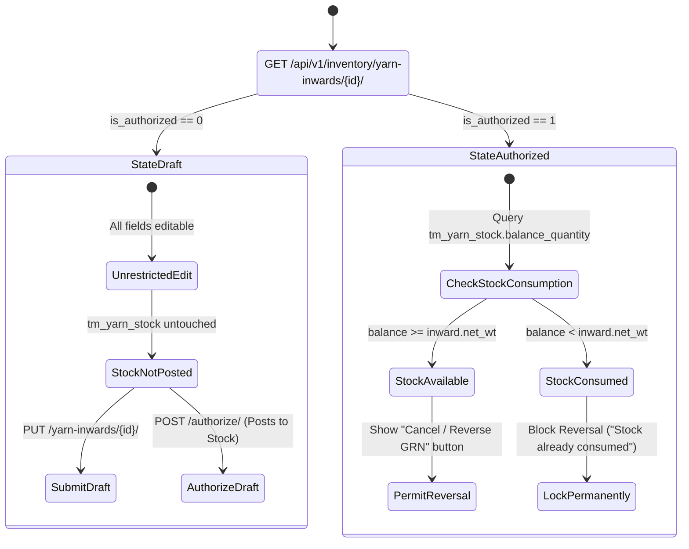

# UI & Frontend Workflow Specification: Yarn Inward (GRN) Edit Screen

## 1. Document Overview, Version, Scope, and Status

- **Document Title**: Yarn Inward Goods Receipt Note (GRN) Edit Screen UI & Frontend Developer Specification
- **Screen ID**: `SCR-INVN-001-EDIT`
- **Document Version**: `v1.0.0`
- **Last Updated**: `15/10/2026`
- **Target Audience**: Frontend Engineers, Full-Stack Developers, QA Engineers, and Technical Product Owners
- **Implementation Status**: `Ready for Review / Implementation`
- **Scope**: Covers data hydration, state-dependent UI locking (Draft vs Authorized vs Stock Consumed), field-by-field editability rules, downstream stock consumption safeguards, unauthorization and cancellation workflows, live stock ledger rollbacks (`tm_yarn_stock`), PO remaining balance restitution, Zod schemas, API integration (`GET`, `PUT/PATCH`, `DELETE`), keyboard shortcuts, and developer acceptance checklists for the Yarn Inward Edit screen.

---

## 2. Module Details, Screen ID, Route, Access Privileges, and API Endpoints

### 2.1 Core Metadata

| Parameter | Specification |
|---|---|
| **Module** | `Module 4 — Inventory & Godown Stock Ledger` |
| **Screen ID** | `SCR-INVN-001-EDIT` |
| **Frontend Route** | `/inventory/yarn-inward/[id]/edit` |
| **File Location** | `app/(app)/inventory/yarn-inward/[id]/edit/page.tsx` |
| **Required Privilege** | `inventory_yarn_inward.can_update` (for editing Drafts); `inventory_yarn_inward.can_approve` (for Cancelling/Reversing posted stock) |
| **Authorized Roles** | `SUPER_ADMIN`, `ADMIN_USER`, `COMPANY_USER` (Inventory Managers, Godown Supervisors, Plant Accounts) |
| **Country Pack** | `IN` (India: Currency INR `₹`, Date `DD/MM/YYYY`, standard bag `45.360 Kg`, GST Engine) |

### 2.2 Primary API Endpoints

| HTTP Method | API Path | Privilege / Scope | Description |
|---|---|---|---|
| `GET` | `/api/v1/inventory/yarn-inwards/{id}/` | `can_read` | Fetch complete inward header, weighbridge line items, tax breakdown, and authorization status |
| `PUT / PATCH` | `/api/v1/inventory/yarn-inwards/{id}/` | `can_update` | Submit updated draft inward header and modified weighbridge line items (Only allowed when `is_authorized == 0`) |
| `POST` | `/api/v1/inventory/yarn-inwards/{id}/authorize/` | `can_approve` | Authorize a draft GRN and post its physical stock to `tm_yarn_stock` atomically |
| `DELETE` | `/api/v1/inventory/yarn-inwards/{id}/` | `can_delete` / `can_approve` | Cancel/Reverse a posted inward GRN, decrementing stock and restoring PO balances (via `YarnInwardService.cancel_inward`) |
| `GET` | `/api/v1/inventory/yarn-stock/?warehouse={id}&yarn_type={type}&yarn_count={count}&mill={mill}&color_shade={shade}&lot_no={lot}` | `can_read` | Real-time stock consumption check: verify that inward yarn has not already been issued to knitting/dyeing |
| `GET` | `/api/v1/purchase/yarn-pos/{id}/` | `can_read` | Fetch linked PO to evaluate remaining balance updates and tolerance limits |

---

## 3. UI Layout, Screen Blueprint, and Visual Mockup

### 3.1 Visual Mockup Reference


### 3.2 Desktop Wireframe Layout (1440px+ Viewport)

```
+--------------------------------------------------------------------------------------------------------------------------+
| TOP BREADCRUMB: Inventory > Yarn Inward > Edit #YIN-202610-0084                                                           |
| Edit Yarn Inward (GRN)               [● DRAFT - EDITABLE]      [🚫 Cancel / Reverse GRN]   [✔ Save Changes (Alt+S)]     |
+--------------------------------------------------------------------------------------------------------------------------+
| [i] DRAFT ALERT: Gate entry draft. Weights and bags are editable. Stock is NOT yet posted to Godown ledger.              |
| (OR: [🔒 LOCKED NOTICE: GRN Authorized & Stock Posted. Direct edits disabled. Reversal requires authorization privilege])|
+--------------------------------------------------------------------------------------------------------------------------+
| +-------------------------------------------------------+  +-----------------------------------------------------------+ |
| | CARD 1: DOCUMENT & GATE ENTRY CONTEXT                 |  | CARD 2: VENDOR, SOURCE & GODOWN ALLOCATION                | |
| | Inward No:     [ YIN-202610-0084 ] [PERM-LOCKED]      |  | Inward Source:  [ From PO (YPO-202610-0042) ] [LOCKED]   | |
| | Inward Date:   [ 15/10/2026            ] [CALENDAR]  |  | Linked PO:      [ YPO-202610-0042 (Vardhman) ] [LOCKED]   | |
| | Supplier DC #: [ DC-94821              ]             |  | Spinning Mill:  [ Vardhman Textiles Ltd.        ] [LOCKED]| |
| | DC Date:       [ 14/10/2026            ] [CALENDAR]  |  | Billing Party:  [ Vardhman Textiles Ltd.        ] [LOCKED]| |
| | Vehicle No:    [ TN-38-BZ-4921         ] [TRUCK ICON]|  | Dest. Godown:   [ Main Factory Godown - Bay A   ] [EDIT]  | |
| | Fiscal Year:   [ FY 2025-2026 (Locked Scope) ]       |  | Mill Lot No:    [ VTM-7842                      ] [EDIT]  | |
| +-------------------------------------------------------+  +-----------------------------------------------------------+ |
|                                                                                                                          |
| +----------------------------------------------------------------------------------------------------------------------+ |
| | CARD 3: YARN TECHNICAL SPECIFICATIONS (READ-ONLY IF LINKED TO PO)                                                    | |
| | Yarn Type: [ Grey Yarn ]  |  Count: [ 30s Combed Cotton ]  |  Color Shade: [ N/A ]  |  Blend: [ 100% Combed Cotton ] | |
| +----------------------------------------------------------------------------------------------------------------------+ |
|                                                                                                                          |
| +----------------------------------------------------------------------------------------------------------------------+ |
| | CARD 4: PHYSICAL WEIGHBRIDGE & LINE ITEMS MATRIX                                                                      | |
| | +-----+--------------------+----------+-------+---------+------------+-----------+------------+----------+-----------+ | |
| | | #   | Yarn Count         | Lot No   | Bags  | Kg/Bag  | Gross (Kg) | Tare (Kg) | Net Wt(Kg) | Rate (₹) | Amount (₹)| | |
| | +-----+--------------------+----------+-------+---------+------------+-----------+------------+----------+-----------+ | |
| | | 1   | [ 30s Combed Cot  ]| VTM-7842 | [100] | [45.360]| [4,590.000]| [54.000 ] | 4,536.000  | [350.00] | 15,87,600 |X| |
| | +-----+--------------------+----------+-------+---------+------------+-----------+------------+----------+-----------+ | |
| | PO Match: 100 Bags / 4,536.000 Kg. PO Pending Balance prior to inward: 100 Bags / 4,536.000 Kg (100% Fulfilled)       | |
| +----------------------------------------------------------------------------------------------------------------------+ |
|                                                                                                                          |
| +-------------------------------------------------------+  +-----------------------------------------------------------+ |
| | CARD 5: TRANSPORTER & GATE PASS METADATA              |  | CARD 6: TAX ENGINE & REVISED TOTALS                       | |
| | Transporter:   [ Associated Road Carriers Ltd.     ]  |  | Subtotal (Taxable):                   ₹15,87,600.00       | |
| | LR / Bilty No: [ ARC-CBE-882109                    ]  |  | GST Applicable: [ 5% Intra-State CGST+SGST             v]| |
| | LR Date:       [ 14/10/2026            ] [CALENDAR]  |  | CGST (2.5%):                            ₹39,690.00        | |
| | Driver Phone:  [ +91 98421 55321                   ]  |  | SGST (2.5%):                            ₹39,690.00        | |
| | Gate Entry No: [ GE-2026-10-094                    ]  |  | IGST (0.0%):                                 ₹0.00        | |
| | Remarks:       [ Bags weighed at Bay 2 scale. OK   ]  |  | GRAND TOTAL VALUE:                   ₹16,66,980.00        | |
| +-------------------------------------------------------+  +-----------------------------------------------------------+ |
|                                                                                                                          |
| +----------------------------------------------------------------------------------------------------------------------+ |
| | STICKY FOOTER SUMMARY & AUDIT TRAIL                                                                                  | |
| | Created by Gate Guard M. Selvam on 15/10/2026 10:14 AM • Last updated 12 mins ago by Storekeeper K. Velu            | |
| | TOTAL BAGS: 100 Bags  |  GROSS: 4,590.000 Kg  |  TARE: 54.000 Kg  |  NET QTY: 4,536.000 Kg  |  TOTAL: ₹16,66,980.00  | |
+--------------------------------------------------------------------------------------------------------------------------+
```

---

## 4. Page Initialization, Hydration, and State Transitions

When `/inventory/yarn-inward/[id]/edit` loads, the master orchestrator executes:

1. **Hydration Query (`GET /api/v1/inventory/yarn-inwards/{id}/`)**:
   - Hydrates header fields, vendor party references, linked PO/Outward, technical specifications, and line items.
2. **Document Lifecycle Evaluation**:



3. **Field Editability Matrix by Lifecycle State**:

| Form Field / Section | Draft (`is_authorized == 0`) | Authorized (`is_authorized == 1`) | Stock Consumed (`balance < net_wt`) |
|---|---|---|---|
| `inward_number` | **Permanently Locked** | **Permanently Locked** | **Permanently Locked** |
| `inward_date` | Editable (Within active FY) | Locked | Locked |
| `dc_number` & `dc_date` | Editable | Locked | Locked |
| `vehicle_no` | Editable | Editable (Metadata update) | Editable (Metadata update) |
| `po_id` / `outward_id` | Editable (If no items locked) | **Permanently Locked** | **Permanently Locked** |
| `mill_id` & `party_id` | Editable (If Direct Inward) | **Permanently Locked** | **Permanently Locked** |
| `warehouse_id` | Editable | **Permanently Locked** | **Permanently Locked** |
| `lot_no` | Editable | Locked | Locked |
| `line_items` (Bags, Wt, Rate)| Fully Editable | **Permanently Locked** | **Permanently Locked** |
| `transporter_name` & `lr_no` | Editable | Editable | Editable |
| `remarks` | Editable | Editable | Editable |
| **"Cancel / Reverse GRN"** | Delete Draft | Allowed (Restores Stock & PO) | **Disabled / Blocked** |

---

## 5. Downstream Stock Consumption Safeguards & Reversal Workflow

In textile manufacturing, an authorized Yarn Inward increases physical godown stock. If that yarn has subsequently been:
- Dispatched to a knitting mill (`tm_yarn_outward` - Knitting Program),
- Dispatched to a dyehouse (`tm_yarn_outward` - Dyeing Job Work), or
- Sold to an external buyer (`tx_yarn_sales`),

**the inward GRN cannot be reversed or cancelled without creating negative stock.**

### 5.1 Real-Time Stock Availability Invariant Check

Before rendering or processing the "Cancel / Reverse GRN" action, the frontend and backend verify:
$$\text{Available Stock Balance} = \text{tm\_yarn\_stock.balance\_quantity} \quad \ge \quad \text{Inward Net Weight} = \text{inward.net\_wt}$$

If $\text{Available Stock Balance} < \text{Inward Net Weight}$:
- The "Cancel / Reverse GRN" button is **disabled** (`opacity-50 cursor-not-allowed`).
- A persistent alert banner is displayed:
  > **Reversal Blocked: Stock Already Issued**  
  > *This inward lot of 4,536.000 Kg has already been partially or fully issued to knitting/dyeing dispatches. Available balance in Main Factory Godown is only 1,200.000 Kg. Reverse the downstream outward dispatches first before cancelling this GRN.*

### 5.2 Atomic Cancellation Workflow (`DELETE /api/v1/inventory/yarn-inwards/{id}/`)

When the user clicks "Cancel / Reverse GRN" and confirms the modal dialog:

1. **Atomic Transaction Execution** (`@transaction.atomic`):
   - Locks `tm_yarn_stock` row via `select_for_update()`.
   - Decrements `stock.inward_bag` and `stock.inward_quantity` by the inward's quantities.
   - Recalculates `stock.balance_bag` and `stock.balance_quantity`.
2. **PO Balance Restitution**:
   - If inward was linked to a PO, increments `child_po_table.remaining_bag` and `child_po_table.remaining_quantity` back by the inward's amounts.
   - If PO was marked completed (`is_complete == 1`), resets `is_complete = 0`.
3. **Soft Delete**:
   - Sets `parent_yarn_inward_table.status = 0` and `child_yarn_inward_table.status = 0`.
4. **Toast & Redirection**:
   - Shows alert toast: *"Yarn Inward YIN-202610-0084 cancelled. Stock and PO balances have been successfully restored."*
   - Navigates to `/inventory/yarn-inward`.

---

## 6. Draft Modification and Re-Calculation Rules

When editing an un-authorized draft (`is_authorized == 0`):

1. **Modifying Bags or Bag Weight**:
   - Immediately updates `Net Wt` if `Gross Wt` is blank:
     $$\text{net\_wt} = \text{bag} \times \text{per\_bag}$$
   - Recalculates line amount: $\text{amount} = \text{net\_wt} \times \text{rate}$.
   - Recalculates GST tax amounts and document totals.
2. **Modifying Gross Weight or Tare Weight**:
   - Immediately validates that $\text{Gross Wt} \ge \text{Tare Wt}$.
   - Updates $\text{net\_wt} = \text{gross\_wt} - \text{tare\_wt}$.
   - Recalculates all pricing and tax distributions.
3. **Linked PO Balance Floor Check**:
   - If the user reduces or increases bags/weight, the UI compares the revised quantity against the linked PO's remaining balance.
   - If revised net weight exceeds the PO's remaining balance by $> 5\%$, a non-blocking tolerance alert warns the user.

---

## 7. Form Actions and Submission Payloads

### 7.1 Action Buttons Specification

1. **"Cancel / Back" Button**:
   - Shortcut: `Esc`.
   - Returns to `/inventory/yarn-inward` with unsaved change confirmation.
2. **"Update Draft Changes" Button**:
   - Shortcut: `Alt + S`.
   - Enabled only when `is_authorized == 0` and form is dirty.
   - Sends `PATCH /api/v1/inventory/yarn-inwards/{id}/`.
3. **"Authorize & Post Stock" Button**:
   - Shortcut: `Alt + Enter`.
   - Available when editing a Draft.
   - Submits changes and immediately posts to live stock (`POST /api/v1/inventory/yarn-inwards/{id}/authorize/`).
4. **"Cancel / Reverse GRN" Button**:
   - Requires privilege `inventory_yarn_inward.can_approve`.
   - Opens confirmation modal requiring a cancellation reason string.

---

## 8. TypeScript Types and Edit Zod Schema

```typescript
export interface YarnInwardEditFormValues {
  id: number;
  inward_number: string;
  inward_date: string;
  dc_number: string;
  dc_date: string;
  vehicle_no?: string;
  inward_source: "PURCHASE_PO" | "DYEING_RETURN" | "DIRECT";
  po_id?: number | null;
  outward_id?: number | null;
  yarn_type: string;
  mill_id: number;
  party_id: number;
  warehouse_id: number;
  lot_no: string;
  color_shade_id?: number | null;
  blend_ratio?: string;
  ply_count: number;
  tax_id?: number | null;
  transporter_name?: string;
  lr_number?: string;
  lr_date?: string;
  driver_phone?: string;
  remarks?: string;
  is_authorized: number;
  line_items: Array<{
    id?: number;
    yarn_count_id: number;
    lot_no: string;
    bag: number;
    per_bag: number;
    gross_wt: number;
    tare_wt: number;
    net_wt: number;
    rate: number;
    amount: number;
    tax_percent: number;
    tax_amount: number;
  }>;
}
```

---

## 9. Developer Acceptance Checklist

- [ ] **1. Route Scaffolding**: Route `/inventory/yarn-inward/[id]/edit` loads correctly with dynamic ID.
- [ ] **2. Data Hydration**: Complete inward details, weighbridge line items, and vendor metadata hydrate accurately.
- [ ] **3. State Locking**: If `is_authorized == 1`, input cells are locked; only metadata (vehicle, transporter, remarks) is editable.
- [ ] **4. Downstream Stock Safeguard**: The system queries `tm_yarn_stock` balance. If stock is consumed, reversal action is disabled with an explanatory banner.
- [ ] **5. Weighbridge Live Math**: Keystrokes in Gross/Tare or Bags/Kg in draft mode update Net Wt and grand totals in real-time.
- [ ] **6. PO Restitution**: Cancelling an inward restores the exact remaining bags and weight to `child_po_table`.
- [ ] **7. Keyboard Ergonomics**: `Alt+S`, `Alt+Enter`, and `Esc` work seamlessly.
