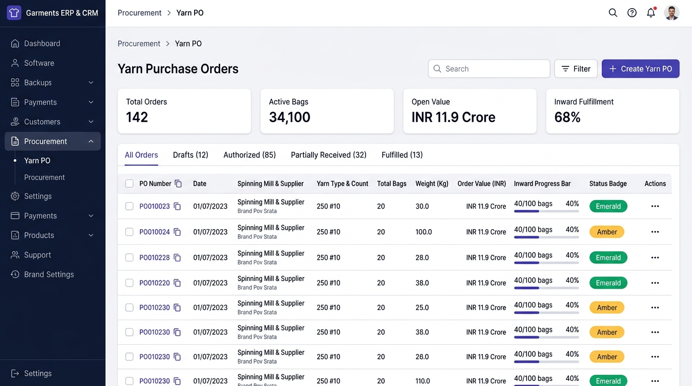

# UI & Frontend Workflow Specification: Yarn Inward (GRN) List & Register Screen

## 1. Document Overview, Version, Scope, and Status

- **Document Title**: Yarn Inward Goods Receipt Note (GRN) Register & List Page UI & Frontend Developer Specification
- **Screen ID**: `SCR-INVN-001-LIST`
- **Document Version**: `v1.0.0`
- **Last Updated**: `15/10/2026`
- **Target Audience**: Frontend Engineers, Full-Stack Developers, QA Engineers, and Technical Product Owners
- **Implementation Status**: `Ready for Review / Implementation`
- **Scope**: Covers the high-density register view, real-time KPI telemetry cards, status tab segmentation (All, Authorized, Drafts, From PO, Dyeing Return), multi-parameter search and filtering, batch actions, pagination, API integration (`GET /api/v1/inventory/yarn-inwards/`), keyboard shortcuts, and developer acceptance checklists for the Yarn Inward List page in the Garments ERP & CRM system.

---

## 2. Module Details, Screen ID, Route, Access Privileges, and API Endpoints

### 2.1 Core Metadata

| Parameter | Specification |
|---|---|
| **Module** | `Module 4 — Inventory & Godown Stock Ledger` |
| **Screen ID** | `SCR-INVN-001-LIST` |
| **Frontend Route** | `/inventory/yarn-inward` |
| **File Location** | `app/(app)/inventory/yarn-inward/page.tsx` |
| **Required Privilege** | `inventory_yarn_inward.can_read` (View list and filters); `inventory_yarn_inward.can_export` (Excel/CSV export) |
| **Authorized Roles** | `SUPER_ADMIN`, `ADMIN_USER`, `COMPANY_USER` (Godown Managers, Gatekeepers, Merchandisers, Auditors) |
| **Country Pack** | `IN` (India: Currency INR `₹`, Date `DD/MM/YYYY`, Number grouping `12,34,567.89`) |

### 2.2 Primary API Endpoints

| HTTP Method | API Path | Privilege / Scope | Description |
|---|---|---|---|
| `GET` | `/api/v1/inventory/yarn-inwards/` | `can_read` | Fetch paginated inward GRN records with filtering (`search`, `yarn_type`, `warehouse`, `mill`, `party`, `inward_source`, `is_authorized`) |
| `POST` | `/api/v1/inventory/yarn-inwards/{id}/authorize/` | `can_approve` | Authorize a gate entry draft and post live stock to `tm_yarn_stock` |
| `DELETE` | `/api/v1/inventory/yarn-inwards/{id}/` | `can_delete` | Cancel/Reverse an inward GRN and restore PO balances |
| `GET` | `/api/v1/masters/warehouses/?record_status=A` | `can_read` | Populate filter dropdown for destination godowns |
| `GET` | `/api/v1/masters/parties/?party_type=MILL` | `can_read` | Populate filter dropdown for spinning mills |
| `GET` | `/api/v1/masters/parties/?party_type=TRADER,SUPPLIER,MILL,DYER` | `can_read` | Populate filter dropdown for invoicing vendors |
| `GET` | `/api/v1/masters/yarn-counts/` | `can_read` | Populate filter dropdown for yarn counts |

---

## 3. UI Layout, Screen Blueprint, and Visual Mockup

### 3.1 Visual Mockup Reference



### 3.2 Desktop Wireframe Layout (1440px+ Viewport)

```
+--------------------------------------------------------------------------------------------------------------------------+
| TOP BREADCRUMB: Inventory > Yarn Inward                                                                                   |
| Yarn Inward Register (GRN)           [🔍 Quick Search (/) ]   [⚡ Filter (F)]   [📥 Export]   [+ New Yarn Inward (N)]      |
+--------------------------------------------------------------------------------------------------------------------------+
| +------------------------+  +------------------------+  +------------------------+  +--------------------------+ |
| | KPI 1: TOTAL INWARDS   |  | KPI 2: TOTAL BAGS REC. |  | KPI 3: TOTAL NET WEIGHT|  | KPI 4: TOTAL INWARD VALUE| |
| | 218 GRNs               |  | 18,450 Bags            |  | 8,36,886.000 Kg        |  | ₹29.28 Crore             | |
| +------------------------+  +------------------------+  +------------------------+  +--------------------------+ |
|                                                                                                                          |
| STATUS TABS: [ All Inwards (218) ] [ Stock Posted (204) ] [ Draft Gate Passes (14) ] [ From PO (186) ] [ Dyeing Return (32) ]|
|                                                                                                                          |
| +----------------------------------------------------------------------------------------------------------------------+ |
| | HIGH-DENSITY ENTERPRISE DATA TABLE                                                                                   | |
| | [ ] | GRN No & Date  | Supplier DC & Date | Source & PO Ref   | Mill & Supplier    | Bags & Net Wt| Godown    | Amount (₹)|...|
| |-----+----------------+--------------------+-------------------+--------------------+--------------+-----------+-----------|---|
| | [ ] | YIN-202610-0084| DC-94821           | [PO] YPO-202610-42| Vardhman Textiles  | 100 Bags     | Main Raw  | 16,66,980 |...|
| |     | 15/10/2026     | 14/10/2026         | 30s Combed Cotton | Direct Mill Pur.   | 4,536.000 Kg | Bay A-02  | [POSTED]  |   |
| |-----+----------------+--------------------+-------------------+--------------------+--------------+-----------+-----------|---|
| | [ ] | YIN-202610-0083| DDC-3391           | [DYE] DY-OUT-0012 | Sri Balaji Dyers   | 40 Bags      | Dyed Godwn|  6,24,500 |...|
| |     | 14/10/2026     | 13/10/2026         | 34s Dyed Navy Blue| Subcontract Jobwork| 1,814.400 Kg | Bay D-01  | [POSTED]  |   |
| +----------------------------------------------------------------------------------------------------------------------+ |
|                                                                                                                          |
| PAGINATION & DENSITY:                                                                                                    |
| Showing 1 - 20 of 218 GRNs  | Rows per page: [ 20 v ]             [<<] [<]  Page 1 of 11  [>] [>>]                      |
+--------------------------------------------------------------------------------------------------------------------------+
```

---

## 4. Page Initialization, Query Parameters, and Hydration

When accessing `/inventory/yarn-inward`, URL search parameters preserve active view configurations:

```
/inventory/yarn-inward?status=posted&warehouse=1&search=30s&page=1&page_size=20&ordering=-inward_date
```

| Query Parameter | Type | Default | Description |
|---|---|---|---|
| `status` | `string` | `'all'` | Tab filter: `'all'`, `'posted'` (`is_authorized=1`), `'draft'` (`is_authorized=0`), `'po'`, `'dyeing'` |
| `search` | `string` | `""` | Search text matching Inward No, DC No, Vehicle No, Lot No, Mill name, Supplier name |
| `warehouse` | `number` | `null` | Filter by Destination Godown ID (`warehouse_id`) |
| `mill` | `number` | `null` | Filter by Spinning Mill ID (`mill_id`) |
| `party` | `number` | `null` | Filter by Supplier/Trader/Dyer ID (`party_id`) |
| `yarn_type` | `string` | `null` | Filter by Yarn Category (`GREY`, `DYED`, `MELANGE`, etc.) |
| `yarn_count` | `number` | `null` | Filter by Yarn Count ID |
| `from_date` | `string` | `null` | ISO Start date `YYYY-MM-DD` |
| `to_date` | `string` | `null` | ISO End date `YYYY-MM-DD` |
| `page` | `number` | `1` | Pagination page number |
| `page_size` | `number` | `20` | Rows per page: `20`, `50`, `100` |
| `ordering` | `string` | `'-inward_date'` | Sorting column: `-inward_date`, `inward_number`, `-net_wt`, `-total_amount` |

---

## 5. Real-Time KPI Telemetry Cards

Hydrated via aggregate selectors from the backend:

1. **Total Inward GRNs (`KPI 1`)**:
   - Total number of active inward records within the active financial year.
2. **Total Inward Bags (`KPI 2`)**:
   - Aggregate sum of physical yarn bags/cartons received and stacked in godowns.
3. **Total Net Weight Received (`KPI 3`)**:
   - Aggregate sum of physical net weight in Kilograms (`Kg`), formatted to 3 decimal places.
4. **Total Inward Value (`KPI 4`)**:
   - Total gross inward purchase value in INR (`₹`), including GST tax credits and dyeing subcontract charges.

---

## 6. High-Density Data Table Column Specifications

| Col # | Column Header | Backend Field | Formatting & Visual Behavior |
|---|---|---|---|
| **1** | `[ ]` | `id` | Multi-select checkbox for bulk batch actions. |
| **2** | `GRN No & Date` | `inward_number`, `inward_date` | Clickable link to `/inventory/yarn-inward/[id]`. Displays formatted date `DD/MM/YYYY`. |
| **3** | `Supplier DC & Date`| `dc_number`, `dc_date` | Supplier delivery challan number with calendar icon and challan date. |
| **4** | `Source & PO Ref` | `inward_source`, `po_number` | Badge: Green for `[PO] #YPO-XXXX`, Purple for `[DYE] #DY-OUT-XXXX`, Slate for `[DIRECT]`. |
| **5** | `Mill & Supplier` | `mill_name`, `party_name` | Top: Spinning Mill Name (Bold). Bottom: Commercial Invoicing Supplier (Muted). |
| **6** | `Yarn Count & Specs`| `yarn_count_name`, `color_shade_name` | Yarn count with color swatch badge if dyed/melange. |
| **7** | `Bags & Net Weight` | `bag`, `net_wt` | Number of bags + bold net weight in Kg (e.g. `100 Bags / 4,536.000 Kg`). |
| **8** | `Destination Godown`| `warehouse_name` | Storage godown location (e.g. `Main Raw Material Godown`). |
| **9** | `Total Amount (₹)` | `total_amount` | Total commercial invoice value formatted in Indian grouping (e.g. `₹16,66,980.00`). |
| **10**| `Status` | `is_authorized` | Emerald Badge: `● Stock Posted`; Amber Badge: `● Gate Draft`. |
| **11**| `Actions` | — | Dropdown menu: `View Details`, `Edit (Draft only)`, `Print GRN (PDF)`, `Cancel / Reverse`. |

---

## 7. Row Actions and Batch Operations

### 7.1 Single Row Actions

- **View Details**: Navigates to `/inventory/yarn-inward/[id]`.
- **Edit**: Navigates to `/inventory/yarn-inward/[id]/edit` (Available if `is_authorized == 0`).
- **Print GRN Sheet**: Opens printable A4 PDF sheet at `/inventory/yarn-inward/[id]/print`.
- **Cancel / Reverse**: Triggers atomic stock rollback modal (Restores PO balances if stock is unconsumed).

### 7.2 Batch Operations Bar (Appears when $\ge 1$ row selected)

- **Authorize Selected Drafts**: Batch calls `POST /authorize/` for selected gate passes.
- **Export Selected to CSV / Excel**: Downloads selected GRN rows as a spreadsheet.

---

## 8. Keyboard Shortcuts

| Shortcut | Scope | Action |
|---|---|---|
| `/` | Global Page | Focuses the Quick Search input box. |
| `F` | Global Page | Toggles open the Multi-Parameter Filter Drawer. |
| `N` | Global Page | Navigates to `/inventory/yarn-inward/new` to create a new inward. |
| `E` | Global Page | Triggers CSV/Excel export for the current filtered list. |
| `Esc` | Filter Drawer | Closes open drawers or clears search focus. |

---

## 9. Developer Acceptance Checklist

- [ ] **1. High-Density Table**: Table renders responsive rows with proper pagination and sorting.
- [ ] **2. Status Tabs**: Clicking tabs correctly filters `All`, `Stock Posted`, `Drafts`, `From PO`, and `Dyeing Return`.
- [ ] **3. Search Debounce**: Quick search triggers after 300ms debounce without redundant queries.
- [ ] **4. Action Permissions**: "Edit" is only enabled for drafts; "Cancel" requires confirmation.
- [ ] **5. Navigation**: Clicking GRN number opens the detail view; clicking Print opens the printable sheet.
- [ ] **6. KPI Cards**: Telemetry totals update accurately based on active financial year and company scope.
