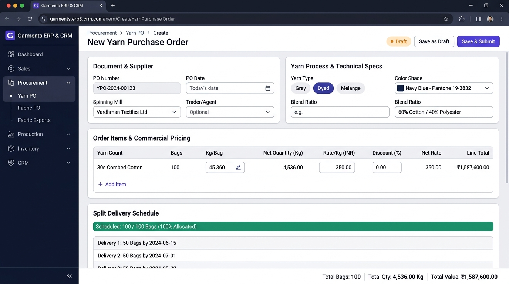
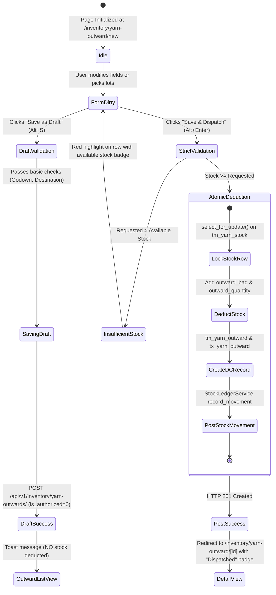

# UI & Frontend Workflow Specification: Yarn Outward Delivery Challan (DC) Add Page

## 1. Document Overview, Version, Scope, and Status

- **Document Title**: Yarn Outward Delivery Challan (DC) Add Page UI & Frontend Developer Specification
- **Screen ID**: `SCR-INVN-002-ADD`
- **Document Version**: `v1.0.0`
- **Last Updated**: `15/10/2026`
- **Target Audience**: Frontend Engineers, Full-Stack Developers, QA Automation Engineers, and ERP Technical Architects
- **Implementation Status**: `Ready for Review / Implementation`
- **Scope**: Defines the complete technical workflow, UI blueprint, field definitions, dynamic outward type configurations (Knitting Mill Dispatch, Dyeing Subcontract, Purchase Return to Mill), live warehouse stock availability validation (`tm_yarn_stock`), weighbridge dispatch deductions, transport/e-Way Bill metadata, Zod schemas, TypeScript interfaces, and developer checklists for creating new Yarn Outward Delivery Challans in the Garments ERP & CRM system.

---

## 2. Module Details, Screen ID, Route, Access Privileges, and API Endpoints

### 2.1 Core Metadata

| Parameter | Specification |
|---|---|
| **Module** | `Module 4 — Inventory & Godown Stock Ledger` |
| **Screen ID** | `SCR-INVN-002-ADD` |
| **Frontend Route** | `/inventory/yarn-outward/new` |
| **File Location** | `app/(app)/inventory/yarn-outward/new/page.tsx` |
| **Required Privilege** | `inventory_yarn_outward.can_create` |
| **Authorized Roles** | `SUPER_ADMIN`, `ADMIN_USER`, `COMPANY_USER` (Godown In-Charge, Dispatch Manager, Production Coordinator) |
| **Country Pack** | `IN` (India: Currency INR `₹`, Date `DD/MM/YYYY`, standard bag `45.360 Kg`, E-Way bill rules) |

### 2.2 Primary API Endpoints

| HTTP Method | API Path | Privilege / Scope | Description |
|---|---|---|---|
| `POST` | `/api/v1/inventory/yarn-outwards/` | `can_create` | Create a new Yarn Outward DC header with line items and atomically deduct live stock |
| `GET` | `/api/v1/inventory/yarn-stock/?warehouse={id}&balance_quantity__gt=0` | `can_read` | Fetch live available godown yarn stock with positive balance to populate selectable lots |
| `GET` | `/api/v1/masters/warehouses/?record_status=A` | `can_read` | Retrieve source dispatch godowns / warehouses (`WarehouseMaster`) |
| `GET` | `/api/v1/masters/parties/?party_type=KNITTER&record_status=A` | `can_read` | Retrieve active subcontract knitting mills (when outward type is `KNITTING`) |
| `GET` | `/api/v1/masters/parties/?party_type=DYER&record_status=A` | `can_read` | Retrieve active commission dyeing units (when outward type is `DYEING`) |
| `GET` | `/api/v1/masters/parties/?party_type=MILL,TRADER&record_status=A` | `can_read` | Retrieve spinning mills / suppliers (when outward type is `PURCHASE_RETURN`) |
| `GET` | `/api/v1/masters/yarn-counts/?record_status=A` | `can_read` | Retrieve active yarn count catalog |
| `GET` | `/api/v1/masters/color-shades/?is_active=1` | `can_read` | Retrieve color shades for dyed yarn dispatches |
| `GET` | `/api/v1/knitting/programs/?is_active=1` | `can_read` | (Optional) Link outward dispatch to an active Knitting Program / Job Card |

---

## 3. UI Layout, Screen Blueprint, and Visual Mockup

### 3.1 Visual Mockup Reference



### 3.2 Desktop Wireframe Layout (1440px+ Viewport)

```
+--------------------------------------------------------------------------------------------------------------------------+
| TOP BREADCRUMB: Inventory > Yarn Outward > Create Delivery Challan                                                        |
| New Yarn Outward (DC)                 [● Draft Badge]                  [ Save as Draft (Alt+S) ]   [ Save & Dispatch (Alt+Enter) ]|
+--------------------------------------------------------------------------------------------------------------------------+
| +-------------------------------------------------------+  +-----------------------------------------------------------+ |
| | CARD 1: DISPATCH & FISCAL CONTEXT                     |  | CARD 2: OUTWARD TYPE & DESTINATION CONSIGNMENT             | |
| | Outward No:    [ YKNT-202610-0031 (Auto) ] [LOCKED]   |  | Outward Type:   (o) To Knitting   ( ) To Dyeing   ( ) Return| |
| | Outward Date:  [ 15/10/2026            ] [CALENDAR]  |  | Source Godown:  [ Main Factory Raw Godown - Bay A       v]| |
| | Vehicle No:    [ TN-38-BZ-4921         ] [TRUCK ICON]|  | Destination:    [ Sri Ram Knitter Mill (Unit 2)         v]| |
| | Driver Name:   [ S. Murugan            ]             |  | E-Way Bill No:  [ 331298492019                          ] | |
| | Driver Phone:  [ +91 98421 98210       ]             |  | E-Way Bill Date:[ 15/10/2026            ] [CALENDAR]    | |
| | Active FY:     [ FY 2025-2026 (Auto)   ] [BADGE]     |  | Knitting Prog #: [ KP-202610-0014 (Optional)          v]| |
| +-------------------------------------------------------+  +-----------------------------------------------------------+ |
|                                                                                                                          |
| +----------------------------------------------------------------------------------------------------------------------+ |
| | CARD 3: STOCK SELECTION & INVENTORY AVAILABILITY CHECKER                                                             | |
| | Filter Available Stock: Count: [ 30s Combed Cotton v]  |  Mill: [ Vardhman Textiles v]  |  Lot: [ VTM-7842 v]        | |
| | Godown Live Stock: [ 100 Bags / 4,536.000 Kg Available in Bay A ] (Verified Non-Zero Balance)                         | |
| +----------------------------------------------------------------------------------------------------------------------+ |
|                                                                                                                          |
| +----------------------------------------------------------------------------------------------------------------------+ |
| | CARD 4: OUTWARD DISPATCH LINE ITEMS & PACKAGING GRID (INTERACTIVE SPREADSHEET MATRIX)                                 | |
| | [ + Add Item Row (Alt+N) ]   [ Pick from Available Stock ]                                                            | |
| | +-----+--------------------+----------+-------------------+-------+------------+------------+------------------------+ | |
| | | #   | Yarn Count         | Lot No   | Spinning Mill     | Bags  | Avail (Kg) | Outward Qty| Remarks / Cone Count   | | |
| | +-----+--------------------+----------+-------------------+-------+------------+------------+------------------------+ | |
| | | 1   | [ 30s Combed Cot v]| VTM-7842 | Vardhman Textiles | [ 50] | 4,536.000  | [2,268.000]| 1,200 Paper Cones      |X| |
| | +-----+--------------------+----------+-------------------+-------+------------+------------+------------------------+ | |
| | Stock Validation: 50 Bags / 2,268.000 Kg will be deducted atomically from Main Factory Godown. 50 Bags will remain.   | |
| +----------------------------------------------------------------------------------------------------------------------+ |
|                                                                                                                          |
| +----------------------------------------------------------------------------------------------------------------------+ |
| | CARD 5: TRANSPORTER, LR & REMARKS                                                                                    | |
| | Transporter: [ Associated Road Carriers Ltd.        ]  |  LR / Bilty No: [ ARC-CBE-994201      ]  |  LR Date: [15/10/2026]| |
| | Dispatch Remarks: [ 50 Bags dispatched for Knitting Program #KP-0014 (Single Jersey 160 GSM Order)                  ] | |
| +----------------------------------------------------------------------------------------------------------------------+ |
|                                                                                                                          |
| +----------------------------------------------------------------------------------------------------------------------+ |
| | STICKY FOOTER SUMMARY BAR                                                                                            | |
| | TOTAL BAGS: 50 Bags  |  TOTAL DISPATCH WEIGHT: 2,268.000 Kg  |  TOTAL CONES: 1,200 Cones  |  DEST: Sri Ram Knitter   | |
| +----------------------------------------------------------------------------------------------------------------------+ |
```

---

## 4. Page Initialization and Default Values

When accessing `/inventory/yarn-outward/new`:

1. **Session & Security Scoping**:
   - Hydrates `company_id` and active `cfyear_id` from user session context.
   - Sets headers `X-Company-ID: <id>`, `X-Financial-Year-ID: <id>`.
2. **URL Query Parameter Check (`?type=KNITTING&program_id=14`)**:
   - If query parameter `type` is present, pre-selects `outward_type`.
   - If `program_id` is passed, hydrates destination knitting mill and required yarn count/weight.
3. **Master Data Hydration**:
   - `GET /api/v1/masters/warehouses/?record_status=A` -> Loads source godowns.
   - `GET /api/v1/masters/parties/?party_type=KNITTER` -> Loads subcontract knitting mills.
   - `GET /api/v1/masters/parties/?party_type=DYER` -> Loads commission dyehouses.
   - `GET /api/v1/inventory/yarn-stock/?balance_quantity__gt=0` -> Caches positive stock balance lots.
4. **Form State Default Initialization**:
   - `outward_number`: Preview string `YKNT-YYYYMM-XXXX` (Read-only).
   - `outward_date`: Formatted current date `DD/MM/YYYY`.
   - `outward_type`: Default `'KNITTING'`.
   - `yarn_type`: Default `'GREY'`.
   - `warehouse_id`: Default primary godown ID.
   - `line_items`: 1 empty row with `bag: 0`, `quantity: 0.000`.

---

## 5. Document Header and Fiscal Context

Located in **Card 1: Dispatch & Fiscal Context**.

### 5.1 Outward Number (`outward_number`)
- **Field Label**: `Delivery Challan No (DC)`
- **Backend Field Key**: `outward_number`
- **Field Type**: Read-only text input with lock icon.
- **Default Value**: Auto-generated sequential preview (e.g. `YKNT-202610-0031`).
- **Related Business Rules**: Format follows type prefix:
  - `YKNT-YYYYMM-XXXX` for Knitting dispatches
  - `YDYE-YYYYMM-XXXX` for Dyeing dispatches
  - `YRET-YYYYMM-XXXX` for Purchase Returns

### 5.2 Outward Date (`outward_date`)
- **Field Label**: `Challan Dispatch Date`
- **Backend Field Key**: `outward_date`
- **Field Type**: Calendar date picker (`DD/MM/YYYY`).
- **Validation Rules**: Must fall strictly within active financial year boundaries. Must not be future-dated.

### 5.3 Vehicle & Driver Metadata
- **Vehicle Number (`vehicle_no`)**: Alphanumeric uppercase (e.g. `TN-38-BZ-4921`).
- **Driver Name (`driver_name`)**: Text input (e.g. `S. Murugan`).
- **Driver Phone (`driver_phone`)**: 10-digit mobile number for consignment tracking.

---

## 6. Outward Type & Destination Selection

Located in **Card 2: Outward Type & Destination Consignment**.

### 6.1 Outward Type Selector (`outward_type`)
- **Field Label**: `Outward Purpose / Category`
- **Backend Field Key**: `outward_type`
- **Field Type**: Segmented Button Group:
  1. `KNITTING`: "To Subcontract Knitting Mill (Knitting Program)"
  2. `DYEING`: "To Dyeing Unit (Grey Yarn for Dyeing Job Work)"
  3. `PURCHASE_RETURN`: "Purchase Return to Mill / Trader (Rejection)"
- **User Interaction Behavior**:
  - Selecting `KNITTING`: Sets destination party filter to `party_type=KNITTER`.
  - Selecting `DYEING`: Sets destination party filter to `party_type=DYER`.
  - Selecting `PURCHASE_RETURN`: Sets destination party filter to `party_type=MILL,TRADER`.

### 6.2 Source Warehouse (`warehouse_id`)
- **Field Label**: `Dispatch Godown / Warehouse`
- **Backend Field Key**: `warehouse_id`
- **Field Type**: Searchable Combobox.
- **Validation Rules**: Mandatory. Stock deduction is executed exclusively from this location in `tm_yarn_stock`.

### 6.3 Destination Party (`destination_party_id`)
- **Field Label**: `Destination Consignee / Mill`
- **Backend Field Key**: `destination_party_id`
- **Field Type**: Searchable Async Combobox.
- **Validation Rules**: Mandatory active party ID.

### 6.4 Statutory E-Way Bill Details
- **E-Way Bill Number (`eway_bill_no`)**: 12-digit GST E-Way Bill Number required for consignments exceeding ₹50,000 value.
- **E-Way Bill Date (`eway_bill_date`)**: Date of E-Way Bill generation.

---

## 7. Dynamic Technical Specifications

Located in **Card 3: Yarn Technical Specifications**. Dynamically mirrors the physical yarn characteristics stored in `tm_yarn_stock`.

| Yarn Category | Backend Code | Lot Number Selection | Color Shade Handling |
|---|---|---|---|
| **Grey Yarn** | `GREY` | Filtered from active Grey stock | N/A (Ecru / Grey) |
| **Dyed Yarn** | `DYED` | Filtered from active Dyed stock | **Mandatory** — Matches stock shade |
| **Melange Yarn** | `MELANGE` | Filtered from active Melange stock| **Mandatory** — Matches shade |

---

## 8. Line Items and Stock Deduction Grid

Located in **Card 4: Outward Dispatch Line Items**. Features an interactive spreadsheet grid with real-time stock floor checks.

### 8.1 Grid Column Specifications

| Col # | Header Label | Backend Key | Type | Default | Required | Validation & Ergonomic Behavior |
|---|---|---|---|---|---|---|
| **1** | `#` | `line_number` | Read-only Index | `1` | Yes | Auto-incrementing row index (`1, 2, 3...`). |
| **2** | `Yarn Count` | `yarn_count_id` | Select Combobox | `null` | **Yes** | Active count with positive stock in source godown. |
| **3** | `Lot No` | `lot_no` | Combobox / Text | `'GEN'` | **Yes** | Spinning mill lot number present in `tm_yarn_stock`. |
| **4** | `Spinning Mill` | `mill_id` | Select Combobox | `null` | **Yes** | Manufacturing mill ID from available stock. |
| **5** | `Color Shade` | `color_shade_id` | Select Combobox | `null` | Cond. | Required if `yarn_type == 'DYED'`. |
| **6** | `Avail Bags` | `avail_bags` | Read-only Text | `0` | Info | Current available bags in `tm_yarn_stock`. |
| **7** | `Avail (Kg)` | `avail_qty` | Read-only Text | `0.000` | Info | Current available net weight in `tm_yarn_stock`. |
| **8** | `Outward Bags` | `bag` | Integer Input | `0` | **Yes** | Must be $\le \text{Avail Bags}$ (unless override held). |
| **9** | `Outward (Kg)` | `quantity` | Decimal Input | `0.000` | **Yes** | Must be $\le \text{Avail (Kg)}$ (prevent negative stock). |
| **10**| `Remarks` | `remarks` | Text Input | `""` | Optional | Cone count or packaging notes. |
| **11**| `Actions` | — | Icon Button | — | — | Delete row button (`TrashIcon`). |

### 8.2 Real-Time Stock Floor Invariant

On keystroke in `Outward Bags` or `Outward (Kg)`:
$$\text{Validation Check: } \text{quantity} \le \text{stock.balance\_quantity} \quad \text{AND} \quad \text{bag} \le \text{stock.balance\_bag}$$

If the entered quantity exceeds available godown stock:
- The cell border turns **Crimson Red**.
- A warning tooltip appears: *"Cannot dispatch 3,000 Kg. Only 2,268.000 Kg available in Main Factory Godown."*
- Form submission is **blocked**.

---

## 9. Weight and Summary Calculations

All mathematical aggregations execute synchronously on keystroke:

1. **Header Total Bags**:
   $$\text{total\_bags} = \sum_{i=1}^{n} \text{line\_items}[i].\text{bag}$$

2. **Header Total Net Outward Weight (Kg)**:
   $$\text{total\_quantity} = \sum_{i=1}^{n} \text{line\_items}[i].\text{quantity}$$

3. **Remaining Processor Balance Initializer (for Dyeing/Knitting)**:
   $$\text{remaining\_quantity} = \text{total\_quantity}, \quad \text{received\_quantity} = 0.000\text{ Kg}, \quad \text{is\_complete} = 0$$

---

## 10. Godown Stock Ledger Invariant (`tm_yarn_stock`)

Upon authorization (`is_authorized: 1`), `YarnStockService.deduct_outward_stock()` executes an atomic database row lock (`select_for_update()`):

```python
stock = yarn_stock_table.objects.select_for_update().filter(
    company_id=company_id,
    warehouse_id=warehouse_id,
    yarn_type=yarn_type,
    yarn_count_id=yarn_count_id,
    mill_id=mill_id,
    color_shade_id=color_shade_id,
    lot_no=lot_no
).first()

if not stock or stock.balance_quantity < quantity or (bag > 0 and stock.balance_bag < bag):
    raise ValidationError("Insufficient stock to complete Yarn Outward.")

stock.outward_bag += bag
stock.outward_quantity += quantity
stock.recalculate_balance()
stock.save()
```

---

## 11. Summary Bar, Transporter, and Action Buttons

### 11.1 Transporter Details & Remarks
- **Transporter Name (`transporter_name`)**: Text input (e.g. `Associated Road Carriers Ltd.`).
- **LR / Bilty Number (`lr_number`)**: Lorry receipt tracking number.
- **LR Date (`lr_date`)**: Date of consignment booking.
- **Dispatch Remarks (`remarks`)**: Multiline textarea (`maxlength="200"`).

### 11.2 Sticky Footer Bar Metrics

```
+--------------------------------------------------------------------------------------------------------------------------+
| TOTAL BAGS: 50 Bags  |  TOTAL DISPATCH WEIGHT: 2,268.000 Kg  |  DESTINATION: Sri Ram Knitter Mill (Unit 2)                |
+--------------------------------------------------------------------------------------------------------------------------+
```

---

## 12. Form Validation Rules and Error Messages

| Field / Target | Trigger | Validation Rule | User-Facing Error Message | UI Highlight |
|---|---|---|---|---|
| `outward_type` | Submit | Mandatory choice | *"Outward Purpose is required"* | Red radio border |
| `warehouse_id` | Submit / Blur | Mandatory godown selection | *"Dispatch Godown is required"* | Red border on Godown combobox |
| `destination_party_id` | Submit / Blur | Mandatory party selection | *"Destination Consignee is required"* | Red border on Destination combobox |
| `outward_date` | Change / Submit | Within active FY date boundaries | *"Challan Date must fall within active FY"* | Red border & calendar alert |
| `line_items` | Submit | Minimum 1 valid row | *"At least one yarn item is required for dispatch"* | Banner alert above grid |
| `line_items[i].bag` | Change / Submit | $\le \text{Avail Bags}$ | *"Outward bags cannot exceed available godown stock"* | Red border on table cell |
| `line_items[i].quantity`| Change / Submit | $\le \text{Avail (Kg)}$ | *"Outward weight cannot exceed available godown stock"* | Red border on Weight cell |

---

## 13. Save as Draft vs Save & Dispatch Workflows



---

## 14. API Integration, Request Headers, and Payload Serialization

### 14.1 Request Headers

```http
Content-Type: application/json
Accept: application/json
Authorization: Bearer <access_token>
X-Company-ID: 1
X-Financial-Year-ID: 1
```

### 14.2 API Payload Serialization Mapping

```typescript
export function serializeYarnOutwardPayload(values: YarnOutwardFormValues) {
  const lineItems = values.line_items.map((item) => ({
    yarn_count_id: item.yarn_count_id,
    color_shade_id: item.color_shade_id || null,
    mill_id: item.mill_id,
    lot_no: item.lot_no || "GEN",
    bag: Number(item.bag) || 0,
    quantity: Number(item.quantity) || 0,
    remarks: item.remarks || "",
  }));

  const totalBags = lineItems.reduce((acc, i) => acc + i.bag, 0);
  const totalQuantity = lineItems.reduce((acc, i) => acc + i.quantity, 0);
  const primaryItem = lineItems[0];

  return {
    outward_number: values.outward_number || undefined,
    outward_date: values.outward_date,
    outward_type: values.outward_type,
    warehouse_id: values.warehouse_id,
    destination_party_id: values.destination_party_id,
    yarn_type: values.yarn_type,
    yarn_count_id: primaryItem.yarn_count_id,
    mill_id: primaryItem.mill_id,
    color_shade_id: primaryItem.color_shade_id || null,
    lot_no: primaryItem.lot_no || "GEN",
    bag: totalBags,
    quantity: totalQuantity,
    vehicle_no: values.vehicle_no ? values.vehicle_no.trim().toUpperCase() : "",
    driver_name: values.driver_name ? values.driver_name.trim() : "",
    remarks: values.remarks || "",
    is_authorized: values.is_authorized !== undefined ? values.is_authorized : 1,
    line_items: lineItems,
  };
}
```

---

## 15. Next.js Folder Structure and Component Responsibilities

```
frontend/app/(app)/inventory/yarn-outward/new/
├── page.tsx                             # Master page orchestrator & query state
├── components/
│   ├── YarnOutwardHeaderCard.tsx        # Outward No, Date, Vehicle, Driver
│   ├── YarnOutwardConsigneeCard.tsx     # Outward type, Godown, Destination Consignee
│   ├── YarnOutwardStockPicker.tsx       # Live lot picker dialog from tm_yarn_stock
│   ├── YarnOutwardLineItemsGrid.tsx     # Dispatch spreadsheet data grid
│   ├── YarnOutwardLineItemRow.tsx       # Single row with stock floor validation
│   ├── YarnOutwardTransportCard.tsx     # Transporter, LR and E-Way Bill fields
│   └── YarnOutwardStickyFooter.tsx      # Aggregate totals & dispatch buttons
├── hooks/
│   ├── useYarnOutwardForm.ts            # Form state & keystroke stock floor checks
│   └── useAvailableStock.ts             # Queries positive tm_yarn_stock balances
└── types/
    └── yarn-outward.types.ts            # DTOs and Form values
```

---

## 16. React Hooks, TypeScript Types, and Zod Schema

### 16.1 TypeScript Interfaces (`yarn-outward.types.ts`)

```typescript
export interface YarnOutwardLineItem {
  id?: number;
  yarn_count_id: number;
  mill_id: number;
  color_shade_id?: number | null;
  lot_no: string;
  avail_bags?: number;
  avail_quantity?: number;
  bag: number;
  quantity: number;
  remarks?: string;
}

export interface YarnOutwardFormValues {
  outward_number?: string;
  outward_date: string;
  outward_type: "KNITTING" | "DYEING" | "PURCHASE_RETURN";
  warehouse_id: number;
  destination_party_id: number;
  yarn_type: "GREY" | "DYED" | "MELANGE" | "BLENDED" | "WOUND" | "SLUB" | "CORE_SPUN" | "RECYCLED";
  vehicle_no?: string;
  driver_name?: string;
  driver_phone?: string;
  eway_bill_no?: string;
  eway_bill_date?: string;
  transporter_name?: string;
  lr_number?: string;
  lr_date?: string;
  remarks?: string;
  is_authorized: number;
  line_items: YarnOutwardLineItem[];
}
```

### 16.2 Zod Validation Schema (`yarn-outward.schema.ts`)

```typescript
import { z } from "zod";

export const yarnOutwardLineItemSchema = z.object({
  yarn_count_id: z.number({ required_error: "Select yarn count" }).positive(),
  mill_id: z.number({ required_error: "Select spinning mill" }).positive(),
  color_shade_id: z.number().nullable().optional(),
  lot_no: z.string().min(1, "Lot number is required").default("GEN"),
  avail_bags: z.number().optional(),
  avail_quantity: z.number().optional(),
  bag: z.number().int().min(1, "Outward bags must be at least 1"),
  quantity: z.number().positive("Outward weight must be greater than 0"),
  remarks: z.string().max(150).optional(),
}).refine((data) => {
  if (data.avail_quantity !== undefined && data.avail_quantity > 0) {
    return data.quantity <= data.avail_quantity;
  }
  return true;
}, {
  message: "Dispatch weight cannot exceed available godown stock",
  path: ["quantity"],
});

export const yarnOutwardFormSchema = z.object({
  outward_number: z.string().optional(),
  outward_date: z.string().min(1, "Dispatch Date is required"),
  outward_type: z.enum(["KNITTING", "DYEING", "PURCHASE_RETURN"]),
  warehouse_id: z.number({ required_error: "Dispatch Godown is required" }).positive(),
  destination_party_id: z.number({ required_error: "Destination Consignee is required" }).positive(),
  yarn_type: z.enum(["GREY", "DYED", "MELANGE", "BLENDED", "WOUND", "SLUB", "CORE_SPUN", "RECYCLED"]),
  vehicle_no: z.string().max(30).optional(),
  driver_name: z.string().max(100).optional(),
  driver_phone: z.string().max(15).optional(),
  eway_bill_no: z.string().max(50).optional(),
  eway_bill_date: z.string().optional(),
  transporter_name: z.string().max(100).optional(),
  lr_number: z.string().max(50).optional(),
  lr_date: z.string().optional(),
  remarks: z.string().max(200).optional(),
  is_authorized: z.number().int().default(1),
  line_items: z.array(yarnOutwardLineItemSchema).min(1, "At least one yarn lot is required for dispatch"),
});
```

---

## 17. Factory Floor & Weighbridge Ergonomics (Shortcuts)

| Shortcut Key | Scope | Action |
|---|---|---|
| `Tab` | Form Grid | Moves horizontally to next cell. |
| `Shift + Tab` | Form Grid | Moves backwards to previous cell. |
| `Enter` in last cell| Grid | Commits row and automatically appends a new outward lot row. |
| `Alt + N` | Global Page | Appends a new item row to the grid. |
| `Alt + P` | Global Page | Opens Live Godown Stock Picker dialog. |
| `Alt + S` | Global Page | Triggers **Save as Draft** (`is_authorized: 0`). |
| `Alt + Enter`| Global Page | Triggers **Save & Dispatch** (`is_authorized: 1`). |
| `Esc` | Modals | Closes dialog or prompts discard confirmation. |

---

## 18. Loading States, Success Messages, and Navigation

1. **Stock Hydration Skeleton**:
   - Shimmer state while querying live godown stock for selected warehouse.
2. **Dispatch In-Flight Loader**:
   - Button text: *"Deducting Stock & Generating Challan..."* with spinner.
3. **Success Feedback & Navigation**:
   - Emerald Toast: *"Delivery Challan YKNT-202610-0031 generated. Stock successfully deducted from Main Factory Godown."*
   - Navigates to `/inventory/yarn-outward/[id]`.

---

## 19. Security, Concurrency, and Backend Invariant Safeguards

1. **Strict Non-Negative Stock Invariant**:
   - Backend `YarnStockService.deduct_outward_stock()` executes row lock `select_for_update()`.
   - Prevents race conditions where two simultaneous dispatches over-draw the same warehouse stock lot.
2. **Tenant Scoping**:
   - Company ID strictly derived from session; cross-company dispatches are forbidden.
3. **Statutory E-Way Bill Rule**:
   - Generates reminder alert if total consignment exceeds ₹50,000 and E-Way Bill Number is blank.

---

## 20. Implementation Sequence and Developer Acceptance Checklist

- [ ] **1. Scaffolding & Routing**: Route `/inventory/yarn-outward/new` created with Next.js App Router.
- [ ] **2. Outward Type Switching**: Switching between Knitting, Dyeing, and Return filters destination parties correctly.
- [ ] **3. Stock Lot Picker**: Live stock dialog displays positive balance lots for selected godown.
- [ ] **4. Real-Time Stock Floor Check**: Entering bags or weight greater than available stock immediately flags error and blocks submit.
- [ ] **5. Atomic Stock Deduction**: Submitting authorized DC decrements `inward_bag`, `inward_quantity`, and balance in `tm_yarn_stock`.
- [ ] **6. Keyboard Ergonomics**: `Alt+N`, `Alt+S`, `Alt+Enter`, `Tab`, and `Enter` function smoothly.
- [ ] **7. API Payload Serialization**: Matches DRF `POST /api/v1/inventory/yarn-outwards/` contract exactly.

---

## 21. Existing Inconsistencies and Items Requiring Confirmation

| Issue ID | Relevant Section | Existing Requirement | Identified Inconsistency / Edge Case | Why It Matters | Recommended Resolution | Confirmation Required |
|---|---|---|---|---|---|---|
| **`ISS-001`** | §6 Outward Type Series | Backend prefixes: `YKNT-`, `YDYE-`, `YRET-`. | If a company prefers a single sequential series `YDC-YYYYMM-XXXX` for all delivery challans regardless of purpose. | Multiple series require separate numbering registers. | Keep distinct prefixes by purpose as implemented in `YarnOutwardService`, but allow config override. | **Developer Confirmation** |
| **`ISS-002`** | §8.2 Negative Stock Policy | PRD rule: Negative stock is blocked unless user holds `negative_stock_override` privilege. | Can a godown supervisor dispatch yarn if physical bags arrived but the supplier GRN has not been entered into the system yet? | Common factory timing discrepancy. | Enforce zero-negative stock by default; allow bypass only if user holds `negative_stock_override` privilege. | **Business Confirmation** |
| **`ISS-003`** | §6.4 E-Way Bill Threshold | Mandatory E-Way bill for consignments $> ₹50,000$. | Delivery challans for job-work don't always record commercial pricing in the outward document. | How to calculate threshold if rate is omitted on DC? | Use standard master yarn valuation rate to compute estimated consignment value for E-Way bill alert. | **Accounts Confirmation** |
