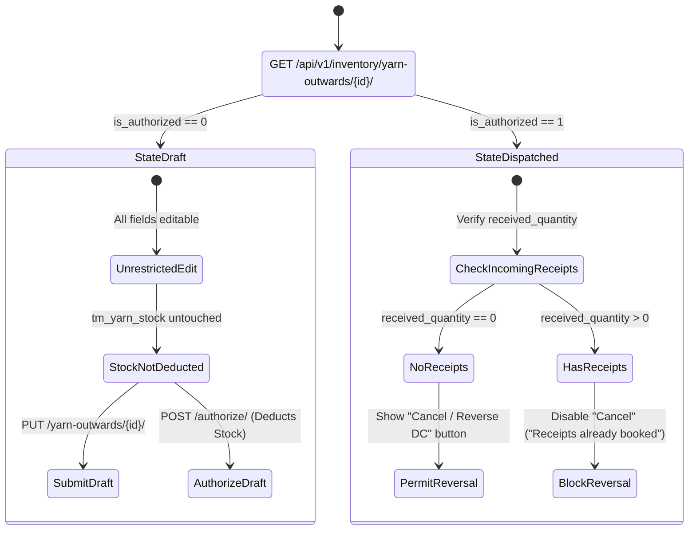

# UI & Frontend Workflow Specification: Yarn Outward Delivery Challan (DC) Edit Screen

## 1. Document Overview, Version, Scope, and Status

- **Document Title**: Yarn Outward Delivery Challan (DC) Edit Screen UI & Frontend Developer Specification
- **Screen ID**: `SCR-INVN-002-EDIT`
- **Document Version**: `v1.0.0`
- **Last Updated**: `15/10/2026`
- **Target Audience**: Frontend Engineers, Full-Stack Developers, QA Engineers, and Technical Product Owners
- **Implementation Status**: `Ready for Review / Implementation`
- **Scope**: Covers data hydration, state-dependent UI locking (Draft vs Dispatched vs Partial Receipt), downstream processing receipt safeguards (`received_quantity > 0`), atomic stock reversal workflows (`cancel_outward`), Zod schemas, API integration (`GET`, `PUT/PATCH`, `DELETE`), keyboard shortcuts, and developer acceptance checklists for the Yarn Outward Edit screen.

---

## 2. Module Details, Screen ID, Route, Access Privileges, and API Endpoints

### 2.1 Core Metadata

| Parameter | Specification |
|---|---|
| **Module** | `Module 4 — Inventory & Godown Stock Ledger` |
| **Screen ID** | `SCR-INVN-002-EDIT` |
| **Frontend Route** | `/inventory/yarn-outward/[id]/edit` |
| **File Location** | `app/(app)/inventory/yarn-outward/[id]/edit/page.tsx` |
| **Required Privilege** | `inventory_yarn_outward.can_update` (for editing Drafts); `inventory_yarn_outward.can_approve` (for Cancelling/Reversing dispatched challans) |
| **Authorized Roles** | `SUPER_ADMIN`, `ADMIN_USER`, `COMPANY_USER` (Inventory Managers, Dispatch Heads) |
| **Country Pack** | `IN` (India: Currency INR `₹`, Date `DD/MM/YYYY`, standard bag `45.360 Kg`) |

### 2.2 Primary API Endpoints

| HTTP Method | API Path | Privilege / Scope | Description |
|---|---|---|---|
| `GET` | `/api/v1/inventory/yarn-outwards/{id}/` | `can_read` | Fetch complete outward DC header, line items, received quantity, and completion status |
| `PUT / PATCH` | `/api/v1/inventory/yarn-outwards/{id}/` | `can_update` | Submit updated draft outward header and modified dispatch quantities (Only allowed when `is_authorized == 0`) |
| `POST` | `/api/v1/inventory/yarn-outwards/{id}/authorize/` | `can_approve` | Authorize a draft DC, deducting live godown stock from `tm_yarn_stock` atomically |
| `DELETE` | `/api/v1/inventory/yarn-outwards/{id}/` | `can_delete` / `can_approve` | Cancel/Reverse an outward DC, restoring stock to godown (via `YarnOutwardService.cancel_outward`) |

---

## 3. UI Layout, Screen Blueprint, and Visual Mockup

### 3.1 Desktop Wireframe Layout (1440px+ Viewport)

```
+--------------------------------------------------------------------------------------------------------------------------+
| TOP BREADCRUMB: Inventory > Yarn Outward > Edit #YKNT-202610-0031                                                         |
| Edit Yarn Outward (DC)               [● DISPATCHED - LOCKED]   [🚫 Cancel / Reverse DC]    [✔ Save Changes (Alt+S)]     |
+--------------------------------------------------------------------------------------------------------------------------+
| [i] DISPATCH NOTICE: This Delivery Challan has been authorized and stock of 2,268.000 Kg deducted from Main Factory Godown|
| (OR: [🔒 REVERSAL BLOCKED: 1,814.400 Kg already received under Inward GRN #YIN-0083. Cancel incoming GRN first])         |
+--------------------------------------------------------------------------------------------------------------------------+
| +-------------------------------------------------------+  +-----------------------------------------------------------+ |
| | CARD 1: DISPATCH & FISCAL CONTEXT                     |  | CARD 2: OUTWARD TYPE & DESTINATION CONSIGNMENT             | |
| | Outward No:    [ YKNT-202610-0031 ] [PERM-LOCKED]     |  | Outward Type:   [ To Knitting Mill ] [LOCKED]             | |
| | Outward Date:  [ 15/10/2026            ] [CALENDAR]  |  | Source Godown:  [ Main Factory Raw Godown - Bay A ] [LOCK]| |
| | Vehicle No:    [ TN-38-BZ-4921         ] [TRUCK ICON]|  | Destination:    [ Sri Ram Knitter Mill (Unit 2)   ] [LOCK]| |
| | Driver Name:   [ S. Murugan            ]             |  | E-Way Bill No:  [ 331298492019                    ] [EDIT]| |
| | Driver Phone:  [ +91 98421 98210       ]             |  | Knitting Prog #: [ KP-202610-0014                 ] [LOCK]| |
| +-------------------------------------------------------+  +-----------------------------------------------------------+ |
|                                                                                                                          |
| +----------------------------------------------------------------------------------------------------------------------+ |
| | CARD 3: DISPATCHED YARN LINE ITEMS (READ-ONLY WHEN DISPATCHED)                                                       | |
| | +-----+--------------------+----------+-------------------+-------+------------+------------+------------------------+ | |
| | | #   | Yarn Count         | Lot No   | Spinning Mill     | Bags  | Dispatched | Received   | Pending at Processor   | | |
| | +-----+--------------------+----------+-------------------+-------+------------+------------+------------------------+ | |
| | | 1   | 30s Combed Cotton  | VTM-7842 | Vardhman Textiles | 50    | 2,268.000  | 0.000 Kg   | 2,268.000 Kg (100% Pen)| | |
| | +-----+--------------------+----------+-------------------+-------+------------+------------+------------------------+ | |
| +----------------------------------------------------------------------------------------------------------------------+ |
|                                                                                                                          |
| +----------------------------------------------------------------------------------------------------------------------+ |
| | CARD 4: TRANSPORTER, LR & DISPATCH REMARKS                                                                           | |
| | Transporter: [ Associated Road Carriers Ltd.        ]  |  LR / Bilty No: [ ARC-CBE-994201      ]  |  LR Date: [15/10/2026]| |
| | Remarks: [ 50 Bags dispatched for Knitting Program #KP-0014                                                        ] | |
| +----------------------------------------------------------------------------------------------------------------------+ |
|                                                                                                                          |
| +----------------------------------------------------------------------------------------------------------------------+ |
| | STICKY FOOTER SUMMARY & AUDIT TRAIL                                                                                  | |
| | Created by Storekeeper K. Velu on 15/10/2026 11:30 AM • Status: Dispatched (Stock Deducted)                          | |
| | TOTAL BAGS: 50 Bags  |  DISPATCHED WEIGHT: 2,268.000 Kg  |  RECEIVED: 0.000 Kg  |  PENDING: 2,268.000 Kg             | |
+--------------------------------------------------------------------------------------------------------------------------+
```

---

## 4. Page Initialization and State Transitions

When `/inventory/yarn-outward/[id]/edit` loads:

1. **Hydration Query (`GET /api/v1/inventory/yarn-outwards/{id}/`)**:
   - Hydrates outward header, consignee details, line items, and processor tracking metrics (`received_quantity`, `remaining_quantity`, `is_complete`).
2. **Lifecycle State Evaluation**:



3. **Field Editability Rules by State**:

| Field / Section | Draft (`is_authorized == 0`) | Dispatched (`is_authorized == 1`) | Receipts Exist (`received_quantity > 0`) |
|---|---|---|---|
| `outward_number` | **Permanently Locked** | **Permanently Locked** | **Permanently Locked** |
| `outward_type` | Editable | **Permanently Locked** | **Permanently Locked** |
| `warehouse_id` | Editable | **Permanently Locked** | **Permanently Locked** |
| `destination_party_id` | Editable | **Permanently Locked** | **Permanently Locked** |
| `line_items` (Bags & Weight)| Editable | **Permanently Locked** | **Permanently Locked** |
| `vehicle_no` & `driver_name`| Editable | Editable (Transport update) | Editable (Transport update) |
| `eway_bill_no` & `date` | Editable | Editable | Editable |
| `remarks` | Editable | Editable | Editable |
| **"Cancel / Reverse DC"** | Delete Draft | Allowed (Restores Stock) | **Disabled / Blocked** |

---

## 5. Downstream Processing Safeguards & Reversal Workflow

In textile production, yarn dispatched for dyeing or knitting cannot be reversed if the processing unit has already completed work and issued an Inward GRN back to the factory.

### 5.1 The Incoming Receipt Invariant Check

Before rendering the "Cancel / Reverse DC" button:
$$\text{Safeguard Invariant: } \text{outward.received\_quantity} == 0.000\text{ Kg}$$

If $\text{outward.received\_quantity} > 0.000\text{ Kg}$:
- The "Cancel / Reverse DC" button is **disabled**.
- A prominent alert banner is displayed:
  > **Challan Reversal Blocked: Incoming Receipts Exist**  
  > *This outward dispatch has active incoming receipts of [X] Kg (under Yarn Inward GRN). You must cancel or reverse all downstream inward GRNs before this dispatch delivery challan can be cancelled.*

### 5.2 Atomic Reversal Execution (`DELETE /api/v1/inventory/yarn-outwards/{id}/`)

When an authorized outward with zero incoming receipts is cancelled:

1. **Atomic Transaction (`@transaction.atomic`)**:
   - Locks `tm_yarn_stock` row via `select_for_update()`.
   - Calls `YarnStockService.reverse_outward_stock()`.
   - Decrements `stock.outward_bag` and `stock.outward_quantity`.
   - Restores `stock.balance_bag` and `stock.balance_quantity`.
2. **Soft Delete**:
   - Sets `parent_yarn_outward_table.status = 0` and `child_yarn_outward_table.status = 0`.
3. **Toast & Navigation**:
   - Displays alert toast: *"Delivery Challan YKNT-202610-0031 cancelled. Stock of 2,268.000 Kg restored to Main Factory Godown."*
   - Navigates to `/inventory/yarn-outward`.

---

## 6. TypeScript Types and Edit Zod Schema

```typescript
export interface YarnOutwardEditFormValues {
  id: number;
  outward_number: string;
  outward_date: string;
  outward_type: "KNITTING" | "DYEING" | "PURCHASE_RETURN";
  warehouse_id: number;
  destination_party_id: number;
  yarn_type: string;
  vehicle_no?: string;
  driver_name?: string;
  driver_phone?: string;
  eway_bill_no?: string;
  eway_bill_date?: string;
  transporter_name?: string;
  lr_number?: string;
  lr_date?: string;
  remarks?: string;
  is_authorized: number;
  received_quantity: number;
  remaining_quantity: number;
  is_complete: number;
  line_items: Array<{
    id?: number;
    yarn_count_id: number;
    mill_id: number;
    color_shade_id?: number | null;
    lot_no: string;
    bag: number;
    quantity: number;
    remarks?: string;
  }>;
}
```

---

## 7. Developer Acceptance Checklist

- [ ] **1. Scaffolding**: Route `/inventory/yarn-outward/[id]/edit` created and loads dynamic ID.
- [ ] **2. Data Hydration**: Outward header, destination consignee, transport metadata, and line items hydrate accurately.
- [ ] **3. State Locking**: If `is_authorized == 1`, input cells are locked; only metadata (vehicle, driver, e-Way bill) is editable.
- [ ] **4. Receipt Safeguard**: If `received_quantity > 0`, "Cancel / Reverse DC" button is disabled and alert banner renders.
- [ ] **5. Atomic Stock Reversal**: Cancelling a clean dispatch restores `stock.balance_quantity` and `stock.balance_bag` in `tm_yarn_stock`.
