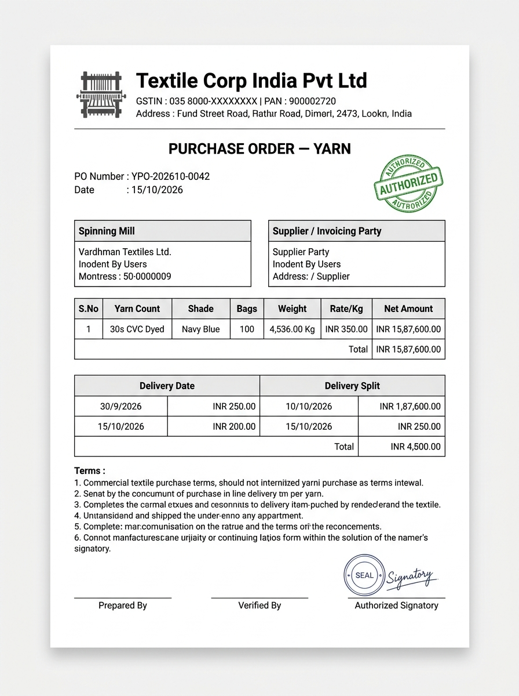

# UI & Document Layout Specification: Yarn Outward Delivery Challan (DC) Print & PDF Document

## 1. Document Overview, Version, Scope, and Status

- **Document Title**: Yarn Outward Delivery Challan (DC) Commercial A4 Print & PDF Document Specification
- **Screen ID**: `SCR-INVN-002-PRINT`
- **Document Version**: `v1.0.0`
- **Last Updated**: `15/10/2026`
- **Target Audience**: Frontend Engineers, Full-Stack Developers, QA Engineers, and Technical Product Owners
- **Implementation Status**: `Ready for Review / Implementation`
- **Scope**: Covers the printable A4 portrait sheet architecture, `@media print` CSS rules, corporate letterhead branding, statutory GST Rule 55 compliance (Goods dispatched for Job Work / Not for Sale), dual party blocks (Consignor vs Consignee), itemized yarn dispatch table, transport & E-Way Bill metadata, statutory declaration text, 4-tier authorized signatory blocks, and PDF export bindings for Yarn Outward Delivery Challans in the Garments ERP & CRM system.

---

## 2. Module Details, Screen ID, Route, Access Privileges, and API Endpoints

### 2.1 Core Metadata

| Parameter | Specification |
|---|---|
| **Module** | `Module 4 — Inventory & Godown Stock Ledger` |
| **Screen ID** | `SCR-INVN-002-PRINT` |
| **Frontend Route** | `/inventory/yarn-outward/[id]/print` |
| **File Location** | `app/(app)/inventory/yarn-outward/[id]/print/page.tsx` |
| **Required Privilege** | `inventory_yarn_outward.can_print` (or `inventory_yarn_outward.can_read`) |
| **Authorized Roles** | `SUPER_ADMIN`, `ADMIN_USER`, `COMPANY_USER` (All operational and dispatch roles) |
| **Paper Standard** | `ISO A4 Portrait (210mm x 297mm)` |
| **Statutory Rule** | `Rule 55 of CGST Rules, 2017 (Transportation of Goods without Invoice / Job Work)` |
| **Country Pack** | `IN` (India: HSN 5205, E-Way Bill, Weight in Kg `DD/MM/YYYY`) |

### 2.2 Primary API Endpoints

| HTTP Method | API Path | Privilege / Scope | Description |
|---|---|---|---|
| `GET` | `/api/v1/inventory/yarn-outwards/{id}/` | `can_read` | Fetch complete outward DC header, line items, consignee details, transport, and driver metadata |
| `GET` | `/api/v1/administration/companies/{id}/` | `can_read` | Fetch tenant company letterhead, logo, GSTIN, PAN, and registered factory dispatch address |

---

## 3. UI Layout, Screen Blueprint, and Visual Mockup

### 3.1 Visual Mockup Reference



### 3.2 A4 Printable Document Structure (210mm x 297mm)

```
+----------------------------------------------------------------------------------------------------+
| [SCREEN ONLY TOOLBAR]  [<- Back]   [🖨 Print (Ctrl+P)]   [📥 Download PDF]   [ Copy: Original (Consignee)v]|
+----------------------------------------------------------------------------------------------------+
| ================================================================================================== |
| [FACTORY LOGO]                   TEXTILE CORP INDIA PVT LTD                                        |
|                                  Spinning & Knitting Division, Mill Road, Tirupur - 641604         |
|                                  GSTIN: 33AABCT1234F1Z5 | PAN: AABCT1234F | State: 33 - Tamil Nadu |
|                                  Phone: +91 421 2471000 | Email: dispatch@tcipl.in                 |
| ================================================================================================== |
|                                 DELIVERY CHALLAN — YARN OUTWARD                                    |
|                      (Issued under Rule 55 of CGST Rules — Goods Sent for Job Work)                 |
|                                                                                                    |
| Challan No : YKNT-202610-0031                                +-----------------------------------+ |
| Challan Dt : 15/10/2026                                      |         DISPATCHED FROM GODOWN    | |
| Purpose    : Subcontract Knitting (Job Card #KP-0014)        |         Main Factory Godown (Bay A| |
| Vehicle No : TN-38-BZ-4921                                   +-----------------------------------+ |
| Driver Name: S. Murugan (+91 98421 98210)                    | E-Way Bill #: 331298492019        | |
| Transporter: Associated Road Carriers Ltd.                   | E-Way Date : 15/10/2026           | |
|                                                              | LR / Bilty : ARC-CBE-994201       | |
|                                                                                                    |
| +--------------------------------------------------+-----------------------------------------------+ |
| | CONSIGNOR (DISPATCHING FROM)                     | CONSIGNEE (DISPATCHED TO)                     | |
| | Textile Corp India Pvt Ltd (Unit-1)              | Sri Ram Knitter Mill (Unit-2)                 | |
| | 124, Mill Road, Angeripalayam, Tirupur - 641604  | 45, Knitter Colony, Angeripalayam Road,       | |
| | GSTIN: 33AABCT1234F1Z5 (State: 33 - Tamil Nadu)  | Tirupur - 641602                              | |
| |                                                  | GSTIN: 33AAAFS4419K1Z1 (State: 33 - Tamil Nadu| |
| +--------------------------------------------------+-----------------------------------------------+ |
|                                                                                                    |
| ITEMIZED YARN DISPATCH TABLE:                                                                      |
| +---+--------------------+----------+-------------------+------+--------+-----------+------------+ |
| |#  | Yarn Count & Specs | Lot No   | Spinning Mill     | HSN  | Bags   | Cones     | Net Wt(Kg) | |
| +---+--------------------+----------+-------------------+------+--------+-----------+------------+ |
| | 1 | 30s Combed Cotton  | VTM-7842 | Vardhman Textiles | 5205 | 50     | 1,200     | 2,268.000  | |
| |   | Grey Yarn / Single |          | Ludhiana Unit     |      |        | Paper Cones|           | |
| +---+--------------------+----------+-------------------+------+--------+-----------+------------+ |
| | TOTALS:                                                      | 50     | 1,200     | 2,268.000  | |
| +--------------------------------------------------------------+--------+-----------+------------+ |
| Net Dispatch Weight in Words: Two Thousand Two Hundred Sixty-Eight Kilograms Only.                 |
| Estimated Value for E-Way Bill: ₹7,93,800.00 (Yarn Valuation @ ₹350.00/Kg)                          |
|                                                                                                    |
| STATUTORY DECLARATION (CGST RULE 55):                                                              |
| 1. The goods covered under this Delivery Challan are dispatched strictly for job-work processing    |
|    (Knitting) under Section 143 of the CGST Act, 2017 and are NOT meant for sale.                  |
| 2. The processed goods (Grey Fabric) shall be returned to our factory within the statutory period  |
|    prescribed under GST laws.                                                                      |
| 3. All waste and scrap arising during the job-work process shall be accounted for by the consignee.|
|                                                                                                    |
| FOUR-TIER AUTHORIZED SIGNATORIES:                                                                  |
| +--------------------+--------------------+-----------------------+--------------------------------+ |
| | 1. Prepared By     | 2. Driver Sign     | 3. Security Gate Pass | 4. Consignee Receiver Sign     | |
| | Storekeeper        | Received Sound Bags| Out-Time: 11:45 AM    | Received in Sound Condition    | |
| | Sign: _____________| Sign: _____________| Sign: ________________| Sign & Stamp: _________________| |
| +--------------------+--------------------+-----------------------+--------------------------------+ |
+----------------------------------------------------------------------------------------------------+
```

---

## 4. Header, Letterhead, and Statutory Metadata

1. **Company Branding & Letterhead**:
   - High-resolution company logo (300 DPI print fidelity).
   - Legal Name, Registered Factory Address, GSTIN, PAN, CIN, State Code.
2. **Challan Title & Statutory Subtitle**:
   - Heading: `DELIVERY CHALLAN — YARN OUTWARD`.
   - Subtitle: `(Issued under Rule 55 of CGST Rules, 2017 — Transportation of Goods without Invoice / Job Work)`.
3. **Distinctive Copy Watermark**:
   - `ORIGINAL FOR CONSIGNEE (RECEIVER)`
   - `DUPLICATE FOR TRANSPORTER`
   - `TRIPLICATE FOR CONSIGNOR (GODOWN RECORD)`

---

## 5. Transport & E-Way Bill Block

- **E-Way Bill Number**: 12-digit GST E-Way Bill tracking number.
- **E-Way Bill Date**: Date of generation.
- **Vehicle Registration Number**: Commercial vehicle registration (e.g. `TN-38-BZ-4921`).
- **Transporter & LR Details**: Transporter name and Lorry Receipt (LR / Bilty) number.
- **Driver Credentials**: Driver name and mobile number.

---

## 6. Itemized Dispatch Table and Statutory Text

- **Itemized Columns**:
  - Item sequence index (`#`).
  - Yarn Count & Technical Specifications (e.g. `30s Combed Cotton Grey Single`).
  - Spinning Mill Lot Number (`lot_no`).
  - Origin Spinning Mill Name.
  - HSN Code (`5205` for cotton yarn).
  - Bags Dispatched.
  - Estimated Cone Count.
  - Net Weight in Kilograms (`Kg`), formatted to 3 decimal places.
- **Weight in Words**:
  - Dynamically converted to Indian English text via `FormatService.weight_to_words()`.
- **Statutory Declaration**:
  - Pre-printed legal text citing Section 143 and Rule 55 of the CGST Act, 2017 confirming that yarn is dispatched for job-work processing and will be returned as finished fabric/dyed yarn.

---

## 7. Four-Tier Authorized Signatories

A valid industrial Delivery Challan requires 4 distinct signatures:

1. **Prepared By (Godown Storekeeper)**:
   - Certifies that the bags were counted, verified against live stock, and loaded onto the truck.
2. **Driver Signature**:
   - Certifies that the driver received the specified number of bags in sound condition.
3. **Security Gate Officer**:
   - Records the physical vehicle out-time, checks vehicle registration, and inspects the lorry seal.
4. **Consignee Receiver Acknowledgment**:
   - The destination mill (Knitter / Dyer) stamps and signs the duplicate copy upon delivery, confirming receipt of sound bags.

---

## 8. Print Styling Rules (`@media print`)

```css
@media print {
  body {
    background: #ffffff !important;
    color: #000000 !important;
    font-size: 11pt;
    line-height: 1.3;
  }

  .screen-only-toolbar {
    display: none !important;
  }

  .print-page-container {
    width: 210mm;
    min-height: 297mm;
    padding: 12mm 15mm;
    margin: 0 auto;
    page-break-after: always;
  }

  table {
    border-collapse: collapse !important;
    width: 100% !important;
  }

  table, th, td {
    border: 1px solid #1e293b !important;
  }

  th {
    background-color: #f1f5f9 !important;
    font-weight: 700 !important;
  }

  .signatory-block {
    page-break-inside: avoid !important;
    margin-top: 25px;
  }
}
```

---

## 9. Developer Acceptance Checklist

- [ ] **1. Single Page Fit**: Standard dispatches ($\le 5$ lots) print cleanly on a single A4 portrait page.
- [ ] **2. Hide Web Chrome**: Browser URL headers, footers, and screen toolbar disappear during `Ctrl+P` print.
- [ ] **3. Accurate Weight Math**: Total bags and total kilograms match line item sums exactly.
- [ ] **4. Weight in Words**: Accurately renders Indian English words for net kilograms.
- [ ] **5. Statutory Text**: CGST Rule 55 declaration is clearly printed above the signatory blocks.
- [ ] **6. Copy Selector**: Toolbar dropdown allows switching between "Original (Consignee)", "Duplicate (Transporter)", and "Triplicate (Store)".
