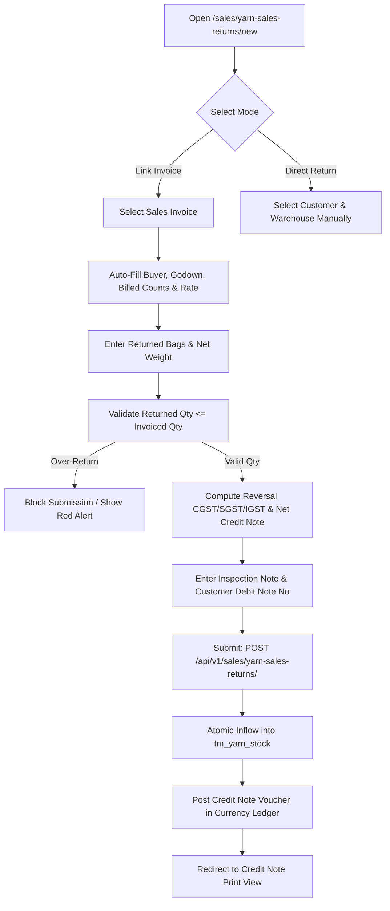

# Yarn Sales Return (Credit Note) Add Workflow Specification

| Standard Code | Screen ID | Target Platform | API Version | Document Version | Date | Status |
|---|---|---|---|---|---|---|
| **STD-UI-001** | **`SCR-SALE-002-ADD`** | Next.js 14 (App Router) + TypeScript | `v1.2` (Django 5 DRF) | `v1.0.0` | 15/10/2026 | **APPROVED FOR IMPLEMENTATION** |

---

## 1. Document Overview, Version, Scope, and Status

### 1.1 Purpose
This specification defines the complete end-to-end frontend architecture, user interaction model, data grid operations, real-time keystroke calculations, statutory Indian GST Credit Note requirements, and backend API integration for the **Yarn Sales Return Add Workflow** (`SCR-SALE-002-ADD`).

This screen enables the commercial desk and godown receiving team to accept yarn returned by customers (e.g. due to shade mismatch, count variation, slub defect, or excess dispatch). Processing this return:
1. Atomically re-credits physical bags and kilogram weight back into godown stock in [`tm_yarn_stock`](file:///d:/Codebase/Garments/backend/apps/inventory/models.py) via [`YarnStockService.add_sales_return_stock`](file:///d:/Codebase/Garments/backend/apps/sales/services.py).
2. Generates a statutory GST Credit Note under **Section 34 of the CGST Act**, computing tax reversals (CGST/SGST or IGST) via [`TaxEngine`](file:///d:/Codebase/Garments/backend/core/utils/tax_engine.py).
3. Automatically posts a credit note voucher reducing the customer's accounts receivable in [`tl_voucher`](file:///d:/Codebase/Garments/backend/apps/ledger/models.py) via [`CurrencyLedgerService.post_sales_return_voucher`](file:///d:/Codebase/Garments/backend/apps/sales/services.py).
4. Records itemized inward stock movement under [`tl_stock_movement`](file:///d:/Codebase/Garments/backend/apps/ledger/models.py).

### 1.2 Scope
- **Entities Handled**: Parent header [`parent_yarn_sales_return_table`](file:///d:/Codebase/Garments/backend/apps/sales/models.py) (`tm_yarn_sales_return`) and itemized line items [`child_yarn_sales_return_table`](file:///d:/Codebase/Garments/backend/apps/sales/models.py) (`tx_yarn_sales_return`).
- **Return Modes**:
  1. **Invoice-Linked Return (Standard)**: References original [`parent_yarn_sales_table`](file:///d:/Codebase/Garments/backend/apps/sales/models.py) (`tm_yarn_sales`), inheriting rates, taxes, and validating that returned quantity does not exceed originally invoiced quantity.
  2. **Direct Return (Standalone)**: For unmigrated legacy invoices or trade adjustments.
- **Country Pack**: India (`IN`) — Indian Rupee (`₹`), Indian numbering grouping (`12,34,567.89`), Date format (`DD/MM/YYYY`), HSN codes `5205` / `5206`, and GST Section 34 Credit Note rules.

---

## 2. Module Details, Screen ID, Route, Access Privileges, and API Endpoints

### 2.1 Core Metadata

| Parameter | Specification |
|---|---|
| **Module** | `Module 5 — Commercial Sales & Customer Returns` |
| **Screen ID** | `SCR-SALE-002-ADD` |
| **Frontend Route** | `/sales/yarn-sales-returns/new` |
| **File Location** | `app/(app)/sales/yarn-sales-returns/new/page.tsx` |
| **Required Privilege** | `sales_yarn_return.can_create` |
| **Authorized Roles** | `SUPER_ADMIN`, `ADMIN_USER`, `COMPANY_USER` (Sales Coordinator, Quality Inspector, Commercial Accountant) |
| **Country Pack** | `IN` (India: Currency INR `₹`, Date `DD/MM/YYYY`, Bags standard `45.360 Kg`, GST CGST/SGST/IGST) |

### 2.2 Primary API Endpoints

| HTTP Method | API Path | Privilege / Scope | Description |
|---|---|---|---|
| `POST` | `/api/v1/sales/yarn-sales-returns/` | `can_create` | Create a new Yarn Sales Return header and line items, re-credit live stock atomically, and post credit note vouchers |
| `GET` | `/api/v1/sales/yarn-sales/?is_authorized=1&status=1` | `can_read` | Fetch active, authorized Sales Invoices to link customer return |
| `GET` | `/api/v1/sales/yarn-sales/{id}/` | `can_read` | Fetch full invoice details, line items, sold weight, and billed rate |
| `GET` | `/api/v1/masters/parties/?party_type=CUSTOMER&is_active=1` | `can_read` | Fetch registered customer buyers |
| `GET` | `/api/v1/masters/warehouses/?is_active=1` | `can_read` | Fetch authorized receiving warehouses |
| `GET` | `/api/v1/masters/yarn-counts/?is_active=1` | `can_read` | Fetch yarn counts |
| `GET` | `/api/v1/masters/color-shades/?is_active=1` | `can_read` | Fetch color shades |

---

## 3. UI Layout, Screen Blueprint, and Visual Mockup (1440px+ Wireframe)

```
+-----------------------------------------------------------------------------------------------------------------------------+
| GARMENTS ERP — Commercial Sales Desk                                         Company: ABC Textiles Ltd | FY: 2026-2027      |
+-----------------------------------------------------------------------------------------------------------------------------+
| [<- Back to Returns]  NEW YARN SALES RETURN (GST CREDIT NOTE)                                [Reset Form]  [Save Draft]     |
+-----------------------------------------------------------------------------------------------------------------------------+
| SECTION 1: RETURN CONTEXT & INVOICE LINKAGE                                                                                 |
| Return Number: [ YSRET-202610-0005 ] (Auto)   Return Date: [ 15/10/2026 ]*    Return Mode: [ (o) Against Invoice  ( ) Direct]|
| Link Sales Invoice: [ YSAL-202610-0018 dt. 15/10/2026 - Premier Knittings Pvt Ltd - 1,587.600 Kg                  v ]*     |
| Customer:      [ Premier Knittings Pvt Ltd - GSTIN: 33AAAAA1234A1Z5 - Tirupur                                       ] (Auto) |
| Receiving Godown: [ Central Godown       v ]*   Place of Supply: [ 33-Tamil Nadu                                     ] (Auto) |
| Return Reason: [ Shade Variation / Uneven Color                                                                   v ]*     |
+-----------------------------------------------------------------------------------------------------------------------------+
| SECTION 2: ORIGINAL INVOICE PARTICULARS & RETURN ITEM GRID                                                                  |
| Original Invoice Summary: Billed 35 Bags (1,587.600 Kg) @ Avg ₹355.00/Kg | Invoice Total: ₹5,91,778.00                     |
| Previous Returns Against Invoice: 0.000 Kg | Maximum Returnable: 1,587.600 Kg                                              |
|                                                                                                                             |
| # | Yarn Count*    | Mill*        | Color Shade   | Lot No*  | Ret Bags* | Weight/Bag | Ret Weight (Kg)* | Rate (₹/Kg)* | Credit Amt(₹)|
|---+----------------+--------------+---------------+----------+-----------+------------+------------------+--------------+--------------|
| 1 | 30s Karded     | Ramco Mills  | -- N/A --     | RM-901   |         5 |     45.360 |          226.800 |       340.00 |    77,112.00 |
|   |                |              |               |          |           |            |                  |              |              |
| [+ Add Returned Line Item]                                                                                                  |
+-----------------------------------------------------------------------------------------------------------------------------+
| SECTION 3: GST CREDIT NOTE SUMMARY & SETTLEMENT DOCK                                                                        |
| Quality Inspection & Gate Pass:                               | Statutory GST Credit Note Summary:                          |
| Quality Inspector: [ S. Muthusamy - QC Lead     ]             | Total Bags Returned:            5 Bags                      |
| Inspection Note:   [ 5 bags rejected due to     ]             | Total Weight Returned:    226.800 Kg                        |
|                    [ uneven dye penetration.    ]             | Taxable Credit Value:     ₹77,112.00                        |
| Vehicle No:        [ TN-38-BZ-4412              ]             | GST Bracket:              [ GST 5% (Inherited)        v ]   |
| Customer Debit Note: [ DN-PK-2026-902           ]             | CGST Reversal (2.50%):     ₹1,927.80                        |
| Debit Note Date:   [ 14/10/2026                 ]             | SGST Reversal (2.50%):     ₹1,927.80                        |
|                                                               | IGST Reversal (0.00%):         ₹0.00 (Intra-State)          |
|                                                               | Round-Off Adjustment:          +₹0.40                       |
|                                                               | TOTAL CREDIT NOTE AMOUNT: ₹80,968.00                        |
|                                                               | (Rupees Eighty Thousand Nine Hundred and                    |
|                                                               |  Sixty-Eight Only)                                          |
+-----------------------------------------------------------------------------------------------------------------------------+
| [Cancel (Esc)]                                                  [Inspect Stock Effect]   [Save & Print]  [POST CREDIT NOTE] |
+-----------------------------------------------------------------------------------------------------------------------------+
```

---

## 4. Page Initialization, Query Parameters, and Default Form State

### 4.1 Page Hydration Lifecycle
1. **Parallel Master Data Hydration** (`TanStack Query`):
   - Active warehouses (`tm_warehouse`).
   - Active customer buyers (`tm_party` where `party_type='CUSTOMER'`).
   - Active spinning mills (`tm_party` where `party_type='MILL'`).
   - Active yarn counts (`tm_yarn_count`).
   - Active color shades (`tm_color_shade`).
   - Master taxes (`mx_tax`).
2. **Query Parameter Handling**:
   - `?sales_invoice_id=18`: Automatically triggers invoice lookup:
     - Pre-selects buyer, receiving warehouse, and place of supply.
     - Fetches billed line items and auto-populates the grid with returnable counts, lots, and rates.
     - Evaluates maximum returnable quantity:
       $$\text{Max Returnable Kg} = \text{Invoice Qty} - \sum \text{Previous Returns Qty}$$

---

## 5. Document Header, Fiscal Context, and Financial Year Configuration

| Field Name | Type | UI Control | Validation & Invariants | Default Value |
|---|---|---|---|---|
| `return_number` | String | Read-only Input | Auto-generated by backend (`YSRET-YYYYMM-XXXX`). Read-only. | System generated |
| `return_date` | Date | Date Picker (`DD/MM/YYYY`) | Must fall within active FY. Cannot be earlier than linked invoice date. | Current local date |
| `sales_invoice` | Integer | Searchable Select | Recommended. Linked sales invoice. Locks customer and tax rates. | Optional (Query param) |
| `customer` | Integer | Searchable Select | Required. Buyer returning the goods. Auto-populated if invoice linked. | None |
| `warehouse` | Integer | Searchable Select | Required. Warehouse where returned yarn will be physically unloaded. | Default Godown |
| `return_reason` | String | Select / Input | Required. Defect or commercial reason (e.g. `Shade Variation`, `Defective Count`). | `Shade Variation` |
| `customer_debit_note` | String | Text Input | Optional. Customer's internal debit note number for audit cross-reference. | Blank |

---

## 6. Primary Master Linkages & Return Reasons

### 6.1 Return Reasons Catalogue
The dropdown provides standard textile industry return categories:
1. **`SHADE_VARIATION`**: Color shade mismatch against approved lab dip / sample.
2. **`COUNT_DEFECT`**: Uneven count, high CV%, or excessive slub / neps.
3. **`EXCESS_QUANTITY`**: Customer received more weight than purchase order specifications.
4. **`TRANSIT_DAMAGE`**: Torn bags, dirt contamination, or water damage during transit.
5. **`REJECTION_AT_KNITTING`**: Frequent yarn breakages or machine stalling on circular knitting machines.

---

## 7. Interactive Spreadsheet Data Grid & Return Items

| Col # | Column Header | Data Key | UI Control | Formatting | Required | Invariants & Calculations |
|---|---|---|---|---|---|---|
| 1 | **#** | `line_number` | Text Badge | Integer | Yes | Auto-incremented row index |
| 2 | **Yarn Count** | `yarn_count_id` | Select | Text (30s K, 40s C) | Yes | Inherited from invoice |
| 3 | **Spinning Mill** | `mill_id` | Select | Text (Ramco, Loyal) | Yes | Inherited from invoice |
| 4 | **Color Shade** | `color_shade_id` | Select | Text (Navy Blue #04) | Conditional | Required if `yarn_type == 'DYED'` |
| 5 | **Lot Number** | `lot_no` | Text Input | Alphanumeric | Yes | Inherited from invoice |
| 6 | **Returned Bags** | `bag` | Number Input | Integer (`5`) | Yes | $\le \text{Invoice Bags}$ |
| 7 | **Kg/Bag** | `per_bag` | Number Input | Decimal (`45.360`) | Yes | Defaults to 45.360 Kg |
| 8 | **Net Weight (Kg)**| `quantity` | Number Input | Decimal (`226.800`) | Yes | $\text{bag} \times \text{per\_bag}$ (or direct scale net) |
| 9 | **Billed Rate (₹)**| `rate` | Currency Input | `₹340.00` | Yes | Inherited from original invoice |
| 10 | **Taxable Amt (₹)** | `amount` | Read-only | `₹77,112.00` | Yes | $\text{quantity} \times \text{rate}$ |
| 11 | **Actions** | `actions` | Button | Icon (Trash) | No | Remove row (Min 1 row required) |

---

## 8. Mathematical Formulas & Keystroke Calculation Engine

### 8.1 Net Returned Weight
$$\text{Line Returned Qty (Kg)} = \text{Returned Bags} \times \text{Weight per Bag (45.360)}$$

### 8.2 Ceiling Validation (Prevent Over-Return)
$$\text{Returned Qty} \le \text{Original Invoice Billed Qty} - \text{Previously Returned Qty}$$
*If exceeded: Input flashes red with blocking error: "Cannot return more than originally billed quantity!"*

### 8.3 Taxable Return Subtotal
$$\text{Subtotal} = \sum_{i=1}^{n} \left(\text{Line Quantity}_i \times \text{Line Rate}_i\right)$$

### 8.4 Statutory GST Tax Reversal
Using [`TaxEngine.compute`](file:///d:/Codebase/Garments/backend/core/utils/tax_engine.py):
- **Intra-State Return**:
  $$\text{CGST Reversal} = \text{Round}\left(\text{Subtotal} \times \frac{2.50}{100}, 2\right)$$
  $$\text{SGST Reversal} = \text{Round}\left(\text{Subtotal} \times \frac{2.50}{100}, 2\right)$$
- **Inter-State Return**:
  $$\text{IGST Reversal} = \text{Round}\left(\text{Subtotal} \times \frac{5.00}{100}, 2\right)$$

### 8.5 Total Credit Note Value
$$\text{Net Credit Amount} = \text{Round}\left(\text{Subtotal} + \text{CGST} + \text{SGST} + \text{IGST}, 0\right)$$

---

## 9. Godown Stock Restitution Mechanics

When this sales return is posted:
1. [`YarnStockService.add_sales_return_stock`](file:///d:/Codebase/Garments/backend/apps/sales/services.py) locates the matching stock record in [`tm_yarn_stock`](file:///d:/Codebase/Garments/backend/apps/inventory/models.py) using `(company, warehouse, yarn_type, yarn_count, mill, color_shade, lot_no)`.
2. It executes atomic increments:
   $$\text{balance\_bag} \leftarrow \text{balance\_bag} + \text{return.bag}$$
   $$\text{balance\_quantity} \leftarrow \text{balance\_quantity} + \text{return.quantity}$$
3. Records movement in [`tl_stock_movement`](file:///d:/Codebase/Garments/backend/apps/ledger/models.py) with movement type `SALES_RETURN` and `party_id=customer_id`.

---

## 10. Summary Bar, Remarks, and Credit Note Calculations

Located in the bottom sticky dock:
- **Total Bags Returned**: $\sum \text{Bags}$ formatted as integer badge.
- **Total Weight Returned**: $\sum \text{Quantity}$ formatted as `226.800 Kg`.
- **Taxable Subtotal**: Formatted in Indian Rupees `₹77,112.00`.
- **Total GST Reversal**: Formatted as `₹3,855.60`.
- **Net Credit Note Value**: Formatted as `₹80,968.00`.
- **Amount in Words**: Auto-generated in Indian English (*"Rupees Eighty Thousand Nine Hundred and Sixty-Eight Only"*).

---

## 11. Form Validation Rules and Error Messages

| Field | Validation Condition | Error Message |
|---|---|---|
| `customer` | Must not be empty | "Please select a customer." |
| `warehouse` | Must not be empty | "Please select receiving warehouse godown." |
| `return_date` | Must be valid FY date | "Return date must fall within current active FY." |
| `sales_invoice` | Date validation | "Return date cannot be earlier than invoice date ({invoice_date})." |
| `quantity` | `quantity <= invoice_remaining` | "Returned quantity ({qty} Kg) exceeds maximum returnable quantity ({max} Kg)." |
| `rate` | Decimal > 0.00 | "Return rate must be greater than zero." |
| `return_reason` | Must not be empty | "Please select a reason for customer sales return." |

---

## 12. Lifecycle Workflows



---

## 13. API Integration, Request Headers, and Payload Serialization

### 13.1 Request Payload
```json
{
  "return_date": "15/10/2026",
  "sales_invoice_id": 18,
  "customer_id": 5,
  "warehouse_id": 1,
  "yarn_type": "GREY",
  "place_of_supply": "33-Tamil Nadu",
  "return_reason": "Shade Variation / Uneven Color",
  "customer_debit_note": "DN-PK-2026-902",
  "remarks": "5 bags returned due to uneven dye penetration.",
  "tax_id": 1,
  "bag": 5,
  "quantity": "226.800",
  "rate": "340.00",
  "line_items": [
    {
      "yarn_count_id": 1,
      "mill_id": 3,
      "color_shade_id": null,
      "lot_no": "RM-901",
      "bag": 5,
      "quantity": "226.800",
      "rate": "340.00",
      "amount": "77112.000"
    }
  ]
}
```

### 13.2 Success Response (`201 Created`)
```json
{
  "success": true,
  "data": {
    "id": 5,
    "return_number": "YSRET-202610-0005",
    "return_date": "15/10/2026",
    "sales_invoice": 18,
    "customer_name": "Premier Knittings Pvt Ltd",
    "warehouse_name": "Central Godown",
    "subtotal": "77112.000",
    "tax_percent": "5.00",
    "tax_amount": "3855.600",
    "cgst_percent": "2.50",
    "cgst_amount": "1927.800",
    "sgst_percent": "2.50",
    "sgst_amount": "1927.800",
    "igst_percent": "0.00",
    "igst_amount": "0.000",
    "total_amount": "80967.600",
    "return_reason": "Shade Variation / Uneven Color",
    "is_authorized": 1,
    "status": 1
  }
}
```

---

## 14. Next.js Folder Structure and Component Responsibilities

```
frontend/src/app/(app)/sales/yarn-sales-returns/
├── page.tsx                           # SCR-SALE-002-LIST (Returns Register)
├── new/
│   ├── page.tsx                       # SCR-SALE-002-ADD (Return Add Workflow)
│   ├── components/
│   │   ├── ReturnHeaderCard.tsx       # Invoice selector, customer, warehouse, reason
│   │   ├── ReturnDataGrid.tsx         # Itemized returned counts and weights
│   │   ├── InvoiceCeilingAlert.tsx    # Max returnable weight vs entered weight
│   │   └── CreditNoteSummaryDock.tsx  # Tax reversal, round-off, amount in words
│   ├── hooks/
│   │   ├── useYarnSalesReturnForm.ts  # Form controller with Zod validation
│   │   └── useInvoiceDetails.ts       # Hydrates parent invoice line items
│   └── types/
│       └── sales-return.types.ts      # TypeScript interfaces and schemas
└── [id]/
    ├── edit/
    │   └── page.tsx                   # SCR-SALE-002-EDIT (Edit & Cancel Return)
    └── print/
        └── page.tsx                   # SCR-SALE-002-PRINT (Credit Note Print)
```

---

## 15. Zod Schemas and TypeScript Types

```typescript
import { z } from "zod";

export const YarnSalesReturnLineItemSchema = z.object({
  yarn_count_id: z.number().min(1, "Select yarn count"),
  mill_id: z.number().min(1, "Select mill"),
  color_shade_id: z.number().nullable().optional(),
  lot_no: z.string().min(1, "Enter lot number"),
  bag: z.number().int().min(1, "Minimum 1 bag"),
  quantity: z.number().positive("Quantity must be positive"),
  rate: z.number().positive("Rate must be positive"),
  amount: z.number().nonnegative(),
});

export const YarnSalesReturnFormSchema = z.object({
  return_date: z.string().regex(/^\d{2}\/\d{2}\/\d{4}$/, "Format: DD/MM/YYYY"),
  sales_invoice_id: z.number().optional().nullable(),
  customer_id: z.number({ required_error: "Select customer" }).min(1),
  warehouse_id: z.number({ required_error: "Select warehouse" }).min(1),
  yarn_type: z.enum(["GREY", "DYED"]),
  place_of_supply: z.string().min(1, "Select place of supply"),
  return_reason: z.string().min(1, "Select return reason"),
  customer_debit_note: z.string().max(50).optional(),
  remarks: z.string().max(255).optional(),
  tax_id: z.number().optional(),
  line_items: z.array(YarnSalesReturnLineItemSchema).min(1, "At least one line item required"),
});

export type YarnSalesReturnFormData = z.infer<typeof YarnSalesReturnFormSchema>;
```

---

## 16. Keyboard Shortcuts & Billing Ergonomics

| Key Combination | Action Scope | Function |
|---|---|---|
| `Ctrl + S` | Global Form | Post & Submit Sales Return (Credit Note) |
| `F4` | Data Grid | Insert new return line row |
| `F2` | Selected Row | Inspect original billed line balance |
| `Delete` | Data Grid Row | Delete row (Min 1 row required) |
| `Escape` | Global Form | Discard changes modal |

---

## 17. Security, Tenant Scoping, and Accounting Invariants

1. **Strict Tenant Isolation**: `company_id` injected exclusively from the authenticated session.
2. **Double-Entry Financial Accounting**: Creating a sales return dispatches [`CurrencyLedgerService.post_sales_return_voucher`](file:///d:/Codebase/Garments/backend/apps/sales/services.py) to post Dr Sales Returns Account and Cr Customer Accounts Receivable.
3. **Physical Stock Restitution**: Returned yarn immediately increases available stock for subsequent production or re-sale.

---

## 18. Developer Acceptance Criteria

- [ ] Route `/sales/yarn-sales-returns/new` allows selecting a past sales invoice to pre-populate return rows.
- [ ] Validates that returned quantity cannot exceed original invoice quantity.
- [ ] Live godown stock balance increases atomically upon posting.
- [ ] Financial debtor balance decreases by the credit note total amount.
- [ ] Upon successful submission, user is automatically redirected to `/sales/yarn-sales-returns/[id]/print`.
