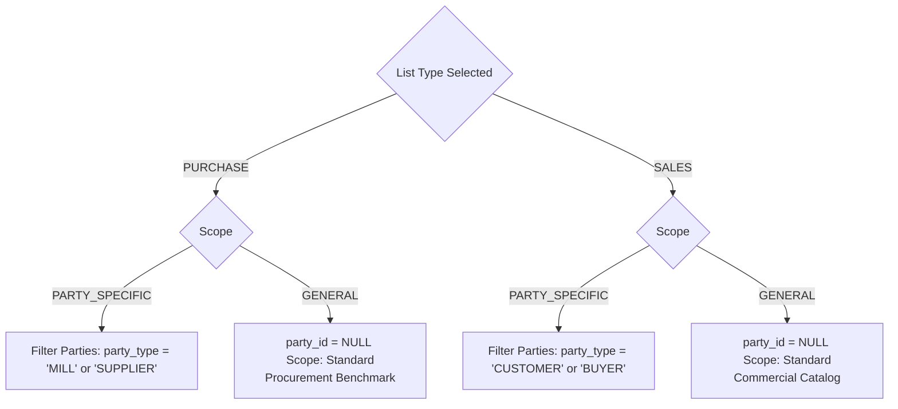
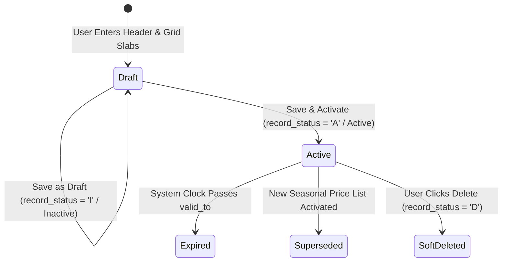

# Yarn Price List Add Workflow Specification

| Standard Code | Screen ID | Target Platform | API Version | Document Version | Date | Status |
|---|---|---|---|---|---|---|
| **STD-UI-001** | **`SCR-PRIC-001-ADD`** | Next.js 14 (App Router) + TypeScript | `v1.2` (Django 5 DRF) | `v1.0.0` | 16/10/2026 | **APPROVED FOR IMPLEMENTATION** |

---

## 1. Document Overview, Version, Scope, and Status

### 1.1 Purpose
This specification defines the complete end-to-end frontend architecture, user interaction model, data grid operations, real-time keystroke calculations, multi-tier volume break slabs, dynamic textile technical specifications, and backend API integration for the **Yarn Price List Add Workflow** (`SCR-PRIC-001-ADD`).

In spinning, knitting, and garment export clusters (e.g. Tirupur, Coimbatore, Surat), raw cotton yarn rates fluctuate continuously. Commercial pricing requires maintaining structured rate cards rather than static item rates. This screen allows procurement merchandisers and commercial sales coordinators to configure:
1. **Purchase Price Lists (`PURCHASE`)**: Contracted yarn procurement rates with spinning mills (e.g., Ramco Mills, SVT Spinning) or suppliers, establishing mill base rates, volume rebate tiers, procurement lead times, and MOQs.
2. **Sales Price Lists (`SALES`)**: Commercial selling rates quoted to domestic buyers, fashion brands, or trading partners, defining count-wise selling rates, trade discounts, and minimum order commitments.
3. **Scope Governance**: Defining **General Base Rate Cards** (`scope = GENERAL`, company-wide default benchmark) or **Party-Specific Contracted Rate Cards** (`scope = PARTY_SPECIFIC`, high-priority contracted rates for a specific mill or client).
4. **Volume Break Slabs**: Multiple tiered pricing brackets for the same yarn count (e.g., 1–500 Kg @ ₹360.00, 501–2,000 Kg @ ₹352.00, >2,000 Kg @ ₹345.00).

### 1.2 Scope
- **Entities Handled**: Parent header [`tm_price_list`](file:///d:/Codebase/Garments/backend/apps/pricing/models.py) (`PriceList`) and itemized line tiers [`tm_price_list_item`](file:///d:/Codebase/Garments/backend/apps/pricing/models.py) (`PriceListItem`).
- **Country Pack**: India (`IN`) — Indian Rupee (`₹`), Indian numerical grouping (`12,34,567.89`), Date format (`DD/MM/YYYY`), Rates displayed to 4 decimal places (`0.0000`), Bag weight default nominal standard `45.360 Kg`, weights in `Kg` to 3 decimal places.
- **Related Transactions**: Rates created here feed directly into the automated **Rate Determination Engine** ([`PricingResolutionService`](file:///d:/Codebase/Garments/backend/apps/pricing/services.py)) called during Yarn Purchase Orders ([`tm_yarn_po`](file:///d:/Codebase/Garments/backend/apps/purchase/models.py)), Inward GRN rate audits ([`tx_parent_yarn_inward`](file:///d:/Codebase/Garments/backend/apps/inventory/models.py)), and Commercial Yarn Sales ([`tm_yarn_sales`](file:///d:/Codebase/Garments/backend/apps/sales/models.py)).

---

## 2. Module Details, Screen ID, Route, Access Privileges, and API Endpoints

### 2.1 Core Metadata

| Parameter | Specification |
|---|---|
| **Module** | `Module 9 — Commercial Pricing Engine` |
| **Screen ID** | `SCR-PRIC-001-ADD` |
| **Frontend Route** | `/pricing/yarn-price-lists/new` |
| **File Location** | `app/(app)/pricing/yarn-price-lists/new/page.tsx` |
| **Required Privilege** | `pricing_manage.can_create` |
| **Authorized Roles** | `SUPER_ADMIN`, `ADMIN_USER`, `COMPANY_USER` (Commercial Director, Procurement Head, Sales Merchandiser, Costing Manager) |
| **Country Pack** | `IN` (India: Currency INR `₹`, Date `DD/MM/YYYY`, Weights in `Kg` [3 dp], Rates [4 dp]) |

### 2.2 Primary API Endpoints

| HTTP Method | API Path | Privilege / Scope | Description |
|---|---|---|---|
| `POST` | `/api/v1/pricing/lists/` | `can_create` | Create a new Price List header with inline item slabs atomically |
| `GET` | `/api/v1/masters/parties/?party_type=MILL,SUPPLIER&is_active=1` | `can_read` | Fetch spinning mills and yarn traders for `PURCHASE` lists |
| `GET` | `/api/v1/masters/parties/?party_type=CUSTOMER,BUYER&is_active=1` | `can_read` | Fetch commercial buyers and export brands for `SALES` lists |
| `GET` | `/api/v1/masters/yarn-counts/?is_active=1` | `can_read` | Fetch active yarn counts (20s, 30s, 34s, 40s Karded/Combed) |
| `GET` | `/api/v1/masters/color-shades/?is_active=1` | `can_read` | Fetch standard shade catalog for dyed and melange yarns |
| `GET` | `/api/v1/masters/uoms/?is_active=1` | `can_read` | Fetch UOM master (Default: KGS) |
| `POST` | `/api/v1/pricing/resolve/` | `can_read` | Simulate and test rate resolution rule against active master |

---

## 3. UI Layout, Screen Blueprint, and Visual Mockup (1440px+ Wireframe)

```
+-----------------------------------------------------------------------------------------------------------------------------+
| GARMENTS ERP — Commercial Pricing Engine                                     Company: ABC Textiles Ltd | FY: 2026-2027      |
+-----------------------------------------------------------------------------------------------------------------------------+
| [<- Back to Price Lists]  CREATE NEW YARN PRICE LIST (RATE CARD)                           [Reset Form]  [Save Draft]       |
+-----------------------------------------------------------------------------------------------------------------------------+
| SECTION 1: PRICE LIST HEADER & CONTRACT CONTEXT                                                                             |
| List Code:    [ YPL-202610-0012 ] (Auto)        List Name:  [ Ramco Mills Q4 Contract - Karded & Combed 30s/40s     ]*      |
| List Type:    (o) PURCHASE (Procurement / Mill)     ( ) SALES (Commercial Buyer / Quotation)                                |
| Scope:        ( ) GENERAL (Company-Wide Base)       (o) PARTY-SPECIFIC (Contracted Agreement)                              |
| Party/Vendor: [ Ramco Mills Ltd - Tirupur (Vendor Code: V-1042)                                                          v ]*|
| Currency:     [ INR - Indian Rupee (₹) v ]      Is Default Base List: [ ] (Auto-disabled when Party-Specific)               |
| Validity:     Valid From: [ 16/10/2026 ]*   Valid To: [ 31/12/2026 ]*   (Status: Active 77 Days Window)                     |
| Description:  [ Quarterly contract covering 30s CH, 34s CH, and 40s Combed hosiery yarn with bulk volume discounts.       ] |
+-----------------------------------------------------------------------------------------------------------------------------+
| SECTION 2: YARN ITEM SLABS & VOLUME PRICING GRID                                                                            |
| Active Lines: 3 Counts / 5 Slabs Configured | Avg Base Rate: ₹358.0000/Kg | Currency: INR (₹)                                |
|                                                                                                                             |
| # | Yarn Count*    | Yarn Type*  | Shade (Dyed/Melange) | Min Qty (Kg)* | Max Qty (Kg) | Base Rate (₹)*| Disc % | Net Rate (₹)*| MOQ (Kg)| Lead(Days)|
|---+----------------+-------------+----------------------+---------------+--------------+---------------+--------+--------------+---------+-----------|
| 1 | 30s Karded     | GREY        | -- N/A --            |         0.000 |      500.000 |      340.0000 |  0.00% |     340.0000 | 100.000 |         3 |
| 2 | 30s Karded     | GREY        | -- N/A --            |       500.001 |    2,000.000 |      340.0000 |  2.00% |     333.2000 | 500.000 |         5 |
| 3 | 30s Karded     | GREY        | -- N/A --            |     2,000.001 |   [Unbounded]|      340.0000 |  3.50% |     328.1000 | 2000.00 |         7 |
| 4 | 40s Combed     | GREY        | -- N/A --            |         0.000 |    1,000.000 |      410.0000 |  0.00% |     410.0000 |  45.360 |         4 |
| 5 | 34s Combed     | DYED        | Navy Blue (SH-102)   |         0.000 |   [Unbounded]|      435.0000 |  1.50% |     428.4750 | 200.000 |        10 |
|                                                                                                                             |
| [+ Add Yarn Count Line]   [+ Add Volume Slab to Selected Count]   [Import from CSV / Mill Excel]                            |
+-----------------------------------------------------------------------------------------------------------------------------+
| SECTION 3: RATE RESOLUTION SIMULATOR & COMMERCIAL TERMS DOCK                                                                |
| Quick Rate Resolution Sandbox:                                | Commercial Contract Summary:                                |
| Test Count:   [ 30s Karded           v ]                      | Total Slabs Defined:        5 Price Brackets                |
| Test Qty:     [ 1,200.000 ] Kg                                | Count Variations:           3 Distinct Counts               |
| Matched Slab: Slab #2 (500.001 - 2,000.000 Kg)                | Lowest Net Rate:            ₹328.1000 / Kg (30s Karded >2t) |
| Resolved Rate: ₹333.2000 / Kg (Disc 2.00% applied)            | Highest Net Rate:           ₹428.4750 / Kg (34s Dyed Navy)  |
|                                                               | Price Escalation Policy:    Fixed for Contract Validity     |
| Commercial Notes / Surcharges:                                | Payment Terms Reference:    Net 30 Days LC / PDC           |
| [ Cotton MSP fluctuation clause: if Shankar-6 spot index rises| Packing Standard:           Paper Cones, 45.360 Kg Bags     |
|   above ₹62,000/candy, rates are subject to 5-day review.    ]                                                              |
+-----------------------------------------------------------------------------------------------------------------------------+
| [Cancel (Esc)]                       [Simulate Hierarchy]   [Export Draft PDF]   [Save as Draft]   [SAVE & ACTIVATE RATE CARD]|
+-----------------------------------------------------------------------------------------------------------------------------+
```

---

## 4. Page Initialization, Query Parameters, and Default Form State

### 4.1 Page Initialization Lifecycle
When the page loads:
1. **Tenant & Fiscal Context**: Injected via session (`X-Company-ID`).
2. **Auto-Generated Code**: Calls code generator format `YPL-YYYYMM-XXXX` (e.g. `YPL-202610-0012`).
3. **Master Caches**: Concurrently loads Yarn Counts, Color Shades, Parties (Mills & Buyers), and UOM masters.
4. **Query Parameter Pre-population**:
   - `?list_type=PURCHASE` or `?list_type=SALES` -> Locks initial radio switch.
   - `?party_id=1042` -> Pre-selects spinning mill and sets scope to `PARTY_SPECIFIC`.
   - `?clone_from_id=45` -> Hydrates lines and slabs from an expiring price list to streamline seasonal renewals.

### 4.2 Default Form State Object

```typescript
const defaultPriceListState: YarnPriceListFormData = {
  price_list_code: "", // Auto-generated by backend
  price_list_name: "",
  list_type: "PURCHASE",
  scope: "PARTY_SPECIFIC",
  party_id: null,
  currency_id: 1, // INR
  valid_from: format(new Date(), "dd/MM/yyyy"),
  valid_to: format(addMonths(new Date(), 3), "dd/MM/yyyy"), // Default 1 quarter
  is_default: false,
  description: "",
  items: [
    {
      id: crypto.randomUUID(),
      item_type: "YARN",
      item_id: null,
      yarn_count_id: null,
      yarn_type: "GREY",
      color_shade_id: null,
      uom_id: 1, // KGS
      min_quantity: "0.000",
      max_quantity: null, // Unbounded
      base_rate: "0.0000",
      discount_percent: "0.00",
      net_rate: "0.0000",
      moq: "45.360", // 1 standard textile bag
      procurement_days: 3,
      lead_time_days: 3,
      remarks: ""
    }
  ]
};
```

---

## 5. Document Header, Fiscal Context, and Validity Window Setup

### 5.1 Header Fields & Invariants

| Field Label | Form Control | Invariant / Validation Rule | Data Binding |
|---|---|---|---|
| **Price List Code** | Read-only input with copy badge | Auto-generated system sequence `YPL-YYYYMM-XXXX`. Must be unique per company. | `price_list_code` |
| **Price List Name** | Text input (max 150 chars) | Mandatory descriptive title (e.g., *"SVT Mills 2026 Q4 Hosiery Yarn Contract"*). | `price_list_name` |
| **List Type** | Radio toggle (`PURCHASE` vs `SALES`) | Mandatory. Changes party selector lookup and sets commercial context. | `list_type` |
| **Scope** | Radio toggle (`PARTY_SPECIFIC` vs `GENERAL`) | Mandatory. If `GENERAL`, `party_id` is locked to `NULL`. If `PARTY_SPECIFIC`, `party_id` is mandatory. | `scope` |
| **Party / Entity** | Searchable combobox | Displays Mills/Suppliers when `PURCHASE`, Buyers/Customers when `SALES`. Disabled when `scope = GENERAL`. | `party_id` |
| **Currency** | Dropdown | Defaults to `INR (₹)`. Multi-currency supported for export sales (`USD`, `EUR`). | `currency_id` |
| **Valid From** | Date picker (`DD/MM/YYYY`) | Must be a valid date. Defaults to Today. | `valid_from` |
| **Valid To** | Date picker (`DD/MM/YYYY`) | Must be $\ge$ `valid_from`. Form indicates total active contract days. | `valid_to` |
| **Is Default Base List** | Checkbox | Can only be checked if `scope = GENERAL`. Only one default list allowed per `list_type` per company. | `is_default` |
| **Description / Notes** | Textarea | Contractual escalation clauses, payment covenants, or mill agreement reference. | `description` |

---

## 6. Primary Master Linkages

### 6.1 Entity Resolution Rules



---

## 7. Dynamic Technical Specifications (Yarn Categories)

Yarn pricing depends heavily on the count and processing type. The grid dynamically adjusts technical requirements based on **Yarn Category**:

| Yarn Category (`yarn_type`) | Technical Implications | Specific Grid Fields Enabled | Rate Multiplier / Add-on Rule |
|---|---|---|---|
| **GREY (Raw White / Ecru)** | Standard natural cotton yarn straight from spinning cones. | `yarn_count_id` (Mandatory), UOM `KGS`. | Baseline rate per Kg. |
| **DYED** | Package cone-dyed yarn. Requires shade matching. | `yarn_count_id`, `color_shade_id` (Mandatory). | Premium of $+₹75.00$ to $+₹120.00$/Kg over Grey base. |
| **MELANGE** | Fibre-dyed blended cotton with heather appearance. | `yarn_count_id`, `color_shade_id` (Shade card reference). | Premium of $+₹35.00$ to $+₹65.00$/Kg depending on % shade depth. |
| **BLENDED (PC / PV)** | Poly-Cotton or Poly-Viscose blended yarns. | `yarn_count_id`, Blend ratio tag. | Cost adjusted by synthetic vs natural fibre proportion. |
| **WOUND / CHEESE** | Soft wound for package dyeing or hank winding. | `yarn_count_id`, winding spec. | $+₹4.00$ to $+₹8.00$/Kg winding charges. |
| **SLUB** | Patterned fancy yarn with thickness variations. | `yarn_count_id`, Slub pattern code. | $+₹6.00$ to $+₹12.00$/Kg specialty surcharge. |

### 7.2 End-to-End Textile Yarn Routing & Knitting Machine Matrix

Price lists govern procurement and commercial pricing based on the yarn's downstream manufacturing destination. The table below specifies the definitive production routing, machine setups, and inward output stages across all yarn categories:

| Input Yarn Category | Intended Knitting Usage / End Fabric Output | Knitting Process / Machine Setup | Inward Stage Received (Output from Knitting) | Next Production Stage / Pipeline |
|---|---|---|---|---|
| **Grey Yarn** *(Raw / Ecru Cotton, Blends)* | Solid-color T-shirts, tops, and basic apparel | Circular single jersey machines (plain knit) | **Grey Fabric (`GREY_FABRIC`)** *(Greige rolls / thans)* | Sent to dye house for scouring, bleaching, and batch/piece dyeing (soft-flow) |
| **Grey Yarn** *(Raw / Ecru)* | Stretch T-shirts, leggings, activewear | Single jersey machines with elastane attachment (e.g., 20D/40D Lycra) | **Grey Fabric (`GREY_FABRIC`)** *(Greige Lycra single jersey)* | Sent for heat-setting (stenter), scouring, and piece dyeing |
| **Grey Yarn** *(Raw / Ecru)* | Polo shirt bodies, tennis tees | Pique / honeycomb / Lacoste circular machines | **Grey Fabric (`GREY_FABRIC`)** *(Greige pique rolls)* | Batch dyeing, bio-polishing, compacting |
| **Grey Yarn** *(Raw / Ecru)* | Winter hoodies, sweatshirts, joggers | 2-thread or 3-thread fleece machines (face, tie, and loop yarn) | **Grey Fabric (`GREY_FABRIC`)** *(Greige fleece rolls)* | Scouring, dyeing, loop raising/brushing (fleece nap) |
| **Grey Yarn** *(Raw / Ecru)* | Premium tees, babywear, double-sided knitwear | Interlock circular knitting machines | **Grey Fabric (`GREY_FABRIC`)** *(Greige interlock rolls)* | Batch dyeing, softening, compacting |
| **Dyed Yarn** *(Package/Cone-Dyed)* | Horizontal striped T-shirts, rugby shirts | Circular machines with multiple feeders alternating colored yarn cones (feeder stripe) | **Yarn-Dyed Fabric (`DYED_FABRIC`)** *(Striped rolls ready without batch dyeing)* | Direct scouring, tentering/stenter finishing, and compacting (no piece dyeing required) |
| **Dyed Yarn** *(Package/Cone-Dyed)* | Branded polo bodies with custom chest bands | Auto-striper circular knitting machines with programmable finger selectors (engineered stripes) | **Yarn-Dyed Fabric (`DYED_FABRIC`)** *(Engineered stripe rolls)* | Slitting, finishing, stenter, compacting |
| **Dyed Yarn** *(Package/Cone-Dyed)* | Polo neck collars and sleeve cuffs with tipping lines | Flatbed knitting machines (e.g., Shima Seiki, Stoll) | **Flat Knit Trims / Collars (`TRIM` / `FABRIC`)** *(Pieces or collar strips)* | Ironing, cutting, inspection, directly attached during garment stitching |
| **Dyed Yarn** *(Package/Cone-Dyed)* | Multi-color textured patterns, knit cardigans, sweaters | Electronic jacquard circular or flat knitting machines | **Jacquard Knit Fabric (`DYED_FABRIC`)** *(Patterned rolls / panels)* | Steam relaxing, washing/softening, compacting |
| **Melange Yarn** *(Fibre-dyed blend)* | Heather grey athletic T-shirts, joggers, gym wear | Circular single jersey, fleece, or French terry machines | **Melange Fabric (`DYED_FABRIC`)** *(Grey/color heather rolls)* | Scouring, softening, compacting (no piece-dye bath needed) |

---

## 8. Interactive Spreadsheet Data Grid & Volume Slabs

The spreadsheet grid allows merchandisers to input rows with Excel-like speed. A single yarn count can have multiple rows representing tiered volume slabs.

### 8.1 Grid Column Specifications

| # | Column Name | Type | Width | Validation / Calculation Rule |
|---|---|---|---|---|
| 1 | **Line #** | Index | 45px | Sequential 1, 2, 3... |
| 2 | **Yarn Count\*** | Combobox | 160px | Ref to [`mx_yarn_count.id`](file:///d:/Codebase/Garments/backend/apps/masters/models.py). Filterable by typing "30s", "34s", "40s". |
| 3 | **Yarn Type\*** | Select | 110px | `GREY`, `DYED`, `MELANGE`, `BLENDED`, `WOUND`, `SLUB`. |
| 4 | **Color Shade** | Combobox | 140px | Required if `yarn_type` IN (`DYED`, `MELANGE`). Displays Shade Code + Name. |
| 5 | **Min Qty (Kg)\***| Number (3 dp)| 110px | Lower bound of volume slab (inclusive). Must be $\ge 0.000$. |
| 6 | **Max Qty (Kg)** | Number (3 dp)| 110px | Upper bound of slab. Leave blank or enter `NULL` for unbounded $> \text{Min Qty}$. Must be $> \text{Min Qty}$. |
| 7 | **Base Rate (₹)\***| Currency (4 dp)| 120px | Standard gross rate in ₹/Kg before slab discounts. Must be $> 0.0000$. |
| 8 | **Disc %** | Number (2 dp)| 80px | Volume or contractual rebate percentage ($0.00\%$ to $100.00\%$). |
| 9 | **Net Rate (₹)\***| Currency (4 dp)| 120px | **Auto-computed keystroke field**: $\text{Base Rate} \times (1 - \frac{\text{Disc}}{100})$. Read-only or editable to back-calculate Disc %. |
| 10| **MOQ (Kg)** | Number (3 dp)| 95px | Minimum Order Quantity. Defaults to 1 bag (`45.360 Kg`). |
| 11| **Lead Days** | Integer | 80px | Procurement or production turnaround time in days. |
| 12| **Actions** | Icons | 80px | `[+] Add Slab`, `[x] Delete Row`. |

---

## 9. Mathematical Formulas & Keystroke Calculation Engine

### 9.1 Net Rate Computation
Whenever `base_rate` or `discount_percent` changes:

$$\text{Net Rate} = \text{round}\left(\text{Base Rate} \times \left(1 - \frac{\text{Discount Percent}}{100}\right), 4\right)$$

*Example*:
- Base Rate = ₹340.0000 / Kg
- Discount % = 2.00%
- Net Rate = $340.0000 \times 0.98 = \text{₹}333.2000 / \text{Kg}$

### 9.2 Reverse Discount Calculation
If an operator directly modifies `net_rate`:

$$\text{Discount Percent} = \text{round}\left(\frac{\text{Base Rate} - \text{Net Rate}}{\text{Base Rate}} \times 100, 2\right)$$

*Example*:
- Base Rate = ₹340.0000, Operator types Net Rate = ₹331.5000
- Discount % = $\frac{340 - 331.50}{340} \times 100 = 2.50\%$

### 9.3 Volume Slab Continuity & Overlap Validation Engine
To prevent ambiguous pricing resolution, volume slabs for the **same yarn count + yarn type + shade** must be strictly continuous and non-overlapping:

1. **Gapless Continuity**:
   $$\text{Slab}_{k+1}.\text{min\_quantity} = \text{Slab}_{k}.\text{max\_quantity} + 0.001$$
2. **Unbounded Final Tier**:
   The highest tier must have $\text{max\_quantity} = \text{NULL}$ to cover large orders.
3. **No Overlap**:
   If an overlap is detected (e.g. Slab 1: 0–500 Kg, Slab 2: 400–1000 Kg), the grid flags the cell with an amber border and displays:
   > *"Overlap error: Quantity 450 Kg matches both Slab 1 and Slab 2."*

---

## 10. Scope & Applicability (Rate Determination Precedence)

The UI clearly educates the user on how this rate card will behave in the automated pricing resolution hierarchy:

```
┌────────────────────────────────────────────────────────┐
│        PRIORITY 1: PARTY-SPECIFIC PRICE LIST           │
│   (Matches Party ID + Item + Count + Date Window)      │
└───────────────────────────┬────────────────────────────┘
                            │ If Not Found
                            ▼
┌────────────────────────────────────────────────────────┐
│          PRIORITY 2: GENERAL BASE PRICE LIST           │
│   (Company-Wide Default + Item + Count + Date Window)  │
└───────────────────────────┬────────────────────────────┘
                            │ If Not Found
                            ▼
┌────────────────────────────────────────────────────────┐
│     PRIORITY 3: ITEM MASTER DEFAULT COST / PRICE       │
└────────────────────────────────────────────────────────┘
```

---

## 11. Summary Bar, Remarks, and Telemetry

Below the interactive grid, an executive telemetry dock provides instant operational statistics:
- **Total Slabs**: Count of all active rows in the grid.
- **Distinct Counts**: Number of unique yarn counts configured (e.g., 3 counts: 30s Karded, 34s Combed, 40s Combed).
- **Price Range**: Min Net Rate to Max Net Rate (e.g., ₹328.1000 – ₹428.4750 / Kg).
- **Average Lead Time**: Weighted average procurement days.
- **Interactive Sandbox**: Merchandisers can type a Test Count and Test Qty in real-time to preview which slab matches and what exact rate will resolve.

---

## 12. Form Validation Rules and Error Messages (Field-by-Field Matrix)

| Field Name | Validation Condition | Error Message | Severity |
|---|---|---|---|
| `price_list_name` | Empty or whitespace | *"Price list name is required."* | Blocking |
| `party_id` | `scope == 'PARTY_SPECIFIC'` and `party_id == null` | *"Please select a party for Party-Specific price list."* | Blocking |
| `valid_from` | Missing or invalid date format | *"Valid from date must be in DD/MM/YYYY format."* | Blocking |
| `valid_to` | `valid_to < valid_from` | *"Valid to date cannot be earlier than valid from date."* | Blocking |
| `items` | Grid has 0 rows | *"At least one yarn pricing slab must be defined."* | Blocking |
| `yarn_count_id` | Row count unselected | *"Row #{index}: Yarn count is required."* | Blocking |
| `base_rate` | $\le 0.0000$ | *"Row #{index}: Base rate must be greater than zero."* | Blocking |
| `discount_percent`| $< 0.00$ or $> 100.00$ | *"Row #{index}: Discount percent must be between 0% and 100%."* | Blocking |
| `max_quantity` | $\text{max\_quantity} \le \text{min\_quantity}$ | *"Row #{index}: Max quantity must be greater than min quantity."* | Blocking |
| `moq` | $< 0.000$ | *"Row #{index}: MOQ cannot be negative."* | Blocking |
| `color_shade_id` | `yarn_type == 'DYED'` and `color_shade_id == null`| *"Row #{index}: Color shade is mandatory for Dyed yarn."* | Blocking |
| `is_default` | Checked while `scope == 'PARTY_SPECIFIC'` | *"Party-specific price lists cannot be marked as default."* | Blocking |

---

## 13. Lifecycle Workflows



- **Save as Draft**: Sets `record_status = 'I'`, allowing procurement to build seasonal lists without affecting active transactions.
- **Save & Activate**: Validates all continuity checks, sets `record_status = 'A'`. The rate determination engine immediately begins honoring these rates.
- **Duplicate / Clone**: Clones all counts and slabs into a new form, auto-incrementing the validity period by 3 months.

---

## 14. API Integration, Payload Serialization, and HTTP Errors

### 14.1 POST Payload Serialization Example

```json
{
  "price_list_code": "YPL-202610-0012",
  "price_list_name": "Ramco Mills Q4 Contract - Karded & Combed 30s/40s",
  "list_type": "PURCHASE",
  "scope": "PARTY_SPECIFIC",
  "party_id": 1042,
  "currency_id": 1,
  "valid_from": "2026-10-16",
  "valid_to": "2026-12-31",
  "is_default": false,
  "description": "Quarterly contract covering 30s CH, 34s CH, and 40s Combed hosiery yarn.",
  "items": [
    {
      "item_type": "YARN",
      "item_id": null,
      "yarn_count_id": 8,
      "yarn_type": "GREY",
      "color_shade_id": null,
      "uom_id": 1,
      "min_quantity": "0.000",
      "max_quantity": "500.000",
      "base_rate": "340.0000",
      "discount_percent": "0.00",
      "moq": "100.000",
      "procurement_days": 3,
      "lead_time_days": 3,
      "remarks": "Tier 1 Retail Slab"
    },
    {
      "item_type": "YARN",
      "item_id": null,
      "yarn_count_id": 8,
      "yarn_type": "GREY",
      "color_shade_id": null,
      "uom_id": 1,
      "min_quantity": "500.001",
      "max_quantity": "2000.000",
      "base_rate": "340.0000",
      "discount_percent": "2.00",
      "moq": "500.000",
      "procurement_days": 5,
      "lead_time_days": 5,
      "remarks": "Tier 2 Volume Slab (2% Rebate)"
    },
    {
      "item_type": "YARN",
      "item_id": null,
      "yarn_count_id": 8,
      "yarn_type": "GREY",
      "color_shade_id": null,
      "uom_id": 1,
      "min_quantity": "2000.001",
      "max_quantity": null,
      "base_rate": "340.0000",
      "discount_percent": "3.50",
      "moq": "2000.000",
      "procurement_days": 7,
      "lead_time_days": 7,
      "remarks": "Tier 3 Bulk Contract (>2 Tons)"
    }
  ]
}
```

### 14.2 HTTP Error Response Handling

| HTTP Code | Error Response Pattern | Frontend Handling |
|---|---|---|
| `400 Bad Request` | `{"success": false, "error": {"code": "VALIDATION_ERROR", "details": {"valid_to": ["valid_to cannot be earlier than valid_from"]}}}` | Inline field highlighting with red error message below date input. |
| `409 Conflict` | `{"success": false, "error": {"code": "DUPLICATE_CODE", "message": "Price list code YPL-202610-0012 already exists."}}` | Toasts error and auto-refreshes sequence code. |
| `403 Forbidden` | `{"success": false, "error": {"code": "PERMISSION_DENIED", "message": "Missing pricing_manage.can_create"}}` | Disables submit button and shows permission banner. |

---

## 15. Next.js Folder Structure and Component Responsibilities

```
app/(app)/pricing/yarn-price-lists/
├── page.tsx                           # SCR-PRIC-001-LIST (Register list)
├── new/
│   └── page.tsx                       # SCR-PRIC-001-ADD (This workflow)
├── [id]/
│   ├── edit/
│   │   └── page.tsx                   # SCR-PRIC-001-EDIT (Revision screen)
│   └── print/
│       └── page.tsx                   # SCR-PRIC-001-PRINT (A4 Print sheet)
└── components/
    ├── PriceListHeaderCard.tsx        # Type, Scope, Party, Dates, Currency
    ├── YarnItemSlabGrid.tsx           # High-speed data grid for count slabs
    ├── YarnSlabRow.tsx                # Single slab line item with keystroke math
    ├── RateResolutionSimulator.tsx    # Live sandbox testing widget
    └── PriceListTelemetryBar.tsx      # Average rates, counts, and action buttons
```

---

## 16. React Hooks, TypeScript Types, Zod Schemas, and Form State

### 16.1 TypeScript Interfaces

```typescript
export type PriceListType = "PURCHASE" | "SALES" | "JOB_WORK";
export type PriceListScope = "GENERAL" | "PARTY_SPECIFIC";
export type YarnType = "GREY" | "DYED" | "MELANGE" | "BLENDED" | "WOUND" | "SLUB";

export interface YarnPriceListItemInput {
  id: string; // Temporary client UUID
  item_type: "YARN";
  item_id: number | null;
  yarn_count_id: number | null;
  yarn_type: YarnType;
  color_shade_id: number | null;
  uom_id: number;
  min_quantity: string; // Decimal string
  max_quantity: string | null;
  base_rate: string;
  discount_percent: string;
  net_rate: string;
  moq: string;
  procurement_days: number;
  lead_time_days: number;
  remarks?: string;
}

export interface YarnPriceListFormValues {
  price_list_code: string;
  price_list_name: string;
  list_type: PriceListType;
  scope: PriceListScope;
  party_id: number | null;
  currency_id: number;
  valid_from: string; // DD/MM/YYYY
  valid_to: string;   // DD/MM/YYYY
  is_default: boolean;
  description?: string;
  items: YarnPriceListItemInput[];
}
```

### 16.2 Zod Validation Schema

```typescript
import { z } from "zod";

export const yarnPriceListItemSchema = z.object({
  yarn_count_id: z.number({ required_error: "Yarn count is required" }).positive("Select a yarn count"),
  yarn_type: z.enum(["GREY", "DYED", "MELANGE", "BLENDED", "WOUND", "SLUB"]),
  color_shade_id: z.number().nullable().optional(),
  min_quantity: z.string().regex(/^\d+(\.\d{1,3})?$/, "Valid quantity required"),
  max_quantity: z.string().regex(/^\d+(\.\d{1,3})?$/, "Valid quantity required").nullable().optional(),
  base_rate: z.string().regex(/^\d+(\.\d{1,4})?$/, "Valid rate required").refine(val => parseFloat(val) > 0, "Base rate must be > 0"),
  discount_percent: z.string().regex(/^\d+(\.\d{1,2})?$/, "Valid percent").refine(val => parseFloat(val) >= 0 && parseFloat(val) <= 100, "0-100%"),
  moq: z.string().regex(/^\d+(\.\d{1,3})?$/, "Valid MOQ"),
  procurement_days: z.number().min(0, "Cannot be negative"),
  lead_time_days: z.number().min(0, "Cannot be negative"),
  remarks: z.string().max(255).optional()
}).refine(data => {
  if (data.yarn_type === "DYED" && !data.color_shade_id) {
    return false;
  }
  return true;
}, {
  message: "Color shade is mandatory for Dyed yarn",
  path: ["color_shade_id"]
}).refine(data => {
  if (data.max_quantity && parseFloat(data.max_quantity) <= parseFloat(data.min_quantity)) {
    return false;
  }
  return true;
}, {
  message: "Max quantity must be greater than min quantity",
  path: ["max_quantity"]
});

export const yarnPriceListFormSchema = z.object({
  price_list_name: z.string().min(3, "Name must be at least 3 characters").max(150),
  list_type: z.enum(["PURCHASE", "SALES", "JOB_WORK"]),
  scope: z.enum(["GENERAL", "PARTY_SPECIFIC"]),
  party_id: z.number().nullable().optional(),
  currency_id: z.number().default(1),
  valid_from: z.string().regex(/^\d{2}\/\d{2}\/\d{4}$/, "DD/MM/YYYY required"),
  valid_to: z.string().regex(/^\d{2}\/\d{2}\/\d{4}$/, "DD/MM/YYYY required"),
  is_default: z.boolean().default(false),
  description: z.string().optional(),
  items: z.array(yarnPriceListItemSchema).min(1, "At least one yarn slab is required")
}).refine(data => {
  if (data.scope === "PARTY_SPECIFIC" && !data.party_id) {
    return false;
  }
  return true;
}, {
  message: "Party selection is mandatory for Party-Specific price lists",
  path: ["party_id"]
});
```

---

## 17. Factory Floor & Commercial Office Keyboard Ergonomics

Speed of data entry is critical when transcribing weekly mill quotation sheets:

| Shortcut | Context | Action |
|---|---|---|
| `Alt + A` | Anywhere on screen | Add a new yarn count line to the bottom of the grid. |
| `Alt + S` | Grid row selected | Add a new volume slab tier below the active count row. |
| `Tab / Shift+Tab`| Grid Cell | Navigate right/left through editable slab inputs. |
| `Ctrl + Enter` | Anywhere | Trigger Save & Activate (Opens confirmation modal). |
| `Ctrl + D` | Anywhere | Quick Save as Draft. |
| `Delete / Backspace` | Empty row | Remove the selected row (if $> 1$ row exists). |
| `Esc` | Modal / Page | Cancel and return to Price List Register. |

---

## 18. Loading States, Shimmer Skeletons, and Error Feedback

1. **Initial Page Shimmer**: When fetching party catalogs and yarn counts, skeleton loaders pulse across header cards and grid rows to prevent layout shifts.
2. **Inline Keystroke Feedback**: When a user inputs a base rate or discount, the Net Rate cell displays a brief subtle green flash (`#10B981` fade) indicating auto-calculation succeeded.
3. **Slab Continuity Indicators**:
   - Continuous slabs: Green link chain icon between Slab 1 and Slab 2.
   - Gap detected (e.g. 0-500 Kg, next slab starts at 600 Kg): Amber warning icon *"Gap of 99.999 Kg between slabs"*.

---

## 19. Security, Tenant Scoping, and Backend Invariant Validation Requirements

1. **Strict Multi-Tenant Scoping**:
   - `company_id` is never accepted from the request body. Injected exclusively from the authenticated JWT session.
2. **Price List Code Uniqueness**:
   - Verified server-side per company. Duplicate codes are rejected with `409 Conflict`.
3. **Atomic Write Guarantee**:
   - The entire price list header and all inline item slabs are wrapped in `@transaction.atomic`. If any single slab validation fails, no records are written.
4. **Privilege Gating**:
   - Gated by `pricing_manage.can_create`. Unauthorized users receive a 403 error page.

---

## 20. Implementation Sequence and Developer Acceptance Checklist

### 20.1 Implementation Milestones
- [ ] **Milestone 1**: Setup route `/pricing/yarn-price-lists/new` and scaffold `PriceListHeaderCard` with Type/Scope selectors.
- [ ] **Milestone 2**: Build `YarnItemSlabGrid` with inline calculations (`base_rate`, `discount_percent`, `net_rate`).
- [ ] **Milestone 3**: Implement volume slab continuity and overlap validation engine.
- [ ] **Milestone 4**: Build `RateResolutionSimulator` sandbox dock for live rule testing.
- [ ] **Milestone 5**: Integrate `POST /api/v1/pricing/lists/` and connect toast notification feedback.

### 20.2 Acceptance Checklist
- [ ] Can create a Purchase Price List for a spinning mill with 3 distinct yarn counts.
- [ ] Can define 3 volume break slabs (0–500 Kg, 501–2,000 Kg, >2,000 Kg) for a single count.
- [ ] Net rate updates instantaneously upon modifying base rate or discount percentage.
- [ ] Slabs with overlapping quantities are blocked with inline descriptive errors.
- [ ] General lists do not allow selecting a party and permit setting `is_default = true`.
- [ ] Party-Specific lists enforce party selection and disallow `is_default = true`.
- [ ] Date format strictly enforces `DD/MM/YYYY`.

---

## 21. Existing Inconsistencies, Edge Cases, and Items Requiring Confirmation

1. **Cotton Market Fluctuation Window**: Spinning mills in Tirupur frequently quote prices valid for only 3 to 7 days. The date picker must support rapid preset chips: `[7 Days]`, `[15 Days]`, `[1 Month]`, `[Quarterly]`.
2. **Cone vs Cheese Tare**: Standard spinning cone packing is `45.360 Kg` per bag (24 cones @ 1.890 Kg). When cheese dyeing packing is used, bags are `50.000 Kg`. MOQ defaults to `45.360 Kg` with single-click bag rounding.
3. **GST Tax Treatment**: Price lists store **tax-exclusive net rates**. Statutory GST (5% for yarn under HSN 5205/5206) is calculated dynamically downstream during PO and Sales Invoice generation via `TaxEngine`.
