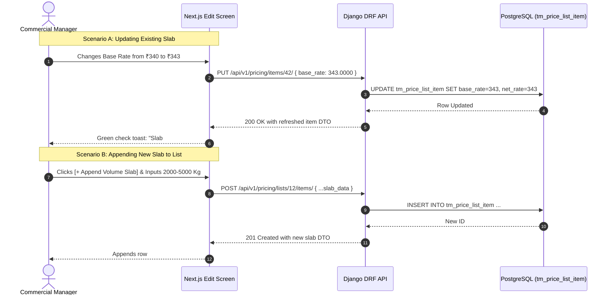

# Yarn Price List Edit & Revision Screen Specification

| Standard Code | Screen ID | Target Platform | API Version | Document Version | Date | Status |
|---|---|---|---|---|---|---|
| **STD-UI-001** | **`SCR-PRIC-001-EDIT`** | Next.js 14 (App Router) + TypeScript | `v1.2` (Django 5 DRF) | `v1.0.0` | 16/10/2026 | **APPROVED FOR IMPLEMENTATION** |

---

## 1. Document Overview, Version, Scope, and Status

### 1.1 Purpose
This specification defines the complete technical architecture, data hydration protocols, state-dependent UI locking, rate revision safeguards, in-place slab modification workflows, and audit trail tracking for the **Yarn Price List Edit & Revision Screen** (`SCR-PRIC-001-EDIT`).

In the textile manufacturing and spinning mill procurement sector, price lists undergo revisions due to weekly raw cotton price spikes, mill contract renegotiations, or changes in customer buying volume commitments. Modifying an existing price list requires stringent safeguards to:
1. **Prevent Unintended Retroactive Rate Changes**: Ensure historical Purchase Orders and Sales Invoices remain locked to their point-of-sale contractual rates.
2. **Support Dynamic In-Place Slab Adjustments**: Enable commercial operators to adjust specific count base rates, alter volume tiers, or append newly negotiated counts without rebuilding the entire contract.
3. **Audit Trail Logging**: Record every rate modification in [`ta_pricing_audit`](file:///d:/Codebase/Garments/backend/apps/pricing/models.py), capturing user ID, timestamp, previous rate, new rate, and commercial rationale.
4. **Contract Validity Lifecycle Management**: Facilitate one-click contract extension, seasonal rollover, or soft deprecation.

### 1.2 Scope
- **Entities Handled**: Parent header [`tm_price_list`](file:///d:/Codebase/Garments/backend/apps/pricing/models.py) (`PriceList`), itemized line tiers [`tm_price_list_item`](file:///d:/Codebase/Garments/backend/apps/pricing/models.py) (`PriceListItem`), and audit logs [`ta_pricing_audit`](file:///d:/Codebase/Garments/backend/apps/pricing/models.py) (`PricingAudit`).
- **Country Pack**: India (`IN`) — Indian Rupee (`₹`), Indian numerical grouping (`12,34,567.89`), Date format (`DD/MM/YYYY`), Rates displayed to 4 decimal places (`0.0000`), Bag weight nominal default `45.360 Kg`.
- **Target Route**: `/pricing/yarn-price-lists/[id]/edit`.

---

## 2. Module Details, Screen ID, Route, Access Privileges, and API Endpoints

### 2.1 Core Metadata

| Parameter | Specification |
|---|---|
| **Module** | `Module 9 — Commercial Pricing Engine` |
| **Screen ID** | `SCR-PRIC-001-EDIT` |
| **Frontend Route** | `/pricing/yarn-price-lists/[id]/edit` |
| **File Location** | `app/(app)/pricing/yarn-price-lists/[id]/edit/page.tsx` |
| **Required Privilege** | `pricing_manage.can_update` (Edit rates/slabs); `pricing_manage.can_delete` (Soft-delete price list) |
| **Authorized Roles** | `SUPER_ADMIN`, `ADMIN_USER`, `COMPANY_USER` (Commercial Director, Procurement Head, Sales Lead) |
| **Country Pack** | `IN` (India: Currency INR `₹`, Date `DD/MM/YYYY`, Weights in `Kg` [3 dp], Rates [4 dp]) |

### 2.2 Primary API Endpoints

| HTTP Method | API Path | Privilege / Scope | Description |
|---|---|---|---|
| `GET` | `/api/v1/pricing/lists/{id}/` | `can_read` | Hydrate existing price list header, active item slabs, and metadata |
| `PUT` | `/api/v1/pricing/lists/{id}/` | `can_update` | Update header parameters (name, validity window, description, is_default) |
| `POST` | `/api/v1/pricing/lists/{id}/items/` | `can_update` | Append a new yarn count or volume slab to the active list |
| `PUT` | `/api/v1/pricing/items/{item_id}/` | `can_update` | In-place update of an existing item slab (base rate, discount %, max qty, lead time) |
| `DELETE` | `/api/v1/pricing/items/{item_id}/` | `can_update` | Soft-delete a single slab from the active price list |
| `DELETE` | `/api/v1/pricing/lists/{id}/` | `can_delete` | Soft-delete the entire price list header and associated slabs |
| `GET` | `/api/v1/pricing/audit/?price_list_id={id}`| `can_read` | Fetch comprehensive revision and rate change audit trail history |

---

## 3. UI Layout, Screen Blueprint, and Visual Mockup (1440px+ Wireframe)

```
+-----------------------------------------------------------------------------------------------------------------------------+
| GARMENTS ERP — Commercial Pricing Engine                                     Company: ABC Textiles Ltd | FY: 2026-2027      |
+-----------------------------------------------------------------------------------------------------------------------------+
| [<- Back to Price Lists]  EDIT YARN PRICE LIST #YPL-202610-0012            [Audit Trail (6)]  [Clone Season]  [Save Changes]|
+-----------------------------------------------------------------------------------------------------------------------------+
| [!] STATUS BANNER: ACTIVE CONTRACT | Valid for 42 more days (Expires 31/12/2026) | Linked to 14 Live Purchase Orders       |
+-----------------------------------------------------------------------------------------------------------------------------+
| SECTION 1: PRICE LIST HEADER & CONTRACT GOVERNANCE                                                                          |
| List Code:    [ YPL-202610-0012 ] [LOCKED]      List Name:  [ Ramco Mills Q4 Contract - Karded & Combed 30s/40s     ]*      |
| List Type:    [ PURCHASE (Mill Procurement) ] [LOCKED]      Scope: [ PARTY-SPECIFIC (Contracted Agreement) ] [LOCKED]       |
| Contract Party: [ Ramco Mills Ltd - Tirupur (Vendor V-1042) ] [LOCKED]   Currency: [ INR (₹) ] [LOCKED]                     |
| Validity Window: Valid From: [ 16/10/2026 ] [LOCKED]   Valid To: [ 31/12/2026 ]*   [+ Extend by 30 Days]                   |
| Status:       (o) Active (Live Resolution)     ( ) Inactive (Paused)     Is Default Base: [ ] (Disabled for Party)          |
| Revision Note:[ Weekly cotton rate adjustment: +₹3.00/Kg applied on 30s Karded counts due to Shankar-6 price surge.       ]*|
+-----------------------------------------------------------------------------------------------------------------------------+
| SECTION 2: ITEM SLABS REVISION & COMPARATIVE RATE GRID                                                                      |
| Total Slabs: 5 | Last Modified: 16/10/2026 14:22 by M. Kumar | Unsaved Edits: 1 Row Modified                                 |
|                                                                                                                             |
| # | Yarn Count     | Type   | Shade (Dyed)  | Min Qty (Kg) | Max Qty (Kg) | Current Base | New Base (₹)* | Disc % | New Net (₹)* | Diff (₹)  | Action  |
|---+----------------+--------+---------------+--------------+--------------+--------------+---------------+--------+--------------+-----------+---------|
| 1 | 30s Karded     | GREY   | -- N/A --     |        0.000 |      500.000 |     340.0000 |      343.0000 |  0.00% |     343.0000 |  +₹3.0000 | [Save]  |
| 2 | 30s Karded     | GREY   | -- N/A --     |      500.001 |    2,000.000 |     340.0000 |      343.0000 |  2.00% |     336.1400 |  +₹2.9400 | [Save]  |
| 3 | 30s Karded     | GREY   | -- N/A --     |    2,000.001 |  [Unbounded] |     340.0000 |      343.0000 |  3.50% |     330.9950 |  +₹2.8950 | [Save]  |
| 4 | 40s Combed     | GREY   | -- N/A --     |        0.000 |    1,000.000 |     410.0000 |      410.0000 |  0.00% |     410.0000 |   ₹0.0000 | [Edit]  |
| 5 | 34s Combed     | DYED   | Navy (SH-102) |        0.000 |  [Unbounded] |     435.0000 |      435.0000 |  1.50% |     428.4750 |   ₹0.0000 | [Edit]  |
|                                                                                                                             |
| [+ Add New Yarn Count Line]   [+ Append Volume Slab]   [Bulk % Adjustment: [ +2.5% v ] (Apply to Selected)]                 |
+-----------------------------------------------------------------------------------------------------------------------------+
| SECTION 3: DOWNSTREAM IMPACT TELEMETRY & REVISION AUDIT TRAIL                                                               |
| Downstream Impact Summary:                                    | Recent Revision History (ta_pricing_audit):                 |
| Unfulfilled POs Under This Contract: 14 Orders (42,000 Kg)    | 16/10 14:22 - M. Kumar: Adjusted 30s Karded +₹3.00/Kg       |
| Active Quotes Issued to Buyers:      3 Quotes                 | 01/10 09:30 - S. Nathan: Contract initiated at ₹340.00/Kg   |
| Policy Notice: Existing approved POs retain their confirmed   | 01/10 09:30 - S. Nathan: Initial Q4 Price List Created      |
| rates. Updated rates will apply to all FUTURE orders created  |                                                             |
| after this revision timestamp.                                | [View Full Audit Log Drawer ->]                             |
+-----------------------------------------------------------------------------------------------------------------------------+
| [Delete Price List (Red)]                 [Discard Edits]   [Export Revised Rate Card]   [SAVE & PUBLISH PRICE REVISION]   |
+-----------------------------------------------------------------------------------------------------------------------------+
```

---

## 4. Page Initialization & Data Hydration

### 4.1 Data Hydration Flow
Upon route entry `/pricing/yarn-price-lists/[id]/edit`:
1. **Parallel Fetch**:
   - `GET /api/v1/pricing/lists/{id}/` -> Hydrates header metadata, line items, and job rules.
   - `GET /api/v1/pricing/audit/?price_list_id={id}` -> Hydrates recent revision records.
   - Master catalogs (Yarn Counts, Color Shades, UOMs, Parties) from client cache or API.
2. **State Classification**:
   - Computes validity status:
     - `EXPIRED` if $\text{valid\_to} < \text{current\_date}$.
     - `ACTIVE` if $\text{valid\_from} \le \text{current\_date} \le \text{valid\_to}$ and $\text{record\_status} == \text{'A'}$.
     - `INACTIVE` if $\text{record\_status} == \text{'I'}$.
     - `FUTURE` if $\text{valid\_from} > \text{current\_date}$.

### 4.2 Hydrated Form State Mapping

```typescript
interface HydratedPriceListEditState {
  id: number;
  price_list_code: string;
  price_list_name: string;
  list_type: "PURCHASE" | "SALES" | "JOB_WORK";
  scope: "GENERAL" | "PARTY_SPECIFIC";
  party_id: number | null;
  party_name: string;
  currency_id: number;
  valid_from: string; // DD/MM/YYYY
  valid_to: string;   // DD/MM/YYYY
  is_default: boolean;
  record_status: "A" | "I" | "D";
  description: string;
  revision_note: string; // Mandatory for saving revisions
  items: Array<HydratedPriceListItem>;
}
```

---

## 5. State-Dependent UI Locking & Permitted Operations

To safeguard financial ledger integrity, specific fields become immutable depending on contract state:

| Field / UI Control | Draft / Inactive State | Active Contract State | Expired Contract State |
|---|---|---|---|
| **Price List Code** | Permanently Locked | Permanently Locked | Permanently Locked |
| **List Type (Purchase/Sales)** | Locked (Immutable) | Locked (Immutable) | Locked (Immutable) |
| **Scope (General/Party)** | Locked (Immutable) | Locked (Immutable) | Locked (Immutable) |
| **Contract Party** | Locked (Immutable) | Locked (Immutable) | Locked (Immutable) |
| **Valid From** | Editable | Locked (Immutable) | Locked (Immutable) |
| **Valid To** | Editable | **Editable** (Can extend) | **Editable** (Can extend) |
| **Price List Name** | Editable | Editable | Locked |
| **Base Rates & Disc %** | Editable | **Editable** (Triggers Audit) | Locked (Must Clone) |
| **Add / Delete Slabs** | Allowed | **Allowed** (Gap checks apply)| Locked (Must Clone) |
| **Soft Delete List** | Allowed (`DELETE`) | Allowed with Confirmation | Allowed |

---

## 6. Rate Revision & Bulk Adjustment Engine

### 6.1 Individual Slab Rate Revision
When an operator modifies `base_rate` or `discount_percent` on an existing row:
- The UI displays both **Current Base** and **New Base**.
- The **Rate Difference (`Diff ₹`)** cell calculates:
  $$\Delta = \text{New Net Rate} - \text{Current Net Rate}$$
- Green highlight for price decreases ($-\text{₹}$), Amber/Red highlight for price increases ($+\text{₹}$).

### 6.2 Bulk Percentage Adjustment Tool
For sudden raw material shifts, the operator can select multiple rows and apply a bulk percentage shift:
$$\text{New Base Rate} = \text{round}\left(\text{Current Base Rate} \times \left(1 + \frac{\text{Shift \%}}{100}\right), 4\right)$$

*Example*:
- Shift $+2.50\%$ applied to 30s Karded (Base ₹340.0000):
  $$\text{New Base} = 340.0000 \times 1.025 = \text{₹}348.5000 / \text{Kg}$$

---

## 7. Downstream Impact Analysis & Audit Safeguards

### 7.1 Forward-Only Pricing Guarantee
A prominent alert informs operators of the enterprise accounting invariant:
> [!IMPORTANT]
> **Forward-Only Pricing Rule**: Revisions made to active price lists apply **exclusively to new transactions** created after this timestamp. Existing approved Purchase Orders ([`tm_yarn_po`](file:///d:/Codebase/Garments/backend/apps/purchase/models.py)) and posted Sales Invoices ([`tm_yarn_sales`](file:///d:/Codebase/Garments/backend/apps/sales/models.py)) are legally binding and will NOT be modified.

### 7.2 Mandatory Revision Note
Saving an active price list modification requires inputting a `revision_note` (minimum 10 characters), describing the commercial justification (e.g. *"Cotton spot rate revision from spinning mill"*). This note is saved directly to [`ta_pricing_audit`](file:///d:/Codebase/Garments/backend/apps/pricing/models.py).

---

## 8. In-Place Item Add, Update, and Soft-Delete Operations

### 8.1 API Request Sequences



---

## 9. Clone Season / Seasonal Renewal Action

When a quarterly contract expires, rather than editing an old contract, the operator clicks **`[Clone Season]`**:
1. Navigates to `/pricing/yarn-price-lists/new?clone_from_id=12`.
2. Pre-populates all yarn counts, volume slabs, MOQs, and lead times.
3. Automatically sets `valid_from` to $\text{old.valid\_to} + 1\text{ day}$.
4. Generates a fresh `price_list_code` sequence.
5. Keeps historical contract `#12` permanently preserved for audit and reporting.

---

## 10. Form Validation Rules (Field-by-Field Matrix)

| Field Name | Validation Condition | Error Message | Severity |
|---|---|---|---|
| `revision_note` | Empty when base rates or discounts are modified | *"Revision note is required when updating rates on active price lists."* | Blocking |
| `valid_to` | Modified date $< \text{valid\_from}$ | *"Valid to date cannot be earlier than valid from date."* | Blocking |
| `base_rate` | Modified to $\le 0.0000$ | *"Base rate must be greater than zero."* | Blocking |
| `discount_percent`| $< 0.00$ or $> 100.00$ | *"Discount must be between 0% and 100%."* | Blocking |
| `max_quantity` | $\le \text{min\_quantity}$ | *"Max quantity must be greater than min quantity."* | Blocking |
| Grid Slabs | Overlap detected with adjacent tier | *"Slab overlap detected for count {yarn_count}."* | Blocking |

---

## 11. API Integration & Serialization

### 11.1 PUT Payload (Header Update)

```json
{
  "price_list_name": "Ramco Mills Q4 Contract - Revised Nov Rates",
  "valid_to": "2027-01-31",
  "is_default": false,
  "description": "Extended contract with revised hosiery yarn pricing.",
  "revision_note": "Extended valid_to by 31 days and updated 30s Karded rate."
}
```

### 11.2 PUT Payload (Item Update)

```json
{
  "base_rate": "343.0000",
  "discount_percent": "2.00",
  "min_quantity": "500.001",
  "max_quantity": "2000.000",
  "moq": "500.000",
  "procurement_days": 5,
  "remarks": "Adjusted for Nov cotton price increase"
}
```

---

## 12. Next.js Component Breakdown

```
app/(app)/pricing/yarn-price-lists/[id]/edit/
├── page.tsx                           # Main Edit Controller & Data Hydrator
└── components/
    ├── EditHeaderCard.tsx             # Header metadata, validity extension button
    ├── EditableSlabGrid.tsx           # Inline editable spreadsheet with diff highlights
    ├── BulkAdjustmentModal.tsx        # Percentage shift modal (+/- X%)
    ├── AuditHistoryDrawer.tsx         # Slide-out drawer showing recent revision log
    └── CloneSeasonButton.tsx          # Fast rollover action
```

---

## 13. Zod Schema for Edit Validation

```typescript
import { z } from "zod";

export const priceListEditHeaderSchema = z.object({
  price_list_name: z.string().min(3).max(150),
  valid_to: z.string().regex(/^\d{2}\/\d{2}\/\d{4}$/, "DD/MM/YYYY required"),
  is_default: z.boolean(),
  description: z.string().optional(),
  revision_note: z.string().min(5, "Please provide a reason for this revision (min 5 chars)")
});

export const priceListItemUpdateSchema = z.object({
  base_rate: z.string().regex(/^\d+(\.\d{1,4})?$/).refine(v => parseFloat(v) > 0, "Rate must be > 0"),
  discount_percent: z.string().regex(/^\d+(\.\d{1,2})?$/).refine(v => parseFloat(v) >= 0 && parseFloat(v) <= 100, "0-100%"),
  min_quantity: z.string().regex(/^\d+(\.\d{1,3})?$/),
  max_quantity: z.string().regex(/^\d+(\.\d{1,3})?$/).nullable().optional(),
  moq: z.string().regex(/^\d+(\.\d{1,3})?$/),
  procurement_days: z.number().min(0),
  remarks: z.string().max(255).optional()
});
```

---

## 14. Keyboard Ergonomics & Fast Navigation

| Shortcut | Action |
|---|---|
| `Ctrl + S` | Save pending line edits and publish revision. |
| `Alt + B` | Open Bulk Percentage Adjustment dialog. |
| `Alt + H` | Toggle Audit Trail Drawer. |
| `Alt + E` | Quick-extend validity by 30 days. |
| `Esc` | Close open modal or return to price list register. |

---

## 15. Implementation Sequence & Developer Acceptance Checklist

### 15.1 Milestones
- [ ] **Milestone 1**: Implement hydration from `GET /api/v1/pricing/lists/{id}/` and state badge logic.
- [ ] **Milestone 2**: Build `EditableSlabGrid` with difference indicators and inline `[Save]` triggers.
- [ ] **Milestone 3**: Implement `AuditHistoryDrawer` fetching from `ta_pricing_audit`.
- [ ] **Milestone 4**: Build `BulkAdjustmentModal` for batch percentage adjustments.
- [ ] **Milestone 5**: Implement `[Clone Season]` redirect with query params.

### 15.2 Acceptance Checklist
- [ ] Editing an active price list requires a revision note before submitting.
- [ ] In-place slab rate edits immediately update Net Rate and compute rate difference `Diff ₹`.
- [ ] Validity date extension updates `valid_to` without corrupting historical logs.
- [ ] Expired price lists clearly show warning badge and provide one-click `Clone Season` rollover.
- [ ] All dates formatted strictly as `DD/MM/YYYY`.
- [ ] Rates formatted to 4 decimal places (`0.0000`).
