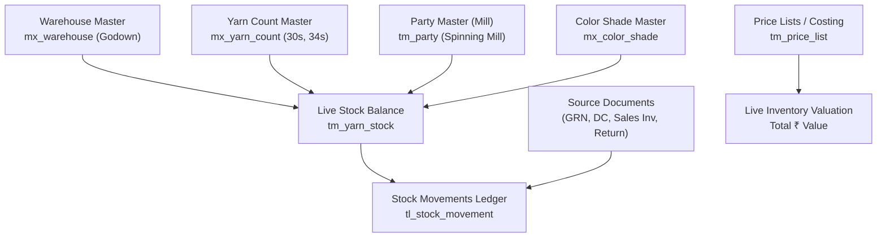

# Live Godown Stock Ledger & Movement Register Specification

| Standard Code | Screen ID | Target Platform | API Version | Document Version | Date | Status |
|---|---|---|---|---|---|---|
| **STD-UI-001** | **`SCR-INVN-003`** | Next.js 14 (App Router) + TypeScript | `v1.2` (Django 5 DRF) | `v1.0.0` | 16/10/2026 | **APPROVED FOR IMPLEMENTATION** |

---

## 1. Document Overview, Version, Scope, and Status

### 1.1 Purpose
This specification defines the complete technical architecture, real-time telemetry metrics, dual-view grid layouts, multi-attribute filtering, running balance calculation engine, inventory valuation models, and backend API integration for the **Live Godown Stock Ledger & Movement Register** (`SCR-INVN-003`).

In textile and apparel manufacturing facilities (spinning mills, knitting units, process houses, and central godowns), physical inventory is the single highest-value asset on the balance sheet. This screen serves as the authoritative, real-time inventory control console for:
1. **Live On-Hand Stock Balances**: Viewing real-time physical inventory across warehouses, counts, spinning mills, color shades, and mill lot numbers via [`yarn_stock_table`](file:///d:/Codebase/Garments/backend/apps/inventory/models.py) (`tm_yarn_stock`).
2. **Chronological Audit Movement Statement**: Providing a drill-down transaction ledger tracking every single receipt, issue, delivery, and return via [`tl_stock_movement`](file:///d:/Codebase/Garments/backend/apps/ledger/models.py).
3. **Dual Metric Tracking**: Recording and reconciling stock simultaneously in **Textile Bag units** (standard $45.360\text{ Kg}$) and **Kilogram Net Weights** ($3\text{ decimal places}$).
4. **Inventory Valuation & Financial Integrity**: Computing live inventory valuation based on standard unit rates, FIFO purchase costs, and weighted average rates in Indian Rupees ($₹$).

### 1.2 Scope
- **Entities Handled**:
  - Live On-Hand Balances: [`yarn_stock_table`](file:///d:/Codebase/Garments/backend/apps/inventory/models.py) (`tm_yarn_stock`).
  - Transaction Audit Movements: [`tl_stock_movement`](file:///d:/Codebase/Garments/backend/apps/ledger/models.py).
  - Multi-Stage Aggregation: Primary focus on `stage = 'YARN'`, extensible to Greige Fabric (`GREY_FABRIC`), Processed Fabric (`DYED_FABRIC`), and Trims via stage filters.
- **Country Pack**: India (`IN`) — Indian Rupee (`₹`), Indian numerical grouping (`12,34,567.89`), Date format (`DD/MM/YYYY`), Weight precision to 3 decimal places (`0.000 Kg`), Rates precision to 2/4 decimal places, Bag nominal standard `45.360 Kg`.
- **Target Routes**: `/inventory/stock-ledger` (Primary) with alias `/inventory/stock-register`.

---

## 2. Module Details, Screen ID, Route, Access Privileges, and API Endpoints

### 2.1 Core Metadata

| Parameter | Specification |
|---|---|
| **Module** | `Module 4 — Inventory & Godown Stock Ledger` |
| **Screen ID** | `SCR-INVN-003` |
| **Frontend Route** | `/inventory/stock-ledger` (Alias: `/inventory/stock-register`) |
| **File Location** | `app/(app)/inventory/stock-ledger/page.tsx` |
| **Required Privilege** | `inventory_yarn_stock.can_read` (View balances); `ledger_stock_movement.can_read` (View movement audit log); `inventory_yarn_stock.can_export` (Excel/PDF export) |
| **Authorized Roles** | `SUPER_ADMIN`, `ADMIN_USER`, `COMPANY_USER` (Godown In-Charge, Storekeeper, Weighbridge Operator, Costing Accountant, Internal Auditor) |
| **Country Pack** | `IN` (India: Currency INR `₹`, Date `DD/MM/YYYY`, Weights in `Kg` [3 dp], Bag tare `45.360 Kg`) |

### 2.2 Primary API Endpoints

| HTTP Method | API Path | Privilege / Scope | Description |
|---|---|---|---|
| `GET` | `/api/v1/inventory/yarn-stock/` | `can_read` | Fetch live on-hand stock records grouped by warehouse, count, mill, shade, and lot |
| `GET` | `/api/v1/ledger/stock-movements/` | `can_read` | Fetch chronological audit movement ledger with running balance arithmetic |
| `GET` | `/api/v1/masters/warehouses/?is_active=1` | `can_read` | Fetch list of active storage godowns / warehouses |
| `GET` | `/api/v1/masters/yarn-counts/?is_active=1` | `can_read` | Fetch active yarn counts (20s, 30s, 34s, 40s Karded/Combed) |
| `GET` | `/api/v1/masters/parties/?party_type=MILL,SUPPLIER,CUSTOMER&is_active=1`| `can_read` | Fetch spinning mills, traders, and customer buyers for ledger party filtering |
| `GET` | `/api/v1/masters/color-shades/?is_active=1` | `can_read` | Fetch color shade master for dyed and melange yarns |

---

## 3. UI Layout, Screen Blueprint, and Visual Mockup (1440px+ Wireframe)

```
+-----------------------------------------------------------------------------------------------------------------------------+
| GARMENTS ERP — Inventory & Godown Stock Desk                                 Company: ABC Textiles Ltd | FY: 2026-2027      |
+-----------------------------------------------------------------------------------------------------------------------------+
| TOP BREADCRUMB: Inventory > Live Godown Stock Ledger                                                                        |
| GODOWN STOCK LEDGER & REGISTER            [🔍 Search Lot / Count (/) ]   [⚡ Filter Drawer (F)]  [📥 Export]  [🖨 Print Sheet]  |
+-----------------------------------------------------------------------------------------------------------------------------+
| +-------------------------+  +-------------------------+  +-------------------------+  +--------------------------+         |
| | KPI 1: TOTAL ON-HAND    |  | KPI 2: TOTAL NET WEIGHT |  | KPI 3: ACTIVE LOTS      |  | KPI 4: INVENTORY VALUE   |         |
| | 3,420 Bags              |  | 1,55,131.200 Kg         |  | 48 Distinct Lots        |  | ₹5,38,20,540.00          |         |
| | (Grey: 2.8k, Dyed: 620) |  | (155.13 Metric Tons)    |  | Across 3 Active Godowns |  | Avg Rate: ₹346.9400 / Kg |         |
| +-------------------------+  +-------------------------+  +-------------------------+  +--------------------------+         |
+-----------------------------------------------------------------------------------------------------------------------------+
| SECTION 1: DATE RANGE & FISCAL PERIOD FILTER DOCK                                                                           |
| Quick Presets: [ Today ]  [ Yesterday ]  [ This Week ]  [ [✔] This Month (MTD) ]  [ Last Month ]  [ FY 2026-27 (YTD) ]  [ Custom ]|
| Date Range:    From Date: [ 01/10/2026 ] [CAL]    To Date: [ 16/10/2026 ] [CAL]    [⚡ Apply Date Filter]   [Reset to MTD]     |
| Point-in-Time: [ ] As-of-Date Point-in-Time Snapshot (Calculates Historical Balance as of Cutoff Date)                      |
| Context Note:  Mode A: Live on-hand stock as of 16/10/2026 | Mode B: Opening Bal (01/10) + Receipts - Issues = Closing (16/10)|
+-----------------------------------------------------------------------------------------------------------------------------+
| SECTION 2: VIEW MODE SELECTOR & WAREHOUSE CHIPS                                                                             |
| View Mode: [ (•) Mode A: Live On-Hand Balances ]   [ ( ) Mode B: Chronological Audit Movement Statement ]                   |
| Godown:    [ [✔] All Godowns (3) ]  [ Central Godown (2,400 Bags) ]  [ Knitting Godown (620 Bags) ]  [ Process Godown (400) ]|
+-----------------------------------------------------------------------------------------------------------------------------+
| DATA TABLE (MODE A: LIVE ON-HAND STOCK BALANCES BY LOT):                                       Showing 1-5 of 48 Lot Groups |
| [ ] | Godown Warehouse | Yarn Count  | Type | Mill (Supplier) | Shade / Color | Lot No   | Inward Bags | Outward | Sales | On-Hand Bags*| On-Hand Kg*    | Avg Rate (₹)| Valuation (₹)   | Actions|
|-----+------------------+-------------+------+-----------------+---------------+----------+-------------+---------+-------+--------------+----------------+-------------+-----------------+--------|
| [ ] | Central Godown   | 30s Karded  | GREY | Ramco Mills Ltd | -- Ecru --    | RM-901   |         500 |     200 |   100 |     200 Bags |   9,072.000 Kg |    340.0000 |   30,84,480.00  | [Hist]v|
| [ ] | Central Godown   | 30s Karded  | GREY | SVT Spinning    | -- Ecru --    | SVT-402  |         400 |     150 |     0 |     250 Bags |  11,340.000 Kg |    338.5000 |   38,38,590.00  | [Hist]v|
| [ ] | Knitting Godown  | 34s Combed  | DYED | Premier Mills   | Navy (SH-102) | PM-D12   |         120 |      40 |     0 |      80 Bags |   3,628.800 Kg |    435.0000 |   15,78,528.00  | [Hist]v|
| [ ] | Central Godown   | 40s Combed  | GREY | Ramco Mills Ltd | -- Ecru --    | RM-918   |         800 |     350 |   150 |     300 Bags |  13,608.000 Kg |    410.0000 |   55,79,280.00  | [Hist]v|
| [ ] | Process Godown   | 30s Karded  | GREY | KPR Mill Ltd    | -- Ecru --    | KPR-77   |         250 |     100 |     0 |     150 Bags |   6,804.000 Kg |    342.0000 |   23,26,968.00  | [Hist]v|
+-----------------------------------------------------------------------------------------------------------------------------+
| DATA TABLE (MODE B: CHRONOLOGICAL AUDIT MOVEMENT STATEMENT WITH DATE FILTER ANCHORS):                                       |
| Filtered Period: 01/10/2026 to 16/10/2026 | Warehouse: All Godowns | Stage: YARN                                             |
| Date       | Doc Type        | Doc Number      | Party (Counterpart)        | In Bags | In Kg      | Out Bags| Out Kg     | Running Bal Kg | Unit Rate (₹)| Net Value (₹) | Auth Signatory|
|------------+-----------------+-----------------+----------------------------+---------+------------+---------+------------+----------------+--------------+---------------+---------------|
| 01/10/2026 | [OPENING BAL]   | -- ANCHOR --    | Opening Stock As of 01/10  |       - |          - |       - |          - | 1,12,492.800 Kg|     342.5000 |3,85,28,784.00 | System Ledger |
| 05/10/2026 | INWARD_GRN      | YGRN-202610-004 | Ramco Mills Limited        |    +300 | +13,608.000|       0 |      0.000 | 1,26,100.800 Kg|     340.0000 |  42,87,427.00 | M. Kumar      |
| 08/10/2026 | OUTWARD_DC      | YDC-202610-0012 | Sri Balaji Knitters (Subc) |       0 |      0.000 |    -200 |  -9,072.000| 1,17,028.800 Kg|     340.0000 |  39,78,979.00 | S. Nathan     |
| 12/10/2026 | SALES_INVOICE   | YSAL-202610-001 | Premier Knittings Pvt Ltd  |       0 |      0.000 |    -100 |  -4,536.000| 1,12,492.800 Kg|     340.0000 |  38,24,755.00 | K. Ramesh     |
| 14/10/2026 | SALES_RETURN    | YSRET-202610-05 | Premier Knittings Pvt Ltd  |      +5 |   +226.800 |       0 |      0.000 | 1,12,719.600 Kg|     340.0000 |  38,32,466.00 | S. Muthusamy  |
| 16/10/2026 | [CLOSING BAL]   | -- ANCHOR --    | Closing Stock As of 16/10  |    +305 | +13,834.800|    -300 | -13,608.000| 1,12,719.600 Kg|     342.1000 |3,85,61,374.00 | Verified ACID |
+-----------------------------------------------------------------------------------------------------------------------------+
| PAGINATION DOCK:                                                                                                            |
| Displaying 1-5 of 48 Lot Balances | Page Size: [ 25 v ]                      [|<] [< Prev]  Page 1 of 2  [Next >] [>|]      |
+-----------------------------------------------------------------------------------------------------------------------------+
```

---

## 4. Page Initialization, Query Parameters, and Default Filter State

### 4.1 Page Initialization Protocol
Upon loading `/inventory/stock-ledger`:
1. **Tenant Validation**: Reads active tenant context from session header `X-Company-ID`.
2. **Master Hydration**: Concurrently caches Warehouses (`/api/v1/masters/warehouses/`), Yarn Counts (`/api/v1/masters/yarn-counts/`), and Spinning Mills (`/api/v1/masters/parties/`).
3. **Date Filter Initialization & Presets**:
   - Computes default `from_date` as the **1st day of the current calendar month** (`01/MM/YYYY`).
   - Computes default `to_date` as **Today's Date** (`DD/MM/YYYY`).
   - Sets active preset chip to `MTD` (Month to Date).
4. **Query Parameter Pre-population**:
   - `?view_mode=summary` (Default: Mode A) vs `?view_mode=movement` (Mode B).
   - `?from_date=01/10/2026&to_date=16/10/2026` -> Directly binds the date range.
   - `?preset=MTD` -> Highlights the Month-To-Date quick chip.
   - `?as_of_date=15/10/2026` -> Activates historical point-in-time valuation snapshot.
   - `?warehouse_id=2` -> Restricts report to a specific godown.
   - `?yarn_count_id=8` -> Pre-filters for specific count (e.g. 30s Karded).
   - `?lot_no=RM-901` -> Directly opens detailed chronological ledger for that single lot.

### 4.2 Default Filter State

```typescript
export type StockLedgerViewMode = "SUMMARY_BALANCE" | "CHRONOLOGICAL_MOVEMENT";
export type StockDatePreset = "TODAY" | "YESTERDAY" | "THIS_WEEK" | "MTD" | "LAST_MONTH" | "YTD" | "CUSTOM";

export interface StockLedgerFilterState {
  view_mode: StockLedgerViewMode;
  date_preset: StockDatePreset;
  from_date: string; // DD/MM/YYYY
  to_date: string;   // DD/MM/YYYY
  as_of_date: string | null; // DD/MM/YYYY or null (null = Live Current)
  is_point_in_time: boolean; // Enables historical snapshot calculation
  warehouse_id: number | null; // null = All Warehouses
  yarn_type: "ALL" | "GREY" | "DYED" | "MELANGE" | "BLENDED";
  yarn_count_id: number | null;
  mill_id: number | null;
  color_shade_id: number | null;
  lot_no: string;
  hide_zero_balance: boolean; // Default true: filters out consumed lots
  stage: string;     // Default: 'YARN'
  page: number;
  page_size: number;
}

export const defaultStockLedgerFilters: StockLedgerFilterState = {
  view_mode: "SUMMARY_BALANCE",
  date_preset: "MTD",
  from_date: format(startOfMonth(new Date()), "dd/MM/yyyy"),
  to_date: format(new Date(), "dd/MM/yyyy"),
  as_of_date: null,
  is_point_in_time: false,
  warehouse_id: null,
  yarn_type: "ALL",
  yarn_count_id: null,
  mill_id: null,
  color_shade_id: null,
  lot_no: "",
  hide_zero_balance: true,
  stage: "YARN",
  page: 1,
  page_size: 25
};
```

---

## 5. Fiscal Context, Warehouse Scoping, and Comprehensive Date Filter Engine

### 5.1 Date Range Invariants & Timezone Authority
1. **Company Timezone Single Authority**:
   - All calendar dates (`movement_date`, `from_date`, `to_date`) are strictly interpreted in the company's timezone (India Standard Time `UTC+05:30`).
   - Time boundaries are standardized:
     - `from_date`: Evaluated at `00:00:00.000` IST.
     - `to_date`: Evaluated at `23:59:59.999` IST.
2. **Date Format Enforcement**:
   - Frontend and API communications strictly utilize **`DD/MM/YYYY`** (e.g. `16/10/2026`).
   - Internal database storage in PostgreSQL uses `DATE` / `timestamptz`.

### 5.2 Date Filter Operation in View Mode A (On-Hand Balance & Point-in-Time Snapshot)
In Mode A, the date filter operates in two distinct operational configurations:
- **Live Real-Time Mode (`is_point_in_time = false`)**:
  - Displays current physical balance on hand right now in `tm_yarn_stock`.
  - Date inputs indicate the active working fiscal context.
- **Point-in-Time Historical Snapshot (`is_point_in_time = true`)**:
  - Activated by clicking *"As of Date Snapshot"* and entering a cutoff date $T_{\text{cutoff}}$ (e.g. `30/09/2026` for monthly balance sheet audits).
  - The backend dynamically reconstructs historical balances as of $T_{\text{cutoff}}$:
    $$\text{Balance Qty}_{T_{\text{cutoff}}} = \sum_{t \le T_{\text{cutoff}}} \text{In Qty}_t - \sum_{t \le T_{\text{cutoff}}} \text{Out Qty}_t$$
  - Prevents distortion when auditors inspect stock balances for past accounting periods.

### 5.3 Date Filter Operation in View Mode B (Opening Balance, Period Movements, Closing Balance)
In Mode B, applying a date range $[T_{\text{from}}, T_{\text{to}}]$ produces a complete, balanced ledger statement with three distinct visual tiers:
1. **Opening Balance Row (Anchor Top)**:
   - Sums all historical inward and outward movements occurring strictly *prior* to $T_{\text{from}}$ ($t < T_{\text{from}}$).
   - Renders as a dedicated, non-selectable row with badge `[OPENING BALANCE]` and amber highlight.
2. **Period Transaction Movements (Middle Journal)**:
   - Renders every single document movement occurring between $T_{\text{from}}$ and $T_{\text{to}}$ ($T_{\text{from}} \le t \le T_{\text{to}}$).
   - Each row updates the cumulative running balance starting from the Opening Balance.
3. **Closing Balance Row (Anchor Bottom)**:
   - Reconciles total opening plus interim receipts minus interim issues as of $T_{\text{to}}$.
   - Renders as a pinned footer row with badge `[CLOSING BALANCE]` and emerald highlight.

### 5.4 Quick Period Preset Calculation Rules

| Preset Button | Mathematical Range Calculation | Example (Reference Date: 16/10/2026) |
|---|---|---|
| **Today** | `from_date = today`, `to_date = today` | `16/10/2026` to `16/10/2026` |
| **Yesterday** | `from_date = today - 1`, `to_date = today - 1` | `15/10/2026` to `15/10/2026` |
| **This Week** | `from_date = startOfWeek(today, Monday)`, `to_date = today` | `12/10/2026` to `16/10/2026` |
| **This Month (MTD)** | `from_date = startOfMonth(today)`, `to_date = today` | `01/10/2026` to `16/10/2026` |
| **Last Month** | `from_date = startOfMonth(prevMonth)`, `to_date = endOfMonth(prevMonth)` | `01/09/2026` to `30/09/2026` |
| **This FY (YTD)** | `from_date = active_fy.start_date`, `to_date = today` | `01/04/2026` to `16/10/2026` |
| **Custom** | User enters custom `from_date` and `to_date` via date picker | Any valid window $\le 365\text{ days}$ |

### 5.5 Financial Year Boundary & Backdating Safeguards
- If a user inputs dates belonging to a closed or locked financial year (e.g. FY 2024-2025), the system verifies whether the user possesses the `unlock_fy` or `backdate_entry` privilege.
- Without this privilege, the date picker blocks selection outside the active financial year (`01/04/2026` to `31/03/2027`).

---

## 6. Primary Master Linkages



---

## 7. Dynamic Category & Technical Filtering

The filter system accommodates specific textile parameters:
- **Yarn Category (`yarn_type`)**:
  - `GREY`: Natural unbleached cotton cones straight from spinning mills.
  - `DYED`: Package cone-dyed yarn with specific shade numbers.
  - `MELANGE`: Cotton-heather mixed shades.
  - `BLENDED`: Poly-cotton (PC) or modal blends.
- **Count Range**: Single or multi-select dropdown grouping by English Count ($N_e$): 20s, 30s, 34s, 40s, 60s.
- **Lot Number Auto-Complete**: Text search querying active lots from `tm_yarn_stock.lot_no`.

---

## 8. High-Density Dual-View Data Grids

### 8.1 View Mode A: Live On-Hand Stock Balances (`tm_yarn_stock`)

Grouped by unique inventory tuple `(company, warehouse, yarn_type, yarn_count, mill, color_shade, lot_no)`:

| Column Name | Alignment | Data Binding | Invariant / Display Rule |
|---|---|---|---|
| **Warehouse** | Left | `warehouse.name` | Storage location (e.g. Central Godown, Bay 2). |
| **Yarn Count** | Left | `yarn_count.count` | Count name (e.g. 30s Karded, 34s Combed). |
| **Category** | Center | `yarn_type` | `GREY`, `DYED`, `MELANGE` badges. |
| **Spinning Mill** | Left | `mill.name` | Supplier mill name (e.g. Ramco Mills Ltd). |
| **Color Shade** | Left | `color_shade.color_name` | Shade code + name (or *"-- Ecru --"* for Grey). |
| **Lot Number** | Center | `lot_no` | Monospace bold badge (e.g. `RM-901`). |
| **Inward Receipts** | Right | `inward_bag` / `inward_quantity` | Total cumulative bags received into godown. |
| **Outward Issues** | Right | `outward_bag` / `outward_quantity`| Total bags dispatched to knitting/dyeing. |
| **Sales Billed** | Right | `sales_bag` / `sales_quantity` | Direct yarn commercial dispatches. |
| **Sales Returns** | Right | `sales_return_bag` / `sales_return_quantity`| Defective yarn accepted back from customers. |
| **On-Hand Bags\*** | Right | `balance_bag` | **Primary invariant**: High-contrast bold black text. |
| **On-Hand Weight\* (Kg)** | Right | `balance_quantity` | Net weight formatted to 3 dp with Indian grouping. |
| **Valuation Rate** | Right | `unit_rate` | Cost or contracted purchase rate per Kg. |
| **Total Valuation (₹)**| Right | `total_value` | $\text{balance\_quantity} \times \text{unit\_rate}$. |
| **Actions** | Center | Icons | `[Hist]` (View Movements), `[Print]`. |

---

### 8.2 View Mode B: Chronological Audit Movement Statement (`tl_stock_movement`)

Sequential journal of every physical inventory event:

| Column Name | Alignment | Data Binding | Description & Formatting |
|---|---|---|---|
| **Date** | Center | `movement_date` | `DD/MM/YYYY` (Company timezone). |
| **Doc Type** | Center | `doc_type` | `INWARD_GRN`, `OUTWARD_DC`, `SALES_INVOICE`, `SALES_RETURN`. |
| **Doc Number** | Center | `doc_number` | Hyperlink opening the source document preview. |
| **Party / Subcontractor** | Left | `party.name` | Mill, Knitter, Dyer, or Customer. |
| **Lot / Batch No** | Center | `lot_or_batch_no` | Lot number reference. |
| **In Units (Bags)** | Right | `in_units` | Green text `+X Bags` if receipt, else `0`. |
| **In Qty (Kg)** | Right | `in_qty` | Green text `+X.XXX Kg`. |
| **Out Units (Bags)** | Right | `out_units` | Rose text `-X Bags` if dispatch, else `0`. |
| **Out Qty (Kg)** | Right | `out_qty` | Rose text `-X.XXX Kg`. |
| **Running Bags** | Right | `balance_units` | Running total bags in godown after this movement. |
| **Running Qty (Kg)**| Right | `balance_qty` | Running net weight in godown after this movement. |
| **Unit Rate (₹)** | Right | `unit_rate` | Rate in ₹ per Kg to 4 decimal places. |
| **Movement Value (₹)** | Right | `total_value` | Movement transaction value. |

---

## 9. Mathematical Formulas & Running Balance Engine

### 9.1 Live Balance Conservation Invariant
For every stock row in [`tm_yarn_stock`](file:///d:/Codebase/Garments/backend/apps/inventory/models.py):

$$\text{Balance Bags} = \text{Inward Bags} - \text{Outward Bags} - \text{Sales Bags} + \text{Sales Return Bags}$$

$$\text{Balance Weight (Kg)} = \text{Inward Qty} - \text{Outward Qty} - \text{Sales Qty} + \text{Sales Return Qty}$$

$$\text{Negative Stock Prohibition}: \quad \text{Balance Bags} \ge 0 \quad \land \quad \text{Balance Qty} \ge 0.000$$

### 9.2 Sequential Running Ledger Arithmetic
In View Mode B ([`tl_stock_movement`](file:///d:/Codebase/Garments/backend/apps/ledger/models.py)), transactions are sorted chronologically by `movement_date ASC, id ASC`:

$$B_i = B_{i-1} + \text{In Qty}_i - \text{Out Qty}_i$$

$$U_i = U_{i-1} + \text{In Bags}_i - \text{Out Bags}_i$$

$$\text{Inventory Value}_i = B_i \times \text{Unit Rate}_i$$

*Invariant Verification*: The closing running balance ($B_n$) in the movement ledger must match the live balance in `tm_yarn_stock.balance_quantity` to the exact third decimal place ($0.000\text{ Kg}$).

### 9.3 Date-Filtered Opening and Closing Stock Derivation
When an operator applies a date filter $[T_{\text{from}}, T_{\text{to}}]$:

1. **Opening Stock Quantity as of $T_{\text{from}}$**:
   $$\text{Opening Stock Qty } (B_{\text{open}}) = \sum_{t < T_{\text{from}}} \left(\text{in\_qty}_t - \text{out\_qty}_t\right)$$
   $$\text{Opening Stock Bags } (U_{\text{open}}) = \sum_{t < T_{\text{from}}} \left(\text{in\_units}_t - \text{out\_units}_t\right)$$

2. **Period Interim Movements**:
   $$\text{Period Inward Qty } (\text{In}_{\text{period}}) = \sum_{T_{\text{from}} \le t \le T_{\text{to}}} \text{in\_qty}_t$$
   $$\text{Period Outward Qty } (\text{Out}_{\text{period}}) = \sum_{T_{\text{from}} \le t \le T_{\text{to}}} \text{out\_qty}_t$$

3. **Closing Stock Quantity as of $T_{\text{to}}$**:
   $$\text{Closing Stock Qty } (B_{\text{close}}) = B_{\text{open}} + \text{In}_{\text{period}} - \text{Out}_{\text{period}}$$
   $$\text{Closing Stock Bags } (U_{\text{close}}) = U_{\text{open}} + U_{\text{in, period}} - U_{\text{out, period}}$$

---

## 10. Godown / Warehouse Stock Allocation & Storage Location

- Each warehouse (`WarehouseMaster`) is tracked independently.
- The UI features a **"Godown Comparison"** matrix showing how a specific count (e.g. 30s Karded) is distributed:
  - Central Godown: 1,800 Bags (81,648 Kg)
  - Knitting Floor Store: 400 Bags (18,144 Kg)
  - Total Available: 2,200 Bags (99,792 Kg)

---

## 11. Summary Bar, Remarks, and Telemetry KPI Calculations

Located at the bottom of the grid, a persistent calculation bar displays:
- **Total Filtered Bags**: Sum of `balance_bag` across currently filtered rows.
- **Total Filtered Weight**: Sum of `balance_quantity` formatted in both Kilograms (`1,55,131.200 Kg`) and Metric Tons (`155.131 MT`).
- **Average Yarn Rate**: Weighted average rate:
  $$\bar{R} = \frac{\sum (\text{Balance Qty}_j \times \text{Unit Rate}_j)}{\sum \text{Balance Qty}_j}$$
- **Total Asset Value**: Sum of `total_value` formatted in Indian Rupees:
  $$\text{Example}: \quad ₹5,38,20,540.00 \quad (\text{Five Crore Thirty-Eight Lakh Twenty Thousand Five Hundred and Forty Rupees})$$

---

## 12. Form Validation Rules & Filter Matrix

| Filter Control | Validation Condition | User Feedback / Error Handling |
|---|---|---|
| **From Date** | Missing or non-`DD/MM/YYYY` format | Displays inline error: *"From date must be in DD/MM/YYYY format"*. |
| **To Date** | Missing or non-`DD/MM/YYYY` format | Displays inline error: *"To date must be in DD/MM/YYYY format"*. |
| **Date Range Precedence** | `to_date < from_date` | Displays red warning banner: *"To date cannot precede From date"*. Query disabled. |
| **Future Date Boundary** | `to_date > today` | Blocked with warning: *"Future dates not permitted for historical stock audit"*. |
| **Financial Year Scope** | Date outside active FY | Prompts for backdate privilege or re-anchors to FY start/end date. |
| **Lot Number** | Special characters | Sanitized automatically to alphanumeric uppercase. |
| **Zero Balance Toggle** | Toggle switch | Filters `balance_quantity > 0.000`. When switched off, includes exhausted lots. |
| **Search Debounce** | Keystroke delay | 300ms debounce before dispatching API request. |

---

## 13. Lifecycle & Interactive Drill-Down Workflows

1. **Inline Lot History Accordion**:
   - Clicking the chevron `[v]` on any Mode A row expands an inline accordion without leaving the page, fetching the last 10 movements for that exact lot.
2. **Dedicated Movement Statement Drawer (`Alt + D`)**:
   - Slides out a full-height right drawer rendering the complete multi-year ledger for the selected yarn lot, complete with PDF export.
3. **Hyperlink Traversal**:
   - Clicking a document number (`YGRN-202610-004`, `YDC-202610-0012`) opens the corresponding transaction print sheet in a new tab.

---

## 14. API Integration, Query Serialization, and HTTP Errors

### 14.1 Query Parameter Mapping (Mode A: On-Hand Stock)
```
GET /api/v1/inventory/yarn-stock/?warehouse=2&yarn_type=GREY&yarn_count=8&search=RM-901&ordering=-balance_quantity
```

### 14.2 Query Parameter Mapping (Mode B: Movement Ledger with Date Filter)
```
GET /api/v1/ledger/stock-movements/?stage=YARN&warehouse=2&lot_or_batch_no=RM-901&from_date=01/10/2026&to_date=16/10/2026
```

### 14.3 Error Handling Protocols
- `401 Unauthorized` -> Redirects to `/login`.
- `403 Forbidden` -> Renders permission alert: *"Access restricted: Requires inventory_yarn_stock.can_read"*.
- `400 Bad Request` -> Triggered on invalid date format; highlights the date picker in red with toast notification.
- `500 Server Error` -> Shows error card with retry button and error telemetry reference.

---

## 15. Next.js Folder Structure and Component Responsibilities

```
app/(app)/inventory/stock-ledger/
├── page.tsx                           # Main Controller & View Mode Switcher
└── components/
    ├── StockTelemetryCards.tsx        # Top 4 KPI metric cards
    ├── StockDateFilterBar.tsx         # Dedicated Date Range Picker, Presets (MTD, YTD), & Snapshot Toggle
    ├── StockViewModeTabs.tsx          # Toggle between Mode A & Mode B
    ├── GodownSelectorChips.tsx        # Filter chips for individual godowns
    ├── LiveBalanceTable.tsx           # View Mode A: On-hand lot balances
    ├── MovementStatementTable.tsx     # View Mode B: Chronological ledger with Opening & Closing rows
    ├── InlineLotAccordion.tsx         # Expandable inline movement history
    ├── StockFilterDrawer.tsx          # Slide-out multi-attribute filter drawer
    ├── StockSummaryFooter.tsx         # Persistent bottom total valuation dock
    └── StockStatementPrintModal.tsx   # A4 print preview dialog
```

---

## 16. React Hooks, TypeScript Types, and Zod Schemas

### 16.1 Date Filter Zod Validation Schema

```typescript
import { z } from "zod";

export const stockDateFilterSchema = z.object({
  from_date: z.string().regex(/^\d{2}\/\d{2}\/\d{4}$/, "From date must be in DD/MM/YYYY format"),
  to_date: z.string().regex(/^\d{2}\/\d{2}\/\d{4}$/, "To date must be in DD/MM/YYYY format"),
  as_of_date: z.string().regex(/^\d{2}\/\d{2}\/\d{4}$/, "As-of date must be in DD/MM/YYYY format").nullable().optional(),
  date_preset: z.enum(["TODAY", "YESTERDAY", "THIS_WEEK", "MTD", "LAST_MONTH", "YTD", "CUSTOM"]),
  is_point_in_time: z.boolean().default(false)
}).refine(data => {
  const [fDay, fMonth, fYear] = data.from_date.split("/").map(Number);
  const [tDay, tMonth, tYear] = data.to_date.split("/").map(Number);
  const from = new Date(fYear, fMonth - 1, fDay);
  const to = new Date(tYear, tMonth - 1, tDay);
  return to >= from;
}, {
  message: "To date cannot be earlier than From date",
  path: ["to_date"]
});
```

### 16.2 TypeScript Interfaces

```typescript
export interface YarnStockBalanceRecord {
  id: number;
  company_id: number;
  warehouse_id: number;
  warehouse_name: string;
  yarn_type: "GREY" | "DYED" | "MELANGE" | "BLENDED";
  yarn_count_id: number;
  yarn_count_name: string;
  mill_id: number;
  mill_name: string;
  color_shade_id: number | null;
  color_shade_name: string | null;
  lot_no: string;
  inward_bag: number;
  inward_quantity: string;
  outward_bag: number;
  outward_quantity: string;
  sales_bag: number;
  sales_quantity: string;
  sales_return_bag: number;
  sales_return_quantity: string;
  balance_bag: number;
  balance_quantity: string;
  unit_rate: string;
  total_value: string;
}

export interface StockMovementRecord {
  id: number;
  movement_date: string; // DD/MM/YYYY
  stage: string;
  doc_type: string;
  doc_number: string;
  party_id: number | null;
  party_name: string | null;
  item_name: string;
  lot_or_batch_no: string;
  in_units: number;
  in_qty: string;
  out_units: number;
  out_qty: string;
  balance_units: number;
  balance_qty: string;
  unit_rate: string;
  total_value: string;
  remarks: string;
}
```

---

## 17. Factory Floor & Weighbridge Keyboard Ergonomics

Designed for fast operation on godown desktop terminals without requiring a mouse:

| Key Shortcut | Scope | Action |
|---|---|---|
| `/` | Screen Level | Focuses the Quick Search input box. |
| `D` | Screen Level | Focuses the From Date input in the Date Filter bar. |
| `Alt + 1` | Date Dock | Quick-selects **Today** preset range. |
| `Alt + M` | Date Dock | Quick-selects **This Month (MTD)** preset range. |
| `Alt + Y` | Date Dock | Quick-selects **This FY (YTD)** preset range. |
| `Alt + S` | Date Dock | Toggles Point-in-Time Historical Snapshot mode. |
| `Alt + V` | Screen Level | Toggles View Mode (Summary Balance vs Movement Ledger). |
| `F` | Screen Level | Opens the slide-over Filter Drawer. |
| `J / K` | Data Grid | Navigates down / up through stock rows. |
| `Enter / Space`| Selected Row | Expands/collapses the inline movement history accordion. |
| `P` | Screen Level | Opens the Printable Stock Ledger Sheet preview. |
| `Alt + E` | Screen Level | Triggers instant Excel export of current filtered grid. |
| `Esc` | Drawer / Modal | Closes filter drawer, detail drawer, or print preview. |

---

## 18. Loading States, Shimmer Skeletons, and Live Stock Badges

1. **Pulse Shimmer Placeholders**: During data fetching, 5 skeleton rows mimic the table grid structure.
2. **Inventory Health Badges**:
   - `● Normal Stock` (Green): Healthy inventory balance.
   - `▲ Low Stock` (Amber): Available weight $< 5\text{ Bags}$ ($< 226.800\text{ Kg}$).
   - `○ Consumed / Zero` (Gray): Fully exhausted lot (only shown when `hide_zero_balance = false`).
3. **Live Sync Telemetry**: Top corner indicator displaying: *"Stock Ledger Synced as of: Today 15:08:40 IST"*.

---

## 19. Security, Tenant Scoping, and Ledger Immutability Requirements

1. **Strict Multi-Tenant Scoping**:
   - Every database query in [`yarn_stock_table`](file:///d:/Codebase/Garments/backend/apps/inventory/models.py) and [`tl_stock_movement`](file:///d:/Codebase/Garments/backend/apps/ledger/models.py) is automatically filtered by `company_id`.
   - Cross-tenant inventory leakage is blocked at the ORM layer.
2. **Immutable Audit Entries**:
   - Stock movements in `tl_stock_movement` are append-only. No `UPDATE` or `DELETE` statements are ever executed on movement records.
3. **Zero Negative Stock Guarantee**:
   - The backend enforces atomic locks (`select_for_update()`) on stock deduction transactions (Outward DC, Sales Invoices).

---

## 20. Implementation Sequence and Developer Acceptance Checklist

### 20.1 Implementation Milestones
- [ ] **Milestone 1**: Scaffold `/inventory/stock-ledger` and build `StockTelemetryCards` with KPI counters.
- [ ] **Milestone 2**: Implement `LiveBalanceTable` (Mode A) consuming `GET /api/v1/inventory/yarn-stock/`.
- [ ] **Milestone 3**: Build `InlineLotAccordion` fetching historical movements from `/api/v1/ledger/stock-movements/`.
- [ ] **Milestone 4**: Implement `MovementStatementTable` (Mode B) with chronological running balance calculations.
- [ ] **Milestone 5**: Build `StockFilterDrawer` with godown chips, counts, mills, and date range filters.
- [ ] **Milestone 6**: Implement Excel export and ISO A4 Print Sheet layout.

### 20.2 Acceptance Checklist
- [ ] On-hand stock displays accurately per Godown, Count, Mill, Shade, and Lot.
- [ ] Dual unit metrics (Bags and Kg) calculate and format properly with Indian grouping.
- [ ] Total inventory value in INR (`₹`) matches the mathematical sum of lot valuations.
- [ ] Expanding a lot displays its complete chronological document lineage (GRN, DC, Sales, Returns).
- [ ] Running balance in movement mode verifies the identity $B_i = B_{i-1} + \text{In}_i - \text{Out}_i$.
- [ ] Switching warehouses instantaneously updates telemetry cards and data rows.
- [ ] Date format strictly enforces `DD/MM/YYYY`.

---

## 21. Existing Inconsistencies, Edge Cases, and Items Requiring Confirmation

1. **Bag Weight Variance (Tare Fluctuation)**: While textile cones standardly yield `45.360 Kg` per bag, physical inward weighment may vary slightly (e.g. `45.280 Kg`). The ledger maintains exact net weight from weighbridge scales while reporting integer bags.
2. **Multi-Stage Extensibility**: The current screen focuses on raw yarn godowns (`stage = 'YARN'`). A future phase can expand the stage selector to Grey Fabric rolls (`stage = 'GREY_FABRIC'`) using the same unified `tl_stock_movement` architecture.
3. **Valuation Method Choice**: Standard valuation utilizes purchase contract rate (`unit_rate`). Moving weighted average cost (MAC) or FIFO lot pricing can be selected in the filter drawer.
