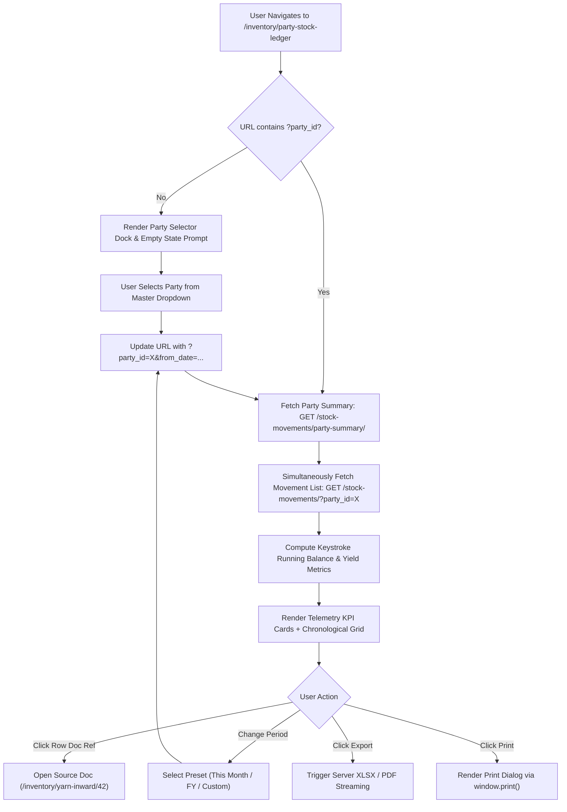

# Party Stock Ledger & Job Work Material Reconciliation Specification

| Standard Code | Screen ID | Target Platform | API Version | Document Version | Date | Status |
|---|---|---|---|---|---|---|
| **STD-UI-001** | **`SCR-INVN-004`** | Next.js 14 (App Router) + TypeScript | `v1.2` (Django 5 DRF) | `v1.0.0` | 16/10/2026 | **APPROVED FOR IMPLEMENTATION** |

---

## 1. Document Overview, Version, Scope, and Status

### 1.1 Purpose
This specification defines the complete technical architecture, real-time telemetry metrics, dual-metric running balance ledger, party context header, job work subcontractor reconciliation engine, multi-parameter filtering, and backend API integration for the **Party Stock Ledger & Job Work Material Reconciliation Register** (`SCR-INVN-004`).

In textile spinning, knitting, dyeing, and garment manufacturing clusters (such as Tirupur, Coimbatore, and Surat), substantial quantities of valuable inventory are continuously in transit or lying at third-party premises. Maintaining an authoritative, real-time **Party Stock Ledger** (also termed the *Subcontractor & Mill Material Reconciliation Statement*) is mandatory for operational, audit, and commercial integrity:
1. **Subcontractor / Job Worker Processing**: Tracks physical raw material (Yarn) issued outward to job workers (Knitters, Dyers, Printers) versus semi-finished or finished goods (Greige Fabric, Processed Fabric) received back inward, computing material yields, process shrinkage/loss %, and net unreturned raw material balance.
2. **Spinning Mill & Supplier Receipts**: Reconciles raw material inward batches received from spinning mills and yarn traders against purchase contracts and delivery notes.
3. **Customer Despatches & Returns**: Tracks commercial yarn sales deliveries and customer return re-credits per party.
4. **Dual Metric Tracking**: Records movements simultaneously in **Textile Bag / Roll units** (standard $45.360\text{ Kg}$) and **Kilogram Net Weights** ($3\text{ decimal places}$).
5. **Backend Verification**: Consumes the production backend endpoint [`StockMovementViewSet.party_summary`](file:///d:/Codebase/Garments/backend/apps/ledger/views.py#L96-L108) (`GET /api/v1/ledger/stock-movements/party-summary/`) and [`tl_stock_movement`](file:///d:/Codebase/Garments/backend/apps/ledger/models.py) backed by [`StockLedgerService.get_party_stock_summary`](file:///d:/Codebase/Garments/backend/apps/ledger/services.py#L119-L213).

### 1.2 Scope
- **Entities Handled**:
  - Chronological Transaction Audit Movements: [`tl_stock_movement`](file:///d:/Codebase/Garments/backend/apps/ledger/models.py).
  - Live Stage Stock Snapshots: [`tm_stage_stock`](file:///d:/Codebase/Garments/backend/apps/ledger/models.py).
  - Party Master Records: [`PartyMaster`](file:///d:/Codebase/Garments/backend/apps/masters/models.py) (`tm_party`).
  - Multi-Stage Aggregation: Raw Yarn (`YARN`), Greige Fabric (`GREY_FABRIC`), Dyed Fabric (`DYED_FABRIC`), and Garments (`GARMENT`).
- **Country Pack**: India (`IN`) — Indian Rupee (`₹`), Indian numerical grouping (`12,34,567.89`), Date format (`DD/MM/YYYY`), Weight precision to 3 decimal places (`0.000 Kg`), Rates precision to 2/4 decimal places, Bag nominal standard `45.360 Kg`.
- **Target Routes**: `/inventory/party-stock-ledger` (Primary) with alias `/ledger/party-stock`.

---

## 2. Module Details, Screen ID, Route, Access Privileges, and API Endpoints

### 2.1 Core Metadata

| Parameter | Specification |
|---|---|
| **Module** | `Module 4 — Inventory & Godown Stock Ledger` / `Module 8 — Dual Stock & Currency Ledger Engine` |
| **Screen ID** | `SCR-INVN-004` (Alias: `SCR-LEDG-001`) |
| **Frontend Route** | `/inventory/party-stock-ledger` (Alias: `/ledger/party-stock`) |
| **File Location** | `app/(app)/inventory/party-stock-ledger/page.tsx` |
| **Required Privilege** | `ledger_stock_movement.can_read` (View movements and party summary); `inventory_yarn_stock.can_export` (Excel/PDF export) |
| **Authorized Roles** | `SUPER_ADMIN`, `ADMIN_USER`, `COMPANY_USER` (Job Work Coordinator, Production Manager, Storekeeper, Costing Accountant, Internal Auditor) |
| **Country Pack** | `IN` (India: Currency INR `₹`, Date `DD/MM/YYYY`, Weights in `Kg` [3 dp], Bag tare `45.360 Kg`) |

### 2.2 Primary API Endpoints

| HTTP Method | API Path | Privilege / Scope | Description |
|---|---|---|---|
| `GET` | `/api/v1/ledger/stock-movements/party-summary/` | `can_read` | Fetch pre-aggregated party stock summary (Total Inward, Total Outward, Net Balance, Movements) |
| `GET` | `/api/v1/ledger/stock-movements/` | `can_read` | Fetch filtered chronological movement list with cursor pagination |
| `GET` | `/api/v1/masters/parties/?is_active=1` | `can_read` | Fetch active parties (Mills, Knitters, Dyers, Customers, Suppliers) for party selector |
| `GET` | `/api/v1/masters/warehouses/?is_active=1` | `can_read` | Fetch company storage godowns and subcontractor plant locations |
| `GET` | `/api/v1/masters/yarn-counts/?is_active=1` | `can_read` | Fetch yarn count catalog for filtering counts issued/received |
| `GET` | `/api/v1/ledger/stock-movements/export/` | `can_export` | Stream server-side generated Party Stock Statement in Excel (`.xlsx`) or PDF (`.pdf`) format |

---

## 3. UI Layout, Screen Blueprint, and Visual Mockup (1440px+ Wireframe)

```
+-----------------------------------------------------------------------------------------------------------------------------+
| GARMENTS ERP — Inventory & Subcontractor Desk                                Company: ABC Textiles Ltd | FY: 2026-2027      |
+-----------------------------------------------------------------------------------------------------------------------------+
| TOP BREADCRUMB: Inventory > Subcontractor Stock > Party Stock Ledger                                                        |
| PARTY STOCK LEDGER & MATERIAL RECONCILIATION                [⚡ Filter Drawer (F)]  [📥 Export Statement]  [🖨 Print Statement]     |
+-----------------------------------------------------------------------------------------------------------------------------+
| PRIMARY PARTY SELECTOR & AUDIT CONTEXT DOCK                                                                                 |
| Select Party*: [ 🏢 Vardhman Textiles Ltd (MILL-001) - Spinning Mill | GSTIN: 03AABCV1234F1Z8 | Ludhiana, PB    ▼ ] [ ✕ Clear ]|
| Stage Filter: [ All Stages (Yarn, Grey, Dyed) ▼ ]    Movement Type: [ All Inward & Outward ▼ ]                              |
| Date Range  : [ FY 2026-2027 ▼ ]  From: [ 01/04/2026 ]  To: [ 16/10/2026 ]  [ ⚡ Apply Filter ]  [ 🔄 Reset ]                |
+-----------------------------------------------------------------------------------------------------------------------------+
| REAL-TIME PARTY TELEMETRY METRIC CARDS                                                                                      |
| +-------------------------+ +-------------------------+ +-------------------------+ +-------------------------------------+ |
| | TOTAL INWARD RECEIVED   | | TOTAL OUTWARD DISPATCHED| | NET MATERIAL BALANCE    | | PROCESS RECONCILIATION & YIELD      | |
| | 1,240 Bags              | | 1,860 Bags              | | -620 Bags (With Party)  | | Total Dispatched: 84,369.600 Kg     | |
| | 56,246.400 Kg           | | 84,369.600 Kg           | | -28,123.200 Kg          | | Material Ret'd  : 56,246.400 Kg     | |
| | Val: ₹1,96,86,240.00    | | Val: ₹2,95,29,360.00    | | Val: -₹98,43,120.00     | | Current Balance : 33.33% Outstanding| |
| +-------------------------+ +-------------------------+ +-------------------------+ +-------------------------------------+ |
+-----------------------------------------------------------------------------------------------------------------------------+
| ACTIVE FILTERS: [Party: Vardhman Textiles Ltd ✕] [Period: 01/04/2026 - 16/10/2026 ✕] [Stage: ALL ✕] (Total 28 Transactions)|
+-----------------------------------------------------------------------------------------------------------------------------+
| CHRONOLOGICAL MATERIAL MOVEMENT & RECONCILIATION LEDGER                                                                     |
| +------------+----------------------+----------+-------------+-----------------------+--------+--------+--------+-----------+ |
| | Date       | Document Type & Ref  | Stage    | Item / Count| Warehouse / Mill Lot  | In Bags| In Kg  |Out Bags| Out Kg    | |
| +------------+----------------------+----------+-------------+-----------------------+--------+--------+--------+-----------+ |
| | 01/04/2026 | OPENING BALANCE      | YARN     | 30s Karded  | Central Godown A      |    0   |   0.000|    0   |      0.000| |
| |            | Balance B/F          |          |             | Opening FY 2026-2027  | Balance: 0 Bags | 0.000 Kg            | |
| +------------+----------------------+----------+-------------+-----------------------+--------+--------+--------+-----------+ |
| | 15/04/2026 | YARN_INWARD_GRN      | YARN     | 30s Karded  | Central Godown A      |  500   |22680.00|    0   |      0.000| |
| |            | GRN-2026-0042        |          | Lot #V4021  | Against PO-2026-0018  | Running Balance: +500 Bags |+22,680.00| |
| +------------+----------------------+----------+-------------+-----------------------+--------+--------+--------+-----------+ |
| | 02/05/2026 | YARN_OUTWARD_DC      | YARN     | 30s Karded  | Processing Knitter    |    0   |   0.000|  300   |  13608.000| |
| |            | DC-2026-0105         |          | Lot #V4021  | Knitter Job Card #84  | Running Balance: +200 Bags | +9,072.00| |
| +------------+----------------------+----------+-------------+-----------------------+--------+--------+--------+-----------+ |
| | 20/05/2026 | GREY_FABRIC_GRN      | GREY_FAB | 30s Single  | Greige Warehouse 1    |  280*  |12927.60|    0   |      0.000| |
| |            | GIN-2026-0019        |          | Rolls Lot 84| Knitting Prog #KP-012 | Running Bal Yarn Equiv: -680.400 Kg(5%)| |
| +------------+----------------------+----------+-------------+-----------------------+--------+--------+--------+-----------+ |
| | 12/06/2026 | YARN_SALES_INVOICE   | YARN     | 30s Karded  | Central Godown A      |    0   |   0.000|  200   |   9072.000| |
| |            | INV-2026-0098        |          | Lot #V4021  | Comm Delivery Tax Inv | Running Balance: 0 Bags | 0.000 Kg     | |
| +------------+----------------------+----------+-------------+-----------------------+--------+--------+--------+-----------+ |
| [<< First] [< Prev] Page 1 of 3 [Next >] [Last >>]              Showing 1-15 of 28 Records | Rows per page: [ 25 ▼ ]        |
+-----------------------------------------------------------------------------------------------------------------------------+
| SUMMARY FOOTER BAR                                                                                                          |
| PERIOD TOTALS: Inward: 1,240 Bags (56,246.400 Kg) | Outward: 1,860 Bags (84,369.600 Kg) | Net Party Balance: -28,123.200 Kg  |
+-----------------------------------------------------------------------------------------------------------------------------+
```

---

## 4. Page Initialization, Query Parameters, and Default State

### 4.1 URL Query Parameters

| Parameter | Type | Default | Description |
|---|---|---|---|
| `party_id` | `integer` | `null` | **Mandatory** Party primary key (`tm_party.id`). If absent, shows party selection prompt. |
| `stage` | `string` | `ALL` | Filter by processing stage: `ALL`, `YARN`, `GREY_FABRIC`, `DYED_FABRIC`. |
| `movement_type`| `string` | `ALL` | Filter direction: `ALL`, `INWARD`, `OUTWARD`, `TRANSFER`, `ADJUSTMENT`. |
| `from_date` | `string` | First day of active FY | Start date formatted `DD/MM/YYYY` (e.g. `01/04/2026`). |
| `to_date` | `string` | Current date | End date formatted `DD/MM/YYYY` (e.g. `16/10/2026`). |
| `warehouse_id` | `integer` | `null` | Optional warehouse restriction (`tm_warehouse.id`). |
| `yarn_count_id`| `integer` | `null` | Optional yarn count filter. |
| `page` | `integer` | `1` | Cursor pagination index. |
| `page_size` | `integer` | `25` | Records per page (options: `25`, `50`, `100`). |

### 4.2 Page Initialization Lifecycle
1. **Context Resolution**: On mount, read `X-Company-ID` and active financial year dates (`start_date`, `end_date`) from session store.
2. **URL Parameter Hydration**: If `?party_id=12` is present, automatically load party details and trigger [`get_party_stock_summary`](file:///d:/Codebase/Garments/backend/apps/ledger/services.py#L119-L213).
3. **Empty State Handling**: If no `party_id` is supplied in the URL, render a prominent Party Selection Bar with quick-search typeahead.
4. **Date Defaulting**: Default `from_date` to `01/04/YYYY` (FY start) and `to_date` to `today` in Indian standard date format (`DD/MM/YYYY`).

---

## 5. Document Header, Fiscal Context, and Financial Year Configuration

### 5.1 Financial Year Guardrails
- **Company Timezone Authority**: Computed against `tm_company.timezone` (Asia/Kolkata).
- **Date Format Rule**: Date input/output strictly uses `DD/MM/YYYY`. ISO dates (`YYYY-MM-DD`) are forbidden on screen.
- **FY Invariant**: If selected `from_date` precedes active financial year `start_date`, display an informational alert: *"Historical audit mode: Data spans previous financial periods."*

### 5.2 Party Entity Context Badge
Upon selecting a party, display an authoritative context banner:
- **Party Legal Name & Code**: e.g., `Vardhman Textiles Ltd (MILL-001)`
- **Party Type Badge**:
  - `MILL` / `SUPPLIER`: Blue Badge (`Raw Material Supplier`)
  - `KNITTER` / `DYER` / `PROCESS_HOUSE`: Purple Badge (`Subcontractor / Job Worker`)
  - `CUSTOMER`: Green Badge (`Commercial Buyer`)
- **Statutory Details**: GSTIN (`03AABCV1234F1Z8`), State Code (`03 - Punjab`), PAN.
- **Address & Contact**: City, Phone, Email.

---

## 6. Primary Master Linkages

| Master Entity | Endpoint | Field Injected | Usage in Screen |
|---|---|---|---|
| **Party Master** | `/api/v1/masters/parties/?is_active=1` | `party_id` | Select spinning mill, knitter, dyer, or customer |
| **Warehouse Master** | `/api/v1/masters/warehouses/?is_active=1` | `warehouse_id` | Filter godown storage or job worker factory location |
| **Yarn Count Master** | `/api/v1/masters/yarn-counts/?is_active=1` | `yarn_count_id` | Filter specific yarn count (e.g. 30s Karded, 40s Combed) |
| **Color Shade Master** | `/api/v1/masters/color-shades/?is_active=1` | `shade_id` | Filter dyed yarn and dyed fabric lots |

---

## 7. Dynamic Technical Specifications (Multi-Stage Processing)

The Party Stock Ledger supports dynamic technical specifications depending on the party role and manufacturing stage:

| Stage Code | Stage Name | Primary Unit | Secondary Metric | Technical Attributes Tracked |
|---|---|---|---|---|
| `YARN` | Raw Yarn | Bags ($45.360\text{ Kg}$) | Net Kg ($3\text{ dp}$) | Yarn Count, Spinning Mill, Lot No, Color Shade, Cone Type |
| `GREY_FABRIC` | Knitted Greige Fabric | Rolls / Thans | Net Kg ($3\text{ dp}$) | Fabric Construction (Single Jersey, Rib, Interlock), GSM, Dia (Inches), Loop Length |
| `DYED_FABRIC` | Processed / Finished Fabric| Rolls / Rolls | Net Kg ($3\text{ dp}$) | Shade Name, Color Code, Shrinkage %, Finish Width, Fastness Grade |
| `GARMENT` | Cut / Sewn Garments | Bundles / Pieces | Gross Pcs | Style No, Size Breakdown, Color Code, PO Reference |

---

## 8. Interactive Spreadsheet Data Grid & Running Balance Ledger

### 8.1 Grid Column Definitions

| # | Column Name | Data Field | Alignment | Width | Formatting / Rule |
|---|---|---|---|---|---|
| 1 | **Date** | `movement_date` | Left | 100px | `DD/MM/YYYY` |
| 2 | **Doc Type & Ref** | `doc_type` + `doc_number` | Left | 160px | Clickable link navigating to source document viewer |
| 3 | **Stage** | `stage` | Center | 100px | Colored pill: `YARN` (Blue), `GREY_FABRIC` (Amber), `DYED` (Purple) |
| 4 | **Item / Count** | `item_name` | Left | 180px | Textile count or fabric description |
| 5 | **Lot / Mill Lot**| `lot_or_batch_no` | Left | 120px | Mill spinning batch or roll lot number |
| 6 | **Godown** | `warehouse_name` | Left | 130px | Storage location name |
| 7 | **Inward Bags** | `in_units` | Right | 90px | Integer count (0 if outward) |
| 8 | **Inward Qty** | `in_qty` | Right | 110px | Kilograms formatted to 3 decimal places |
| 9 | **Outward Bags**| `out_units` | Right | 90px | Integer count (0 if inward) |
| 10| **Outward Qty** | `out_qty` | Right | 110px | Kilograms formatted to 3 decimal places |
| 11| **Running Bal (Kg)**| `running_balance_qty` | Right | 120px | Net cumulative quantity in Kilograms |
| 12| **Trans. Against** | `transaction_against` | Left | 160px | Upstream linkage: e.g. `PO #2026-0018` or `Knitting Prog #KP-012` |
| 13| **Unit Rate (₹)**| `unit_rate` | Right | 100px | Standard currency rate formatted to 2 decimal places |
| 14| **Remarks** | `remarks` | Left | 180px | Audit note or gate pass reference |

---

## 9. Mathematical Formulas & Keystroke Calculation Engine

### 9.1 Net Cumulative Running Balance Formula
For chronological row $i \in \{1, \dots, n\}$ ordered by `movement_date ASC, id ASC`:

$$\text{Running Balance Qty}_i = \text{Opening Balance Qty} + \sum_{k=1}^{i} \left( \text{Inward Qty}_k - \text{Outward Qty}_k \right)$$

$$\text{Running Balance Units}_i = \text{Opening Balance Units} + \sum_{k=1}^{i} \left( \text{Inward Units}_k - \text{Outward Units}_k \right)$$

### 9.2 Period Aggregate Summary Formulas

$$\text{Total Inward Qty} = \sum_{k=1}^{n} \text{Inward Qty}_k \quad (\text{Kg})$$

$$\text{Total Outward Qty} = \sum_{k=1}^{n} \text{Outward Qty}_k \quad (\text{Kg})$$

$$\text{Net Material Position} = \text{Total Inward Qty} - \text{Total Outward Qty}$$

- If $\text{Net Material Position} > 0$: Net physical material received from party.
- If $\text{Net Material Position} < 0$: Net company material currently lying at party / subcontractor location.

### 9.3 Monetary Stock Valuation Formula

$$\text{Valuation Amount} = \sum_{k=1}^{n} \left( \text{Net Balance Qty}_k \times \text{Unit Rate}_k \right) \quad (\text{INR ₹})$$

---

## 10. Job Work Subcontractor Yield & Process Loss Reconciliation Matrix

When evaluating external subcontractors (Knitters, Dyers, Compactors), the system computes real-time manufacturing material yields:

| Metric | LaTeX Calculation Formula | Industry Standard Tolerance |
|---|---|---|
| **Yarn Issued to Knitter** | $\text{Input Yarn Qty} = \sum \text{Outward Qty (Yarn)}$ | Reference Base (100.0%) |
| **Fabric Received from Knitter** | $\text{Output Fabric Qty} = \sum \text{Inward Qty (Grey Fabric)}$ | Measured Net Weight |
| **Knitting Process Loss (Kg)** | $\Delta_{\text{Loss}} = \text{Input Yarn Qty} - \text{Output Fabric Qty}$ | Target: $\le 3.000\%$ to $4.500\%$ |
| **Knitting Process Loss (%)** | $\text{Loss } \% = \left( \frac{\Delta_{\text{Loss}}}{\text{Input Yarn Qty}} \right) \times 100$ | Red alert if $\text{Loss } \% > 4.5\%$ |
| **Unreturned Yarn Balance** | $\text{Balance Yarn} = \text{Input Yarn Qty} - (\text{Output Fabric Qty} + \text{Approved Loss})$ | Material recoverable from knitter |

---

## 11. Summary Bar, Remarks, Telemetry KPI Cards, and Total Calculations

### 11.1 Real-Time Telemetry Cards

```
+----------------------------------------------------------------------------------------------------------------+
| [📥 TOTAL INWARD]             [📤 TOTAL OUTWARD]            [⚖️ NET PARTY BALANCE]       [⚡ RECONCILIATION]    |
| 1,240 Bags                    1,860 Bags                    -620 Bags (With Party)       Yarn Issued: 84,369 Kg |
| 56,246.400 Kg                 84,369.600 Kg                 -28,123.200 Kg               Fabric Rcvd: 56,246 Kg |
| ₹1,96,86,240.00               ₹2,95,29,360.00               -₹98,43,120.00               Yield: 66.67% (Active) |
+----------------------------------------------------------------------------------------------------------------+
```

### 11.2 Sticky Footer Summary Bar
Fixed at the bottom of the viewport showing current page sub-totals and period grand-totals:
- **Filtered Row Count**: e.g., `Showing 28 transactions across 3 pages`
- **Total Inward Weight**: `56,246.400 Kg` (Green)
- **Total Outward Weight**: `84,369.600 Kg` (Orange)
- **Net Balance Weight**: `-28,123.200 Kg` (Red Badge if material outstanding with party)

---

## 12. Form & Filter Validation Rules (Field-by-Field Matrix & Zod Schema)

### 12.1 Validation Matrix

| Field | Rule Type | Error Condition | User Error Message |
|---|---|---|---|
| `party_id` | Mandatory | Value is null or 0 | *"Please select a valid Party to view stock movements."* |
| `from_date` | Format & Range | Not `DD/MM/YYYY` | *"Date format must be DD/MM/YYYY (e.g. 01/04/2026)."* |
| `to_date` | Chronological | `to_date < from_date` | *"End Date cannot precede Start Date."* |
| `stage` | Enum | Not in `ALL`, `YARN`, `GREY_FABRIC`, `DYED_FABRIC` | *"Invalid stage selected."* |

### 12.2 Copy-Paste Ready Zod Schema

```typescript
import { z } from "zod";

const dateRegex = /^(0[1-9]|[12][0-9]|3[01])\/(0[1-9]|1[012])\/(19|20)\d\d$/;

export const partyStockLedgerFilterSchema = z.object({
  party_id: z.number({
    required_error: "Please select a Party to view stock ledger",
    invalid_type_error: "Party ID must be a valid number",
  }).int().positive("Party ID must be positive"),
  stage: z.enum(["ALL", "YARN", "GREY_FABRIC", "DYED_FABRIC", "GARMENT"]).default("ALL"),
  movement_type: z.enum(["ALL", "INWARD", "OUTWARD", "TRANSFER", "ADJUSTMENT"]).default("ALL"),
  warehouse_id: z.number().int().positive().nullable().optional(),
  yarn_count_id: z.number().int().positive().nullable().optional(),
  from_date: z.string().regex(dateRegex, "Start Date must be DD/MM/YYYY"),
  to_date: z.string().regex(dateRegex, "End Date must be DD/MM/YYYY"),
  page: z.number().int().positive().default(1),
  page_size: z.number().int().positive().default(25),
}).superRefine((data, ctx) => {
  const parseDDMMYYYY = (val: string): Date => {
    const [day, month, year] = val.split("/").map(Number);
    return new Date(year, month - 1, day);
  };

  const start = parseDDMMYYYY(data.from_date);
  const end = parseDDMMYYYY(data.to_date);

  if (end < start) {
    ctx.addIssue({
      code: z.ZodIssueCode.custom,
      path: ["to_date"],
      message: "End Date cannot precede Start Date",
    });
  }
});

export type PartyStockLedgerFilterValues = z.infer<typeof partyStockLedgerFilterSchema>;
```

---

## 13. Lifecycle Workflows



---

## 14. API Integration, Request Headers, and HTTP Errors

### 14.1 Request Headers
```http
GET /api/v1/ledger/stock-movements/party-summary/?party_id=1&stage=ALL&from_date=01/04/2026&to_date=16/10/2026 HTTP/1.1
Host: api.garmentserp.local
Authorization: Bearer <JWT_ACCESS_TOKEN>
X-Company-ID: 1
X-Financial-Year-ID: 4
Accept: application/json
```

### 14.2 API Response DTO (`200 OK`)
```json
{
  "success": true,
  "data": {
    "party": {
      "id": 1,
      "code": "MILL-001",
      "name": "Vardhman Textiles Ltd",
      "party_type": "MILL",
      "party_type_display": "Spinning Mill"
    },
    "stage_filter": "ALL",
    "date_range": {
      "from_date": "01/04/2026",
      "to_date": "16/10/2026"
    },
    "total_inward_units": 1240,
    "total_inward_qty": "56246.400",
    "total_outward_units": 1860,
    "total_outward_qty": "84369.600",
    "net_units": -620,
    "net_quantity": "-28123.200",
    "movement_count": 28,
    "movements": [
      {
        "id": 104,
        "movement_date": "15/04/2026",
        "stage": "YARN",
        "warehouse": 1,
        "warehouse_name": "Central Godown A",
        "movement_type": "INWARD",
        "doc_type": "YARN_INWARD_GRN",
        "doc_number": "GRN-2026-0042",
        "transaction_against": "YARN_PO #PO-2026-0018",
        "item_name": "30s Karded Yarn",
        "lot_or_batch_no": "V4021",
        "in_units": 500,
        "in_qty": "22680.000",
        "out_units": 0,
        "out_qty": "0.000",
        "balance_qty": "22680.000",
        "unit_rate": "350.00",
        "remarks": "Weighbridge Net Weight Accepted"
      }
    ]
  }
}
```

---

## 15. Next.js Folder Structure and Component Responsibilities

```
app/(app)/inventory/party-stock-ledger/
├── page.tsx                           # Master page orchestrator, URL state & data hydration
├── components/
│   ├── PartySelectorHeader.tsx        # Party autocomplete dropdown, GSTIN & legal badge
│   ├── PeriodDateFilterDock.tsx       # Presets (Today, This Month, FY) & custom date pickers
│   ├── PartyStockTelemetryCards.tsx   # 4 KPI cards (Inward, Outward, Net Balance, Yield)
│   ├── SubcontractorYieldMatrix.tsx   # Yarn Issued vs Fabric Returned reconciliation card
│   ├── MovementLedgerGrid.tsx         # Chronological spreadsheet table with running math
│   ├── MovementLedgerRow.tsx          # Single transaction row with clickable source doc drill-down
│   ├── SourceDocumentModal.tsx        # Quick preview modal for linked GRN/DC/Invoice
│   └── PartyStockStickyFooter.tsx     # Persistent bottom totals bar
├── hooks/
│   ├── usePartyStockLedger.ts         # TanStack Query hook calling /party-summary/ and /stock-movements/
│   └── usePartyMasterLookup.ts        # Debounced party master search typeahead
└── types/
    └── party-stock-ledger.types.ts    # TypeScript DTOs, API contracts, and filter values
```

---

## 16. React Hooks, TypeScript Types, and Filter State

```typescript
// types/party-stock-ledger.types.ts

export type ProcessingStage = "ALL" | "YARN" | "GREY_FABRIC" | "DYED_FABRIC" | "GARMENT";
export type MovementType = "ALL" | "INWARD" | "OUTWARD" | "TRANSFER" | "ADJUSTMENT";

export interface PartyStockMovementDTO {
  id: number;
  movement_date: string; // DD/MM/YYYY
  stage: ProcessingStage;
  warehouse: number;
  warehouse_name: string;
  movement_type: MovementType;
  doc_type: string;
  doc_number: string;
  transaction_against: string;
  item_name: string;
  lot_or_batch_no: string;
  in_units: number;
  in_qty: string; // 3 decimal places
  out_units: number;
  out_qty: string; // 3 decimal places
  balance_qty: string;
  unit_rate: string;
  remarks: string;
  running_balance_qty?: number;
}

export interface PartySummaryResponse {
  party: {
    id: number;
    code: string;
    name: string;
    party_type: string;
    party_type_display: string;
  };
  stage_filter: string;
  date_range: {
    from_date: string;
    to_date: string;
  };
  total_inward_units: number;
  total_inward_qty: string;
  total_outward_units: number;
  total_outward_qty: string;
  net_units: number;
  net_quantity: string;
  movement_count: number;
  movements: PartyStockMovementDTO[];
}
```

---

## 17. Factory Floor & Weighbridge Keyboard Ergonomics (Shortcuts)

| Shortcut | Scope | Behavior |
|---|---|---|
| `P` or `Alt + P` | Global Page | Focuses the Primary Party Selector input box |
| `F` | Global Page | Toggles open the Multi-Parameter Filter Drawer |
| `/` | Global Page | Focuses table Quick Search (Lot No / Doc Number) |
| `Alt + 1` | Date Dock | Activates **Today** filter preset |
| `Alt + 2` | Date Dock | Activates **This Month** filter preset |
| `Alt + 3` | Date Dock | Activates **Active Financial Year** preset |
| `Alt + E` | Global Page | Triggers **Export to Excel (.xlsx)** |
| `Ctrl + P` / `Cmd + P` | Global Page | Opens standardized A4 portrait printable statement |
| `Esc` | Modals/Drawers | Closes active preview modals or filter drawer |

---

## 18. Loading States, Shimmer Skeletons, and Failure Handling

- **Party Selector Loading**: Shimmer skeleton placeholder over party legal badge and telemetry cards during network transit.
- **Initial Empty State**: When `party_id` is null, displays an illustrated prompt: *"Select a Party above to view inward/outward material ledger and job work balance."*
- **Zero Records State**: When a party has zero transactions within the selected date range: *"No stock movements recorded for [Party Name] between [from_date] and [to_date]."*
- **Network Error State**: If backend returns `500` or timeout, show retry banner with technical correlation ID and error toast.

---

## 19. Security, Tenant Scoping, and Backend Invariant Validation

1. **Mandatory Tenant Isolation**:
   - `company_id` is strictly extracted from `request.user.company_id` on the server. Never accepted in request body or URL.
2. **Double Invariant Enforcement**:
   - Client calculation of running balances is reconciled against the server-generated `balance_qty` field. Any deviation triggers an invariant warning icon on the row.
3. **Privilege Gating**:
   - Requires `ledger_stock_movement.can_read`. Non-authorized users receive a structured `403 Forbidden` response.
4. **Data Tamper Prevention**:
   - Historical movement records are strictly read-only (`ReadOnlyModelViewSet`). Reversals can only occur by posting compensatory contra documents.

---

## 20. Implementation Sequence and Developer Acceptance Checklist

- [ ] **Step 1: Scaffolding**: Create directory `app/(app)/inventory/party-stock-ledger/`.
- [ ] **Step 2: Type Definitions**: Implement `party-stock-ledger.types.ts` and Zod validation schema.
- [ ] **Step 3: Data Hooks**: Create TanStack Query hook `usePartyStockLedger` calling `/api/v1/ledger/stock-movements/party-summary/`.
- [ ] **Step 4: Party Context Bar**: Implement `PartySelectorHeader.tsx` with debounced search typeahead.
- [ ] **Step 5: Telemetry Cards**: Build `PartyStockTelemetryCards.tsx` with Bag/Kg dual metric display.
- [ ] **Step 6: Spreadsheet Grid**: Construct `MovementLedgerGrid.tsx` with dynamic running balance calculation.
- [ ] **Step 7: Subcontractor Reconciliation**: Build `SubcontractorYieldMatrix.tsx` computing Yarn Issued vs Fabric Received.
- [ ] **Step 8: Export & Print**: Wire server export streaming and CSS `@media print` layout.
- [ ] **Step 9: Automated Tests**: Add unit tests for running balance math and Playwright E2E spec for party filtering.

---

## 21. Edge Cases & Items Requiring Confirmation

1. **Cross-Stage Job Work Reconciliation**:
   - *Scenario*: Yarn is issued to Knitter in `Kg` (Stage `YARN`), and Knitted Grey Fabric is received back in `Rolls & Kg` (Stage `GREY_FABRIC`).
   - *Design*: The ledger displays both movements chronologically. In the reconciliation card, Greige Fabric Weight received is compared against Yarn Weight issued to compute the actual knitting loss %.
2. **Subcontractor Waste & Return Yarn**:
   - *Scenario*: Knitter returns unused yarn cones alongside knitted fabric.
   - *Design*: Unused yarn is credited back under `YARN` inward return, reducing the knitter's net yarn balance without counting as process loss.
3. **Multi-Lot Issues**:
   - When a DC issues yarn from multiple spinning mill lots to a single knitter job card, the ledger renders separate rows per lot to preserve lot traceability.
