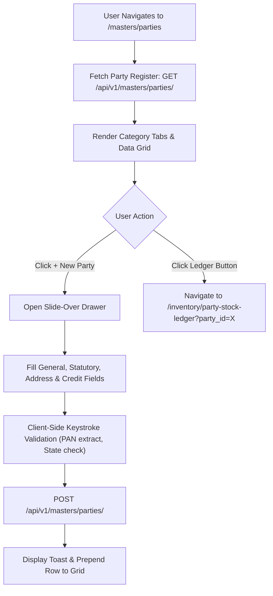

# Party Master (Mills, Traders, Subcontractors, Customers & Suppliers) Specification

| Standard Code | Screen ID | Target Platform | API Version | Document Version | Date | Status |
|---|---|---|---|---|---|---|
| **STD-UI-001** | **`SCR-MAST-001`** | Next.js 14 (App Router) + TypeScript | `v1.2` (Django 5 DRF) | `v1.0.0` | 16/10/2026 | **APPROVED FOR IMPLEMENTATION** |

---

## 1. Document Overview, Version, Scope, and Status

### 1.1 Purpose
This specification defines the complete technical architecture, UI layout, field definitions, statutory Indian tax validation rules, credit governance, party category filters, Zod validation schemas, TypeScript interfaces, and backend API integration for the **Enterprise Party Master Registry** (`SCR-MAST-001`).

In the textile supply chain (from spinning mills through job-work processors to wholesale buyers and garment exporters), the Party Master is the authoritative registry for all external business relationships:
1. **Supply Chain Entity Classification**: Distinguishing between Spinning Mills (`MILL`), Yarn Traders (`TRADER`), Knitting Subcontractors (`KNITTING_UNIT`), Dye Houses (`DYEING_UNIT`), Process Subcontractors (`JOB_WORKER`), Commercial Buyers (`CUSTOMER`), and Raw Material Vendors (`SUPPLIER`).
2. **Statutory Indian Tax Integrity**: Enforcing valid 15-character Goods and Services Tax Identification Numbers (GSTIN), state-prefix validation, Income Tax PAN extraction, and MSME classification.
3. **Credit Governance & Financial Guardrails**: Establishing formal credit windows (**Credit Days**, e.g. 30/45/60 days), **Credit Limits** (in INR $₹$), and tracking initial opening balances across financial ledgers.
4. **Subcontractor Yield & Capacity Telemetry**: Tagging approved process loss tolerances ($3.0\% - 4.5\%$) and machine capacities (e.g. knitting circular diameters, dyeing batch sizes).

### 1.2 Scope
- **Backend Model**: [`PartyMaster`](file:///d:/Codebase/Garments/backend/apps/masters/models.py#L25-L60) (`mx_party`).
- **Country Pack**: India (`IN`) — Indian Rupee (`₹`), Indian numerical grouping (`12,34,567.89`), Date format (`DD/MM/YYYY`), Indian State codes (01 to 37), PAN extraction.
- **Target Route**: `/masters/parties` (Next.js route: `app/(app)/masters/parties/page.tsx`).

---

## 2. Module Details, Screen ID, Route, Access Privileges, and API Endpoints

### 2.1 Core Metadata

| Parameter | Specification |
|---|---|
| **Module** | `Module 2 — Master Data Governance` |
| **Screen ID** | `SCR-MAST-001` |
| **Frontend Route** | `/masters/parties` |
| **File Location** | `app/(app)/masters/parties/page.tsx` |
| **Required Privilege** | `masters_party.can_read` (View catalog); `masters_party.can_create` (Add); `masters_party.can_update` (Edit); `masters_party.can_delete` (Deactivate) |
| **Authorized Roles** | `SUPER_ADMIN`, `ADMIN_USER`, `COMPANY_USER` (Commercial Manager, Purchase Head, Accounts Manager, Sales Coordinator) |
| **Country Pack** | `IN` (India: Currency INR `₹`, Date `DD/MM/YYYY`, GSTIN 15-char, PAN 10-char) |

### 2.2 Primary API Endpoints

| HTTP Method | API Path | Privilege / Scope | Description |
|---|---|---|---|
| `GET` | `/api/v1/masters/parties/` | `can_read` | Fetch filtered party master list with cursor pagination and search |
| `POST` | `/api/v1/masters/parties/` | `can_create` | Create a new Party Master record |
| `GET` | `/api/v1/masters/parties/{id}/` | `can_read` | Retrieve single party profile with historical ledger summaries |
| `PATCH` / `PUT` | `/api/v1/masters/parties/{id}/` | `can_update` | Update party address, credit limits, contact persons, or tax details |
| `DELETE` | `/api/v1/masters/parties/{id}/` | `can_delete` | Soft delete / deactivate party (`is_deleted = True`, `is_active = False`) |
| `GET` | `/api/v1/ledger/stock-movements/party-summary/?party_id={id}` | `can_read` | Quick link to view party's physical stock ledger and job work balance |

---

## 3. UI Layout, Screen Blueprint, and Visual Mockup (1440px+ Wireframe)

```
+-----------------------------------------------------------------------------------------------------------------------------+
| GARMENTS ERP — Master Data Governance Desk                                   Company: ABC Textiles Ltd | FY: 2026-2027      |
+-----------------------------------------------------------------------------------------------------------------------------+
| TOP BREADCRUMB: Masters > Party Master Registry                                                                             |
| ENTERPRISE PARTY MASTER REGISTER              [ ➕ New Party (Alt+N) ]  [ 📥 Export Parties ]  [ ⚡ Filter Drawer (F) ]     |
+-----------------------------------------------------------------------------------------------------------------------------+
| CATEGORY TABS & TELEMETRY KPI CARDS                                                                                         |
| [ All Parties (142) ] [ Spinning Mills (24) ] [ Knitters (18) ] [ Dyers (12) ] [ Customers (65) ] [ Suppliers (23) ]       |
|                                                                                                                             |
| +-------------------------+ +-------------------------+ +-------------------------+ +-------------------------------------+ |
| | TOTAL ACTIVE PARTIES    | | APPROVED CREDIT LIMIT   | | OUTSTANDING BALANCES    | | SUBCONTRACTOR RECONCILIATION        | |
| | 142 Accounts            | | ₹8,45,00,000.00         | | ₹3,12,45,670.00         | | 30 Active Job Work Units            | |
| | 96 Verified GSTINs      | | Avg Terms: 45 Days      | | 18 Overdue Invoices     | | Total Lying Stock: 42,650.000 Kg    | |
| +-------------------------+ +-------------------------+ +-------------------------+ +-------------------------------------+ |
+-----------------------------------------------------------------------------------------------------------------------------+
| FILTER & SEARCH CONTROL DOCK                                                                                                |
| Search Party*: [ 🔍 Search by Name, Code, GSTIN, City (/)              ]  State: [ All Indian States ▼ ]  Status: [ Active ▼] |
+-----------------------------------------------------------------------------------------------------------------------------+
| PARTY MASTER DATA GRID                                                                                                      |
| +--------+------------------------------+---------------+-------------------+---------------+------------+-----------+----+ |
| | Code   | Party Legal / Trade Name     | Type          | GSTIN & State     | City / Phone  | Credit Days| Credit Lim|Act | |
| +--------+------------------------------+---------------+-------------------+---------------+------------+-----------+----+ |
| |MILL-001| Vardhman Textiles Limited    | SPINNING MILL | 03AABCV1234F1Z8   | Ludhiana, PB  | 30 Days    | ₹50.00 L  |[✎] | |
| |        | Legal: Vardhman Textiles Ltd | (Supplier)    | ✔ 03 - Punjab     | +91 9876543210| Bal: ₹0.00 |           |[🗑]| |
| +--------+------------------------------+---------------+-------------------+---------------+------------+-----------+----+ |
| |KNIT-004| Sri Krishna Knitting Works   | KNITTER       | 33AABCS4321D1Z2   | Tirupur, TN   | 45 Days    | ₹15.00 L  |[✎] | |
| |        | Legal: Sri Krishna Tex LLP   | (Job Worker)  | ✔ 33 - Tamil Nadu | 0421 2233445  | Stock:420Kg|           |[🗑]| |
| +--------+------------------------------+---------------+-------------------+---------------+------------+-----------+----+ |
| |CUST-012| Arvind Fashions Limited      | CUSTOMER      | 24AABCA9876P1Z4   | Ahmedabad, GJ | 60 Days    | ₹1.50 Cr  |[✎] | |
| |        | Brand: Flying Machine / USPA | (Buyer)       | ✔ 24 - Gujarat    | +91 9825012345| Bal:₹8.40 L|           |[🗑]| |
| +--------+------------------------------+---------------+-------------------+---------------+------------+-----------+----+ |
| [<< First] [< Prev] Page 1 of 6 [Next >] [Last >>]              Showing 1-25 of 142 Records | Rows per page: [ 25 ▼ ]       |
+-----------------------------------------------------------------------------------------------------------------------------+
```

---

## 4. Page Initialization, Query Parameters, and Default Form State

### 4.1 URL Parameters
- `party_type`: Optional tab filter (`ALL`, `MILL`, `TRADER`, `KNITTING_UNIT`, `DYEING_UNIT`, `CUSTOMER`, `SUPPLIER`, `JOB_WORKER`).
- `search`: Debounced keyword searching `code`, `name`, `gst_number`, `city`.
- `state`: 2-digit Indian State code filter.
- `page`: Cursor pagination index (default: `1`).

### 4.2 Add / Edit Party Slide-Over Drawer
Triggered by `➕ New Party` (`Alt + N`) or clicking the edit icon `[✎]`:
- Tab 1: **General & Statutory** (Code, Trade Name, Legal Name, Party Type, GSTIN, PAN).
- Tab 2: **Registered Address & Contact** (Address lines, City, State, Pincode, Email, Phone, Contact Person).
- Tab 3: **Credit Governance & Financial Terms** (Credit Days, Credit Limit ₹, Opening Balance, Bank Details).

---

## 5. Document Header, Fiscal Context, and Financial Year Configuration

- **Company Scoping**: Every query strictly enforces `WHERE company_id = request.user.company_id`.
- **Opening Balance Fiscal Year Link**: Opening ledger balances are anchored to the company's active working FY start date (`01/04/YYYY`).

---

## 6. Primary Master Linkages

| Linked System Entity | Usage in Party Master |
|---|---|
| **Indian State Master** | Populates state dropdown with statutory census prefix codes (e.g. `33 - Tamil Nadu`, `24 - Gujarat`) |
| **Currency Control** | Enforces INR (`₹`) formatting for credit limits and ledger balances |
| **Financial Ledger Engine** | Automatically creates ledger account in [`Account`](file:///d:/Codebase/Garments/backend/apps/ledger/models.py) under Sundry Debtors (`CUSTOMER`) or Sundry Creditors (`SUPPLIER`, `MILL`, `KNITTER`) |

---

## 7. Dynamic Technical Specifications (Party Type Taxonomy)

| Party Type Code | Classification | Primary ERP Role | Mandatory Specifics |
|---|---|---|---|
| `MILL` | Spinning Mill | Raw Yarn Supplier | Mill Count Capabilities, Spindle Capacity, Yarn Delivery Lead Times |
| `TRADER` | Yarn / Fabric Broker | Commercial Intermediary | Commission %, Brokerage Terms, Trade Licenses |
| `KNITTING_UNIT` | Knitting Job Worker | Fabric Processor | Machine Types (Single Jersey, Interlock, Rib), Dia/Gauge Matrix, Allowed Loss % |
| `DYEING_UNIT` | Dyeing & Processing House | Fabric Finisher | Batch Capacity (Kg), Effluent Treatment (ETP) Certification, Standard Loss % |
| `CUSTOMER` | Garment Buyer / Brand | Sales Invoice Debtor | GSTIN, E-Way Bill Destination Pincode, Credit Limit & Terms |
| `SUPPLIER` | Raw Material Vendor | Procurement Creditor | MSME Registration, Bank Remittance IFSC, Payment Terms |
| `JOB_WORKER` | General Subcontractor | Auxiliary Processor | Printing, Compacting, Stentering, Embroidery |

---

## 8. Interactive Spreadsheet Data Grid & Column Definitions

| # | Column Name | Field | Width | Alignment | Formatting / Rule |
|---|---|---|---|---|---|
| 1 | **Code** | `code` | 100px | Left | Semibold (e.g. `MILL-001`, `KNIT-004`) |
| 2 | **Party Name** | `name` | 240px | Left | Primary Trade Name with Legal Name subtext |
| 3 | **Type** | `party_type` | 130px | Center | Colored Badge (Blue for Mill, Purple for Knitter, Green for Customer) |
| 4 | **GSTIN & State** | `gst_number` | 160px | Left | 15-char code with verified state checkmark pill |
| 5 | **City & Phone** | `city` + `phone` | 150px | Left | Geographical city with contact number |
| 6 | **Credit Terms**| `credit_days` | 100px | Right | Number of Days (e.g. `30 Days`) |
| 7 | **Credit Limit**| `credit_limit`| 130px | Right | Currency format: `₹15,00,000.00` |
| 8 | **Status** | `is_active` | 90px | Center | `Active` (Emerald) vs `Inactive` (Slate) |
| 9 | **Actions** | `actions` | 110px | Center | `[✎ Edit]`, `[📊 Ledger]`, `[🗑 Deactivate]` |

---

## 9. Mathematical Formulas & Keystroke Calculation Engine

### 9.1 GSTIN State Code Matching Formula

$$\text{Prefix} = \text{SubString}(\text{GSTIN}, 0, 2) \stackrel{?}{=} \text{Selected State Census Code}$$

### 9.2 Automated PAN Extraction

$$\text{PAN} = \text{SubString}(\text{GSTIN}, 2, 10)$$

### 9.3 Credit Limit Utilization Formula

$$\text{Available Credit} = \text{Approved Credit Limit} - \left( \sum \text{Unpaid Invoices} + \sum \text{Pending Delivery Orders} \right)$$

---

## 10. Multi-Branch & Godown Linkages

Parties are linked to godowns during physical delivery:
- Subcontractors (`KNITTING_UNIT`, `DYEING_UNIT`) have an associated virtual or third-party warehouse record in [`WarehouseMaster`](file:///d:/Codebase/Garments/backend/apps/masters/models.py) to enable live material balance tracking via [`SCR-INVN-004`](file:///d:/Codebase/Garments/docs/ui/28_PARTY_STOCK_LEDGER_UI_SPECIFICATION.md).

---

## 11. Summary Bar, Telemetry KPI Cards, and Action Dock

- **Total Party Count Card**: Live count of active external parties.
- **Credit Exposure Card**: Total approved credit limit across active customer accounts.
- **Job Work Telemetry Card**: Total material outstanding at subcontractor premises.
- **Sticky Footer Action Bar**: Batch actions (Export selected to Excel, Deactivate selected).

---

## 12. Form Validation Rules and Error Messages (Field-by-Field Matrix & Zod Schema)

### 12.1 Validation Matrix

| Field | Rule Type | Error Condition | User Error Message |
|---|---|---|---|
| `code` | Mandatory & Unique | Length < 2 or already exists | *"Party code is required and must be unique."* |
| `name` | Mandatory | Length < 2 | *"Party trade name is required."* |
| `party_type` | Mandatory | Value not in Enum | *"Please select a valid Party Type."* |
| `gst_number` | Optional/Mandatory | Invalid 15-char regex | *"Enter a valid 15-character GSTIN (e.g. 33AABCV1234F1Z8)."* |
| `pincode` | Mandatory | Not 6 digits | *"Postal Pincode must be exactly 6 digits."* |

### 12.2 Copy-Paste Ready Zod Schema

```typescript
import { z } from "zod";

const gstinRegex = /^[0-9]{2}[A-Z]{5}[0-9]{4}[A-Z]{1}[1-9A-Z]{1}Z[0-9A-Z]{1}$/;
const panRegex = /^[A-Z]{5}[0-9]{4}[A-Z]{1}$/;
const pincodeRegex = /^\d{6}$/;

export const partyMasterSchema = z.object({
  code: z.string().min(2, "Party code required").max(50),
  name: z.string().min(2, "Party trade name required").max(255),
  party_type: z.enum([
    "MILL", "TRADER", "KNITTING_UNIT", "DYEING_UNIT",
    "CUSTOMER", "SUPPLIER", "JOB_WORKER"
  ], { required_error: "Party type is required" }),
  contact_person: z.string().max(150).optional().or(z.literal("")),
  phone: z.string().max(30).optional().or(z.literal("")),
  email: z.string().email("Invalid email address").optional().or(z.literal("")),
  gst_number: z.string().regex(gstinRegex, "Invalid 15-character GSTIN").optional().or(z.literal("")),
  pan_number: z.string().regex(panRegex, "Invalid 10-character PAN").optional().or(z.literal("")),
  address_line1: z.string().max(255).optional().or(z.literal("")),
  address_line2: z.string().max(255).optional().or(z.literal("")),
  city: z.string().max(100).optional().or(z.literal("")),
  state: z.string().max(100).optional().or(z.literal("")),
  pincode: z.string().regex(pincodeRegex, "Pincode must be 6 digits").optional().or(z.literal("")),
  credit_days: z.number().int().nonnegative().default(0),
  credit_limit: z.number().nonnegative().default(0),
  opening_balance: z.number().default(0),
  is_active: z.boolean().default(true),
}).superRefine((data, ctx) => {
  // If GSTIN provided, auto-validate PAN
  if (data.gst_number && data.gst_number.length === 15) {
    const extractedPan = data.gst_number.substring(2, 12);
    if (data.pan_number && data.pan_number.toUpperCase() !== extractedPan) {
      ctx.addIssue({
        code: z.ZodIssueCode.custom,
        path: ["pan_number"],
        message: `PAN must match characters 3–12 of GSTIN (${extractedPan})`,
      });
    }
  }
});

export type PartyMasterFormValues = z.infer<typeof partyMasterSchema>;
```

---

## 13. Lifecycle Workflows



---

## 14. API Integration, Request Headers, and HTTP Errors

### 14.1 Request Headers
```http
POST /api/v1/masters/parties/ HTTP/1.1
Host: api.garmentserp.local
Authorization: Bearer <JWT_ACCESS_TOKEN>
X-Company-ID: 1
Content-Type: application/json
Accept: application/json
```

### 14.2 DTO Serialization
```json
{
  "code": "MILL-001",
  "name": "Vardhman Textiles Limited",
  "party_type": "MILL",
  "contact_person": "Rajesh Kumar",
  "phone": "+91 98765 43210",
  "email": "sales@vardhman.com",
  "gst_number": "03AABCV1234F1Z8",
  "pan_number": "AABCV1234F",
  "address_line1": "Chandigarh Road",
  "city": "Ludhiana",
  "state": "Punjab",
  "pincode": "141010",
  "credit_days": 30,
  "credit_limit": "5000000.00",
  "opening_balance": "0.00",
  "is_active": true
}
```

---

## 15. Next.js Folder Structure and Component Responsibilities

```
app/(app)/masters/parties/
├── page.tsx                           # Master orchestrator, query state & pagination
├── components/
│   ├── PartyCategoryTabs.tsx          # Filter pills: All, Mills, Knitters, Dyers, Customers
│   ├── PartyTelemetryCards.tsx        # KPI cards (Active parties, credit exposure, job workers)
│   ├── PartyDataGrid.tsx              # Interactive spreadsheet table with sorting
│   ├── PartyDrawerForm.tsx            # Slide-over create/edit drawer with multi-tab inputs
│   └── PartyStickyFooter.tsx          # Selection actions & export triggers
├── hooks/
│   └── usePartyMaster.ts              # TanStack Query & Mutation hooks for /parties/
└── types/
    └── party.types.ts                 # TypeScript DTOs and Form values
```

---

## 16. React Hooks, TypeScript Types, and Form State

```typescript
// types/party.types.ts

export type PartyType = "MILL" | "TRADER" | "KNITTING_UNIT" | "DYEING_UNIT" | "CUSTOMER" | "SUPPLIER" | "JOB_WORKER";

export interface PartyMasterDTO {
  id: number;
  code: string;
  name: string;
  party_type: PartyType;
  party_type_display: string;
  contact_person: string;
  phone: string;
  email: string;
  gst_number: string;
  pan_number: string;
  address_line1: string;
  address_line2: string;
  city: string;
  state: string;
  pincode: string;
  credit_days: number;
  credit_limit: string;
  opening_balance: string;
  is_active: boolean;
}
```

---

## 17. Factory Floor & Admin Keyboard Ergonomics (Shortcuts)

| Shortcut | Scope | Behavior |
|---|---|---|
| `Alt + N` | Global Page | Opens the **New Party Slide-Over Drawer** |
| `/` | Global Page | Focuses the Quick Search input box |
| `F` | Global Page | Toggles open the Multi-Parameter Filter Drawer |
| `Alt + S` | Drawer | Submits drawer form and triggers **Save Party** |
| `Esc` | Drawer | Prompts to discard unsaved changes and closes drawer |

---

## 18. Loading States, Shimmer Skeletons, and Failure Handling

- **Grid Hydration**: Renders 10 shimmer row skeletons while fetching `/parties/`.
- **Drawer Save**: Disables inputs and renders spinning indicator on the primary save button.
- **Deactivation Confirmation**: Prompts modal dialog before setting `is_active = false`.

---

## 19. Security, Tenant Scoping, and Backend Invariant Validation

1. **Mandatory Tenant Isolation**:
   - Every read and write enforces `WHERE company_id = request.user.company_id`.
2. **GSTIN Deduplication**:
   - Prevents duplicate registration of the same GSTIN within the same company tenant.
3. **Downstream Transaction Protection**:
   - Soft-delete only (`is_deleted = True`); physical database hard-delete is blocked if transactions exist in `tx_yarn_po`, `tx_sales_invoice`, or `tl_stock_movement`.

---

## 20. Implementation Sequence and Developer Acceptance Checklist

- [ ] **Step 1: Scaffolding**: Create `app/(app)/masters/parties/` with component hierarchy.
- [ ] **Step 2: Zod Schema**: Implement `partyMasterSchema` with GSTIN/PAN matching.
- [ ] **Step 3: Data Hooks**: Create TanStack Query hook `usePartyMaster`.
- [ ] **Step 4: Grid & Tabs**: Build `PartyCategoryTabs.tsx` and `PartyDataGrid.tsx`.
- [ ] **Step 5: Slide-Over Drawer**: Implement `PartyDrawerForm.tsx` with reactive PAN auto-extraction.
- [ ] **Step 6: E2E Tests**: Playwright test verifying party creation, GSTIN validation, and deactivation.

---

## 21. Existing Inconsistencies, Edge Cases, and Items Requiring Confirmation

1. **Dual Role Parties**:
   - *Scenario*: A business acts as both a Spinning Mill (supplier of raw yarn) and a Customer (buyer of processed fabric).
   - *Design*: The system allows selecting a primary role (`MILL`), while purchase and sales modules both query parties without restrictive role blockers unless configured.
