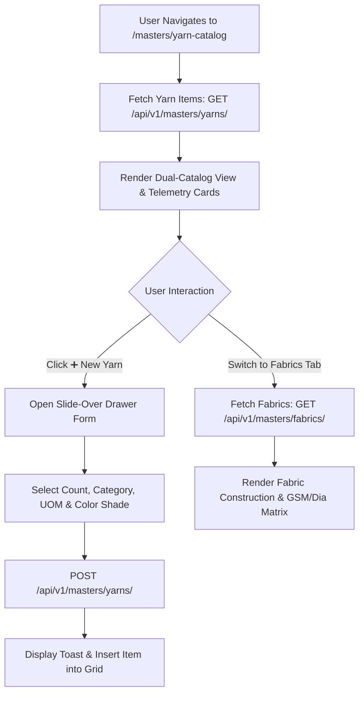

# Yarn & Fabric Master Catalog Specification

| Standard Code | Screen ID | Target Platform | API Version | Document Version | Date | Status |
|---|---|---|---|---|---|---|
| **STD-UI-001** | **`SCR-MAST-002`** | Next.js 14 (App Router) + TypeScript | `v1.2` (Django 5 DRF) | `v1.0.0` | 16/10/2026 | **APPROVED FOR IMPLEMENTATION** |

---

## 1. Document Overview, Version, Scope, and Status

### 1.1 Purpose
This specification defines the complete technical architecture, UI layout, multi-attribute classification, color shade swatches, fabric technical parameters (GSM, Dia, Gauge), Zod validation schemas, TypeScript interfaces, and backend API integration for the **Yarn & Fabric Master Catalog** (`SCR-MAST-002`).

In textile manufacturing and commercial trading, raw material specifications govern every production order:
1. **Yarn Classification & Sub-Categories**: Managing raw yarn counts (`20s`, `30s`, `34s`, `40s`, `2/40s`), category types (`GREY`, `DYED`, `MELANGE`, `BLENDED`, `SLUB`, `CORE_SPUN/LYCRA`, `RECYCLED`), and statutory HSN codes (`5205`).
2. **Color Shade & Swatch Registry**: Cataloging mill shade codes, Pantone references, and visual Hex color swatches (`#HEX`) for accurate matching across dyeing programs.
3. **Fabric Structure & Knitting Matrix**: Defining fabric types (`Single Jersey`, `Interlock`, `1x1 Rib`, `2x2 Rib`, `Fleece`, `Pique`), yarn composition, standard Grams per Square Meter (**GSM**, e.g. $160 - 240\text{ GSM}$), machine cylinder diameters (**Dia**, e.g. $24'' - 34''$), machine needle gauges (**Gauge**, e.g. $24\text{GG}, 28\text{GG}$), and HSN code `6006`.
4. **Inventory Reorder Alerts**: Establishing minimum safety stock thresholds to drive automated purchase reorder warnings in live inventory ledgers.

### 1.2 Scope
- **Backend Models**:
  - Yarn Count: [`YarnCountMaster`](file:///d:/Codebase/Garments/backend/apps/masters/models.py#L63-L78) (`mx_yarn_count`).
  - Color Shade: [`ColorShadeMaster`](file:///d:/Codebase/Garments/backend/apps/masters/models.py#L80-L98) (`mx_color_shade`).
  - Yarn Catalog: [`YarnMaster`](file:///d:/Codebase/Garments/backend/apps/masters/models.py#L100-L125) (`mx_yarn`).
  - Fabric Type: [`FabricTypeMaster`](file:///d:/Codebase/Garments/backend/apps/masters/models.py#L127-L143) (`mx_fabric_type`).
  - Fabric Catalog: [`FabricMaster`](file:///d:/Codebase/Garments/backend/apps/masters/models.py#L145-L174) (`mx_fabric`).
- **Country Pack**: India (`IN`) — Indian Rupee (`₹`), Weights in `Kg` ($3\text{ dp}$), Nominal Bags ($45.360\text{ Kg}$), Fabric Rolls ($20.000\text{ Kg}$).
- **Target Route**: `/masters/yarn-catalog` (Next.js route: `app/(app)/masters/yarn-catalog/page.tsx`).

---

## 2. Module Details, Screen ID, Route, Access Privileges, and API Endpoints

### 2.1 Core Metadata

| Parameter | Specification |
|---|---|
| **Module** | `Module 2 — Master Data Governance` |
| **Screen ID** | `SCR-MAST-002` |
| **Frontend Route** | `/masters/yarn-catalog` |
| **File Location** | `app/(app)/masters/yarn-catalog/page.tsx` |
| **Required Privilege** | `masters_yarn.can_read` / `masters_fabric.can_read` (View catalog); `masters_yarn.can_create` (Add); `masters_yarn.can_update` (Edit) |
| **Authorized Roles** | `SUPER_ADMIN`, `ADMIN_USER`, `COMPANY_USER` (Textile Technologist, Quality Controller, Purchase Head, Storekeeper) |
| **Country Pack** | `IN` (HSN 5205 for Cotton Yarn, HSN 6006 for Knitted Fabrics) |

### 2.2 Primary API Endpoints

| HTTP Method | API Path | Privilege / Scope | Description |
|---|---|---|---|
| `GET` | `/api/v1/masters/yarns/` | `can_read` | Fetch registered yarn master items with count and color linkages |
| `POST` | `/api/v1/masters/yarns/` | `can_create` | Create a new Yarn Catalog item |
| `GET` | `/api/v1/masters/yarn-counts/?is_active=1` | `can_read` | Fetch active yarn counts dictionary (20s, 30s, 34s, 40s) |
| `GET` | `/api/v1/masters/colors/?is_active=1` | `can_read` | Fetch color shade master with pantone and hex swatches |
| `GET` | `/api/v1/masters/fabrics/` | `can_read` | Fetch knitted and dyed fabric catalog with technical specs |
| `POST` | `/api/v1/masters/fabrics/` | `can_create` | Create a new Fabric Master specification |
| `GET` | `/api/v1/masters/fabric-types/?is_active=1` | `can_read` | Fetch fabric construction types (Single Jersey, Interlock, Rib) |

---

## 3. UI Layout, Screen Blueprint, and Visual Mockup (1440px+ Wireframe)

```
+-----------------------------------------------------------------------------------------------------------------------------+
| GARMENTS ERP — Master Data Governance Desk                                   Company: ABC Textiles Ltd | FY: 2026-2027      |
+-----------------------------------------------------------------------------------------------------------------------------+
| TOP BREADCRUMB: Masters > Yarn & Fabric Catalog                                                                             |
| YARN & FABRIC MASTER CATALOG                    [ ➕ New Item (Alt+N) ]  [ 🎨 Shade Swatches ]  [ 📥 Export Catalog ]       |
+-----------------------------------------------------------------------------------------------------------------------------+
| DUAL-CATALOG MODE SELECTOR & TELEMETRY                                                                                      |
| [ 🧶 Raw & Processed Yarns (84) ]          [ 🧵 Knitted & Dyed Fabrics (42) ]          [ 🎨 Color Shade Master (128) ]       |
|                                                                                                                             |
| +-------------------------+ +-------------------------+ +-------------------------+ +-------------------------------------+ |
| | TOTAL CATALOG ITEMS     | | POPULAR YARN COUNTS     | | KNITTED CONSTRUCTIONS   | | INVENTORY REORDER ALERTS            | |
| | 84 Active Yarn Items    | | 30s Combed (32% Orders) | | Single Jersey: 18 Specs | | 6 Items Below Safety Stock          | |
| | 42 Fabric Formulations  | | 34s Karded (24% Orders) | | 1x1 Rib: 12 Specs       | | Immediate PO Re-ordering Triggered  | |
| +-------------------------+ +-------------------------+ +-------------------------+ +-------------------------------------+ |
+-----------------------------------------------------------------------------------------------------------------------------+
| SEARCH & ATTRIBUTE FILTER DOCK                                                                                              |
| Search Catalog*: [ 🔍 Search by Item Code, Count, Shade, Construction (/)  ]  Category: [ All Categories ▼ ]  HSN: [ All ▼ ] |
+-----------------------------------------------------------------------------------------------------------------------------+
| YARN CATALOG SPREADSHEET DATA GRID (Mode: Yarns)                                                                            |
| +--------+--------------------+-----------+---------------------+---------+----------+------------+------------+------+ |
| | Code   | Yarn Specification | Count     | Color Shade & Hex   | Category| UOM      | HSN Code   | Reorder Lvl|Status| |
| +--------+--------------------+-----------+---------------------+---------+----------+------------+------------+------+ |
| |YRN-001 | 30s Combed Cotton  | 30s       | [ ] Natural Grey    | GREY    | BAGS     | 52051210   | 100 Bags   |Active| |
| |        | 100% Cotton Karded |           | RAW COTTON FIBER    | (Raw)   | (45.36Kg)|            | 4,536.0 Kg | [✎]  | |
| +--------+--------------------+-----------+---------------------+---------+----------+------------+------------+------+ |
| |YRN-014 | 34s Combed Dyed    | 34s       | [■] Navy Blue #001  | DYED    | BAGS     | 52052400   | 50 Bags    |Active| |
| |        | Pantone: 19-4024 TC|           | Hex: #0F172A        | (Dyed)  | (45.36Kg)|            | 2,268.0 Kg | [✎]  | |
| +--------+--------------------+-----------+---------------------+---------+----------+------------+------------+------+ |
| |YRN-022 | 30s Melange 90/10  | 30s       | [■] Anthra Melange  | MELANGE | BAGS     | 52053200   | 80 Bags    |Active| |
| |        | Grey Blend Cotton  |           | Hex: #475569        | (Fancy) | (45.36Kg)|            | 3,628.8 Kg | [✎]  | |
| +--------+--------------------+-----------+---------------------+---------+----------+------------+------------+------+ |
| [<< First] [< Prev] Page 1 of 4 [Next >] [Last >>]              Showing 1-25 of 84 Yarn Items | Rows per page: [ 25 ▼ ]     |
+-----------------------------------------------------------------------------------------------------------------------------+
```

---

## 4. Page Initialization, Query Parameters, and Default Form State

### 4.1 URL Parameters
- `tab`: Active catalog view (`yarns`, `fabrics`, `colors`). Default: `yarns`.
- `category`: Filter by yarn category (`GREY`, `DYED`, `MELANGE`, `SLUB`, `CORE_SPUN`).
- `count_id`: Filter by specific yarn count primary key.
- `search`: Debounced keyword searching `yarn_code`, `count`, `color_name`.

---

## 5. Document Header, Fiscal Context, and Financial Year Configuration

- **Company Scoping**: All catalog codes and formulations are strictly tenant-scoped (`company_id`).
- **HSN Code Tax Authority**: HSN codes link to the GST tax engine:
  - Cotton Yarn: HSN `5205` ($5.0\%$ GST rate).
  - Knitted Fabrics: HSN `6006` ($5.0\%$ GST rate).

---

## 6. Primary Master Linkages

| Catalog Entity | Parent Master | Foreign Key | Linkage Impact |
|---|---|---|---|
| **Yarn Item** | Yarn Count Master | `yarn_count_id` | Populates standard count description (e.g. 30s, 34s) |
| **Yarn Item** | Color Shade Master | `color_shade_id` | Populates color name, hex code swatch, and pantone code |
| **Yarn Item** | Unit of Measurement | `uom_id` | Enforces standard trading unit (Bags of $45.360\text{ Kg}$ or Cones) |
| **Fabric Item** | Fabric Type Master | `fabric_type_id` | Selects structural construction (Single Jersey, Interlock, Rib) |
| **Fabric Item** | Yarn Item | `yarn_id` | Binds raw yarn formulation and count |

---

## 7. Dynamic Technical Specifications

### 7.1 Yarn Category Variants

| Category Code | Description | Key Technical Fields |
|---|---|---|
| `GREY` | Unbleached Natural Raw Cotton Yarn | Count, Trash %, CSP (Count Strength Product), Twist Direction (Z/S) |
| `DYED` | Chemically Processed Dyed Yarn | Color Shade Code, Fastness Grade, Dye Lot No |
| `MELANGE` | Blended Fiber Mixture | Blend Ratio (e.g. 90/10, 85/15), Black Cotton %, Shade Tone |
| `CORE_SPUN` | Lycra / Elastane Core Yarn | Core Denier (20D, 40D, 70D), Draft Ratio, Cotton Sheath % |

### 7.2 Knitted Fabric Technical Parameters

| Parameter | Unit | Industry Range | Validation Rule |
|---|---|---|---|
| **GSM** | $\text{Grams} / \text{m}^2$ | $120 - 320\text{ GSM}$ | Positive integer ($> 0$) |
| **Dia (Diameter)** | Inches ($''$) | $24'' - 36''$ | Positive integer or standard gauge width |
| **Machine Gauge**| GG (Needles/Inch) | $20\text{GG}, 24\text{GG}, 28\text{GG}, 32\text{GG}$ | Text selection |
| **Loop Length** | Millimeters (mm) | $2.60\text{ mm} - 3.20\text{ mm}$ | Decimal ($2\text{ dp}$) |

---

## 8. Interactive Spreadsheet Data Grid & Column Definitions

### 8.1 Fabric Catalog Columns (Mode: Fabrics)

| # | Column Name | Field | Width | Alignment | Formatting / Rule |
|---|---|---|---|---|---|
| 1 | **Code** | `fabric_code` | 110px | Left | Semibold (e.g. `FAB-001`) |
| 2 | **Fabric Name** | `fabric_name` | 220px | Left | Description (e.g. `100% Cotton Single Jersey`) |
| 3 | **Construction** | `fabric_type.name` | 140px | Left | Construction (Single Jersey, 1x1 Rib) |
| 4 | **Yarn Formulation**| `yarn.yarn_code` | 140px | Left | Bound yarn count (e.g. `30s Combed Cotton`) |
| 5 | **GSM** | `gsm` | 90px | Right | Integer + 'GSM' (e.g. `180 GSM`) |
| 6 | **Dia / Gauge** | `dia` + `gauge` | 120px | Center | e.g. `30" / 28GG` |
| 7 | **Category** | `category` | 100px | Center | `GREY` vs `DYED` |
| 8 | **HSN Code** | `hsn_code` | 100px | Center | `6006` |
| 9 | **Min Stock Alert** | `min_stock_alert`| 110px | Right | Kilograms ($3\text{ dp}$) |

---

## 9. Mathematical Formulas & Calculations

### 9.1 Fabric Yield from Yarn Formula

$$\text{Estimated Fabric Output (Kg)} = \text{Input Yarn (Kg)} \times \left(1 - \frac{\text{Knitting Loss } \%}{100}\right)$$

### 9.2 Fabric Roll Net Weight Calculation

$$\text{Roll Weight} = \text{Gross Scale Weight} - \text{Tare Weight (Paper Core Tube } \approx 0.800\text{ Kg})$$

---

## 10. Multi-Branch & Godown Linkages

- Raw Yarns link to `YARN_GODOWN` locations.
- Greige Fabrics link to `GREY_FABRIC_GODOWN` locations.

---

## 11. Summary Bar, Telemetry KPI Cards, and Action Dock

- **Total Catalog Formulations Card**: Count of active yarns and fabrics.
- **Stock Alert Card**: Highlights items whose on-hand balance is below `reorder_level`.
- **Quick Action Drawer**: Slide-over panel for high-speed creation of yarns, counts, and fabric formulations.

---

## 12. Form Validation Rules and Error Messages (Field-by-Field Matrix & Zod Schema)

### 12.1 Validation Matrix

| Field | Rule Type | Error Condition | User Error Message |
|---|---|---|---|
| `yarn_code` | Mandatory & Unique | Length < 2 or exists | *"Yarn code required and must be unique."* |
| `yarn_count` | Mandatory | Unselected | *"Please select a valid Yarn Count."* |
| `category` | Mandatory | Invalid category | *"Select a valid Yarn Category."* |
| `uom` | Mandatory | Unselected | *"Select Unit of Measurement (e.g. Bags)."* |
| `reorder_level`| Numeric | $< 0$ | *"Reorder level cannot be negative."* |

### 12.2 Copy-Paste Ready Zod Schema

```typescript
import { z } from "zod";

export const yarnMasterSchema = z.object({
  yarn_code: z.string().min(2, "Yarn code required").max(50),
  yarn_count_id: z.number({ required_error: "Select a yarn count" }).int().positive(),
  category: z.enum([
    "GREY", "DYED", "MELANGE", "BLENDED", "WOUND", "SLUB", "CORE_SPUN", "RECYCLED"
  ]),
  color_shade_id: z.number().int().positive().nullable().optional(),
  uom_id: z.number({ required_error: "Select UOM" }).int().positive(),
  hsn_code: z.string().default("52051210"),
  reorder_level: z.number().nonnegative("Reorder level cannot be negative").default(0),
  description: z.string().max(500).optional().or(z.literal("")),
  is_active: z.boolean().default(true),
}).superRefine((data, ctx) => {
  if (data.category === "DYED" && !data.color_shade_id) {
    ctx.addIssue({
      code: z.ZodIssueCode.custom,
      path: ["color_shade_id"],
      message: "Color Shade is mandatory for Dyed Yarn",
    });
  }
});

export const fabricMasterSchema = z.object({
  fabric_code: z.string().min(2, "Fabric code required").max(50),
  fabric_name: z.string().min(2, "Fabric name required").max(200),
  fabric_type_id: z.number({ required_error: "Select construction type" }).int().positive(),
  category: z.enum(["GREY", "DYED"]).default("GREY"),
  yarn_id: z.number().int().positive().nullable().optional(),
  color_shade_id: z.number().int().positive().nullable().optional(),
  gsm: z.number().int().positive("GSM must be positive (e.g. 180)"),
  dia: z.string().min(1, "Diameter required (e.g. 24, 30)").max(50),
  gauge: z.string().max(50).optional().or(z.literal("")),
  uom_id: z.number({ required_error: "Select UOM" }).int().positive(),
  hsn_code: z.string().default("6006"),
  min_stock_alert: z.number().nonnegative().default(0),
  description: z.string().max(500).optional().or(z.literal("")),
  is_active: z.boolean().default(true),
});

export type YarnMasterFormValues = z.infer<typeof yarnMasterSchema>;
export type FabricMasterFormValues = z.infer<typeof fabricMasterSchema>;
```

---

## 13. Lifecycle Workflows



---

## 14. API Integration, Request Headers, and HTTP Errors

```http
POST /api/v1/masters/yarns/ HTTP/1.1
Host: api.garmentserp.local
Authorization: Bearer <JWT_ACCESS_TOKEN>
X-Company-ID: 1
Content-Type: application/json

{
  "yarn_code": "YRN-001",
  "yarn_count_id": 1,
  "category": "GREY",
  "uom_id": 3,
  "hsn_code": "52051210",
  "reorder_level": "100.00",
  "description": "Standard 30s Karded Combed Raw Cotton",
  "is_active": true
}
```

---

## 15. Next.js Folder Structure and Component Responsibilities

```
app/(app)/masters/yarn-catalog/
├── page.tsx                           # Master orchestrator, tab state & query manager
├── components/
│   ├── CatalogModeTabs.tsx            # Mode switch: Yarns, Fabrics, Color Shades
│   ├── CatalogTelemetryCards.tsx      # Stock alerts, popular counts & formulations
│   ├── YarnCatalogGrid.tsx            # Yarns spreadsheet table
│   ├── FabricCatalogGrid.tsx          # Fabrics spreadsheet table with GSM & Dia
│   ├── YarnDrawerForm.tsx             # Slide-over create/edit drawer for yarns
│   └── FabricDrawerForm.tsx           # Slide-over create/edit drawer for fabrics
├── hooks/
│   └── useYarnCatalog.ts              # TanStack Query & Mutation hooks for catalog endpoints
└── types/
    └── yarn-catalog.types.ts          # TypeScript DTOs and Form values
```

---

## 16. React Hooks, TypeScript Types, and Form State

```typescript
// types/yarn-catalog.types.ts

export interface YarnMasterDTO {
  id: number;
  yarn_code: string;
  yarn_count: {
    id: number;
    count: string;
  };
  category: string;
  color_shade?: {
    id: number;
    shade_code: string;
    color_name: string;
    hex_code: string;
  };
  uom: {
    id: number;
    code: string;
    name: string;
  };
  hsn_code: string;
  reorder_level: string;
  is_active: boolean;
}
```

---

## 17. Factory Floor & Weighbridge Keyboard Ergonomics (Shortcuts)

| Shortcut | Scope | Behavior |
|---|---|---|
| `Alt + N` | Global Page | Opens the **New Item Slide-Over Drawer** |
| `Alt + 1` | Global Page | Switches to **Yarns Catalog Tab** |
| `Alt + 2` | Global Page | Switches to **Fabrics Catalog Tab** |
| `Alt + 3` | Global Page | Switches to **Color Shades Tab** |
| `/` | Global Page | Focuses the Quick Search input box |
| `Alt + S` | Drawer | Submits drawer form and triggers **Save Item** |
| `Esc` | Drawer | Closes active drawer |

---

## 18. Loading States, Shimmer Skeletons, and Failure Handling

- **Grid Loading**: Renders 10 shimmer row skeletons during tab switching.
- **Color Swatch Fallback**: If hex code is missing, renders neutral fabric gray swatch.

---

## 19. Security, Tenant Scoping, and Backend Invariant Validation

1. **Strict Multi-Tenancy**:
   - `company_id` is enforced on all catalog tables (`mx_yarn`, `mx_fabric`, `mx_color_shade`).
2. **Formula Integrity**:
   - Deleting a yarn count is blocked if active yarn master items or live stock rows reference it (`on_delete = PROTECT`).

---

## 20. Implementation Sequence and Developer Acceptance Checklist

- [ ] **Step 1: Scaffolding**: Create `app/(app)/masters/yarn-catalog/` with dual-mode tabs.
- [ ] **Step 2: Zod Schemas**: Implement `yarnMasterSchema` and `fabricMasterSchema`.
- [ ] **Step 3: Data Hooks**: Create TanStack Query hook `useYarnCatalog`.
- [ ] **Step 4: Grids**: Build `YarnCatalogGrid.tsx` and `FabricCatalogGrid.tsx`.
- [ ] **Step 5: Swatches**: Implement visual `#HEX` color preview swatches.
- [ ] **Step 6: E2E Tests**: Author Playwright E2E test verifying item creation and reorder alert display.

---

## 21. Existing Inconsistencies, Edge Cases, and Items Requiring Confirmation

1. **Auto-Generated Item Codes**:
   - *Design*: The UI supports typing a custom code (`YRN-001`) or leaving it blank for server-side auto-generation using `tc_doc_series`.
