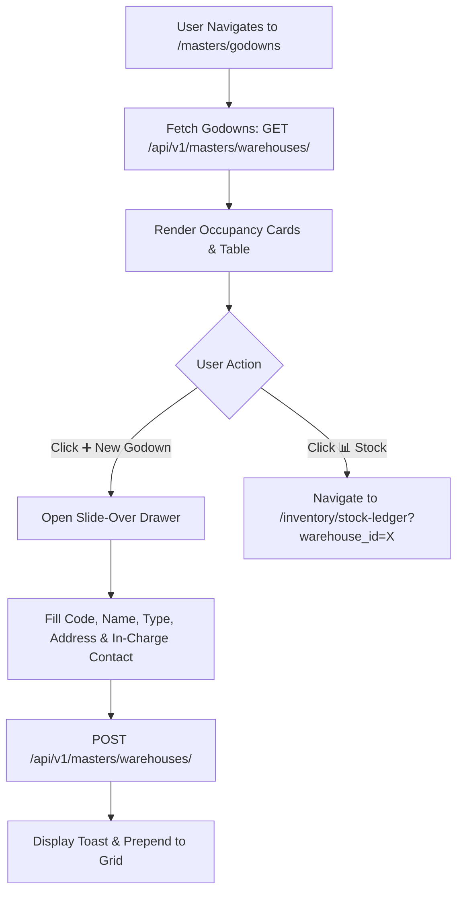

# Godown & Warehouse Locations Master Specification

| Standard Code | Screen ID | Target Platform | API Version | Document Version | Date | Status |
|---|---|---|---|---|---|---|
| **STD-UI-001** | **`SCR-MAST-003`** | Next.js 14 (App Router) + TypeScript | `v1.2` (Django 5 DRF) | `v1.0.0` | 16/10/2026 | **APPROVED FOR IMPLEMENTATION** |

---

## 1. Document Overview, Version, Scope, and Status

### 1.1 Purpose
This specification defines the complete technical architecture, UI layout, warehouse classification, capacity limits, in-charge contacts, Zod validation schemas, TypeScript interfaces, and backend API integration for the **Godown & Storage Location Master Registry** (`SCR-MAST-003`).

In textile manufacturing and distribution, accurate godown partitioning is essential to prevent inventory contamination, track work-in-progress, and enforce weighbridge physical audit controls:
1. **Physical & Virtual Storage Partitioning**: Classifying storage facilities into Central Raw Yarn Godowns (`YARN_GODOWN`), Greige Fabric Warehouses (`GREY_FABRIC_GODOWN`), Processed/Dyed Fabric Storage (`DYED_FABRIC_GODOWN`), Trims/Accessories Store (`ACCESSORIES_GODOWN`), and Export Finished Goods Warehouses (`FINISHED_GOODS_GODOWN`).
2. **Weighbridge & Security Gate Linkages**: Assigning in-charge storekeepers, gate pass desks, and emergency contact numbers.
3. **Storage Telemetry & Capacity Limits**: Tagging nominal bag capacity (e.g. $5,000\text{ Bags}$ at $45.360\text{ Kg}$) and fabric roll rack capacities.
4. **Live Stock Ledger Linkage**: Providing the definitive warehouse keys consumed by [`tm_yarn_stock`](file:///d:/Codebase/Garments/backend/apps/inventory/models.py) and [`tl_stock_movement`](file:///d:/Codebase/Garments/backend/apps/ledger/models.py).

### 1.2 Scope
- **Backend Model**: [`WarehouseMaster`](file:///d:/Codebase/Garments/backend/apps/masters/models.py#L197-L216) (`mx_warehouse`).
- **Country Pack**: India (`IN`) — Indian Rupee (`₹`), Weights in `Kg` ($3\text{ dp}$), Nominal Bags ($45.360\text{ Kg}$).
- **Target Route**: `/masters/godowns` (Next.js route: `app/(app)/masters/godowns/page.tsx`).

---

## 2. Module Details, Screen ID, Route, Access Privileges, and API Endpoints

### 2.1 Core Metadata

| Parameter | Specification |
|---|---|
| **Module** | `Module 2 — Master Data Governance` |
| **Screen ID** | `SCR-MAST-003` |
| **Frontend Route** | `/masters/godowns` |
| **File Location** | `app/(app)/masters/godowns/page.tsx` |
| **Required Privilege** | `masters_warehouse.can_read` (View catalog); `masters_warehouse.can_create` (Add); `masters_warehouse.can_update` (Edit) |
| **Authorized Roles** | `SUPER_ADMIN`, `ADMIN_USER`, `COMPANY_USER` (Godown In-Charge, Storekeeper, Logistics Manager, Internal Auditor) |
| **Country Pack** | `IN` (India Standards) |

### 2.2 Primary API Endpoints

| HTTP Method | API Path | Privilege / Scope | Description |
|---|---|---|---|
| `GET` | `/api/v1/masters/warehouses/` | `can_read` | Fetch all active company godowns and storage facilities |
| `POST` | `/api/v1/masters/warehouses/` | `can_create` | Register a new warehouse or storage location |
| `GET` | `/api/v1/masters/warehouses/{id}/` | `can_read` | Retrieve single godown profile with current physical stock volume |
| `PATCH` | `/api/v1/masters/warehouses/{id}/` | `can_update` | Update address, capacity, in-charge contact person, or active status |
| `DELETE` | `/api/v1/masters/warehouses/{id}/` | `can_delete` | Soft delete / deactivate warehouse (`is_deleted = True`) |

---

## 3. UI Layout, Screen Blueprint, and Visual Mockup (1440px+ Wireframe)

```
+-----------------------------------------------------------------------------------------------------------------------------+
| GARMENTS ERP — Master Data Governance Desk                                   Company: ABC Textiles Ltd | FY: 2026-2027      |
+-----------------------------------------------------------------------------------------------------------------------------+
| TOP BREADCRUMB: Masters > Godown & Warehouse Locations                                                                      |
| GODOWN & STORAGE LOCATION REGISTER             [ ➕ New Godown (Alt+N) ]  [ 📊 Live Stock Map ]  [ 📥 Export Locations ]     |
+-----------------------------------------------------------------------------------------------------------------------------+
| WAREHOUSE TYPE TABS & OCCUPANCY METRICS                                                                                     |
| [ All Godowns (12) ] [ Yarn Godowns (4) ] [ Grey Fabric (3) ] [ Dyed Fabric (2) ] [ Accessories (2) ] [ Finished Goods (1) ]|
|                                                                                                                             |
| +-------------------------+ +-------------------------+ +-------------------------+ +-------------------------------------+ |
| | TOTAL STORAGE SITES     | | YARN CAPACITY UTILIZED  | | FABRIC ROLLS ON HAND    | | GODOWN SECURITY AUDIT               | |
| | 12 Registered Godowns   | | 64.2% Occupancy         | | 1,420 Rolls Stored      | | 100% In-Charge Assigned             | |
| | 8 On-Site Mill Godowns  | | 8,450 / 12,000 Bags     | | 3 Godowns Active        | | Weighbridge Calibrated (12/10/2026) | |
| +-------------------------+ +-------------------------+ +-------------------------+ +-------------------------------------+ |
+-----------------------------------------------------------------------------------------------------------------------------+
| GODOWN REGISTER DATA GRID                                                                                                   |
| +----------+---------------------------+---------------------+-----------------------------+---------------+---------+----+ |
| | Code     | Warehouse Name            | Type                | Physical Mill Location      | In-Charge     | Capacity|Act | |
| +----------+---------------------------+---------------------+-----------------------------+---------------+---------+----+ |
| |GDN-001   | Central Yarn Godown A     | YARN GODOWN         | Mill Compound, Gate #1      | K. Murugan    | 5,000   |[✎] | |
| |          | Primary Weighbridge Store | (Raw Material)      | Palladam Road, Tirupur      | +91 9842112345| Bags    |[📊]| |
| +----------+---------------------------+---------------------+-----------------------------+---------------+---------+----+ |
| |GDN-002   | Subcontractor Yarn Transit| YARN GODOWN         | Processing Dock 2           | S. Ramesh     | 2,000   |[✎] | |
| |          | Knitter Outward Stage     | (Outward DC Staging)| Angeripalayam Unit          | +91 9842154321| Bags    |[📊]| |
| +----------+---------------------------+---------------------+-----------------------------+---------------+---------+----+ |
| |GDN-005   | Knitting Greige Store 1   | GREY FABRIC GODOWN  | Knitting Shed 3             | P. Selvam     | 1,500   |[✎] | |
| |          | Knitted Rolls Inspection  | (Greige Storage)    | Veerapandi, Tirupur         | 0421 2244556  | Rolls   |[📊]| |
| +----------+---------------------------+---------------------+-----------------------------+---------------+---------+----+ |
| [<< First] [< Prev] Page 1 of 1 [Next >] [Last >>]              Showing 1-12 of 12 Warehouses | Rows per page: [ 25 ▼ ]      |
+-----------------------------------------------------------------------------------------------------------------------------+
```

---

## 4. Page Initialization, Query Parameters, and Default Form State

### 4.1 URL Parameters
- `type`: Optional filter pill (`ALL`, `YARN_GODOWN`, `GREY_FABRIC_GODOWN`, `DYED_FABRIC_GODOWN`, `ACCESSORIES_GODOWN`, `FINISHED_GOODS_GODOWN`).
- `search`: Debounced keyword searching `warehouse_code`, `name`, `address`, `contact_person`.

---

## 5. Document Header, Fiscal Context, and Financial Year Configuration

- **Company Scoping**: All godowns enforce `company_id = request.user.company_id`.
- **Physical Stock Invariant**: A godown cannot be deactivated if current live inventory balance $\sum \text{Balance Qty} > 0$ in [`tm_yarn_stock`](file:///d:/Codebase/Garments/backend/apps/inventory/models.py).

---

## 6. Primary Master Linkages

| Master Entity | Model | Usage |
|---|---|---|
| **Company Tenant** | [`Company`](file:///d:/Codebase/Garments/backend/apps/authentication/models.py) | Scopes warehouse ownership |
| **Yarn Stock Ledger**| [`yarn_stock_table`](file:///d:/Codebase/Garments/backend/apps/inventory/models.py) | Tracks live balance per godown |
| **Movement Ledger** | [`tl_stock_movement`](file:///d:/Codebase/Garments/backend/apps/ledger/models.py) | Records physical movements in/out of godown |

---

## 7. Dynamic Technical Specifications (Warehouse Types)

| Type Code | Storage Purpose | Stored Asset Types | Mandatory Tracking Attributes |
|---|---|---|---|
| `YARN_GODOWN` | Raw Yarn Cones & Bags | Grey, Dyed, Melange Yarn | Pallet / Bay Location, Fire Safety Cert, Bag Stacking Limit |
| `GREY_FABRIC_GODOWN`| Knitted Fabric Rolls | Tubular, Open Width Greige | Fabric Rack No, Roll Batch Tagging, Moisture Sensor |
| `DYED_FABRIC_GODOWN`| Processed Finished Fabric | Finished Fabric Rolls | Color Shade Segregation, Shrinkage Inspection Bay |
| `ACCESSORIES_GODOWN`| Trims & Packing Materials | Sewing Thread, Buttons, Zips | Bin / Shelf Location, Carton Count |
| `FINISHED_GOODS_GODOWN`| Ready Garments | Export Carton Boxes | Container Loading Dock, E-Way Bill Staging Zone |

---

## 8. Interactive Spreadsheet Data Grid & Column Definitions

| # | Column Name | Field | Width | Alignment | Formatting / Rule |
|---|---|---|---|---|---|
| 1 | **Code** | `warehouse_code`| 100px | Left | Semibold (e.g. `GDN-001`) |
| 2 | **Warehouse Name**| `name` | 220px | Left | Trade name with description |
| 3 | **Type** | `warehouse_type`| 160px | Center | Pill: `YARN`, `GREY FABRIC`, `DYED` |
| 4 | **Physical Address**| `address` | 240px | Left | Street, Mill compound, City |
| 5 | **In-Charge Person**| `contact_person`| 150px | Left | Supervisor name |
| 6 | **Phone** | `phone` | 130px | Left | Mobile / Landline |
| 7 | **Status** | `is_active` | 90px | Center | `Active` (Emerald) vs `Inactive` |
| 8 | **Actions** | `actions` | 110px | Center | `[✎ Edit]`, `[📊 Stock]` |

---

## 9. Mathematical Formulas & Calculations

### 9.1 Godown Utilization Percentage

$$\text{Capacity Utilization } \% = \left( \frac{\text{Current On-Hand Bags}}{\text{Max Nominal Bag Capacity}} \right) \times 100$$

---

## 10. Multi-Branch & Godown Linkages

- Central Mill Godowns handle raw receipt.
- Transit Godowns handle external job work issuing.

---

## 11. Summary Bar, Telemetry KPI Cards, and Action Dock

- **Total Storage Sites Card**: Active warehouse count.
- **Occupancy Metric Card**: Total utilized bags vs maximum capacity.
- **Stock Audit Quick Link**: Direct drill-down to [`SCR-INVN-003`](file:///d:/Codebase/Garments/docs/ui/27_STOCK_LEDGER_UI_SPECIFICATION.md) for live godown stock.

---

## 12. Form Validation Rules and Error Messages (Field-by-Field Matrix & Zod Schema)

### 12.1 Validation Matrix

| Field | Rule Type | Error Condition | User Error Message |
|---|---|---|---|
| `warehouse_code`| Mandatory & Unique | Length < 2 or exists | *"Godown code required and must be unique."* |
| `name` | Mandatory | Length < 2 | *"Godown name is required."* |
| `warehouse_type`| Mandatory | Unselected | *"Please select a valid Warehouse Type."* |
| `address` | Mandatory | Length < 5 | *"Physical location address is required."* |

### 12.2 Copy-Paste Ready Zod Schema

```typescript
import { z } from "zod";

export const warehouseMasterSchema = z.object({
  warehouse_code: z.string().min(2, "Code required").max(50),
  name: z.string().min(2, "Warehouse name required").max(200),
  warehouse_type: z.enum([
    "YARN_GODOWN", "GREY_FABRIC_GODOWN", "DYED_FABRIC_GODOWN",
    "ACCESSORIES_GODOWN", "FINISHED_GOODS_GODOWN"
  ], { required_error: "Select warehouse type" }),
  address: z.string().min(5, "Physical address is required"),
  contact_person: z.string().max(150).optional().or(z.literal("")),
  phone: z.string().max(30).optional().or(z.literal("")),
  is_active: z.boolean().default(true),
});

export type WarehouseMasterFormValues = z.infer<typeof warehouseMasterSchema>;
```

---

## 13. Lifecycle Workflows



---

## 14. API Integration, Request Headers, and HTTP Errors

```http
POST /api/v1/masters/warehouses/ HTTP/1.1
Host: api.garmentserp.local
Authorization: Bearer <JWT_ACCESS_TOKEN>
X-Company-ID: 1
Content-Type: application/json

{
  "warehouse_code": "GDN-001",
  "name": "Central Yarn Godown A",
  "warehouse_type": "YARN_GODOWN",
  "address": "Mill Compound Gate #1, Palladam Road, Tirupur, Tamil Nadu",
  "contact_person": "K. Murugan",
  "phone": "+91 98421 12345",
  "is_active": true
}
```

---

## 15. Next.js Folder Structure and Component Responsibilities

```
app/(app)/masters/godowns/
├── page.tsx                           # Master orchestrator & query state
├── components/
│   ├── GodownTypeTabs.tsx             # Filter pills: All, Yarn, Greige, Dyed, Finished
│   ├── GodownTelemetryCards.tsx       # KPI cards (Sites, occupancy %, rolls stored)
│   ├── GodownDataGrid.tsx             # Locations spreadsheet table
│   └── GodownDrawerForm.tsx           # Slide-over create/edit form
├── hooks/
│   └── useWarehouseMaster.ts          # TanStack Query & Mutation hooks for /warehouses/
└── types/
    └── warehouse.types.ts             # TypeScript DTOs and Form values
```

---

## 16. React Hooks, TypeScript Types, and Form State

```typescript
// types/warehouse.types.ts

export type WarehouseType = "YARN_GODOWN" | "GREY_FABRIC_GODOWN" | "DYED_FABRIC_GODOWN" | "ACCESSORIES_GODOWN" | "FINISHED_GOODS_GODOWN";

export interface WarehouseMasterDTO {
  id: number;
  warehouse_code: string;
  name: string;
  warehouse_type: WarehouseType;
  warehouse_type_display: string;
  address: string;
  contact_person: string;
  phone: string;
  is_active: boolean;
}
```

---

## 17. Factory Floor & Weighbridge Keyboard Ergonomics (Shortcuts)

| Shortcut | Scope | Behavior |
|---|---|---|
| `Alt + N` | Global Page | Opens the **New Godown Slide-Over Drawer** |
| `/` | Global Page | Focuses the Quick Search input box |
| `Alt + S` | Drawer | Submits drawer form and triggers **Save Godown** |
| `Esc` | Drawer | Closes active drawer |

---

## 18. Loading States, Shimmer Skeletons, and Failure Handling

- **Grid Loading**: Renders 6 shimmer skeleton rows while fetching `/warehouses/`.
- **Occupancy Warning**: Visual amber badge if current utilization $> 85\%$.

---

## 19. Security, Tenant Scoping, and Backend Invariant Validation

1. **Company Isolation**:
   - `WHERE company_id = request.user.company_id` strictly applied to all database operations.
2. **Stock Zero Deletion Safeguard**:
   - A warehouse with active stock balance cannot be deactivated or deleted.

---

## 20. Implementation Sequence and Developer Acceptance Checklist

- [ ] **Step 1: Scaffolding**: Create `app/(app)/masters/godowns/`.
- [ ] **Step 2: Zod Schema**: Implement `warehouseMasterSchema`.
- [ ] **Step 3: Data Hooks**: Create TanStack Query hook `useWarehouseMaster`.
- [ ] **Step 4: Grid**: Build `GodownDataGrid.tsx` with type badges.
- [ ] **Step 5: Drawer**: Implement `GodownDrawerForm.tsx`.
- [ ] **Step 6: E2E Tests**: Playwright test verifying godown creation and drill-down to stock ledger.

---

## 21. Existing Inconsistencies, Edge Cases, and Items Requiring Confirmation

1. **Subcontractor Virtual Godowns**:
   - *Design*: Third-party knitting and dyeing units have dedicated warehouse records of type `YARN_GODOWN` to track work-in-progress stock lying outside company premises.
